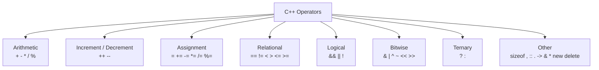
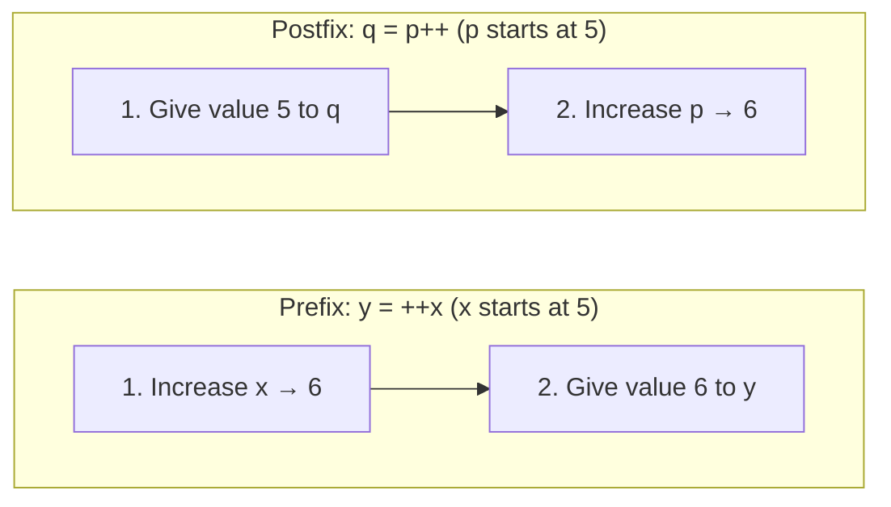
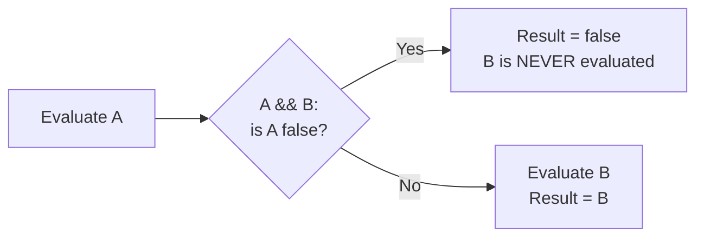
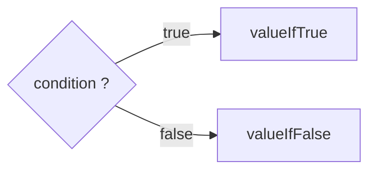
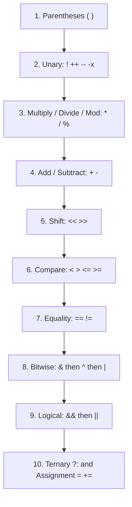

# 📘  Operators in C++

> **Goal of this lesson:** Learn every major operator in C++ — arithmetic, assignment, increment/decrement, relational, logical, bitwise, ternary, and more — understand precedence and associativity, and avoid the traps that cause the most beginner bugs.

> 💡 *Diagrams use **Mermaid**, which GitHub renders automatically.*

---

## 📑 Table of Contents

1. [What is an Operator?](#1-what-is-an-operator)
2. [Classification of Operators](#2-classification-of-operators)
3. [Arithmetic Operators](#3-arithmetic-operators)
4. [Increment and Decrement Operators](#4-increment-and-decrement-operators)
5. [Assignment Operators](#5-assignment-operators)
6. [Relational (Comparison) Operators](#6-relational-comparison-operators)
7. [Logical Operators](#7-logical-operators)
8. [Bitwise Operators](#8-bitwise-operators)
9. [Ternary (Conditional) Operator](#9-ternary-conditional-operator)
10. [Other Operators](#10-other-operators)
11. [Operator Precedence and Associativity](#11-operator-precedence-and-associativity)
12. [Type Conversion in Expressions](#12-type-conversion-in-expressions)
13. [Common Operator Traps](#13-common-operator-traps)
14. [Common Beginner Mistakes](#14-common-beginner-mistakes)
15. [Practice Exercises](#15-practice-exercises)
16. [Quick Quiz](#16-quick-quiz)
17. [Summary](#17-summary)

---

## 1. What is an Operator?

An **operator** is a **symbol that tells the compiler to perform an operation** — calculate, compare, assign, or combine values.

```cpp
int total = price + tax;
```

| Term | Meaning | In the example |
|------|---------|----------------|
| **Operator** | The symbol that performs the action | `+`, `=` |
| **Operand** | The values the operator works on | `price`, `tax`, `total` |
| **Expression** | A combination of operands and operators that produces a value | `price + tax` |
| **Statement** | A complete instruction ending with `;` | `int total = price + tax;` |

```
      total  =  price  +  tax ;
        │    │    │    │   │
    operand  │ operand │ operand
          operator  operator
                └── expression ──┘
```

🧮 **Analogy:** On a calculator, the **numbers** are operands and the **buttons** (`+`, `−`, `×`, `÷`, `=`) are operators.

---

## 2. Classification of Operators

### By Number of Operands

| Type | Operands | Examples |
|------|----------|----------|
| **Unary** | 1 | `-x`, `!flag`, `++i`, `~bits`, `sizeof(x)` |
| **Binary** | 2 | `a + b`, `a == b`, `a && b`, `a = b` |
| **Ternary** | 3 | `condition ? a : b` (the only one) |

### By Purpose



---

## 3. Arithmetic Operators

| Operator | Name | Example (`a = 17`, `b = 5`) | Result |
|----------|------|----------------------------|--------|
| `+` | Addition | `a + b` | 22 |
| `-` | Subtraction | `a - b` | 12 |
| `*` | Multiplication | `a * b` | 85 |
| `/` | Division | `a / b` | **3** (integer division!) |
| `%` | Modulus (remainder) | `a % b` | 2 |
| `-` (unary) | Negation | `-a` | -17 |
| `+` (unary) | Plus | `+a` | 17 |

```cpp
#include <iostream>
using namespace std;

int main() {
    int a = 17, b = 5;

    cout << "a + b = " << a + b << endl;
    cout << "a - b = " << a - b << endl;
    cout << "a * b = " << a * b << endl;
    cout << "a / b = " << a / b << endl;
    cout << "a % b = " << a % b << endl;
    return 0;
}
```

**Output:**
```
a + b = 22
a - b = 12
a * b = 85
a / b = 3
a % b = 2
```

### ⚠️ Integer Division

When **both** operands are integers, the result is an **integer** — the decimal part is **thrown away** (truncated toward zero), not rounded.

| Expression | Result | Why |
|------------|--------|-----|
| `17 / 5` | `3` | int / int → int |
| `17.0 / 5` | `3.4` | double / int → double |
| `17 / 5.0` | `3.4` | int / double → double |
| `(double)17 / 5` | `3.4` | cast first |
| `(double)(17 / 5)` | `3.0` | ❌ division already happened! |
| `-7 / 2` | `-3` | truncates **toward zero** |
| `9 / 10` | `0` | 0.9 → 0 |

```cpp
int marks = 437, subjects = 5;
double avg1 = marks / subjects;                        // 87   ❌
double avg2 = static_cast<double>(marks) / subjects;   // 87.4 ✅
```

### 🧩 The Modulus Operator `%`

`%` gives the **remainder** after integer division.

```
   17 ÷ 5  =  3  remainder  2
   17 / 5  →  3
   17 % 5  →  2
```

#### Rules
- Works **only with integers** — `5.5 % 2` is a **compile error** (use `fmod()` from `<cmath>` for decimals)
- Result has the **same sign as the left operand**
- `x % 0` → **undefined behaviour** (crash)

| Expression | Result |
|------------|--------|
| `10 % 3` | 1 |
| `10 % 5` | 0 |
| `3 % 10` | 3 |
| `-7 % 3` | -1 |
| `7 % -3` | 1 |

#### 🌟 Practical Uses of `%`

| Use | Code | Example |
|-----|------|---------|
| Check even/odd | `n % 2 == 0` | 8 → even |
| Check divisibility | `n % 5 == 0` | 25 → divisible by 5 |
| Last digit of a number | `n % 10` | 1234 → 4 |
| Remove last digit | `n / 10` | 1234 → 123 |
| Wrap around (clock) | `(hour + 5) % 24` | 22 + 5 → 3 |
| Convert minutes | `m / 60` hours, `m % 60` minutes | 135 → 2 h 15 m |

```cpp
int totalSeconds = 3725;
int hours   = totalSeconds / 3600;          // 1
int minutes = (totalSeconds % 3600) / 60;   // 2
int seconds = totalSeconds % 60;            // 5
cout << hours << "h " << minutes << "m " << seconds << "s";   // 1h 2m 5s
```

### ⚠️ Division by Zero

```cpp
int x = 10 / 0;        // ❌ integer: undefined behaviour — usually crashes
double y = 10.0 / 0;   // floating-point: gives inf (infinity)
```

Always check the divisor before dividing user input.

### ❗ C++ Has No Power Operator

```cpp
int x = 2 ^ 3;          // ❌ this is NOT 8! (^ is bitwise XOR → 1)

#include <cmath>
double y = pow(2, 3);   // ✅ 8
int z = 2 * 2 * 2;      // ✅ 8 (for small powers)
```

---

## 4. Increment and Decrement Operators

| Operator | Meaning | Equivalent |
|----------|---------|------------|
| `++x` | Pre-increment | `x = x + 1`, then use `x` |
| `x++` | Post-increment | use `x`, then `x = x + 1` |
| `--x` | Pre-decrement | `x = x - 1`, then use `x` |
| `x--` | Post-decrement | use `x`, then `x = x - 1` |

### Prefix vs Postfix

When used **alone**, both do the same thing:
```cpp
int a = 5;
a++;     // a = 6
++a;     // a = 7
```

The difference appears **inside an expression**:

```cpp
#include <iostream>
using namespace std;

int main() {
    int x = 5;
    int y = ++x;    // x becomes 6 FIRST, then y = 6
    cout << "Prefix : x = " << x << ", y = " << y << endl;

    int p = 5;
    int q = p++;    // q = 5 FIRST, then p becomes 6
    cout << "Postfix: p = " << p << ", q = " << q << endl;
    return 0;
}
```

**Output:**
```
Prefix : x = 6, y = 6
Postfix: p = 6, q = 5
```



🧠 **Memory trick:**
- **`++x`** → the `++` comes **first**, so the increment happens **first**
- **`x++`** → the `++` comes **after**, so the increment happens **after** the value is used

### ⛔ Don't Modify a Variable Twice in One Expression

```cpp
int i = 5;
int r = i++ + ++i;   // ❌ undefined behaviour — result varies by compiler!
```

✅ **Rule:** use `++`/`--` in **simple statements** (`i++;`) or **loops** (`for (int i = 0; i < n; i++)`), not in complicated expressions.

---

## 5. Assignment Operators

### Simple Assignment `=`

Stores the value on the **right** into the variable on the **left**.

```cpp
int x;
x = 10;          // ✅
10 = x;          // ❌ error: left side must be a variable (lvalue)
```

📌 `=` means **"store into"**, not "is equal to" (that's `==`).

### Chained Assignment
Assignment works **right to left**:
```cpp
int a, b, c;
a = b = c = 7;   // c = 7, then b = 7, then a = 7
```

### Compound Assignment Operators

| Operator | Example | Same As |
|----------|---------|---------|
| `+=` | `x += 5` | `x = x + 5` |
| `-=` | `x -= 5` | `x = x - 5` |
| `*=` | `x *= 5` | `x = x * 5` |
| `/=` | `x /= 5` | `x = x / 5` |
| `%=` | `x %= 5` | `x = x % 5` |
| `&=` | `x &= 5` | `x = x & 5` |
| `\|=` | `x \|= 5` | `x = x \| 5` |
| `^=` | `x ^= 5` | `x = x ^ 5` |
| `<<=` | `x <<= 2` | `x = x << 2` |
| `>>=` | `x >>= 2` | `x = x >> 2` |

```cpp
#include <iostream>
using namespace std;

int main() {
    int balance = 1000;

    balance += 500;    // deposit     → 1500
    balance -= 200;    // withdraw    → 1300
    balance *= 2;      // double it   → 2600
    balance /= 4;      // quarter     → 650
    balance %= 100;    // remainder   → 50

    cout << "Final: " << balance << endl;   // 50
    return 0;
}
```

⚠️ Watch the precedence:
```cpp
int x = 10;
x *= 2 + 3;      // x = x * (2 + 3) = 50, NOT (x * 2) + 3 = 23
```

---

## 6. Relational (Comparison) Operators

Relational operators **compare** two values. The result is always a **`bool`**: `true` (1) or `false` (0).

| Operator | Meaning | Example (`a = 10`, `b = 20`) | Result |
|----------|---------|------------------------------|--------|
| `==` | Equal to | `a == b` | false |
| `!=` | Not equal to | `a != b` | true |
| `>` | Greater than | `a > b` | false |
| `<` | Less than | `a < b` | true |
| `>=` | Greater than or equal to | `a >= 10` | true |
| `<=` | Less than or equal to | `b <= 15` | false |

```cpp
#include <iostream>
using namespace std;

int main() {
    int a = 10, b = 20;

    cout << boolalpha;   // print true/false instead of 1/0
    cout << "a == b : " << (a == b) << endl;
    cout << "a != b : " << (a != b) << endl;
    cout << "a <  b : " << (a < b)  << endl;
    cout << "a >= 10: " << (a >= 10) << endl;
    return 0;
}
```

**Output:**
```
a == b : false
a != b : true
a <  b : true
a >= 10: true
```

📌 **Parentheses are required** around comparisons inside `cout`, because `<<` has higher precedence than `==` and `<`.

### Comparing Characters and Strings

```cpp
cout << ('A' < 'B');                     // 1 — compares ASCII codes (65 < 66)
cout << ('a' > 'Z');                     // 1 — 97 > 90

string s1 = "apple", s2 = "banana";
cout << (s1 < s2);                       // 1 — dictionary (lexicographic) order
cout << (s1 == "apple");                 // 1
```

### ⚠️ `=` vs `==`

```cpp
int x = 5;
if (x = 10) { ... }    // ❌ assigns 10 to x, condition is ALWAYS true!
if (x == 10) { ... }   // ✅ compares
```
Compile with `-Wall` — g++ warns: *"suggest parentheses around assignment used as truth value"*.

### ⚠️ Never Compare Decimals with `==`

As promised in Lesson 2 — floating-point values are **approximate**:

```cpp
#include <iostream>
#include <cmath>
using namespace std;

int main() {
    double a = 0.1 + 0.2;
    double b = 0.3;

    cout << boolalpha;
    cout << (a == b) << endl;                     // false 😱

    const double EPSILON = 1e-9;
    cout << (fabs(a - b) < EPSILON) << endl;      // true ✅
    return 0;
}
```

✅ **Rule:** two decimals are "equal" if their **difference is tiny**.

### ⚠️ No Chained Comparisons

```cpp
int x = 50;
if (1 < x < 10) { ... }            // ❌ ALWAYS true! (1 < 50) → 1, then 1 < 10 → true
if (x > 1 && x < 10) { ... }       // ✅ correct
```

### Three-Way Comparison `<=>` (C++20, Advanced)
The "spaceship operator" compares in one step and tells you **less, equal, or greater**:
```cpp
auto result = (a <=> b);
if (result < 0)  cout << "a is smaller";
if (result == 0) cout << "equal";
if (result > 0)  cout << "a is bigger";
```

---

## 7. Logical Operators

Logical operators **combine conditions**. They work with `bool` values.

| Operator | Name | Meaning | Alternative token |
|----------|------|---------|-------------------|
| `&&` | Logical AND | true if **both** are true | `and` |
| `\|\|` | Logical OR | true if **at least one** is true | `or` |
| `!` | Logical NOT | flips true ↔ false | `not` |

*(Alternative tokens from Lesson 5 — `if (a and not b)` is valid C++!)*

### Truth Tables

| A | B | A && B | A \|\| B |
|---|---|--------|----------|
| false | false | false | false |
| false | true | false | true |
| true | false | false | true |
| true | true | **true** | true |

| A | !A |
|---|----|
| false | true |
| true | false |

🧠 **Memory trick:**
- **AND** is strict — needs **everything** true (like needing *both* a ticket **and** an ID to board a flight ✈️)
- **OR** is relaxed — needs **anything** true (pay by cash **or** card 💳)

### Example: Exam Eligibility

```cpp
#include <iostream>
using namespace std;

int main() {
    int attendance = 80, marks = 35;
    bool feesPaid = true;

    bool canSitExam = (attendance >= 75) && feesPaid;
    bool hasPassed  = marks >= 40;
    bool needsHelp  = (attendance < 75) || (marks < 40);

    cout << boolalpha;
    cout << "Can sit exam : " << canSitExam << endl;   // true
    cout << "Passed       : " << hasPassed  << endl;   // false
    cout << "Needs help   : " << needsHelp  << endl;   // true
    cout << "Failed       : " << !hasPassed << endl;   // true
    return 0;
}
```

### ⚡ Short-Circuit Evaluation

C++ stops evaluating as soon as the result is known:

| Expression | If left side is... | Right side |
|------------|--------------------|------------|
| `A && B` | `false` | **skipped** (result must be false) |
| `A \|\| B` | `true` | **skipped** (result must be true) |



#### Why It Matters — Safety Checks

```cpp
int a = 10, b = 0;

if (b != 0 && a / b > 2) {     // ✅ safe: if b is 0, division never happens
    cout << "Big ratio";
}

if (a / b > 2 && b != 0) {     // ❌ crashes: division happens first!
    cout << "Big ratio";
}
```

📌 **Put the safety check first** in `&&` conditions.

### Truthy and Falsy Values
In conditions, any **non-zero** number counts as `true`, and **0** counts as `false`:
```cpp
cout << (5 && 3);    // 1
cout << (5 && 0);    // 0
cout << !7;          // 0
cout << !0;          // 1
```

### De Morgan's Laws
Useful for simplifying conditions:
```
!(A && B)  ==  !A || !B
!(A || B)  ==  !A && !B
```
```cpp
// "Not (adult AND has ID)" is the same as "not adult OR no ID"
!(isAdult && hasID)  ==  (!isAdult || !hasID)
```

### ⚠️ `&&` vs `&`, `||` vs `|`
| Logical | Bitwise |
|---------|---------|
| `&&` — works on true/false, short-circuits | `&` — works on individual bits, **no** short-circuit |
| `\|\|` | `\|` |

Using `&` instead of `&&` often "works" by accident, then breaks later. Use `&&` and `||` for conditions.

---

## 8. Bitwise Operators

Bitwise operators work on the **individual bits** (0s and 1s) of integers.

| Operator | Name | Rule (per bit) |
|----------|------|----------------|
| `&` | AND | 1 if **both** bits are 1 |
| `\|` | OR | 1 if **either** bit is 1 |
| `^` | XOR (exclusive OR) | 1 if bits are **different** |
| `~` | NOT (complement) | Flips every bit |
| `<<` | Left shift | Moves bits left, fills with 0 |
| `>>` | Right shift | Moves bits right |

### Visual Examples (`a = 5`, `b = 3`)

```
 a     =  0101   (5)
 b     =  0011   (3)
          ────
 a & b =  0001   (1)    both 1
 a | b =  0111   (7)    either 1
 a ^ b =  0110   (6)    different
```

```
 a      = 0000 0101   (5)
 a << 1 = 0000 1010   (10)   shift left 1  → × 2
 a << 2 = 0001 0100   (20)   shift left 2  → × 4

 20      = 0001 0100  (20)
 20 >> 2 = 0000 0101  (5)    shift right 2 → ÷ 4
```

```cpp
#include <iostream>
using namespace std;

int main() {
    int a = 5, b = 3;

    cout << "a & b  = " << (a & b)  << endl;   // 1
    cout << "a | b  = " << (a | b)  << endl;   // 7
    cout << "a ^ b  = " << (a ^ b)  << endl;   // 6
    cout << "~a     = " << (~a)     << endl;   // -6
    cout << "a << 1 = " << (a << 1) << endl;   // 10
    cout << "a >> 1 = " << (a >> 1) << endl;   // 2
    return 0;
}
```

📌 Parentheses are **required** here — without them, `cout << a & b` is parsed as `(cout << a) & b` → error.

💡 **Why is `~5` equal to `-6`?** Negative integers are stored in **two's complement** form, where `~x` always equals `-(x + 1)`.

💡 **Seeing bits:** use `bitset` to print binary:
```cpp
#include <bitset>
cout << bitset<8>(5) << endl;    // 00000101
cout << bitset<8>(5 << 2);       // 00010100
```

### 🌟 Practical Uses of Bitwise Operators

| Task | Code | Explanation |
|------|------|-------------|
| Check odd | `n & 1` | Last bit is 1 for odd numbers |
| Multiply by 2ⁿ | `x << n` | `5 << 3` = 40 |
| Divide by 2ⁿ (positive) | `x >> n` | `40 >> 3` = 5 |
| Set bit k | `x \| (1 << k)` | Turn a flag **on** |
| Clear bit k | `x & ~(1 << k)` | Turn a flag **off** |
| Toggle bit k | `x ^ (1 << k)` | Flip a flag |
| Check bit k | `(x >> k) & 1` | Is flag on? |
| Swap without temp | `a ^= b; b ^= a; a ^= b;` | XOR trick (just for fun!) |

Bitwise operators are used in **permission flags** (Lesson 7), graphics, networking, embedded systems, and competitive programming.

⚠️ Shifting by a **negative** amount or by **≥ the number of bits** in the type (e.g., `1 << 40` for a 32-bit `int`) is **undefined behaviour**.

---

## 9. Ternary (Conditional) Operator

The only operator with **three operands** — a compact `if-else` that **produces a value**.

### Syntax
```
condition ? valueIfTrue : valueIfFalse
```



### Examples

```cpp
#include <iostream>
#include <string>
using namespace std;

int main() {
    int a = 12, b = 20;
    int larger = (a > b) ? a : b;
    cout << "Larger: " << larger << endl;                       // 20

    int marks = 72;
    string result = (marks >= 40) ? "Pass" : "Fail";
    cout << "Result: " << result << endl;                       // Pass

    int n = 7;
    cout << n << " is " << (n % 2 == 0 ? "even" : "odd") << endl;   // 7 is odd

    int items = 1;
    cout << items << " item" << (items == 1 ? "" : "s") << endl;    // 1 item
    return 0;
}
```

### Nested Ternary (Use Sparingly)

```cpp
int marks = 82;
char grade = (marks >= 90) ? 'A'
           : (marks >= 75) ? 'B'
           : (marks >= 60) ? 'C'
           : 'F';
cout << grade;   // B
```

✅ Good for **short, simple** choices. For complex logic, use `if-else` (next lesson) — readability matters more than saving lines.

---

## 10. Other Operators

| Operator | Name | Example | Covered In |
|----------|------|---------|------------|
| `sizeof` | Size in bytes | `sizeof(int)` → 4 | Lesson 2 |
| `,` | Comma | `a = (b = 3, b + 2);` → 5 | Below |
| `::` | Scope resolution | `std::cout`, `::x` | Lesson 4 |
| `.` | Member access | `student.name` | Structs / Classes |
| `->` | Member access via pointer | `ptr->name` | Pointers |
| `&` (unary) | Address-of | `&x` | Pointers |
| `*` (unary) | Dereference | `*ptr` | Pointers |
| `[]` | Subscript | `arr[0]` | Arrays |
| `()` | Function call | `add(2, 3)` | Functions |
| `new` / `delete` | Dynamic memory | `new int` | Dynamic Memory |
| `static_cast<>` etc. | Type casts | `static_cast<double>(x)` | Lesson 2 |
| `typeid` | Type information | `typeid(x).name()` | Advanced |

### The Comma Operator
Evaluates the left side, **discards** it, then evaluates and returns the right side:
```cpp
int x = (5, 10);    // x = 10
```
📌 Mostly seen in `for` loops: `for (int i = 0, j = 10; i < j; i++, j--)`.
⚠️ Commas in declarations (`int a, b;`) and function calls (`f(a, b)`) are **separators**, not the comma operator.

### `sizeof` Reminder
```cpp
int arr[10];
cout << sizeof(arr);              // 40 (10 × 4 bytes)
cout << sizeof(arr) / sizeof(arr[0]);   // 10 elements
```

---

## 11. Operator Precedence and Associativity

When an expression has **several operators**, which runs first?

```cpp
int result = 2 + 3 * 4;    // 14 or 20?
```

- **Precedence** decides **which operator goes first** (like BODMAS/PEMDAS in math). `*` beats `+` → **14**.
- **Associativity** decides the order when operators have the **same precedence**.

### Precedence Table (Simplified, Highest → Lowest)

| Level | Operators | Description | Associativity |
|-------|-----------|-------------|---------------|
| 1 | `::` | Scope resolution | Left → Right |
| 2 | `x++` `x--` `()` `[]` `.` `->` | Postfix, call, subscript, member | Left → Right |
| 3 | `++x` `--x` `+x` `-x` `!` `~` `(type)` `*` `&` `sizeof` `new` `delete` | Unary / prefix | **Right → Left** |
| 4 | `*` `/` `%` | Multiplicative | Left → Right |
| 5 | `+` `-` | Additive | Left → Right |
| 6 | `<<` `>>` | Shift (and stream I/O!) | Left → Right |
| 7 | `<=>` | Three-way comparison (C++20) | Left → Right |
| 8 | `<` `<=` `>` `>=` | Relational | Left → Right |
| 9 | `==` `!=` | Equality | Left → Right |
| 10 | `&` | Bitwise AND | Left → Right |
| 11 | `^` | Bitwise XOR | Left → Right |
| 12 | `\|` | Bitwise OR | Left → Right |
| 13 | `&&` | Logical AND | Left → Right |
| 14 | `\|\|` | Logical OR | Left → Right |
| 15 | `?:` `=` `+=` `-=` `*=` ... | Ternary & assignment | **Right → Left** |
| 16 | `,` | Comma | Left → Right |

### 🧠 Simplified Order to Remember



> **Mnemonic:** "**P**lease **U**nderstand **M**ath **A**nd **S**hift **C**arefully, **E**veryone **B**ecomes **L**ogical **A**fterwards"
> **P**arentheses → **U**nary → **M**ultiplicative → **A**dditive → **S**hift → **C**omparison → **E**quality → **B**itwise → **L**ogical → **A**ssignment

### Step-by-Step Evaluation Examples

**Example 1:**
```cpp
int r = 10 + 20 / 5 * 2 - 3;
```
```
10 + 20 / 5 * 2 - 3
10 + 4 * 2 - 3          ← / first (left to right with *)
10 + 8 - 3              ← then *
18 - 3                  ← + and - left to right
15
```

**Example 2:**
```cpp
bool ok = 5 + 3 > 7 && 10 % 3 == 1;
```
```
5 + 3 > 7 && 10 % 3 == 1
8 > 7 && 1 == 1           ← arithmetic first
true && true              ← relational, then equality
true                      ← logical AND
```

**Example 3 — Right-to-left associativity:**
```cpp
a = b = c = 0;     // a = (b = (c = 0))
int x = -!0;       // -(!0) = -(1) = -1
```

### ✅ Golden Rule: Use Parentheses

```cpp
// ❌ Correct, but hard to read
bool eligible = age >= 18 && hasID || isAccompanied && age >= 12;

// ✅ Clear intent
bool eligible = (age >= 18 && hasID) || (isAccompanied && age >= 12);
```

> **Parentheses cost nothing and prevent bugs. When in doubt, add them.**

---

## 12. Type Conversion in Expressions

When operands have **different types**, the smaller type is **promoted** to the larger one (Lesson 2):

```
bool, char, short → int → long → long long → float → double → long double
```

| Expression | Types | Result Type | Value |
|------------|-------|-------------|-------|
| `5 + 2` | int + int | `int` | 7 |
| `5 + 2.0` | int + double | `double` | 7.0 |
| `'A' + 1` | char + int | `int` | 66 |
| `true + true` | bool + bool | `int` | 2 |
| `5 / 2` | int / int | `int` | 2 |
| `5 / 2.0f` | int / float | `float` | 2.5 |

```cpp
char c = 'A';
cout << c + 1 << endl;                       // 66 (int)
cout << static_cast<char>(c + 1) << endl;    // B
cout << char(c + 1) << endl;                 // B
```

---

## 13. Common Operator Traps

| # | Trap | Wrong | Right |
|---|------|-------|-------|
| 1 | Assignment instead of comparison | `if (x = 5)` | `if (x == 5)` |
| 2 | Integer division | `double avg = sum / n;` | `double avg = static_cast<double>(sum) / n;` |
| 3 | `^` as power | `int p = 2 ^ 10;` (→ 8) | `pow(2, 10)` |
| 4 | Chained comparison | `if (0 < x < 100)` | `if (x > 0 && x < 100)` |
| 5 | Comparing decimals | `if (a == 0.3)` | `if (fabs(a - 0.3) < 1e-9)` |
| 6 | `&` / `\|` instead of `&&` / `\|\|` | `if (a > 0 & b > 0)` | `if (a > 0 && b > 0)` |
| 7 | Missing parentheses with `cout` | `cout << a == b;` | `cout << (a == b);` |
| 8 | Bitwise precedence | `if (x & 1 == 0)` → `x & (1 == 0)` | `if ((x & 1) == 0)` |
| 9 | `%` on decimals | `7.5 % 2` | `fmod(7.5, 2)` |
| 10 | Unsafe order in `&&` | `if (a / b > 1 && b != 0)` | `if (b != 0 && a / b > 1)` |
| 11 | Modifying a variable twice | `i = i++ + ++i;` | Separate statements |
| 12 | Overflow | `int big = 50000 * 50000;` | `long long big = 50000LL * 50000;` |
| 13 | Cast too late | `(double)(7 / 2)` → 3.0 | `(double)7 / 2` → 3.5 |
| 14 | Compound precedence | `x *= 2 + 3` expecting 23 | It's `x * 5`; write `x = x * 2 + 3` |

---

## 14. Common Beginner Mistakes

| ❌ Mistake | ✅ Correct | Why |
|-----------|-----------|-----|
| `x =+ 5;` | `x += 5;` | `=+` assigns `+5` (positive five) |
| `x = x++;` | `x++;` | Confusing and pointless |
| Thinking `++x` and `x++` always differ | They differ **only inside expressions** | Alone, both add 1 |
| `if (marks => 40)` | `if (marks >= 40)` | `=>` is not an operator |
| `if (a =! b)` | `if (a != b)` | `=!` assigns `!b` |
| `cout << 5 & 3;` | `cout << (5 & 3);` | Precedence with `<<` |
| `if (!x == 5)` | `if (x != 5)` | `!x` happens first |
| `int r = 10 / 3 * 3;` expecting 10 | It's 9 | Integer division drops the remainder |
| Using `and` as a variable name | Pick another name | `and` is an operator (Lesson 5) |
| No parentheses in complex conditions | Add parentheses | Readability and correctness |

---

## 15. Practice Exercises

### 🟢 Easy

**Exercise 1:** Take two integers as input and print the result of all five arithmetic operators (`+ - * / %`).

**Exercise 2:** Predict the output:
```cpp
cout << 20 / 6 << " " << 20 % 6 << " " << 20.0 / 6 << " " << -20 % 6 << endl;
```

**Exercise 3:** Take a number as input and print whether it's even or odd using the **ternary operator**.

### 🟡 Medium

**Exercise 4:** Predict the values of `a`, `b`, `c`, and `d`:
```cpp
int x = 10;
int a = x++;
int b = ++x;
int c = x--;
int d = --x;
```
Also give the final value of `x`.

**Exercise 5:** Take a total number of **seconds** as input and convert it to **hours, minutes, and seconds** using `/` and `%`.

**Exercise 6:** Evaluate step by step (show each step):
- a) `5 + 3 * 2 - 8 / 4`
- b) `(5 + 3) * (2 - 8) / 4`
- c) `10 > 5 && 3 == 3 || 7 < 2`
- d) `!(4 > 2) || 6 % 4 == 2`

**Exercise 7:** Take a 3-digit number and print the **sum of its digits** using `/` and `%` only (no loops). Example: 472 → 4 + 7 + 2 = 13.

**Exercise 8:** Predict the output:
```cpp
int a = 12, b = 10;
cout << (a & b) << " " << (a | b) << " " << (a ^ b) << " "
     << (a << 2) << " " << (a >> 2) << endl;
```

### 🔴 Challenge

**Exercise 9:** Take a **year** as input and print whether it's a **leap year** using a single boolean expression.
Rule: divisible by 4 **and** not by 100, **or** divisible by 400.

**Exercise 10:** Find and fix **all** bugs (the program should print the average and whether the student passed):
```cpp
#include <iostream>
using namespace std;

int main() {
    int m1 = 78, m2 = 85, m3 = 90;
    double avg = (m1 + m2 + m3) / 3;
    bool passed = avg => 40;
    if (passed = false) {
        cout << "Failed";
    }
    cout << "Average: " << avg << endl;
    cout << "Passed: " << passed == true << endl;
    return 0;
}
```

**Exercise 11:** Swap two integers using **only arithmetic** operators, then again using **only XOR**.

**Exercise 12:** Using bitwise operators, write expressions that:
- a) Check whether `n` is odd
- b) Multiply `n` by 8
- c) Turn on bit 3 of `flags`
- d) Check whether bit 2 of `flags` is on

---

### ✅ Solutions

<details>
<summary>Click to view Exercise 1 solution</summary>

```cpp
#include <iostream>
using namespace std;

int main() {
    int a, b;
    cout << "Enter two integers: ";
    cin >> a >> b;

    cout << a << " + " << b << " = " << a + b << endl;
    cout << a << " - " << b << " = " << a - b << endl;
    cout << a << " * " << b << " = " << a * b << endl;
    if (b != 0) {
        cout << a << " / " << b << " = " << a / b << endl;
        cout << a << " % " << b << " = " << a % b << endl;
    } else {
        cout << "Cannot divide by zero" << endl;
    }
    return 0;
}
```
</details>

<details>
<summary>Click to view Exercise 2 answer</summary>

**Output:**
```
3 2 3.33333 -2
```
- `20 / 6` → 3 (integer division)
- `20 % 6` → 2
- `20.0 / 6` → 3.33333 (`cout` shows 6 significant digits by default)
- `-20 % 6` → -2 (sign follows the left operand)
</details>

<details>
<summary>Click to view Exercise 3 solution</summary>

```cpp
#include <iostream>
using namespace std;

int main() {
    int n;
    cout << "Enter a number: ";
    cin >> n;
    cout << n << " is " << (n % 2 == 0 ? "even" : "odd") << endl;
    return 0;
}
```
</details>

<details>
<summary>Click to view Exercise 4 answer</summary>

| Statement | Value assigned | `x` after |
|-----------|----------------|-----------|
| `a = x++` | a = **10** | 11 |
| `b = ++x` | b = **12** | 12 |
| `c = x--` | c = **12** | 11 |
| `d = --x` | d = **10** | 10 |

Final `x` = **10**
</details>

<details>
<summary>Click to view Exercise 5 solution</summary>

```cpp
#include <iostream>
using namespace std;

int main() {
    int totalSeconds;
    cout << "Enter seconds: ";
    cin >> totalSeconds;

    int hours   = totalSeconds / 3600;
    int minutes = (totalSeconds % 3600) / 60;
    int seconds = totalSeconds % 60;

    cout << hours << "h " << minutes << "m " << seconds << "s" << endl;
    return 0;
}
```
**Sample:** `5000` → `1h 23m 20s`
</details>

<details>
<summary>Click to view Exercise 6 answers</summary>

**a)** `5 + 3 * 2 - 8 / 4`
```
5 + 6 - 2      (* and / first)
11 - 2
9
```

**b)** `(5 + 3) * (2 - 8) / 4`
```
8 * -6 / 4     (parentheses first)
-48 / 4        (left to right)
-12
```

**c)** `10 > 5 && 3 == 3 || 7 < 2`
```
true && true || false     (relational/equality first)
true || false             (&& before ||)
true
```

**d)** `!(4 > 2) || 6 % 4 == 2`
```
!true || 2 == 2
false || true
true
```
</details>

<details>
<summary>Click to view Exercise 7 solution</summary>

```cpp
#include <iostream>
using namespace std;

int main() {
    int n;
    cout << "Enter a 3-digit number: ";
    cin >> n;

    int hundreds = n / 100;          // 472 / 100 = 4
    int tens     = (n / 10) % 10;    // 47 % 10 = 7
    int units    = n % 10;           // 2

    cout << "Sum of digits: " << hundreds + tens + units << endl;   // 13
    return 0;
}
```
</details>

<details>
<summary>Click to view Exercise 8 answer</summary>

```
a = 12 = 1100
b = 10 = 1010
```

| Expression | Binary | Decimal |
|------------|--------|---------|
| `a & b` | 1000 | **8** |
| `a \| b` | 1110 | **14** |
| `a ^ b` | 0110 | **6** |
| `a << 2` | 110000 | **48** |
| `a >> 2` | 0011 | **3** |

**Output:** `8 14 6 48 3`
</details>

<details>
<summary>Click to view Exercise 9 solution</summary>

```cpp
#include <iostream>
using namespace std;

int main() {
    int year;
    cout << "Enter year: ";
    cin >> year;

    bool isLeap = (year % 4 == 0 && year % 100 != 0) || (year % 400 == 0);

    cout << year << (isLeap ? " is" : " is not") << " a leap year" << endl;
    return 0;
}
```
| Year | Result |
|------|--------|
| 2024 | leap |
| 1900 | not leap (divisible by 100, not 400) |
| 2000 | leap (divisible by 400) |
| 2026 | not leap |
</details>

<details>
<summary>Click to view Exercise 10 solution</summary>

**Bugs:**
1. `(m1 + m2 + m3) / 3` → integer division (gives 84, not 84.33)
2. `=>` is not an operator → `>=`
3. `if (passed = false)` → assignment, not comparison
4. `cout << passed == true` → needs parentheses (and `== true` is unnecessary)

```cpp
#include <iostream>
using namespace std;

int main() {
    int m1 = 78, m2 = 85, m3 = 90;
    double avg = (m1 + m2 + m3) / 3.0;
    bool passed = avg >= 40;

    if (!passed) {
        cout << "Failed" << endl;
    }
    cout << "Average: " << avg << endl;
    cout << "Passed: " << boolalpha << passed << endl;
    return 0;
}
```
**Output:**
```
Average: 84.3333
Passed: true
```
</details>

<details>
<summary>Click to view Exercise 11 solution</summary>

```cpp
#include <iostream>
using namespace std;

int main() {
    int a = 5, b = 9;

    // Arithmetic swap
    a = a + b;   // 14
    b = a - b;   // 5
    a = a - b;   // 9
    cout << "After arithmetic swap: a = " << a << ", b = " << b << endl;

    // XOR swap (swaps them back)
    a = a ^ b;
    b = a ^ b;
    a = a ^ b;
    cout << "After XOR swap: a = " << a << ", b = " << b << endl;
    return 0;
}
```
**Output:**
```
After arithmetic swap: a = 9, b = 5
After XOR swap: a = 5, b = 9
```
> ⚠️ Fun tricks, but in real code use `std::swap(a, b);` — it's clearer and safe from overflow.
</details>

<details>
<summary>Click to view Exercise 12 answers</summary>

| Task | Expression |
|------|------------|
| a) `n` is odd | `(n & 1) == 1` |
| b) `n × 8` | `n << 3` |
| c) Turn on bit 3 | `flags \|= (1 << 3);` |
| d) Bit 2 is on? | `((flags >> 2) & 1) == 1` or `(flags & (1 << 2)) != 0` |
</details>

---

## 16. Quick Quiz

**Q1.** What is `17 % 5`?
- a) 3
- b) 2
- c) 3.4
- d) 0

**Q2.** What is `7 / 2` in C++?
- a) 3.5
- b) 4
- c) 3
- d) Error

**Q3.** After `int x = 5; int y = x++;` what are `x` and `y`?
- a) x = 5, y = 5
- b) x = 6, y = 6
- c) x = 6, y = 5
- d) x = 5, y = 6

**Q4.** Which operator checks equality?
- a) `=`
- b) `==`
- c) `===`
- d) `:=`

**Q5.** What is `true && false || true`?
- a) true
- b) false
- c) Error
- d) Depends on compiler

**Q6.** In `b != 0 && a / b > 2`, what happens when `b` is 0?
- a) Program crashes
- b) The division is skipped (short-circuit)
- c) Compile error
- d) Result is true

**Q7.** What is `2 ^ 3` in C++?
- a) 8
- b) 6
- c) 1
- d) 9

**Q8.** What is `5 << 2`?
- a) 7
- b) 10
- c) 20
- d) 1

**Q9.** What does `(10 > 5) ? "Yes" : "No"` produce?
- a) "No"
- b) "Yes"
- c) true
- d) 1

**Q10.** What is `2 + 3 * 4 - 6 / 2`?
- a) 17
- b) 11
- c) 7
- d) 13

**Q11.** Which has the **highest** precedence?
- a) `&&`
- b) `+`
- c) `*`
- d) `=`

**Q12.** Why is `if (1 < x < 10)` wrong?
- a) It's a syntax error
- b) It always evaluates to true
- c) It's correct
- d) It only works for integers

<details>
<summary>✅ Click to view answers</summary>

| Q | Answer | Explanation |
|---|--------|-------------|
| 1 | b) 2 | 17 = 5 × 3 + **2** |
| 2 | c) 3 | Integer division |
| 3 | c) | Postfix: assign first, then increment |
| 4 | b) `==` | `=` assigns |
| 5 | a) true | `(true && false) \|\| true` → `false \|\| true` |
| 6 | b) | `&&` stops when left side is false |
| 7 | c) 1 | `^` is XOR: 010 ^ 011 = 001 |
| 8 | c) 20 | 5 × 2² |
| 9 | b) "Yes" | Condition is true |
| 10 | b) 11 | 2 + 12 − 3 |
| 11 | c) `*` | Multiplicative > additive > logical > assignment |
| 12 | b) | `(1 < x)` is 0 or 1, which is always `< 10` |

</details>

---

## 17. Summary

- ✅ An **operator** performs an action on **operands**; together they form an **expression**.
- ✅ **Unary** (1 operand), **binary** (2), **ternary** (3 — only `?:`).
- ✅ **Arithmetic:** `+ - * / %` — **int / int = int**; `%` works only on integers; no power operator (use `pow`).
- ✅ **Increment/decrement:** `++x` changes **first**, `x++` changes **after** use; never modify a variable twice in one expression.
- ✅ **Assignment:** `=` stores; compound operators (`+=`, `-=`, ...) are shortcuts.
- ✅ **Relational:** `== != < > <= >=` return `bool`; don't confuse `=` with `==`; compare decimals with an epsilon; no chained comparisons.
- ✅ **Logical:** `&& || !` — **short-circuit** evaluation; put safety checks first.
- ✅ **Bitwise:** `& | ^ ~ << >>` work on bits; `<<` multiplies, `>>` divides by powers of 2.
- ✅ **Ternary:** `condition ? a : b` — a compact if-else that produces a value.
- ✅ **Precedence:** Parentheses → Unary → `* / %` → `+ -` → Shift → Relational → Equality → Bitwise → `&&` → `||` → Assignment.
- ✅ **When in doubt, use parentheses.**

---


---

> 📝 *Tip for students: Before running any expression with mixed operators, predict the result on paper step by step. If your prediction and the output differ, you've just discovered a precedence rule!*
