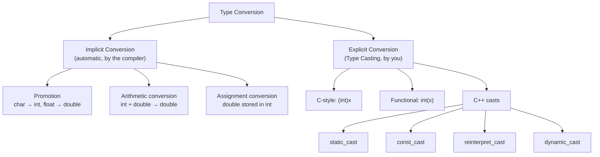
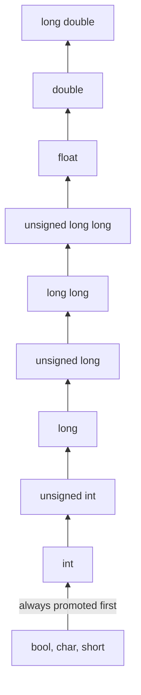
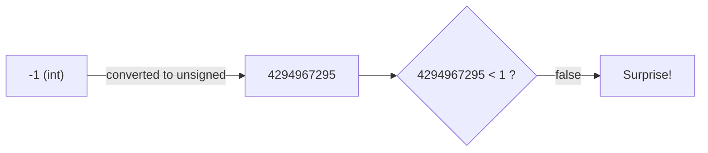
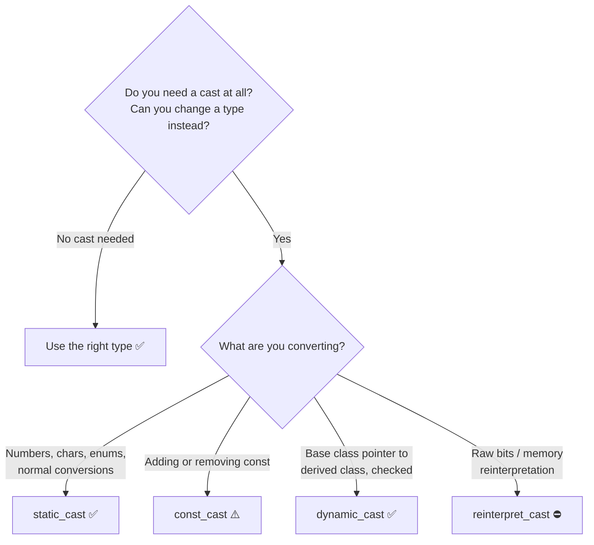

# Type Casting and Type Conversion in C++

> **Goal of this lesson:** Understand how C++ converts values from one type to another — automatically (implicit) and on your command (explicit) — learn all four C++ cast operators, convert between strings and numbers, and avoid the silent data-loss bugs that conversions cause.

> 🔗 *Lesson 2 introduced `static_cast` and the integer-division trap. This lesson covers type conversion in full depth.*

> 💡 *Diagrams use **Mermaid**, which GitHub renders automatically.*

---

## 📑 Table of Contents

1. [What is Type Conversion?](#1-what-is-type-conversion)
2. [Two Kinds of Conversion](#2-two-kinds-of-conversion)
3. [Implicit Conversion](#3-implicit-conversion)
4. [Type Promotion in Expressions](#4-type-promotion-in-expressions)
5. [Where Implicit Conversions Happen](#5-where-implicit-conversions-happen)
6. [Data Loss: When Conversion Goes Wrong](#6-data-loss-when-conversion-goes-wrong)
7. [The Signed vs Unsigned Trap](#7-the-signed-vs-unsigned-trap)
8. [Narrowing and Brace Initialization](#8-narrowing-and-brace-initialization)
9. [Explicit Conversion (Type Casting)](#9-explicit-conversion-type-casting)
10. [C-Style and Functional Casts](#10-c-style-and-functional-casts)
11. [`static_cast`](#11-static_cast)
12. [`const_cast`](#12-const_cast)
13. [`reinterpret_cast`](#13-reinterpret_cast)
14. [`dynamic_cast`](#14-dynamic_cast)
15. [Choosing the Right Cast](#15-choosing-the-right-cast)
16. [Rounding vs Truncation](#16-rounding-vs-truncation)
17. [Converting Between Strings and Numbers](#17-converting-between-strings-and-numbers)
18. [Conversions with `bool` and `char`](#18-conversions-with-bool-and-char)
19. [Best Practices](#19-best-practices)
20. [Common Beginner Mistakes](#20-common-beginner-mistakes)
21. [Practice Exercises](#21-practice-exercises)
22. [Quick Quiz](#22-quick-quiz)
23. [Summary](#23-summary)

---

## 1. What is Type Conversion?

**Type conversion** means changing a value from **one data type to another**.

```cpp
int marks = 87;
double percent = marks;   // int 87 → double 87.0
```

🥤 **Analogy:** Pouring liquid between containers.
- Pouring from a **small glass into a big jug** → everything fits ✅ (safe conversion)
- Pouring from a **big jug into a small glass** → some spills over ❌ (data loss)

```
  int  (small glass)  ──►  double (big jug)     ✅ nothing lost
  double (big jug)    ──►  int (small glass)    ⚠️ decimal part spills out
```

### Why Do We Need Conversions?

| Situation | Example |
|-----------|---------|
| Mixing types in a calculation | `int` marks ÷ `int` count → need a `double` average |
| Storing a value in a different type | Reading `"25"` as text, needing it as `int` |
| Calling a function expecting another type | `sqrt(16)` expects `double`, you pass `int` |
| Working with characters | `'7'` (char) → `7` (int) |
| Displaying numbers as text | `42` → `"42"` to build a message |

---

## 2. Two Kinds of Conversion



| | Implicit Conversion | Explicit Conversion (Casting) |
|--|--------------------|-------------------------------|
| Also called | Automatic / coercion | Type casting |
| Done by | The **compiler** | The **programmer** |
| Visible in code? | ❌ Hidden | ✅ Clearly written |
| Risk | Silent data loss | You take responsibility |
| Example | `double d = 5;` | `int n = static_cast<int>(9.7);` |

---

## 3. Implicit Conversion

The compiler converts types **automatically** when it's needed and allowed.

```cpp
#include <iostream>
using namespace std;

int main() {
    int    i = 42;
    double d = i;        // int → double     : 42.0   ✅ safe (widening)
    long long big = i;   // int → long long  : 42     ✅ safe

    double price = 99.99;
    int rupees = price;  // double → int     : 99     ⚠️ decimal lost (narrowing)

    char letter = 'A';
    int code = letter;   // char → int       : 65     ✅ safe

    cout << d << " " << big << " " << rupees << " " << code << endl;
    return 0;
}
```

**Output:**
```
42 42 99 65
```

### Widening vs Narrowing

| Type | Direction | Safe? | Example |
|------|-----------|-------|---------|
| **Widening** | Smaller → larger type | ✅ Usually safe | `int` → `double`, `int` → `long long` |
| **Narrowing** | Larger → smaller type | ⚠️ Can lose data | `double` → `int`, `long long` → `int`, `int` → `char` |

📌 Compile with `-Wall -Wconversion` to get **warnings** for risky implicit conversions:
```bash
g++ -Wall -Wconversion program.cpp -o program
```
```
warning: conversion from 'double' to 'int' may change value [-Wfloat-conversion]
```

---

## 4. Type Promotion in Expressions

When an expression mixes types, C++ converts operands to a **common type** before calculating.

### Step 1: Integral Promotion
Small integer types are **always** promoted to `int` before arithmetic:

```
bool, char, short, (and their unsigned versions)  ──►  int
```

```cpp
char a = 'A', b = 'B';
cout << a + b << endl;              // 131  (65 + 66) — result is int, not char!
cout << sizeof(a + b) << endl;      // 4    — it's an int

short s1 = 10, s2 = 20;
auto result = s1 + s2;              // result is int, not short
```

### Step 2: Usual Arithmetic Conversion
Then, the **"smaller"** type is converted to the **"larger"** one:



*(Read bottom to top: the lower type is converted to the higher one.)*

### Examples

| Expression | Conversion | Result Type | Value |
|------------|-----------|-------------|-------|
| `5 + 2` | none | `int` | 7 |
| `5 + 2.5` | `5` → `5.0` | `double` | 7.5 |
| `'A' + 1` | `'A'` → `65` | `int` | 66 |
| `true + 10` | `true` → `1` | `int` | 11 |
| `3.0f * 2` | `2` → `2.0f` | `float` | 6.0 |
| `2.5f + 1.5` | `2.5f` → `2.5` | `double` | 4.0 |
| `10L + 5` | `5` → `5L` | `long` | 15 |
| `7 / 2` | none | `int` | **3** |
| `7 / 2.0` | `7` → `7.0` | `double` | 3.5 |

### Checking a Type
```cpp
#include <iostream>
#include <typeinfo>
using namespace std;

int main() {
    cout << typeid(5 + 2.5).name() << endl;     // d  (double)
    cout << typeid('A' + 1).name() << endl;     // i  (int)
    cout << typeid(3.0f * 2).name() << endl;    // f  (float)
    return 0;
}
```
*(g++ prints short codes: `i` = int, `d` = double, `f` = float, `c` = char.)*

### ⚠️ Promotion Happens Per Operation — Order Matters!

```cpp
int a = 7, b = 2;
double r1 = a / b * 1.0;    // (7 / 2) * 1.0 = 3 * 1.0 = 3.0   ❌
double r2 = 1.0 * a / b;    // (1.0 * 7) / 2 = 7.0 / 2 = 3.5   ✅
```
The integer division in `r1` happens **before** the double ever appears.

---

## 5. Where Implicit Conversions Happen

### 1️⃣ In Assignment — converted to the **variable's** type
```cpp
int x = 9.99;           // 9
double y = 'A';         // 65.0
```

### 2️⃣ In Expressions — converted to the **common** type
```cpp
double avg = 10 + 2.5;  // 10 → 10.0
```

### 3️⃣ In Function Arguments — converted to the **parameter** type
```cpp
void showAge(int age) { cout << age; }

showAge(21.8);          // 21.8 → 21  (prints 21)
```

### 4️⃣ In Return Values — converted to the **return** type
```cpp
int getPrice() {
    return 49.95;       // 49.95 → 49
}
```

### 5️⃣ In Conditions — converted to **`bool`**
```cpp
int count = 5;
if (count) { ... }      // 5 → true
if (0.0) { ... }        // 0.0 → false
```

---

## 6. Data Loss: When Conversion Goes Wrong

| Conversion | What Happens | Example | Result |
|------------|-------------|---------|--------|
| `double` → `int` | Decimal part **truncated** (toward zero) | `int x = 7.99;` | 7 |
| Negative `double` → `int` | Truncated toward zero | `int x = -7.99;` | -7 |
| Large `double` → `int` | ❌ **Undefined behaviour** if out of range | `int x = 1e20;` | ??? |
| `int` → `char` | Keeps only the lowest 8 bits (wraps) | `char c = 300;` | 44 (`','`) |
| `int` → `short` | Wraps if out of range | `short s = 70000;` | 4464 |
| `long long` → `int` | Wraps if out of range | `int i = 5'000'000'000LL;` | 705032704 |
| Negative → `unsigned` | Wraps to a huge number | `unsigned u = -1;` | 4294967295 |
| `double` → `float` | Precision lost | `float f = 3.14159265358979;` | 3.14159274 |
| Large `int` → `float` | Precision lost | `float f = 16777217;` | 16777216 |

```cpp
#include <iostream>
using namespace std;

int main() {
    int truncated = 7.99;
    char wrapped = 300;
    unsigned int huge = -1;
    float imprecise = 16777217;

    cout << "7.99 → int        : " << truncated << endl;
    cout << "300 → char (as int): " << static_cast<int>(wrapped) << endl;
    cout << "-1 → unsigned     : " << huge << endl;
    cout.precision(10);
    cout << "16777217 → float  : " << imprecise << endl;
    return 0;
}
```

**Output** (typical 32-bit `int`, 8-bit `char`):
```
7.99 → int        : 7
300 → char (as int): 44
-1 → unsigned     : 4294967295
16777217 → float  : 16777216
```

### 🔍 Why Does 300 Become 44?

A `char` holds 8 bits (values 0–255 as a pattern). 300 needs 9 bits, so the top bit is **dropped**:

```
 300 = 1 0010 1100   (9 bits)
         ─────────
 char =   0010 1100  = 44   (only the lowest 8 bits are kept)
```
Same as `300 % 256 = 44` — like an odometer rolling over.

### 🔍 Why Can't `float` Store 16777217 Exactly?

A `float` keeps only about **7 significant digits** (24 bits of precision). Above 16,777,216 (2²⁴), it can no longer represent every integer, so it rounds to the nearest one it can store.

📌 **Lesson:** `double` holds about **15–16 digits** — use it as your default decimal type (Lesson 2).

---

## 7. The Signed vs Unsigned Trap

This is one of the **most surprising** bugs in C++.

When you mix **signed** (`int`) and **unsigned** (`unsigned int`) in an expression, the signed value is **converted to unsigned** — negative numbers become huge!

```cpp
#include <iostream>
using namespace std;

int main() {
    int negative = -1;
    unsigned int positive = 1;

    if (negative < positive) {
        cout << "-1 is less than 1" << endl;
    } else {
        cout << "-1 is NOT less than 1 ?!" << endl;   // 😱 this prints!
    }

    unsigned int u = 10;
    int i = -20;
    cout << "10 + (-20) = " << u + i << endl;           // 4294967286 😱
    return 0;
}
```

**Output:**
```
-1 is NOT less than 1 ?!
10 + (-20) = 4294967286
```



### Where This Bites Students
`.size()` and `.length()` return an **unsigned** type (`size_t`):

```cpp
string s = "";                       // empty string
cout << s.length() - 1;              // 18446744073709551615 😱 (not -1)
```

✅ **Fixes:**
- Don't mix signed and unsigned in comparisons and arithmetic
- Cast explicitly: `static_cast<int>(s.length()) - 1`
- Compile with `-Wall -Wextra` → warns: *"comparison of integer expressions of different signedness"*
- C++20 offers safe comparison functions: `std::cmp_less(a, b)` from `<utility>`

---

## 8. Narrowing and Brace Initialization

Brace initialization `{}` (Lesson 2) **refuses** narrowing conversions at compile time:

```cpp
int a = 9.99;      // ✅ compiles, silently becomes 9
int b(9.99);       // ✅ compiles, silently becomes 9
int c{9.99};       // ❌ error: narrowing conversion of '9.99' from 'double' to 'int'

char d{300};       // ❌ error: narrowing — 300 doesn't fit in char
char e{65};        // ✅ OK — 65 fits, compiler knows the constant value

double f = 5;
int g{f};          // ❌ error: narrowing from double to int
int h{static_cast<int>(f)};   // ✅ explicit cast shows you meant it
```

✅ Brace initialization is your **safety net**. If you truly want the conversion, make it **explicit** with a cast.

---

## 9. Explicit Conversion (Type Casting)

**Type casting** is when **you** tell the compiler to convert a value:

```cpp
double average = static_cast<double>(total) / count;
```

### Why Cast Explicitly?

| Reason | Example |
|--------|---------|
| Force correct calculation | Avoid integer division |
| Show intent clearly | "Yes, I know the decimal will be lost" |
| Silence warnings safely | `-Wconversion` stays quiet when you cast |
| Convert enums | `static_cast<int>(Color::Red)` (Lesson 7) |
| Print char codes | `static_cast<int>('A')` → 65 |

### The Casting Methods in C++

| Method | Syntax | Origin | Recommended? |
|--------|--------|--------|--------------|
| C-style cast | `(int)x` | C language | ⚠️ Avoid in C++ |
| Functional cast | `int(x)` | C++ | ⚠️ Same as C-style |
| `static_cast` | `static_cast<int>(x)` | C++ | ✅ **Default choice** |
| `const_cast` | `const_cast<T>(x)` | C++ | ⚠️ Rarely |
| `reinterpret_cast` | `reinterpret_cast<T>(x)` | C++ | ⛔ Very rarely (low-level) |
| `dynamic_cast` | `dynamic_cast<T>(x)` | C++ | ✅ For class hierarchies |

---

## 10. C-Style and Functional Casts

```cpp
double price = 99.75;

int a = (int)price;    // C-style cast        → 99
int b = int(price);    // functional cast     → 99
```

Both work, and you'll see them in a lot of code. So why avoid them?

### ⚠️ Problems with C-Style Casts

**1. They can do too much, silently.** A C-style cast tries `const_cast`, `static_cast`, and even `reinterpret_cast` — whatever makes the code compile. It can turn a mistake into a hidden bug:

```cpp
const int secret = 42;
int* p = (int*)&secret;    // compiles — silently removes const!
*p = 100;                  // ❌ undefined behaviour
```

**2. They're hard to find.** Searching your code for `(int)` also finds function calls and parentheses. Searching for `static_cast` finds exactly the casts.

**3. They hide intent.** `(T)x` doesn't say *what kind* of conversion you meant.

| | C-style `(int)x` | `static_cast<int>(x)` |
|--|-----------------|----------------------|
| Short to type | ✅ | ❌ |
| Easy to search | ❌ | ✅ |
| Shows intent | ❌ | ✅ |
| Compiler checks safety | ❌ (tries anything) | ✅ (refuses dangerous casts) |

📌 **The long name is a feature:** casts should be **visible**, because they're places where bugs hide.

---

## 11. `static_cast`

The **everyday cast** — for normal, well-defined conversions checked at **compile time**.

### Syntax
```cpp
static_cast<new_type>(expression)
```

### Common Uses

```cpp
#include <iostream>
using namespace std;

enum class Level { Low, Medium, High };

int main() {
    // 1. Numeric conversions
    int total = 437, count = 5;
    double avg = static_cast<double>(total) / count;          // 87.4

    // 2. Decimal → integer (intentional truncation)
    double temperature = 36.8;
    int wholeDegrees = static_cast<int>(temperature);         // 36

    // 3. char ↔ int
    char ch = 'A';
    int ascii = static_cast<int>(ch);                         // 65
    char next = static_cast<char>(ascii + 1);                 // 'B'

    // 4. enum ↔ int (Lesson 7)
    Level lv = static_cast<Level>(2);                         // Level::High
    int lvNum = static_cast<int>(Level::Medium);              // 1

    // 5. Large → smaller integer (you accept the risk)
    long long big = 1234;
    int small = static_cast<int>(big);                        // 1234

    cout << avg << " " << wholeDegrees << " " << ascii << " "
         << next << " " << lvNum << " " << small << endl;
    return 0;
}
```

**Output:**
```
87.4 36 65 B 1 1234
```

### What `static_cast` Refuses to Do ✅

```cpp
const int c = 10;
int* p1 = static_cast<int*>(&c);       // ❌ error: casts away const

int x = 5;
double* p2 = static_cast<double*>(&x); // ❌ error: unrelated pointer types
```

These refusals **protect you**. A C-style cast would allow both.

> 📚 `static_cast` is also used for converting between related classes (base ↔ derived) — covered in the Inheritance lesson.

---

## 12. `const_cast`

Adds or removes **`const`** (Lesson 6). It's the **only** C++ cast that can do this.

### Syntax
```cpp
const_cast<new_type>(expression)
```

### Legitimate Use: Calling Old Code

Sometimes an older function forgets to mark a parameter `const`, even though it **doesn't modify** it:

```cpp
#include <iostream>
using namespace std;

// Old library function — should have been 'const char*', but isn't
void legacyPrint(char* text) {
    cout << text << endl;     // only reads, never modifies
}

int main() {
    const char* message = "Hello, Students!";
    // legacyPrint(message);                       // ❌ error: const char* → char*
    legacyPrint(const_cast<char*>(message));       // ✅ OK: function won't modify it
    return 0;
}
```

### ⛔ The Danger

```cpp
const int MAX = 100;
int* p = const_cast<int*>(&MAX);
*p = 200;                 // ❌ UNDEFINED BEHAVIOUR — MAX was truly const
cout << MAX;              // might print 100, 200, or crash
```

📌 **Rule:** `const_cast` is safe **only** if the original object was **not** declared `const`, or if you **never modify** it. If you find yourself using `const_cast`, first ask whether the design should be fixed instead.

---

## 13. `reinterpret_cast`

The **most dangerous** cast. It tells the compiler: *"treat these raw bits as a completely different type."* No conversion happens — the bits stay the same, only their interpretation changes.

### Syntax
```cpp
reinterpret_cast<new_type>(expression)
```

### Example: Looking at the Bytes of an Integer

```cpp
#include <iostream>
using namespace std;

int main() {
    int number = 0x41424344;     // bytes: 41 42 43 44 → 'A' 'B' 'C' 'D'

    unsigned char* bytes = reinterpret_cast<unsigned char*>(&number);

    for (int i = 0; i < 4; i++) {
        cout << bytes[i];        // print each byte as a character
    }
    cout << endl;
    return 0;
}
```

**Output** (on most PCs, which are *little-endian*):
```
DCBA
```

The bytes are stored in **reverse order** in memory on Intel/AMD and most ARM CPUs. `reinterpret_cast` lets you see the raw memory layout.

### When Is It Used?
- Low-level systems and hardware programming
- Reading/writing raw binary files and network packets
- Interfacing with operating system APIs

### ⛔ Why It's Dangerous

```cpp
int x = 10;
double* d = reinterpret_cast<double*>(&x);
cout << *d;     // ❌ undefined behaviour — reads 8 bytes from a 4-byte int
```

📌 **Beginners should almost never need `reinterpret_cast`.** If you're using it, you should know exactly why.

> 📚 Pointers are covered in a later lesson.

---

## 14. `dynamic_cast`

> 🎓 *Preview — uses classes, inheritance, and pointers (covered in OOP lessons). Focus on the idea.*

`dynamic_cast` safely converts between classes in an **inheritance hierarchy**, checking **at runtime** whether the conversion is valid.

### Syntax
```cpp
dynamic_cast<new_type>(expression)
```

### Example

```cpp
#include <iostream>
using namespace std;

class Animal {
public:
    virtual ~Animal() {}          // dynamic_cast needs at least one virtual function
};

class Dog : public Animal {
public:
    void bark() { cout << "Woof!" << endl; }
};

class Cat : public Animal {
public:
    void meow() { cout << "Meow!" << endl; }
};

int main() {
    Animal* pet = new Dog();

    Dog* d = dynamic_cast<Dog*>(pet);
    if (d != nullptr) {
        d->bark();                // ✅ pet really is a Dog
    }

    Cat* c = dynamic_cast<Cat*>(pet);
    if (c == nullptr) {
        cout << "This animal is not a cat." << endl;   // ✅ safely detected
    }

    delete pet;
    return 0;
}
```

**Output:**
```
Woof!
This animal is not a cat.
```

🐾 **Analogy:** You have a box labelled **"Animal"**. `dynamic_cast` **opens the box and checks** whether it's really a Dog before letting you treat it like one. If it's not, you get `nullptr` instead of a disaster.

| | `static_cast` (base → derived) | `dynamic_cast` |
|--|------------------------------|----------------|
| Checked when? | Compile time only | **Runtime** |
| Wrong type? | Undefined behaviour | Returns `nullptr` (pointers) |
| Speed | Fast | Slightly slower |
| Requirement | — | Class must have a `virtual` function |

---

## 15. Choosing the Right Cast



### Summary Table

| Cast | Purpose | Checked | Safety | How Often |
|------|---------|---------|--------|-----------|
| `static_cast` | Normal conversions | Compile time | ✅ Safe if values fit | **Very often** |
| `const_cast` | Add/remove `const` | Compile time | ⚠️ Risky | Rare |
| `reinterpret_cast` | Reinterpret raw bits | None | ⛔ Dangerous | Very rare |
| `dynamic_cast` | Safe downcasting in class hierarchies | Runtime | ✅ Safe | Occasionally (OOP) |
| `(T)x` / `T(x)` | Anything | None | ⚠️ Hides intent | Avoid in new code |

> 🧠 **Remember:** "**S**afe **C**asting **R**equires **D**iscipline" → **S**tatic (everyday), **C**onst (remove const), **R**einterpret (raw bits), **D**ynamic (runtime-checked classes)

---

## 16. Rounding vs Truncation

Casting a `double` to `int` **truncates** (cuts off the decimal). It does **not** round!

```cpp
int a = static_cast<int>(4.9);    // 4, not 5!
int b = static_cast<int>(-4.9);   // -4 (toward zero)
```

Use functions from **`<cmath>`** for other behaviour:

| Function | Meaning | `2.3` | `2.5` | `2.7` | `-2.3` | `-2.5` | `-2.7` |
|----------|---------|-------|-------|-------|--------|--------|--------|
| `static_cast<int>` / `trunc` | Toward zero | 2 | 2 | 2 | -2 | -2 | -2 |
| `round` | Nearest (halves away from 0) | 2 | 3 | 3 | -2 | -3 | -3 |
| `floor` | Down (toward −∞) | 2 | 2 | 2 | -3 | -3 | -3 |
| `ceil` | Up (toward +∞) | 3 | 3 | 3 | -2 | -2 | -2 |

```
       floor ◄────────── value ──────────► ceil
   ───┼───────┼───────●───────┼───────┼───
     -3      -2     -2.5     -1       0
                trunc → -2 (toward zero)
                round → -3 (away from zero at .5)
```

```cpp
#include <iostream>
#include <cmath>
using namespace std;

int main() {
    double price = 249.75;

    cout << "Truncated: " << static_cast<int>(price) << endl;          // 249
    cout << "Rounded  : " << static_cast<int>(round(price)) << endl;   // 250
    cout << "Floor    : " << floor(price) << endl;                     // 249
    cout << "Ceil     : " << ceil(price) << endl;                      // 250

    // Round to 2 decimal places
    double value = 3.14159;
    double rounded2 = round(value * 100) / 100;                        // 3.14
    cout << "2 places : " << rounded2 << endl;
    return 0;
}
```

### 🌟 Practical Example: Pages Needed
```cpp
int students = 45, perPage = 10;
int pages = static_cast<int>(ceil(static_cast<double>(students) / perPage));   // 5 ✅
// or the integer trick:
int pages2 = (students + perPage - 1) / perPage;                               // 5 ✅
```

📌 **Remember:** `round`, `floor`, and `ceil` return a **`double`** — cast the result if you need an `int`.

---

## 17. Converting Between Strings and Numbers

`static_cast` **cannot** convert text to numbers:
```cpp
string s = "42";
int n = static_cast<int>(s);    // ❌ error: invalid static_cast
```

Use the functions from **`<string>`** instead.

### Number → String: `to_string()`

```cpp
#include <iostream>
#include <string>
using namespace std;

int main() {
    int age = 21;
    double gpa = 8.75;

    string msg = "Age: " + to_string(age) + ", GPA: " + to_string(gpa);
    cout << msg << endl;
    return 0;
}
```

**Output:**
```
Age: 21, GPA: 8.750000
```

⚠️ `to_string(double)` always shows **6 decimal places**. For formatted output, use `<iomanip>` or C++20's `std::format` (later lessons).

### String → Number

| Function | Converts To | Example | Result |
|----------|-------------|---------|--------|
| `stoi(s)` | `int` | `stoi("42")` | 42 |
| `stol(s)` | `long` | `stol("123456")` | 123456 |
| `stoll(s)` | `long long` | `stoll("9000000000")` | 9000000000 |
| `stof(s)` | `float` | `stof("3.14")` | 3.14 |
| `stod(s)` | `double` | `stod("99.5")` | 99.5 |

```cpp
#include <iostream>
#include <string>
using namespace std;

int main() {
    string qty = "12", price = "49.99";

    int q = stoi(qty);
    double p = stod(price);

    cout << "Total: " << q * p << endl;   // 599.88
    return 0;
}
```

### How `stoi` Handles Messy Input

| Input | `stoi` Result |
|-------|---------------|
| `"42"` | 42 |
| `"  42"` | 42 (leading spaces skipped) |
| `"-17"` | -17 |
| `"42abc"` | 42 (stops at first invalid character) |
| `"3.99"` | 3 (stops at `.`) |
| `"abc"` | ❌ throws `invalid_argument` → program stops |
| `"99999999999"` | ❌ throws `out_of_range` → program stops |

> 📚 You'll learn to **catch** these errors safely with `try`/`catch` in the Exception Handling lesson.

### Single Digit Characters ↔ Numbers

```cpp
char digitChar = '7';
int digit = digitChar - '0';              // 7   ('7' is 55, '0' is 48)

int n = 4;
char c = static_cast<char>('0' + n);      // '4'
```

⚠️ Don't confuse these:
```cpp
int a = '7';            // 55  — the ASCII code!
int b = '7' - '0';      // 7   — the digit value ✅
int c = stoi("7");      // 7   — from a string ✅
```

---

## 18. Conversions with `bool` and `char`

### Anything → `bool`

| Value | As `bool` |
|-------|-----------|
| `0`, `0.0`, `'\0'`, `nullptr` | `false` |
| **Any** other number (`1`, `-5`, `0.001`, `'A'`) | `true` |

```cpp
bool a = 42;      // true
bool b = -3.7;    // true
bool c = 0;       // false
cout << a << b << c;   // 110
```

### `bool` → Number
```cpp
int x = true;        // 1
int y = false;       // 0
int votes = true + true + false;   // 2 — counting true values!
```

### `char` ↔ `int`

```cpp
char ch = 97;                           // 'a'
int code = 'z';                         // 122

char upper = static_cast<char>('a' - 32);   // 'A' (lowercase → uppercase in ASCII)
char lower = static_cast<char>('A' + 32);   // 'a'
```

💡 Safer, clearer alternatives from `<cctype>`:
```cpp
#include <cctype>
char u = toupper('a');    // 'A'
char l = tolower('Q');    // 'q'
bool d = isdigit('7');    // true
```

### Printing `char` Values

```cpp
char grade = 'A';
cout << grade;                        // A
cout << static_cast<int>(grade);      // 65
cout << +grade;                       // 65 (unary + promotes to int — a handy trick)
```

---

## 19. Best Practices

1. ✅ **Choose the right type first** — the best cast is the one you don't need.
2. ✅ Use **`static_cast`** for everyday conversions; avoid C-style `(int)x` in new code.
3. ✅ Use **brace initialization** `{}` to catch accidental narrowing.
4. ✅ Compile with **`-Wall -Wextra -Wconversion`** to see risky implicit conversions.
5. ✅ **Cast before dividing**, not after: `static_cast<double>(a) / b`.
6. ✅ Use **`round()`** when you need rounding — casting truncates.
7. ✅ **Don't mix signed and unsigned** in comparisons.
8. ✅ Use **`stoi` / `stod` / `to_string`** for string ↔ number conversions.
9. ✅ Check that values **fit** before narrowing (`<climits>`, `<limits>`).
10. ⚠️ Treat `const_cast` and `reinterpret_cast` as **warning signs** — use only with a clear reason.

---

## 20. Common Beginner Mistakes

| ❌ Mistake | ✅ Correct | Why |
|-----------|-----------|-----|
| `double avg = sum / n;` | `double avg = static_cast<double>(sum) / n;` | int / int happens first |
| `static_cast<double>(sum / n)` | `static_cast<double>(sum) / n` | Cast after division is too late |
| `int r = static_cast<int>(4.7);` expecting 5 | `static_cast<int>(round(4.7))` | Casting truncates |
| `int n = static_cast<int>("42");` | `int n = stoi("42");` | Can't cast strings to numbers |
| `int d = '7';` expecting 7 | `int d = '7' - '0';` | `'7'` is ASCII 55 |
| `string s; s = 42;` expecting `"42"` | `s = to_string(42);` | Compiles, but stores the character with code 42 (`'*'`)! |
| `if (s.length() - 1 >= 0)` | `if (!s.empty())` | Unsigned never goes below 0 |
| `if (-1 < v.size())` | Cast or avoid mixing | Signed/unsigned trap |
| `char c = 300;` | Use `int` for large values | Wraps around |
| `int big = 3'000'000'000;` | `long long big = 3'000'000'000LL;` | Doesn't fit in `int` |
| `(int)x` everywhere | `static_cast<int>(x)` | Safer, searchable |
| Using `const_cast` to modify a `const` variable | Don't make it `const`, or don't modify it | Undefined behaviour |

---

## 21. Practice Exercises

### 🟢 Easy

**Exercise 1:** Predict the output:
```cpp
int a = 9.81;
double b = 7;
char c = 66;
int d = 'a';
cout << a << " " << b << " " << c << " " << d << endl;
```

**Exercise 2:** Take marks of 4 subjects (integers) and print the average **as a decimal** using `static_cast`.

**Exercise 3:** Convert the string `"250"` to an integer, add 50, then convert the result back to a string and print `"Total: 300"`.

### 🟡 Medium

**Exercise 4:** Predict the **type** and **value** of each expression:
- a) `10 / 4`
- b) `10 / 4.0`
- c) `'A' + 2`
- d) `true + true`
- e) `5.0f * 2`
- f) `static_cast<int>(7.9) + static_cast<int>(-7.9)`

**Exercise 5:** Take a decimal number from the user and print its **truncated**, **rounded**, **floor**, and **ceil** values. Test with `5.5` and `-5.5`.

**Exercise 6:** Take a single digit **character** (`'0'`–`'9'`) as input and print the digit **multiplied by 10** — without using `stoi`.

**Exercise 7:** Explain why this program prints `"Surprise!"`, then fix it:
```cpp
#include <iostream>
using namespace std;

int main() {
    int score = -5;
    unsigned int limit = 10;
    if (score < limit) {
        cout << "Normal" << endl;
    } else {
        cout << "Surprise!" << endl;
    }
    return 0;
}
```

### 🔴 Challenge

**Exercise 8:** Which lines **fail to compile**? Explain each.
```cpp
double d = 3.7;
int a = d;                          // line 1
int b{d};                           // line 2
int c{static_cast<int>(d)};         // line 3
char e{65};                         // line 4
char f{300};                        // line 5
const int g = 10;
int* p = static_cast<int*>(&g);     // line 6
```

**Exercise 9:** Write a program that reads the **price** of an item as a string (like `"1299.50"`) and a **quantity** as a string (like `"3"`), converts both, applies 18% GST, and prints the total **rounded to the nearest rupee**.

**Exercise 10:** A class has `n` students and buses hold `k` students each. Read `n` and `k`, and print the number of buses needed using:
- a) `ceil()` with `static_cast`
- b) Only integer arithmetic

**Exercise 11:** Predict the output and explain each line (assume 8-bit `char`, 32-bit `int`):
```cpp
char c = 260;
unsigned int u = -2;
float f = 123456789;
cout << static_cast<int>(c) << endl;
cout << u << endl;
cout.precision(12);
cout << f << endl;
```

---

### ✅ Solutions

<details>
<summary>Click to view Exercise 1 answer</summary>

**Output:**
```
9 7 B 97
```
- `9.81` → `int` truncates to **9**
- `7` → `double` 7.0, printed as **7**
- `66` → `char` **'B'**
- `'a'` → `int` **97**
</details>

<details>
<summary>Click to view Exercise 2 solution</summary>

```cpp
#include <iostream>
using namespace std;

int main() {
    int m1, m2, m3, m4;
    cout << "Enter marks of 4 subjects: ";
    cin >> m1 >> m2 >> m3 >> m4;

    int total = m1 + m2 + m3 + m4;
    double average = static_cast<double>(total) / 4;

    cout << "Average: " << average << endl;
    return 0;
}
```
**Sample:** `78 85 90 66` → `Average: 79.75`
</details>

<details>
<summary>Click to view Exercise 3 solution</summary>

```cpp
#include <iostream>
#include <string>
using namespace std;

int main() {
    string text = "250";
    int value = stoi(text) + 50;
    string result = "Total: " + to_string(value);
    cout << result << endl;
    return 0;
}
```
</details>

<details>
<summary>Click to view Exercise 4 answers</summary>

| Expression | Type | Value |
|------------|------|-------|
| a) `10 / 4` | `int` | 2 |
| b) `10 / 4.0` | `double` | 2.5 |
| c) `'A' + 2` | `int` | 67 |
| d) `true + true` | `int` | 2 |
| e) `5.0f * 2` | `float` | 10 |
| f) `7 + (-7)` | `int` | 0 |
</details>

<details>
<summary>Click to view Exercise 5 solution</summary>

```cpp
#include <iostream>
#include <cmath>
using namespace std;

int main() {
    double x;
    cout << "Enter a decimal number: ";
    cin >> x;

    cout << "Truncated: " << static_cast<int>(x) << endl;
    cout << "Rounded  : " << round(x) << endl;
    cout << "Floor    : " << floor(x) << endl;
    cout << "Ceil     : " << ceil(x) << endl;
    return 0;
}
```

| Input | Truncated | Rounded | Floor | Ceil |
|-------|-----------|---------|-------|------|
| 5.5 | 5 | 6 | 5 | 6 |
| -5.5 | -5 | -6 | -6 | -5 |
</details>

<details>
<summary>Click to view Exercise 6 solution</summary>

```cpp
#include <iostream>
using namespace std;

int main() {
    char ch;
    cout << "Enter a digit: ";
    cin >> ch;

    int digit = ch - '0';
    cout << digit << " x 10 = " << digit * 10 << endl;
    return 0;
}
```
**Sample:** `7` → `7 x 10 = 70`
</details>

<details>
<summary>Click to view Exercise 7 solution</summary>

**Why:** In `score < limit`, `score` (signed) is converted to **unsigned**. `-5` becomes `4294967291`, which is **not** less than 10.

**Fix 1 — use the same type:**
```cpp
int score = -5;
int limit = 10;
if (score < limit) { ... }        // Normal
```

**Fix 2 — cast explicitly:**
```cpp
if (score < static_cast<int>(limit)) { ... }   // Normal
```

**Fix 3 — C++20 safe comparison:**
```cpp
#include <utility>
if (std::cmp_less(score, limit)) { ... }       // Normal
```
</details>

<details>
<summary>Click to view Exercise 8 answers</summary>

| Line | Compiles? | Reason |
|------|-----------|--------|
| 1 | ✅ | Implicit narrowing allowed with `=` (value becomes 3) |
| 2 | ❌ | Brace init blocks narrowing from `double` to `int` |
| 3 | ✅ | Explicit cast shows intent |
| 4 | ✅ | Constant 65 fits in `char` |
| 5 | ❌ | Constant 300 doesn't fit in `char` → narrowing |
| 6 | ❌ | `static_cast` cannot remove `const` |
</details>

<details>
<summary>Click to view Exercise 9 solution</summary>

```cpp
#include <iostream>
#include <string>
#include <cmath>
using namespace std;

constexpr double GST_RATE = 0.18;

int main() {
    string priceText, qtyText;
    cout << "Enter price: ";
    cin >> priceText;
    cout << "Enter quantity: ";
    cin >> qtyText;

    double price = stod(priceText);
    int quantity = stoi(qtyText);

    double subtotal = price * quantity;
    double total = subtotal + subtotal * GST_RATE;
    int finalAmount = static_cast<int>(round(total));

    cout << "Subtotal : " << subtotal << endl;
    cout << "Total    : Rs. " << finalAmount << endl;
    return 0;
}
```
**Sample:** price `1299.50`, quantity `3` → subtotal 3898.5 → with GST 4600.23 → **Rs. 4600**
</details>

<details>
<summary>Click to view Exercise 10 solution</summary>

```cpp
#include <iostream>
#include <cmath>
using namespace std;

int main() {
    int n, k;
    cout << "Students and bus capacity: ";
    cin >> n >> k;

    // a) Using ceil
    int busesA = static_cast<int>(ceil(static_cast<double>(n) / k));

    // b) Integer arithmetic only
    int busesB = (n + k - 1) / k;

    cout << "Buses (ceil)   : " << busesA << endl;
    cout << "Buses (integer): " << busesB << endl;
    return 0;
}
```
**Sample:** `n = 125`, `k = 40` → **4** buses
</details>

<details>
<summary>Click to view Exercise 11 answer</summary>

**Output:**
```
4
4294967294
123456792
```
- `char c = 260;` → 260 − 256 = **4** (only the lowest 8 bits kept)
- `unsigned int u = -2;` → 2³² − 2 = **4294967294**
- `float f = 123456789;` → `float` has ~7 significant digits, so the nearest storable value is **123456792**
</details>

---

## 22. Quick Quiz

**Q1.** What is implicit type conversion?
- a) Conversion written by the programmer
- b) Conversion done automatically by the compiler
- c) Converting strings to numbers
- d) A runtime error

**Q2.** What is `static_cast<int>(8.9)`?
- a) 9
- b) 8
- c) 8.9
- d) Error

**Q3.** What is the result type of `'A' + 1`?
- a) `char`
- b) `int`
- c) `string`
- d) `bool`

**Q4.** Which cast removes `const`?
- a) `static_cast`
- b) `dynamic_cast`
- c) `const_cast`
- d) `reinterpret_cast`

**Q5.** Which line causes a compile error?
- a) `int a = 3.5;`
- b) `int b(3.5);`
- c) `int c{3.5};`
- d) `double d = 3;`

**Q6.** What does `stoi("42abc")` return?
- a) Error
- b) 0
- c) 42
- d) "42"

**Q7.** Which gives `3.5`?
- a) `static_cast<double>(7 / 2)`
- b) `static_cast<double>(7) / 2`
- c) `(double)(7 / 2)`
- d) `7 / 2`

**Q8.** What does `-1 < 1u` evaluate to?
- a) true
- b) false
- c) Compile error
- d) Undefined

**Q9.** What is `round(-2.5)`?
- a) -2
- b) -3
- c) 2
- d) -2.5

**Q10.** Which cast checks the type **at runtime**?
- a) `static_cast`
- b) `const_cast`
- c) `reinterpret_cast`
- d) `dynamic_cast`

**Q11.** What is `'9' - '0'`?
- a) 9
- b) 57
- c) '9'
- d) 0

**Q12.** Why is `static_cast` preferred over `(int)x`?
- a) It runs faster
- b) It is shorter
- c) It's safer, searchable, and shows intent
- d) C-style casts don't compile in C++

<details>
<summary>✅ Click to view answers</summary>

| Q | Answer | Explanation |
|---|--------|-------------|
| 1 | b) | Automatic conversion |
| 2 | b) 8 | Casting truncates |
| 3 | b) `int` | `char` is promoted to `int` |
| 4 | c) | Only `const_cast` can change const-ness |
| 5 | c) | Brace init blocks narrowing |
| 6 | c) 42 | Stops at the first invalid character |
| 7 | b) | Cast before dividing |
| 8 | b) false | -1 becomes 4294967295 as unsigned |
| 9 | b) -3 | `round` moves halves away from zero |
| 10 | d) | `dynamic_cast` checks at runtime |
| 11 | a) 9 | 57 − 48 |
| 12 | c) | Compiler refuses dangerous conversions, and casts are easy to find |

</details>

---

## 23. Summary

- ✅ **Type conversion** changes a value from one type to another.
- ✅ **Implicit** conversion is automatic; **explicit** conversion (casting) is written by you.
- ✅ **Widening** (int → double) is safe; **narrowing** (double → int) can lose data.
- ✅ In expressions, `bool`/`char`/`short` are **promoted to `int`**, then the smaller type converts to the larger: `int → long → long long → float → double`.
- ✅ Conversions also happen in **assignments**, **function arguments**, **return values**, and **conditions**.
- ✅ **Data loss**: truncation, wrap-around, precision loss in `float`, and **undefined behaviour** when a `double` doesn't fit in an `int`.
- ✅ **Signed + unsigned** → signed becomes unsigned: `-1 < 1u` is **false**!
- ✅ **Brace initialization** `{}` blocks narrowing at compile time.
- ✅ **C++ casts:**
  - `static_cast` → everyday conversions ✅
  - `const_cast` → add/remove `const` ⚠️
  - `reinterpret_cast` → raw bit reinterpretation ⛔
  - `dynamic_cast` → runtime-checked class conversions ✅
- ✅ Avoid C-style `(int)x` in new code.
- ✅ Casting **truncates**; use `round`, `floor`, `ceil` from `<cmath>` for other behaviour.
- ✅ Strings ↔ numbers: `to_string()`, `stoi()`, `stod()`; digit chars: `ch - '0'`.

---


---

> 📝 *Tip for students: Every cast is a place where you tell the compiler "trust me." Before writing one, ask: "Am I sure the value fits, and is there a way to avoid this cast?"*
