# Control Structures in C++

> **Goal of this lesson:** Learn how to control the **flow** of a program — making decisions with `if`, `else`, and `switch`, repeating work with `for`, `while`, and `do-while` loops, and changing flow with `break`, `continue`, `return`, and `goto`.

> 💡 *Flowcharts use **Mermaid**, which GitHub renders automatically.*

---

## 📑 Table of Contents

**Part A — Introduction**
1. [What Are Control Structures?](#1-what-are-control-structures)
2. [Sequence: The Default Flow](#2-sequence-the-default-flow)

**Part B — Selection (Decision Making)**

3. [The `if` Statement](#3-the-if-statement)
4. [The `if-else` Statement](#4-the-if-else-statement)
5. [The `else if` Ladder](#5-the-else-if-ladder)
6. [Nested `if`](#6-nested-if)
7. [`if` with Initializer (C++17)](#7-if-with-initializer-c17)
8. [The `switch` Statement](#8-the-switch-statement)
9. [`if-else` vs `switch` vs Ternary](#9-if-else-vs-switch-vs-ternary)

**Part C — Iteration (Loops)**

10. [Why Loops?](#10-why-loops)
11. [The `while` Loop](#11-the-while-loop)
12. [The `do-while` Loop](#12-the-do-while-loop)
13. [The `for` Loop](#13-the-for-loop)
14. [Range-Based `for` Loop (C++11)](#14-range-based-for-loop-c11)
15. [Nested Loops](#15-nested-loops)
16. [Infinite Loops](#16-infinite-loops)
17. [Choosing the Right Loop](#17-choosing-the-right-loop)

**Part D — Jump Statements**

18. [`break`](#18-break)
19. [`continue`](#19-continue)
20. [`return`](#20-return)
21. [`goto` (and Why to Avoid It)](#21-goto-and-why-to-avoid-it)

**Part E — Putting It Together**

22. [Common Loop Patterns](#22-common-loop-patterns)
23. [Menu-Driven Program](#23-menu-driven-program)
24. [Common Beginner Mistakes](#24-common-beginner-mistakes)
25. [Practice Exercises](#25-practice-exercises)
26. [Quick Quiz](#26-quick-quiz)
27. [Summary](#27-summary)

---

# Part A — Introduction

## 1. What Are Control Structures?

By default, a program runs **line by line, top to bottom**. **Control structures** let you change that order — to **choose** between paths, **repeat** steps, or **jump** to another place.

🚗 **Analogy:** Driving to college.
- **Sequence:** start the car → drive → park
- **Selection:** *if* the signal is red, stop; *else* go
- **Iteration:** keep driving *while* you haven't reached college
- **Jump:** road blocked? *break* off and take another route

### The Three Basic Control Structures

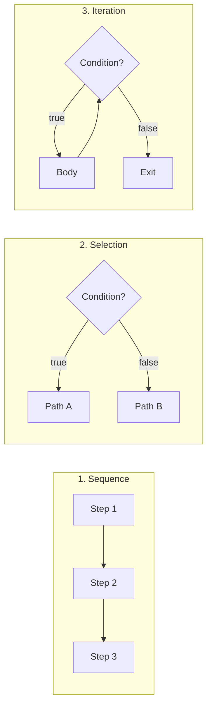

| Type | Purpose | C++ Statements |
|------|---------|----------------|
| **Sequence** | Run statements in order | (default behaviour) |
| **Selection** (Decision) | Choose a path based on a condition | `if`, `if-else`, `else if`, `switch`, `?:` |
| **Iteration** (Loops) | Repeat a block | `while`, `do-while`, `for`, range-based `for` |
| **Jump** | Transfer control elsewhere | `break`, `continue`, `return`, `goto` |

📌 **Any** program — from a calculator to a video game — can be built from just **sequence, selection, and iteration**. (This is a famous result in computer science: the *structured program theorem*.)

---

## 2. Sequence: The Default Flow

Statements run **one after another** in the order written.

```cpp
#include <iostream>
using namespace std;

int main() {
    double length, width;               // 1
    cout << "Enter length and width: "; // 2
    cin >> length >> width;             // 3
    double area = length * width;       // 4
    cout << "Area = " << area << endl;  // 5
    return 0;                           // 6
}
```

Every program you've written so far used only sequence. Now let's make programs that **think** and **repeat**. 🧠

---

# Part B — Selection (Decision Making)

## 3. The `if` Statement

Runs a block **only if** a condition is `true`.

### Syntax
```cpp
if (condition) {
    // runs only when condition is true
}
```

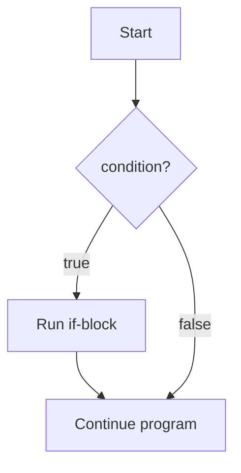

### Example

```cpp
#include <iostream>
using namespace std;

int main() {
    int age;
    cout << "Enter your age: ";
    cin >> age;

    if (age >= 18) {
        cout << "You are eligible to vote." << endl;
    }

    cout << "Thank you!" << endl;
    return 0;
}
```

**Sample runs:**
```
Enter your age: 20
You are eligible to vote.
Thank you!
```
```
Enter your age: 15
Thank you!
```

### The Condition
The condition is any expression that can be converted to `bool` (Lessons 9 and 10):

```cpp
if (marks >= 40)           // relational
if (age >= 18 && hasID)    // logical
if (count)                 // non-zero → true
if (!isEmpty)              // NOT
```

### Braces `{ }` — Always Use Them

Without braces, **only the next single statement** belongs to the `if`:

```cpp
if (marks < 40)
    cout << "Failed. ";
    cout << "Please retake the exam.";   // ⚠️ ALWAYS runs — not part of the if!
```

```cpp
if (marks < 40) {
    cout << "Failed. ";
    cout << "Please retake the exam.";   // ✅ both inside
}
```

✅ **Rule:** always use braces, even for one statement. It prevents bugs when you add lines later.

### ⚠️ The Semicolon Trap

```cpp
if (marks < 40);                 // ❌ the ; ends the if — empty statement!
{
    cout << "Failed";            // ALWAYS runs
}
```

---

## 4. The `if-else` Statement

Chooses between **two** paths.

### Syntax
```cpp
if (condition) {
    // runs when true
} else {
    // runs when false
}
```

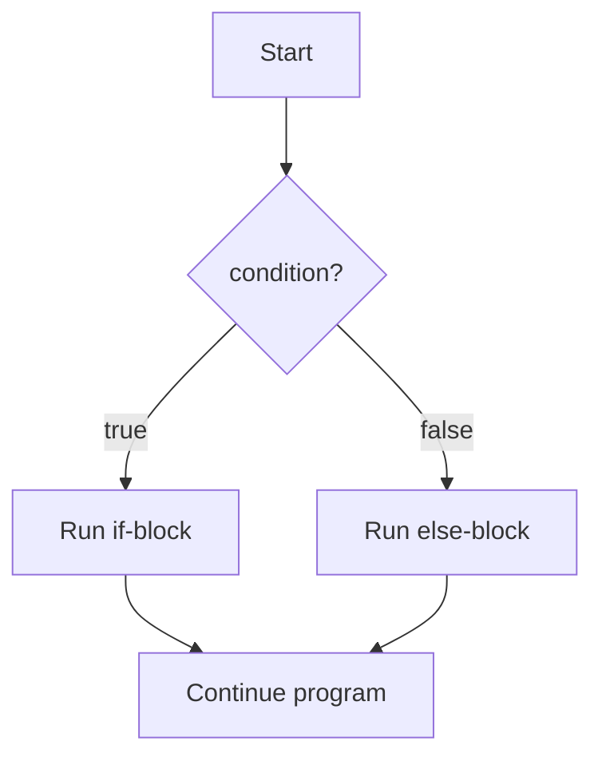

### Example: Even or Odd

```cpp
#include <iostream>
using namespace std;

int main() {
    int n;
    cout << "Enter a number: ";
    cin >> n;

    if (n % 2 == 0) {
        cout << n << " is even." << endl;
    } else {
        cout << n << " is odd." << endl;
    }
    return 0;
}
```

📌 Exactly **one** of the two blocks always runs — never both, never neither.

### Example: Safe Division

```cpp
double a, b;
cin >> a >> b;

if (b != 0) {
    cout << "Result: " << a / b << endl;
} else {
    cout << "Error: cannot divide by zero!" << endl;
}
```

---

## 5. The `else if` Ladder

Chooses between **many** paths. Conditions are checked **top to bottom**; the **first true** one runs, and the rest are **skipped**.

### Syntax
```cpp
if (condition1) {
    // block 1
} else if (condition2) {
    // block 2
} else if (condition3) {
    // block 3
} else {
    // runs if none were true (optional)
}
```

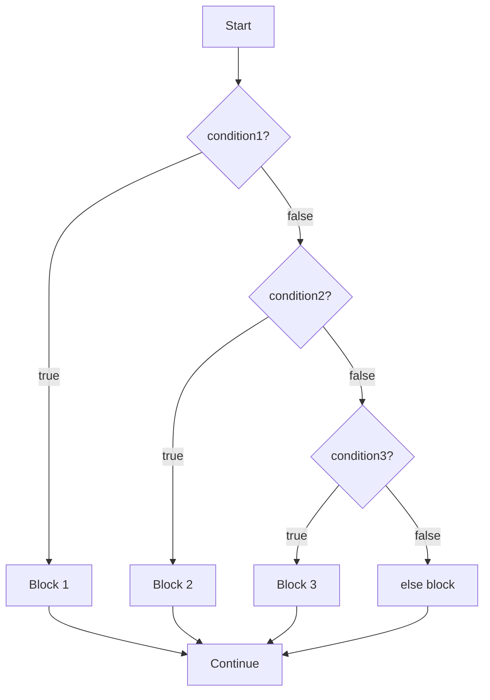

### Example: Grade Calculator

```cpp
#include <iostream>
using namespace std;

int main() {
    int marks;
    cout << "Enter marks (0-100): ";
    cin >> marks;

    if (marks < 0 || marks > 100) {
        cout << "Invalid marks!" << endl;
    } else if (marks >= 90) {
        cout << "Grade: A+" << endl;
    } else if (marks >= 75) {
        cout << "Grade: A" << endl;
    } else if (marks >= 60) {
        cout << "Grade: B" << endl;
    } else if (marks >= 40) {
        cout << "Grade: C" << endl;
    } else {
        cout << "Grade: F" << endl;
    }
    return 0;
}
```

**Sample run:**
```
Enter marks (0-100): 82
Grade: A
```

### ⚠️ Order Matters!

Because the **first** true condition wins, put the **most specific** (or highest) conditions first:

```cpp
// ❌ Wrong order — 95 prints "Grade: C"!
if (marks >= 40)      cout << "C";
else if (marks >= 60) cout << "B";    // never reached for 95
else if (marks >= 90) cout << "A+";   // never reached
```

### Independent `if`s vs `else if`

```cpp
int marks = 95;

// Independent ifs — ALL true conditions run
if (marks >= 90) cout << "A+ ";
if (marks >= 75) cout << "A ";
if (marks >= 60) cout << "B ";
// Output: A+ A B   ❌

// else-if ladder — only the FIRST true condition runs
if (marks >= 90)      cout << "A+ ";
else if (marks >= 75) cout << "A ";
else if (marks >= 60) cout << "B ";
// Output: A+   ✅
```

---

## 6. Nested `if`

An `if` **inside** another `if` — for decisions that depend on earlier decisions.

```cpp
#include <iostream>
using namespace std;

int main() {
    int age;
    bool hasLicense;

    cout << "Enter age: ";
    cin >> age;
    cout << "Have a license? (1 = yes, 0 = no): ";
    cin >> hasLicense;

    if (age >= 18) {
        if (hasLicense) {
            cout << "You can drive." << endl;
        } else {
            cout << "Get a license first." << endl;
        }
    } else {
        cout << "Too young to drive." << endl;
    }
    return 0;
}
```

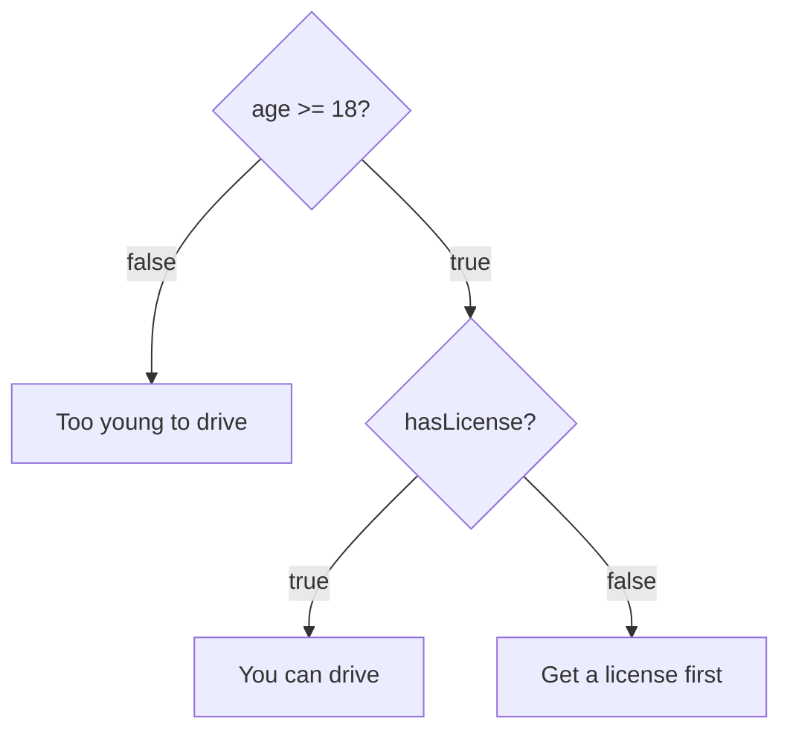

### Flatten When You Can
Nested `if`s get hard to read. Often `&&` is cleaner:

```cpp
// Nested
if (age >= 18) {
    if (hasLicense) {
        cout << "You can drive.";
    }
}

// Flattened ✅
if (age >= 18 && hasLicense) {
    cout << "You can drive.";
}
```

### ⚠️ The Dangling `else` Problem

Without braces, an `else` belongs to the **nearest** `if`:

```cpp
int x = 5, y = -1;
if (x > 0)
    if (y > 0)
        cout << "Both positive";
else                              // ⚠️ belongs to "if (y > 0)", NOT "if (x > 0)"!
    cout << "x is not positive";  // prints — even though x IS positive!
```

The indentation **lies**. Braces fix it:

```cpp
if (x > 0) {
    if (y > 0) {
        cout << "Both positive";
    }
} else {
    cout << "x is not positive";
}
```

---

## 7. `if` with Initializer (C++17)

You can declare a variable **inside** the `if`, limited to that `if-else` (Lesson 2 — scope):

```cpp
#include <iostream>
using namespace std;

int main() {
    int number;
    cin >> number;

    if (int remainder = number % 3; remainder == 0) {
        cout << "Divisible by 3" << endl;
    } else {
        cout << "Remainder is " << remainder << endl;   // still visible in else
    }
    // remainder is NOT visible here ✅ keeps scope small
    return 0;
}
```

Compile with `g++ -std=c++17`.

---

## 8. The `switch` Statement

Chooses a path by **matching a value** against a list of **constant cases**. It's a cleaner alternative to a long `else if` ladder that checks **one variable for equality**.

### Syntax
```cpp
switch (expression) {
    case constant1:
        // statements
        break;
    case constant2:
        // statements
        break;
    default:
        // runs if no case matches (optional)
}
```

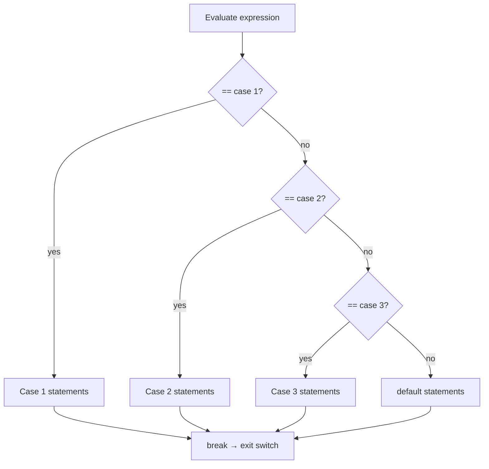

### Example: Day of the Week

```cpp
#include <iostream>
using namespace std;

int main() {
    int day;
    cout << "Enter day number (1-7): ";
    cin >> day;

    switch (day) {
        case 1:
            cout << "Monday" << endl;
            break;
        case 2:
            cout << "Tuesday" << endl;
            break;
        case 3:
            cout << "Wednesday" << endl;
            break;
        case 4:
            cout << "Thursday" << endl;
            break;
        case 5:
            cout << "Friday" << endl;
            break;
        case 6:
            cout << "Saturday" << endl;
            break;
        case 7:
            cout << "Sunday" << endl;
            break;
        default:
            cout << "Invalid day!" << endl;
    }
    return 0;
}
```

### ⚠️ Forgetting `break` → Fall-Through

Without `break`, execution **falls through** into the next case:

```cpp
int choice = 2;
switch (choice) {
    case 1: cout << "One ";
    case 2: cout << "Two ";       // matches here...
    case 3: cout << "Three ";     // ...and keeps going!
    default: cout << "Default";
}
// Output: Two Three Default   😱
```

### ✅ Intentional Fall-Through: Grouping Cases

Sometimes fall-through is **useful** — several values share the same action:

```cpp
#include <iostream>
using namespace std;

int main() {
    char ch;
    cout << "Enter a letter: ";
    cin >> ch;

    switch (ch) {
        case 'a': case 'e': case 'i': case 'o': case 'u':
        case 'A': case 'E': case 'I': case 'O': case 'U':
            cout << ch << " is a vowel." << endl;
            break;
        default:
            cout << ch << " is a consonant (or not a letter)." << endl;
    }
    return 0;
}
```

When fall-through happens **after** statements and is deliberate, mark it with `[[fallthrough]];` (C++17) so the compiler (and readers) know it's not a mistake:

```cpp
switch (level) {
    case 3:
        cout << "Gold bonus. ";
        [[fallthrough]];
    case 2:
        cout << "Silver bonus. ";
        [[fallthrough]];
    case 1:
        cout << "Basic bonus.";
        break;
}
// level 3 → Gold bonus. Silver bonus. Basic bonus.
```

### `switch` with Enums (Lesson 7)

```cpp
enum class TrafficLight { Red, Yellow, Green };

TrafficLight light = TrafficLight::Yellow;
switch (light) {
    case TrafficLight::Red:    cout << "Stop";       break;
    case TrafficLight::Yellow: cout << "Get ready";  break;
    case TrafficLight::Green:  cout << "Go";         break;
}
```
With `-Wall`, the compiler warns if you forget an enum value.

### 📌 Rules of `switch`

| Rule | ✅ Allowed | ❌ Not Allowed |
|------|-----------|---------------|
| Expression type | `int`, `char`, `bool`, `enum`, `long`, etc. | `double`, `float`, `string` |
| Case labels | Constants: `case 5:`, `case 'A':`, `case MAX:` (constexpr) | Variables: `case x:` |
| Duplicates | Each case value unique | Two `case 1:` labels |
| Ranges | — | `case 1-10:` or `case > 50:` |
| `default` | Optional, can be anywhere (usually last) | More than one `default` |

```cpp
string cmd = "start";
switch (cmd) { ... }       // ❌ error: switch quantity not an integer

double d = 2.5;
switch (d) { ... }         // ❌ error

switch (marks) {
    case marks > 90: ...   // ❌ error: case needs a constant value, not a condition
}
```
➡️ For ranges, strings, or decimals, use an **`else if` ladder**.

### ⚠️ Declaring Variables Inside a Case

```cpp
switch (choice) {
    case 1:
        int total = 10;        // ❌ error: jump to case label crosses initialization
        cout << total;
        break;
    case 2:
        cout << "Two";
        break;
}
```

✅ Fix: wrap the case in **braces** to give it its own scope:
```cpp
switch (choice) {
    case 1: {
        int total = 10;
        cout << total;
        break;
    }
    case 2:
        cout << "Two";
        break;
}
```

---

## 9. `if-else` vs `switch` vs Ternary

| Feature | `if-else` | `switch` | Ternary `?:` |
|---------|-----------|----------|--------------|
| Condition type | **Any** boolean expression | Equality with **constants** | Any boolean expression |
| Ranges (`marks >= 90`) | ✅ | ❌ | ✅ |
| Strings / decimals | ✅ | ❌ | ✅ |
| Many fixed values (menus, enums) | Works, but long | ✅ Cleanest | ❌ |
| Produces a value | ❌ | ❌ | ✅ |
| Best for | General decisions | Menus, enums, chars, codes | Short value choices |

```cpp
// ✅ if-else: ranges
if (temp > 35) cout << "Hot";
else if (temp > 20) cout << "Pleasant";
else cout << "Cold";

// ✅ switch: fixed values
switch (option) { case 1: ... case 2: ... }

// ✅ ternary: pick a value (Lesson 9)
string status = (marks >= 40) ? "Pass" : "Fail";
```

---

# Part C — Iteration (Loops)

## 10. Why Loops?

Suppose you want to print "Hello" 5 times:

```cpp
cout << "Hello\n";
cout << "Hello\n";
cout << "Hello\n";
cout << "Hello\n";
cout << "Hello\n";
```

Now 1,000 times? 😩 A **loop** repeats code automatically:

```cpp
for (int i = 1; i <= 1000; i++) {
    cout << "Hello\n";
}
```

### Loop Vocabulary

| Term | Meaning |
|------|---------|
| **Iteration** | One complete run of the loop body |
| **Loop variable / counter** | A variable that changes each iteration (often `i`) |
| **Condition** | Checked to decide whether to continue |
| **Body** | The statements that repeat |
| **Update** | Changes the loop variable (e.g. `i++`) |
| **Entry-controlled** | Condition checked **before** the body (`while`, `for`) |
| **Exit-controlled** | Condition checked **after** the body (`do-while`) |

Every loop needs **three things** to work correctly:
1. **Initialize** the loop variable
2. **Test** a condition
3. **Update** the variable so the condition eventually becomes false

Forget #3 → **infinite loop**!

---

## 11. The `while` Loop

Repeats **while** a condition is `true`. The condition is checked **before** each iteration — so the body may run **zero** times.

### Syntax
```cpp
initialization;
while (condition) {
    // body
    update;
}
```

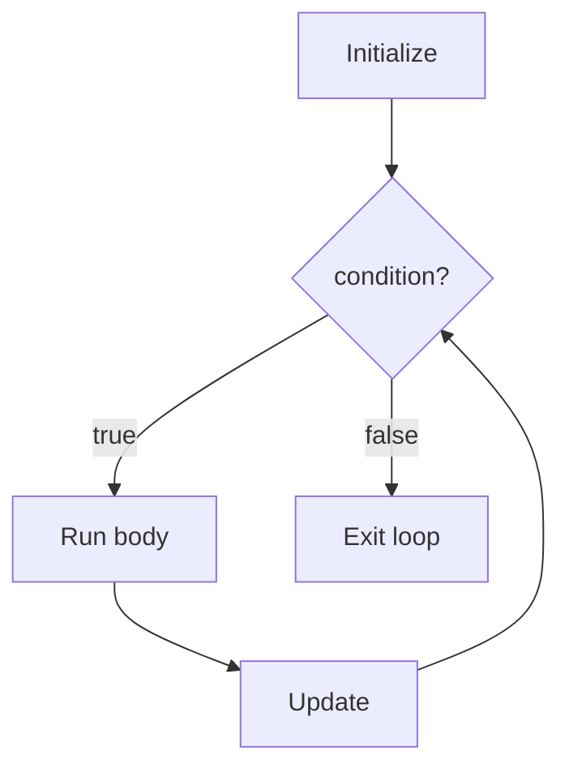

### Example: Count from 1 to 5

```cpp
#include <iostream>
using namespace std;

int main() {
    int i = 1;               // 1. initialize
    while (i <= 5) {         // 2. test
        cout << i << " ";
        i++;                 // 3. update
    }
    cout << endl;
    return 0;
}
```

**Output:**
```
1 2 3 4 5
```

### 🔍 Dry Run (Trace Table)

| Iteration | `i` | `i <= 5`? | Output |
|-----------|-----|-----------|--------|
| 1 | 1 | ✅ true | `1` |
| 2 | 2 | ✅ true | `2` |
| 3 | 3 | ✅ true | `3` |
| 4 | 4 | ✅ true | `4` |
| 5 | 5 | ✅ true | `5` |
| — | 6 | ❌ false | loop ends |

💡 **Teaching tip:** trace tables are the best way to understand loops. Do them on paper!

### When to Use `while`
When you **don't know in advance** how many times to repeat:

```cpp
// Sum digits of a number (unknown number of digits)
#include <iostream>
using namespace std;

int main() {
    int n, sum = 0;
    cout << "Enter a number: ";
    cin >> n;

    while (n > 0) {
        sum += n % 10;   // add last digit
        n /= 10;         // remove last digit
    }
    cout << "Sum of digits: " << sum << endl;
    return 0;
}
```

**Sample:** `4729` → `22`

| `n` | `n % 10` | `sum` | `n / 10` |
|-----|----------|-------|----------|
| 4729 | 9 | 9 | 472 |
| 472 | 2 | 11 | 47 |
| 47 | 7 | 18 | 4 |
| 4 | 4 | 22 | 0 → stop |

---

## 12. The `do-while` Loop

Like `while`, but the condition is checked **after** the body — so the body runs **at least once**.

### Syntax
```cpp
do {
    // body
} while (condition);    // ⚠️ semicolon required!
```

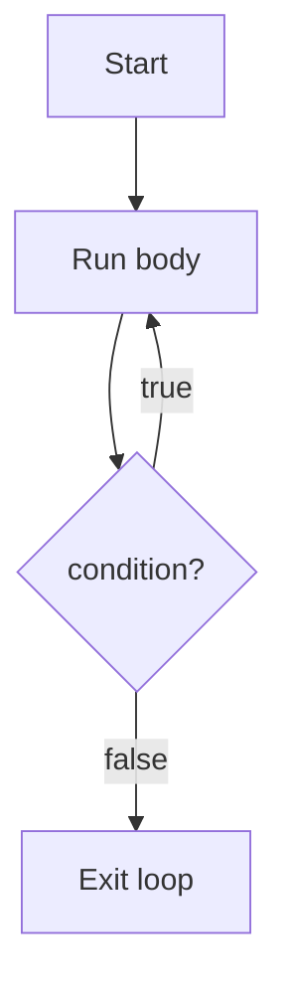

### `while` vs `do-while`

```cpp
int x = 10;

while (x < 5) {
    cout << "while ran";       // never runs
}

do {
    cout << "do-while ran";    // runs ONCE, even though 10 < 5 is false
} while (x < 5);
```

| | `while` | `do-while` |
|--|---------|-----------|
| Condition checked | **Before** body | **After** body |
| Minimum runs | 0 | **1** |
| Type | Entry-controlled | Exit-controlled |
| Semicolon at end | No | **Yes** `while (...);` |

### ⭐ Perfect Use: Input Validation

Ask **at least once**, and **keep asking** until the input is valid:

```cpp
#include <iostream>
using namespace std;

int main() {
    int marks;
    do {
        cout << "Enter marks (0-100): ";
        cin >> marks;
        if (marks < 0 || marks > 100) {
            cout << "Invalid! Try again." << endl;
        }
    } while (marks < 0 || marks > 100);

    cout << "You entered: " << marks << endl;
    return 0;
}
```

**Sample run:**
```
Enter marks (0-100): 150
Invalid! Try again.
Enter marks (0-100): -5
Invalid! Try again.
Enter marks (0-100): 88
You entered: 88
```

---

## 13. The `for` Loop

The most common loop — puts **initialization, condition, and update in one line**. Best when you **know how many times** to repeat.

### Syntax
```cpp
for (initialization; condition; update) {
    // body
}
```

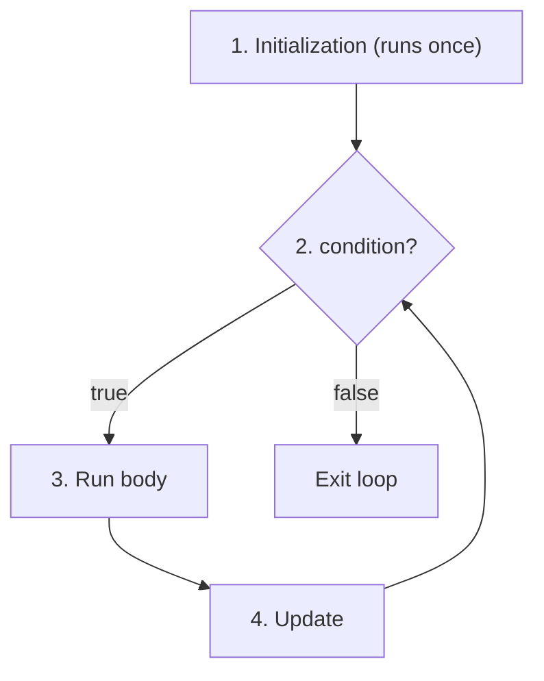

📌 Order: **init → [condition → body → update] → [condition → body → update] → ... → condition false → exit**

### Example: Multiplication Table

```cpp
#include <iostream>
using namespace std;

int main() {
    int n;
    cout << "Enter a number: ";
    cin >> n;

    for (int i = 1; i <= 10; i++) {
        cout << n << " x " << i << " = " << n * i << endl;
    }
    return 0;
}
```

**Output** (for 7):
```
7 x 1 = 7
7 x 2 = 14
...
7 x 10 = 70
```

### `for` and `while` Are Equivalent

```cpp
for (int i = 1; i <= 5; i++) {      │    int i = 1;
    cout << i;                      │    while (i <= 5) {
}                                   │        cout << i;
                                    │        i++;
                                    │    }
```

### Common `for` Variations

```cpp
for (int i = 0; i < 5; i++)          // 0 1 2 3 4         (5 times, from 0)
for (int i = 1; i <= 5; i++)         // 1 2 3 4 5         (5 times, from 1)
for (int i = 10; i >= 1; i--)        // 10 9 8 ... 1      (counting down)
for (int i = 0; i <= 20; i += 5)     // 0 5 10 15 20      (step of 5)
for (int i = 1; i <= 100; i *= 2)    // 1 2 4 8 16 32 64  (doubling)
for (int i = 0, j = 10; i < j; i++, j--)   // two variables (comma operator, Lesson 9)
```

### Loop Variable Scope

```cpp
for (int i = 0; i < 3; i++) {
    cout << i;
}
cout << i;   // ❌ error: 'i' was not declared — it only exists inside the loop
```

✅ This is good — it keeps `i` from leaking into the rest of your code.

### Optional Parts

All three parts are optional (semicolons are not):
```cpp
int i = 0;
for (; i < 5; ) {      // init and update moved outside
    cout << i++;
}

for (;;) { ... }       // no condition → infinite loop
```

### ⚠️ Off-by-One Errors

The **most common loop bug** — running one time too many or too few:

| Want | ❌ Wrong | ✅ Right |
|------|----------|---------|
| 1 to 10 | `i < 10` (stops at 9) | `i <= 10` |
| 5 times from 0 | `i <= 5` (6 times) | `i < 5` |

💡 **Tip:** `for (int i = 0; i < n; i++)` runs **exactly `n`** times — a pattern you'll use constantly with arrays.

### ⚠️ Don't Use Decimals as Loop Counters

```cpp
for (double x = 0.0; x != 1.0; x += 0.1) {   // ❌ may never equal 1.0 exactly → infinite loop!
}
for (int i = 0; i <= 10; i++) {              // ✅ use an int, compute the decimal
    double x = i / 10.0;
}
```
(Floating-point precision — Lessons 2 and 9.)

---

## 14. Range-Based `for` Loop (C++11)

Loops over **every element** of a collection — no counter needed.

### Syntax
```cpp
for (type element : collection) {
    // use element
}
```

### Examples

```cpp
#include <iostream>
#include <string>
using namespace std;

int main() {
    string name = "CPP";
    for (char ch : name) {
        cout << ch << "-";
    }
    cout << endl;                          // C-P-P-

    int marks[] = {85, 92, 78, 66};
    int total = 0;
    for (int m : marks) {
        total += m;
    }
    cout << "Total: " << total << endl;    // 321

    for (int n : {2, 4, 6, 8}) {           // works with a list too
        cout << n * n << " ";
    }
    cout << endl;                          // 4 16 36 64
    return 0;
}
```

💡 Use `auto` to let the compiler pick the type: `for (auto ch : name)`.

📌 To **modify** elements, use a reference `&` (covered in the References lesson):
```cpp
for (char& ch : name) {
    ch = toupper(ch);
}
```

> 📚 Arrays and strings are covered in depth in later lessons.

---

## 15. Nested Loops

A loop **inside** another loop. For **each** iteration of the outer loop, the inner loop runs **completely**.

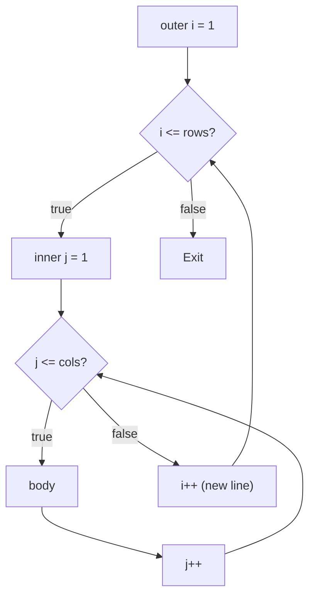

🕐 **Analogy:** A clock — the **minute hand** (inner loop) goes all the way around 60 times for **every single** move of the **hour hand** (outer loop).

### Example: Rectangle of Stars

```cpp
for (int i = 1; i <= 3; i++) {          // rows
    for (int j = 1; j <= 5; j++) {      // columns
        cout << "* ";
    }
    cout << endl;
}
```
```
* * * * *
* * * * *
* * * * *
```
Total iterations = 3 × 5 = **15**.

### ⭐ Pattern Programs (Classic Practice)

**Right triangle:**
```cpp
for (int i = 1; i <= 4; i++) {
    for (int j = 1; j <= i; j++) {      // inner loop depends on i
        cout << "* ";
    }
    cout << endl;
}
```
```
*
* *
* * *
* * * *
```

**Number triangle:**
```cpp
for (int i = 1; i <= 4; i++) {
    for (int j = 1; j <= i; j++) {
        cout << j << " ";
    }
    cout << endl;
}
```
```
1
1 2
1 2 3
1 2 3 4
```

**Pyramid:**
```cpp
int rows = 4;
for (int i = 1; i <= rows; i++) {
    for (int s = 1; s <= rows - i; s++) cout << " ";       // spaces
    for (int j = 1; j <= 2 * i - 1; j++) cout << "*";      // stars
    cout << endl;
}
```
```
   *
  ***
 *****
*******
```

💡 **Pattern-solving method:**
1. Outer loop = **rows**
2. For each row, figure out **what** to print and **how many** (in terms of `i`)
3. Inner loop(s) print that

---

## 16. Infinite Loops

A loop whose condition **never becomes false**.

### Accidental (Bugs ❌)

```cpp
int i = 1;
while (i <= 5) {
    cout << i;
    // forgot i++  → prints 1 forever
}

for (int i = 1; i <= 10; i--) { }        // i goes down, never reaches > 10

for (unsigned int i = 5; i >= 0; i--) { }   // unsigned is NEVER < 0 (Lesson 10) — wraps to 4294967295!

int x = 1;
while (x = 1) { }                         // assignment, not comparison — always true
```

🛑 To stop a running program in the terminal: press **Ctrl + C**.

### Intentional (Useful ✅)

Programs that run until the user quits — games, menus, servers:

```cpp
while (true) {
    // ...
    if (userWantsToQuit) {
        break;      // the only exit
    }
}

for (;;) { ... }    // same thing
```

---

## 17. Choosing the Right Loop

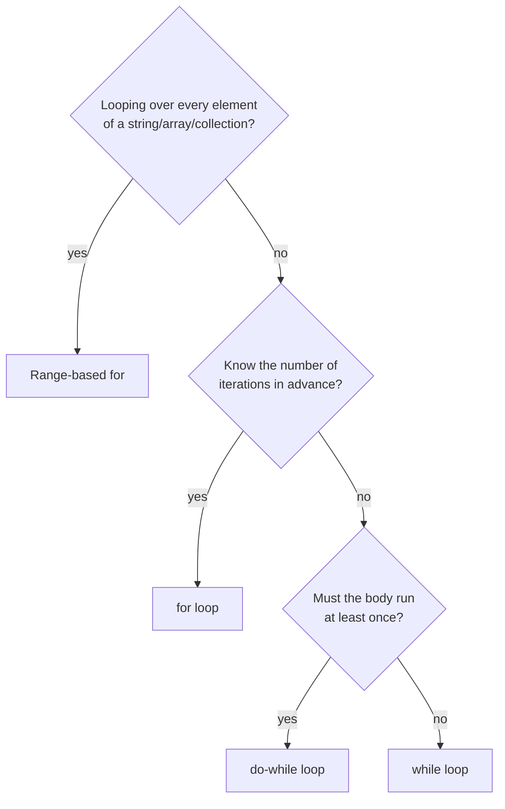

| Loop | Best For | Example |
|------|----------|---------|
| `for` | Known count, counters | Print a table, repeat n times |
| `while` | Unknown count, check first | Process digits, read until sentinel |
| `do-while` | Must run at least once | Input validation, menus |
| Range-based `for` | Every element of a collection | Sum array, process each character |

---

# Part D — Jump Statements

## 18. `break`

Immediately **exits** the nearest enclosing loop or `switch`.

```cpp
#include <iostream>
using namespace std;

int main() {
    for (int i = 1; i <= 10; i++) {
        if (i == 6) {
            break;            // leave the loop completely
        }
        cout << i << " ";
    }
    cout << "\nLoop ended." << endl;
    return 0;
}
```

**Output:**
```
1 2 3 4 5
Loop ended.
```

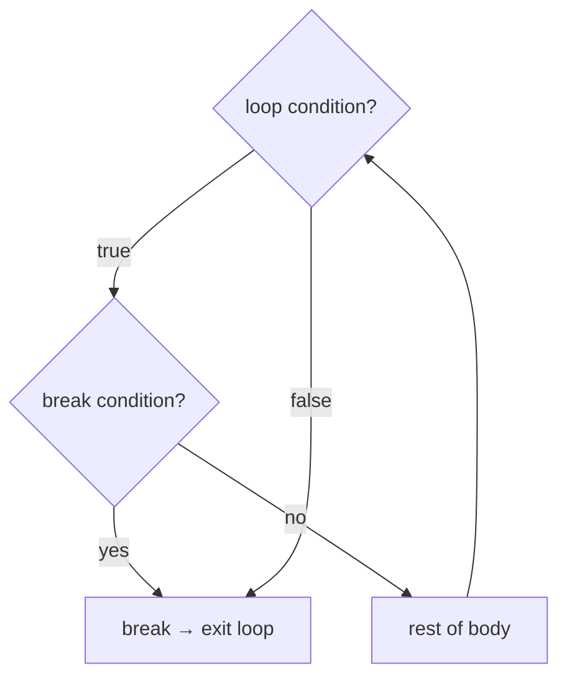

### Example: Find the First Multiple

```cpp
int n = 7;
for (int i = 50; i <= 100; i++) {
    if (i % n == 0) {
        cout << "First multiple of " << n << " after 50: " << i << endl;   // 56
        break;   // no need to check the rest
    }
}
```

### ⚠️ `break` Exits Only ONE Level

```cpp
for (int i = 1; i <= 3; i++) {
    for (int j = 1; j <= 3; j++) {
        if (j == 2) break;          // exits ONLY the inner loop
        cout << i << j << " ";
    }
}
// Output: 11 21 31
```

To exit **both** loops, use a flag:
```cpp
bool found = false;
for (int i = 1; i <= 3 && !found; i++) {
    for (int j = 1; j <= 3; j++) {
        if (i * j == 4) {
            found = true;
            break;
        }
    }
}
```
(Or put the loops in a function and use `return` — Functions lesson.)

---

## 19. `continue`

**Skips the rest of the current iteration** and jumps to the next one.

```cpp
#include <iostream>
using namespace std;

int main() {
    for (int i = 1; i <= 10; i++) {
        if (i % 3 == 0) {
            continue;         // skip multiples of 3
        }
        cout << i << " ";
    }
    cout << endl;
    return 0;
}
```

**Output:**
```
1 2 4 5 7 8 10
```

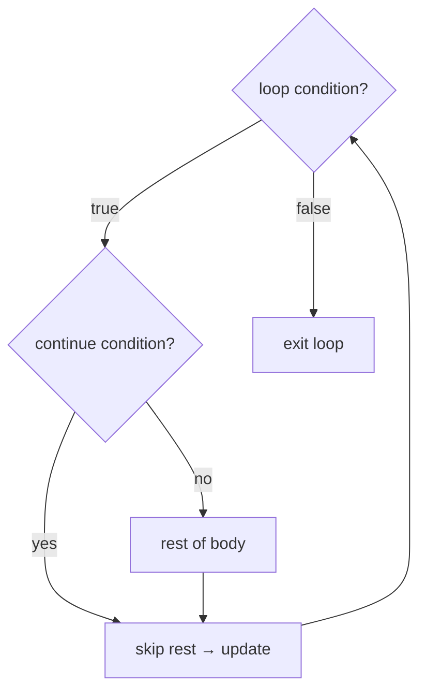

### `break` vs `continue`

| | `break` | `continue` |
|--|---------|-----------|
| Effect | **Exits** the loop entirely | **Skips** to the next iteration |
| Works in | Loops **and** `switch` | Loops only |
| Analogy | Leaving the cinema 🚪 | Skipping one song on a playlist ⏭️ |

### ⚠️ `continue` in a `while` Loop

```cpp
int i = 0;
while (i < 5) {
    if (i == 2) continue;   // ❌ infinite loop — i++ below is skipped forever!
    cout << i;
    i++;
}
```
✅ Update **before** `continue`, or use a `for` loop (whose update always runs).

---

## 20. `return`

Exits the **entire function** immediately. In `main()`, it ends the **whole program** (Lesson 3).

```cpp
#include <iostream>
using namespace std;

int main() {
    int age;
    cout << "Enter age: ";
    cin >> age;

    if (age < 0) {
        cout << "Invalid age!" << endl;
        return 1;            // stop the program with an error code
    }

    cout << "Age accepted: " << age << endl;
    return 0;
}
```

📌 `return` is more powerful than `break` — it leaves **all** loops and the function at once. More in the Functions lesson.

---

## 21. `goto` (and Why to Avoid It)

`goto` jumps to a **labelled** statement anywhere in the same function.

```cpp
#include <iostream>
using namespace std;

int main() {
    int n = 1;

start:                       // a label
    cout << n << " ";
    n++;
    if (n <= 5) {
        goto start;          // jump back to the label
    }
    cout << endl;
    return 0;
}
```

**Output:**
```
1 2 3 4 5
```

### ⛔ Why Avoid `goto`?

- Makes code **jump around unpredictably** — hard to read and debug
- Leads to **"spaghetti code"** 🍝 — tangled flow that nobody can follow
- Everything `goto` does can be done more clearly with **loops, `break`, `continue`, `return`, and functions**

📌 You should **recognize** `goto` in old code, but **don't use it** in your programs.

---

# Part E — Putting It Together

## 22. Common Loop Patterns

### 1️⃣ Counter
```cpp
int count = 0;
for (int i = 1; i <= 100; i++) {
    if (i % 7 == 0) count++;
}
cout << "Multiples of 7: " << count;   // 14
```

### 2️⃣ Accumulator (Sum / Product)
```cpp
int sum = 0;
for (int i = 1; i <= 10; i++) sum += i;           // 55

long long factorial = 1;
for (int i = 1; i <= 10; i++) factorial *= i;     // 3628800
```

### 3️⃣ Sentinel-Controlled Loop
Keep reading until a special **stop value** is entered:
```cpp
int num, total = 0;
cout << "Enter numbers (0 to stop): ";
while (cin >> num && num != 0) {
    total += num;
}
cout << "Total: " << total;
```

### 4️⃣ Finding Max / Min
```cpp
int n, value, maxValue;
cout << "How many numbers? ";
cin >> n;
cin >> maxValue;                       // first value is the starting max
for (int i = 2; i <= n; i++) {
    cin >> value;
    if (value > maxValue) maxValue = value;
}
cout << "Max: " << maxValue;
```

### 5️⃣ Flag (Search)
```cpp
int n;
cin >> n;
bool isPrime = (n >= 2);
for (int i = 2; i * i <= n; i++) {
    if (n % i == 0) {
        isPrime = false;
        break;
    }
}
cout << n << (isPrime ? " is prime" : " is not prime");
```
💡 Checking up to `i * i <= n` (square root) is enough — any factor larger than √n pairs with one smaller than √n.

### 6️⃣ Digit Processing
```cpp
int n = 1234, reversed = 0;
while (n > 0) {
    reversed = reversed * 10 + n % 10;
    n /= 10;
}
cout << reversed;   // 4321
```

### 7️⃣ Fibonacci Sequence
```cpp
int a = 0, b = 1;
for (int i = 1; i <= 10; i++) {
    cout << a << " ";
    int next = a + b;
    a = b;
    b = next;
}
// 0 1 1 2 3 5 8 13 21 34
```

---

## 23. Menu-Driven Program

Combines **`do-while`** (repeat until exit) + **`switch`** (handle choices) — a classic exam program!

```cpp
#include <iostream>
using namespace std;

int main() {
    int choice;
    double a, b;

    do {
        cout << "\n===== CALCULATOR =====" << endl;
        cout << "1. Add" << endl;
        cout << "2. Subtract" << endl;
        cout << "3. Multiply" << endl;
        cout << "4. Divide" << endl;
        cout << "0. Exit" << endl;
        cout << "Enter choice: ";
        cin >> choice;

        if (choice >= 1 && choice <= 4) {
            cout << "Enter two numbers: ";
            cin >> a >> b;
        }

        switch (choice) {
            case 1:
                cout << "Result: " << a + b << endl;
                break;
            case 2:
                cout << "Result: " << a - b << endl;
                break;
            case 3:
                cout << "Result: " << a * b << endl;
                break;
            case 4:
                if (b != 0) {
                    cout << "Result: " << a / b << endl;
                } else {
                    cout << "Error: division by zero!" << endl;
                }
                break;
            case 0:
                cout << "Goodbye!" << endl;
                break;
            default:
                cout << "Invalid choice. Try again." << endl;
        }
    } while (choice != 0);

    return 0;
}
```

**Sample run:**
```
===== CALCULATOR =====
1. Add
2. Subtract
3. Multiply
4. Divide
0. Exit
Enter choice: 3
Enter two numbers: 6 7
Result: 42

===== CALCULATOR =====
...
Enter choice: 0
Goodbye!
```

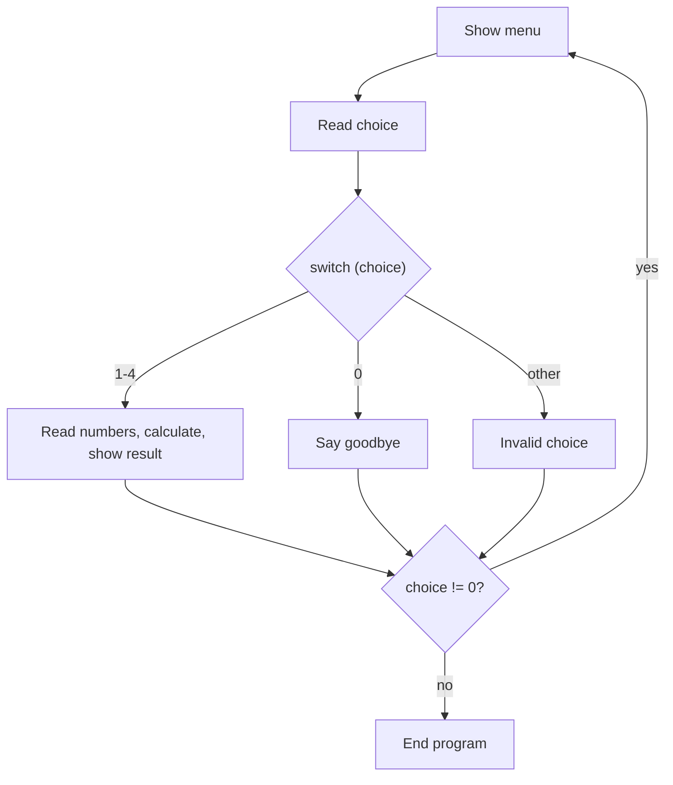

---

## 24. Common Beginner Mistakes

| ❌ Mistake | ✅ Correct | Why |
|-----------|-----------|-----|
| `if (x = 5)` | `if (x == 5)` | Assignment is always true (for non-zero) |
| `if (x > 0);` | `if (x > 0)` | Semicolon ends the `if` |
| No braces with multiple statements | Always use `{ }` | Only the first statement is controlled |
| `if (0 < x < 10)` | `if (x > 0 && x < 10)` | Chained comparison is always true |
| Wrong order in `else if` ladder | Most specific / highest first | First true condition wins |
| Missing `break` in `switch` | Add `break;` to each case | Unwanted fall-through |
| `switch` on `string` or `double` | Use `if-else` | Only integral and enum types |
| `case x > 50:` | Use `if-else` | Case labels must be constants |
| Declaring variables in a case without braces | `case 1: { int x = 0; ... }` | Jump crosses initialization |
| `while (i <= 5) { ... }` without `i++` | Update the loop variable | Infinite loop |
| `do { ... } while (x < 5)` (no `;`) | `while (x < 5);` | Semicolon required |
| `for (int i = 0; i <= n; i++)` for n times | `i < n` | Off-by-one |
| `for (int i = 0; i < 10; i++);` | Remove `;` | Empty loop body |
| Using `i` after a `for` loop | Declare outside if needed | Loop variable scope |
| `for (unsigned i = n; i >= 0; i--)` | Use `int` | Unsigned never goes below 0 |
| `continue` before update in `while` | Update first, or use `for` | Infinite loop |
| Expecting `break` to exit all nested loops | Use a flag or `return` | `break` exits one level |
| Using `goto` | Loops, `break`, functions | Spaghetti code |

---

## 25. Practice Exercises

### 🟢 Easy — Selection

**Exercise 1:** Read a number and print whether it is **positive**, **negative**, or **zero**.

**Exercise 2:** Read three numbers and print the **largest** using `if-else`.

**Exercise 3:** Read a character and print whether it's an **uppercase letter**, **lowercase letter**, **digit**, or **special character** (use ASCII ranges, e.g. `ch >= 'A' && ch <= 'Z'`).

### 🟢 Easy — Loops

**Exercise 4:** Print all **even numbers from 1 to 50** using a `for` loop.

**Exercise 5:** Print numbers from **10 down to 1** using a `while` loop.

**Exercise 6:** Find the **sum of the first n natural numbers** using a loop. Verify with the formula `n * (n + 1) / 2`.

### 🟡 Medium

**Exercise 7:** Read a month number (1–12) and print the **number of days** in that month using `switch` with **grouped cases** (ignore leap years).

**Exercise 8:** Read a number and print its **factorial**. Use `long long`. Reject negative numbers.

**Exercise 9:** Read a number and check whether it's a **palindrome** (reads the same backwards, e.g. 12321).

**Exercise 10:** Print these patterns for `n = 4`:
```
Pattern A      Pattern B      Pattern C
* * * *        4 4 4 4        1
* * *          3 3 3          2 3
* *            2 2            4 5 6
*              1              7 8 9 10
```

**Exercise 11:** Print **all prime numbers between 1 and 100**.

**Exercise 12:** Predict the output:
```cpp
for (int i = 1; i <= 10; i++) {
    if (i == 3) continue;
    if (i == 8) break;
    cout << i << " ";
}
```

### 🔴 Challenge

**Exercise 13:** **Number guessing game.** Store a secret number (e.g. `42`). Let the user keep guessing; print "Too high" or "Too low" after each guess, and "Correct! You took N attempts." when they get it right.

**Exercise 14:** Check whether a number is an **Armstrong number** (a 3-digit number whose digits cubed add up to the number itself, e.g. 153 = 1³ + 5³ + 3³). Then print **all** 3-digit Armstrong numbers.

**Exercise 15:** Build a **menu-driven program** for a simple bank account with options: 1. Deposit, 2. Withdraw (don't allow balance below 0), 3. Check balance, 0. Exit. Start with a balance of ₹1000.

**Exercise 16:** Print **Floyd's triangle** for `n` rows and **Pascal's triangle** for 5 rows:
```
Pascal's triangle
    1
   1 1
  1 2 1
 1 3 3 1
1 4 6 4 1
```

---

### ✅ Solutions

<details>
<summary>Click to view Exercise 1 solution</summary>

```cpp
#include <iostream>
using namespace std;

int main() {
    int n;
    cout << "Enter a number: ";
    cin >> n;

    if (n > 0) {
        cout << "Positive" << endl;
    } else if (n < 0) {
        cout << "Negative" << endl;
    } else {
        cout << "Zero" << endl;
    }
    return 0;
}
```
</details>

<details>
<summary>Click to view Exercise 2 solution</summary>

```cpp
#include <iostream>
using namespace std;

int main() {
    int a, b, c;
    cout << "Enter three numbers: ";
    cin >> a >> b >> c;

    if (a >= b && a >= c) {
        cout << "Largest: " << a << endl;
    } else if (b >= a && b >= c) {
        cout << "Largest: " << b << endl;
    } else {
        cout << "Largest: " << c << endl;
    }
    return 0;
}
```
💡 Shorter alternative: `int largest = max({a, b, c});` with `#include <algorithm>`.
</details>

<details>
<summary>Click to view Exercise 3 solution</summary>

```cpp
#include <iostream>
using namespace std;

int main() {
    char ch;
    cout << "Enter a character: ";
    cin >> ch;

    if (ch >= 'A' && ch <= 'Z') {
        cout << "Uppercase letter" << endl;
    } else if (ch >= 'a' && ch <= 'z') {
        cout << "Lowercase letter" << endl;
    } else if (ch >= '0' && ch <= '9') {
        cout << "Digit" << endl;
    } else {
        cout << "Special character" << endl;
    }
    return 0;
}
```
</details>

<details>
<summary>Click to view Exercise 4 solution</summary>

```cpp
for (int i = 2; i <= 50; i += 2) {
    cout << i << " ";
}
```
Alternative: `for (int i = 1; i <= 50; i++) if (i % 2 == 0) cout << i << " ";`
</details>

<details>
<summary>Click to view Exercise 5 solution</summary>

```cpp
int i = 10;
while (i >= 1) {
    cout << i << " ";
    i--;
}
```
</details>

<details>
<summary>Click to view Exercise 6 solution</summary>

```cpp
#include <iostream>
using namespace std;

int main() {
    int n;
    cout << "Enter n: ";
    cin >> n;

    long long sum = 0;
    for (int i = 1; i <= n; i++) {
        sum += i;
    }

    cout << "Sum using loop   : " << sum << endl;
    cout << "Sum using formula: " << 1LL * n * (n + 1) / 2 << endl;
    return 0;
}
```
</details>

<details>
<summary>Click to view Exercise 7 solution</summary>

```cpp
#include <iostream>
using namespace std;

int main() {
    int month;
    cout << "Enter month (1-12): ";
    cin >> month;

    switch (month) {
        case 1: case 3: case 5: case 7: case 8: case 10: case 12:
            cout << "31 days" << endl;
            break;
        case 4: case 6: case 9: case 11:
            cout << "30 days" << endl;
            break;
        case 2:
            cout << "28 days" << endl;
            break;
        default:
            cout << "Invalid month" << endl;
    }
    return 0;
}
```
</details>

<details>
<summary>Click to view Exercise 8 solution</summary>

```cpp
#include <iostream>
using namespace std;

int main() {
    int n;
    cout << "Enter a number: ";
    cin >> n;

    if (n < 0) {
        cout << "Factorial is not defined for negative numbers." << endl;
        return 1;
    }

    long long factorial = 1;
    for (int i = 2; i <= n; i++) {
        factorial *= i;
    }
    cout << n << "! = " << factorial << endl;
    return 0;
}
```
⚠️ `long long` overflows after `20!`.
</details>

<details>
<summary>Click to view Exercise 9 solution</summary>

```cpp
#include <iostream>
using namespace std;

int main() {
    int n;
    cout << "Enter a number: ";
    cin >> n;

    int original = n, reversed = 0;
    while (n > 0) {
        reversed = reversed * 10 + n % 10;
        n /= 10;
    }

    if (original == reversed) {
        cout << original << " is a palindrome" << endl;
    } else {
        cout << original << " is not a palindrome" << endl;
    }
    return 0;
}
```
</details>

<details>
<summary>Click to view Exercise 10 solution</summary>

```cpp
#include <iostream>
using namespace std;

int main() {
    int n = 4;

    cout << "Pattern A" << endl;
    for (int i = n; i >= 1; i--) {
        for (int j = 1; j <= i; j++) cout << "* ";
        cout << endl;
    }

    cout << "\nPattern B" << endl;
    for (int i = n; i >= 1; i--) {
        for (int j = 1; j <= i; j++) cout << i << " ";
        cout << endl;
    }

    cout << "\nPattern C" << endl;
    int num = 1;
    for (int i = 1; i <= n; i++) {
        for (int j = 1; j <= i; j++) cout << num++ << " ";
        cout << endl;
    }
    return 0;
}
```
💡 Pattern C is called **Floyd's triangle**.
</details>

<details>
<summary>Click to view Exercise 11 solution</summary>

```cpp
#include <iostream>
using namespace std;

int main() {
    for (int n = 2; n <= 100; n++) {
        bool isPrime = true;
        for (int i = 2; i * i <= n; i++) {
            if (n % i == 0) {
                isPrime = false;
                break;
            }
        }
        if (isPrime) cout << n << " ";
    }
    cout << endl;
    return 0;
}
```
**Output:**
```
2 3 5 7 11 13 17 19 23 29 31 37 41 43 47 53 59 61 67 71 73 79 83 89 97
```
</details>

<details>
<summary>Click to view Exercise 12 answer</summary>

**Output:**
```
1 2 4 5 6 7
```
- `i == 3` → skipped by `continue`
- `i == 8` → `break` exits before printing
</details>

<details>
<summary>Click to view Exercise 13 solution</summary>

```cpp
#include <iostream>
using namespace std;

int main() {
    const int SECRET = 42;
    int guess, attempts = 0;

    cout << "Guess the number (1-100)!" << endl;
    do {
        cout << "Your guess: ";
        cin >> guess;
        attempts++;

        if (guess > SECRET) {
            cout << "Too high!" << endl;
        } else if (guess < SECRET) {
            cout << "Too low!" << endl;
        }
    } while (guess != SECRET);

    cout << "Correct! You took " << attempts << " attempts." << endl;
    return 0;
}
```
💡 For a random secret number, see `<random>` in a later lesson.
</details>

<details>
<summary>Click to view Exercise 14 solution</summary>

```cpp
#include <iostream>
using namespace std;

int main() {
    cout << "3-digit Armstrong numbers: ";
    for (int n = 100; n <= 999; n++) {
        int temp = n, sum = 0;
        while (temp > 0) {
            int d = temp % 10;
            sum += d * d * d;
            temp /= 10;
        }
        if (sum == n) {
            cout << n << " ";
        }
    }
    cout << endl;
    return 0;
}
```
**Output:**
```
3-digit Armstrong numbers: 153 370 371 407
```
</details>

<details>
<summary>Click to view Exercise 15 solution</summary>

```cpp
#include <iostream>
using namespace std;

int main() {
    double balance = 1000, amount;
    int choice;

    do {
        cout << "\n--- BANK MENU ---" << endl;
        cout << "1. Deposit\n2. Withdraw\n3. Check balance\n0. Exit" << endl;
        cout << "Choice: ";
        cin >> choice;

        switch (choice) {
            case 1:
                cout << "Amount to deposit: ";
                cin >> amount;
                if (amount > 0) {
                    balance += amount;
                    cout << "Deposited. New balance: Rs. " << balance << endl;
                } else {
                    cout << "Invalid amount." << endl;
                }
                break;
            case 2:
                cout << "Amount to withdraw: ";
                cin >> amount;
                if (amount <= 0) {
                    cout << "Invalid amount." << endl;
                } else if (amount > balance) {
                    cout << "Insufficient balance!" << endl;
                } else {
                    balance -= amount;
                    cout << "Withdrawn. New balance: Rs. " << balance << endl;
                }
                break;
            case 3:
                cout << "Balance: Rs. " << balance << endl;
                break;
            case 0:
                cout << "Thank you for banking with us!" << endl;
                break;
            default:
                cout << "Invalid choice." << endl;
        }
    } while (choice != 0);

    return 0;
}
```
</details>

<details>
<summary>Click to view Exercise 16 solution</summary>

**Floyd's triangle** — see Pattern C in Exercise 10.

**Pascal's triangle:**
```cpp
#include <iostream>
using namespace std;

int main() {
    int rows = 5;
    for (int i = 0; i < rows; i++) {
        for (int s = 0; s < rows - i - 1; s++) {
            cout << " ";
        }
        int value = 1;                          // first value in every row
        for (int j = 0; j <= i; j++) {
            cout << value << " ";
            value = value * (i - j) / (j + 1);  // next value in the row
        }
        cout << endl;
    }
    return 0;
}
```
💡 Each value is a binomial coefficient: the next value = previous × (i − j) / (j + 1).
</details>

---

## 26. Quick Quiz

**Q1.** What are the three basic control structures?
- a) Input, process, output
- b) Sequence, selection, iteration
- c) if, for, while
- d) break, continue, return

**Q2.** In an `else if` ladder, how many blocks can run?
- a) All true ones
- b) At most one
- c) Exactly two
- d) None

**Q3.** What happens if you forget `break` in a `switch` case?
- a) Compile error
- b) Execution falls through to the next case
- c) The program crashes
- d) Nothing

**Q4.** Which type **cannot** be used in a `switch`?
- a) `int`
- b) `char`
- c) `enum`
- d) `string`

**Q5.** Which loop always runs **at least once**?
- a) `for`
- b) `while`
- c) `do-while`
- d) range-based `for`

**Q6.** How many times does `for (int i = 0; i < 5; i++)` run?
- a) 4
- b) 5
- c) 6
- d) Infinite

**Q7.** What does `continue` do?
- a) Exits the loop
- b) Skips to the next iteration
- c) Restarts the program
- d) Exits the function

**Q8.** What is printed?
```cpp
int i = 10;
while (i < 5) { cout << i; i++; }
```
- a) 10
- b) 5
- c) Nothing
- d) Infinite loop

**Q9.** How many times does `*` print?
```cpp
for (int i = 1; i <= 3; i++)
    for (int j = 1; j <= 4; j++)
        cout << "*";
```
- a) 7
- b) 12
- c) 3
- d) 4

**Q10.** What's wrong with `if (x > 5); { cout << "Big"; }`?
- a) Nothing
- b) The `;` makes the `if` empty, so "Big" always prints
- c) Compile error
- d) "Big" never prints

**Q11.** `break` inside a nested loop exits:
- a) All loops
- b) Only the innermost loop containing it
- c) The function
- d) The program

**Q12.** Which statement is best for a menu that repeats until the user chooses Exit?
- a) `for` + `if`
- b) `do-while` + `switch`
- c) `goto`
- d) `while (false)`

<details>
<summary>✅ Click to view answers</summary>

| Q | Answer | Explanation |
|---|--------|-------------|
| 1 | b) | Sequence, selection, iteration |
| 2 | b) | First true condition wins |
| 3 | b) | Fall-through |
| 4 | d) `string` | Only integral and enum types |
| 5 | c) | Condition checked after the body |
| 6 | b) 5 | i = 0, 1, 2, 3, 4 |
| 7 | b) | Skips the rest of the current iteration |
| 8 | c) | Condition false from the start |
| 9 | b) 12 | 3 × 4 |
| 10 | b) | Semicolon trap |
| 11 | b) | One level only |
| 12 | b) | Menu shown at least once, choices via switch |

</details>

---

## 27. Summary

### Selection
- ✅ **`if`** runs a block when a condition is true.
- ✅ **`if-else`** chooses between two paths — exactly one runs.
- ✅ **`else if` ladder** — first true condition wins; order matters.
- ✅ **Nested `if`** for dependent decisions; flatten with `&&` when possible; braces prevent the **dangling else**.
- ✅ **`switch`** matches one value against constant cases — use `break`; `default` handles the rest; only integral/enum types; no ranges or strings.
- ✅ Always use **braces** and avoid the **`if (...);`** trap.

### Iteration
- ✅ **`while`** — checks first, may run 0 times; good for unknown counts.
- ✅ **`do-while`** — runs at least once; good for input validation and menus.
- ✅ **`for`** — init, condition, update in one line; good for known counts.
- ✅ **Range-based `for`** — every element of a collection.
- ✅ **Nested loops** — inner loop completes for each outer iteration; used for patterns and tables.
- ✅ Watch out for **infinite loops** and **off-by-one** errors.

### Jump Statements
- ✅ **`break`** — exits the nearest loop/switch.
- ✅ **`continue`** — skips to the next iteration.
- ✅ **`return`** — exits the function (or program from `main`).
- ✅ **`goto`** — avoid it.

---


---

> 📝 *Tip for students: Before writing any loop, answer three questions on paper: Where does it start? When does it stop? How does it move toward stopping? If you can't answer all three, the loop isn't ready to write yet!*
