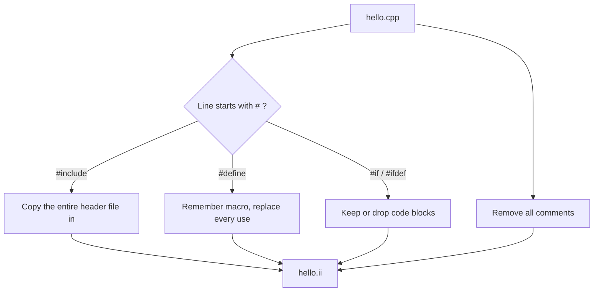
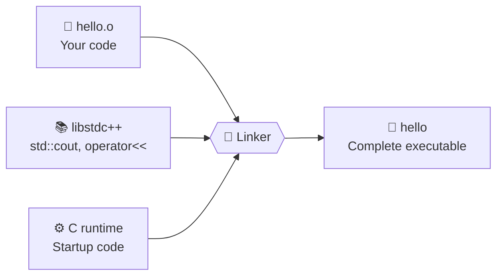
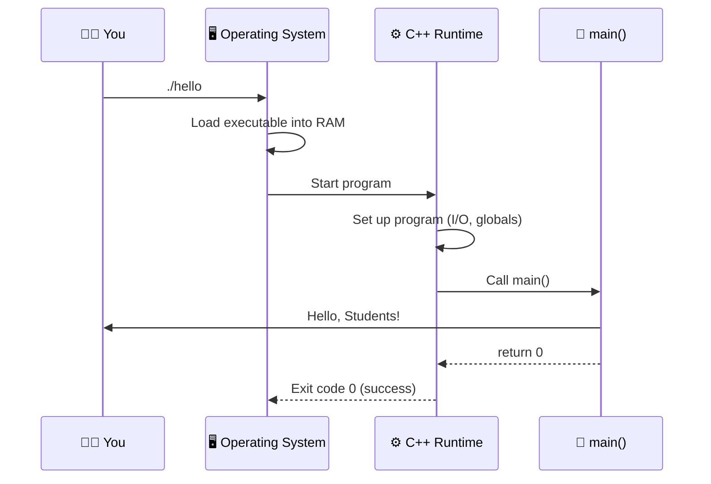
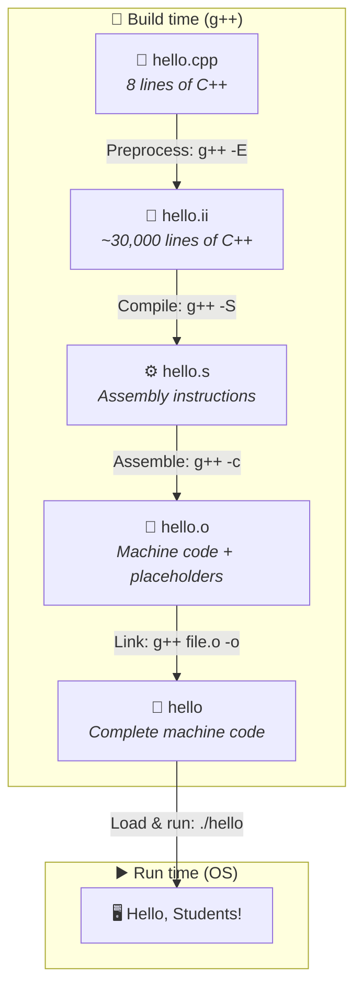
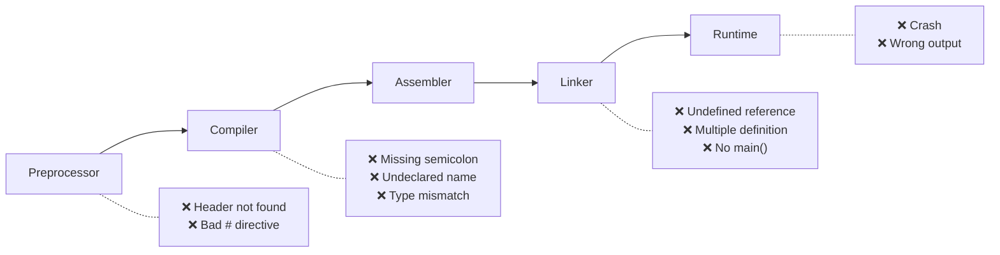
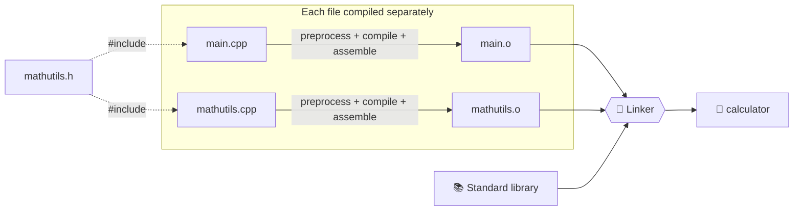
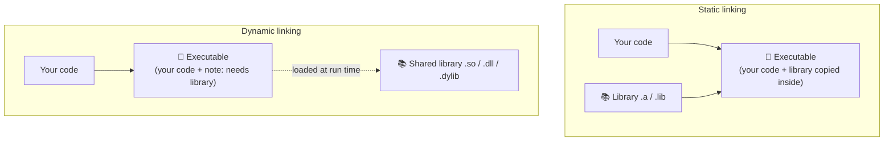

# 📘 How C++ Code is Compiled and Run

> **Goal of this lesson:** Follow a single C++ program through every stage — from the source code you type, through the preprocessor, compiler, assembler, linker, and loader — until it prints output on the screen. Learn what each stage does, what file it produces, and which errors it catches.

> 💡 *The diagrams in this lesson use **Mermaid**, which GitHub renders automatically. View this file on GitHub to see them as pictures.*

---

## 📑 Table of Contents

1. [The Big Picture](#1-the-big-picture)
2. [Our Example Program](#2-our-example-program)
3. [Stage 1: Writing the Source Code](#3-stage-1-writing-the-source-code)
4. [Stage 2: Preprocessing](#4-stage-2-preprocessing)
5. [Stage 3: Compiling](#5-stage-3-compiling)
6. [Stage 4: Assembling](#6-stage-4-assembling)
7. [Stage 5: Linking](#7-stage-5-linking)
8. [Stage 6: Loading and Running](#8-stage-6-loading-and-running)
9. [All Stages Side by Side](#9-all-stages-side-by-side)
10. [See It Yourself: Hands-On Commands](#10-see-it-yourself-hands-on-commands)
11. [Which Stage Caught My Error?](#11-which-stage-caught-my-error)
12. [Compiling Multiple Files](#12-compiling-multiple-files)
13. [Static vs Dynamic Linking](#13-static-vs-dynamic-linking)
14. [Useful g++ Options](#14-useful-g-options)
15. [Common Beginner Mistakes](#15-common-beginner-mistakes)
16. [Practice Exercises](#16-practice-exercises)
17. [Quick Quiz](#17-quick-quiz)
18. [Summary](#18-summary)

---

## 1. The Big Picture

A computer's CPU understands only **machine code** — binary numbers. C++ code is text written for humans. Something has to **translate** it.

When you type:

```bash
g++ hello.cpp -o hello
```

it looks like one step, but `g++` secretly runs **four separate tools** in order. Then the **operating system** loads and runs the result.


### The Six Stages at a Glance

| # | Stage | Tool | Input | Output | Human-readable? |
|---|-------|------|-------|--------|-----------------|
| 1 | Write | Text editor | — | `hello.cpp` | ✅ Yes |
| 2 | Preprocess | Preprocessor (`cpp`) | `hello.cpp` | `hello.ii` | ✅ Yes |
| 3 | Compile | Compiler (`cc1plus`) | `hello.ii` | `hello.s` | ⚠️ Barely (assembly) |
| 4 | Assemble | Assembler (`as`) | `hello.s` | `hello.o` | ❌ No (binary) |
| 5 | Link | Linker (`ld`) | `hello.o` + libraries | `hello` / `hello.exe` | ❌ No (binary) |
| 6 | Load & run | Operating system | `hello` | Program output | — |

🏭 **Analogy: a car factory**

| Factory Step | Compilation Step |
|--------------|------------------|
| Designer draws the blueprint | **You** write source code |
| Assistant collects all referenced parts lists | **Preprocessor** pastes in header files |
| Engineer converts blueprint into assembly instructions | **Compiler** creates assembly code |
| Workers build individual parts | **Assembler** makes object files |
| Assembly line bolts parts together, adds the engine from a supplier | **Linker** joins your code with libraries |
| Driver starts the car | **Loader** runs the program |

---

## 2. Our Example Program

We will follow **this exact program** through every stage:

📄 **`hello.cpp`**

```cpp
// Greeting program
#include <iostream>
#define NAME "Students"

int main() {
    std::cout << "Hello, " << NAME << "!\n";  // print
    return 0;
}
```

Notice three special things — watch what happens to each one:

| Item | Line | What will happen |
|------|------|------------------|
| 💬 Comments | `// Greeting program`, `// print` | Removed by the preprocessor |
| 📥 `#include` | `#include <iostream>` | Replaced by the entire header file |
| 🔁 Macro | `#define NAME "Students"` | Every `NAME` replaced with `"Students"` |

---

## 3. Stage 1: Writing the Source Code

| | |
|--|--|
| **Who** | You, the programmer |
| **Tool** | Text editor or IDE (VS Code, Code::Blocks, etc.) |
| **Output** | `hello.cpp` |
| **Readable?** | ✅ Plain text |

The source file is just **text**. You could open it in Notepad. The CPU cannot run it — it doesn't understand words like `int`, `main`, or `cout`.

📌 C++ source file extensions: `.cpp` (most common), `.cc`, `.cxx`. Header files: `.h`, `.hpp`.

---

## 4. Stage 2: Preprocessing

| | |
|--|--|
| **Tool** | Preprocessor (`cpp`) |
| **Input** | `hello.cpp` |
| **Output** | `hello.ii` (expanded source, still C++ text) |
| **Command** | `g++ -E hello.cpp -o hello.ii` |

The preprocessor handles every line that starts with **`#`**. It does **pure text processing** — it doesn't understand C++ at all.

### What the Preprocessor Does



| Job | Example | Result |
|-----|---------|--------|
| **Remove comments** | `// print` | Deleted |
| **Include headers** | `#include <iostream>` | Thousands of lines pasted in |
| **Expand macros** | `NAME` | Replaced with `"Students"` |
| **Conditional compilation** | `#ifdef DEBUG ... #endif` | Code kept or removed |

### Before → After

**Before** (`hello.cpp`, 8 lines):
```cpp
// Greeting program
#include <iostream>
#define NAME "Students"

int main() {
    std::cout << "Hello, " << NAME << "!\n";  // print
    return 0;
}
```

**After** (`hello.ii`, tens of thousands of lines — simplified):
```cpp
// ... ~30,000+ lines copied from <iostream> and the headers it includes ...
namespace std {
    // ...
    extern ostream cout;
    // ...
}

int main() {
    std::cout << "Hello, " << "Students" << "!\n";
    return 0;
}
```

### 🔍 What Changed?

| Original | After Preprocessing |
|----------|---------------------|
| `// Greeting program` | ❌ Gone |
| `#include <iostream>` | ➕ Replaced by the full `iostream` contents |
| `#define NAME "Students"` | ❌ Gone (it was only an instruction) |
| `<< NAME <<` | `<< "Students" <<` |
| `// print` | ❌ Gone |

😲 **Surprise for students:** an 8-line program becomes **30,000+ lines**! That's why `#include` was called "copy-paste" in Lesson 3.

### Try It
```bash
g++ -E hello.cpp -o hello.ii
wc -l hello.ii          # count lines (Linux/macOS)
```
Scroll to the **very bottom** of `hello.ii` to find your `main()`.

---

## 5. Stage 3: Compiling

| | |
|--|--|
| **Tool** | Compiler proper (`cc1plus` inside g++) |
| **Input** | `hello.ii` |
| **Output** | `hello.s` (assembly language) |
| **Command** | `g++ -S hello.cpp -o hello.s` |

This is the **"real" compilation** and the **most complex stage**. The compiler actually **understands C++**.

### What the Compiler Does


| Phase | What It Does | Example Error It Catches |
|-------|--------------|--------------------------|
| **Lexical analysis** | Breaks text into **tokens** (Lesson 3): `int`, `main`, `(`, `)`, ... | Invalid character like `@` in code |
| **Syntax analysis** | Checks the **grammar** — are tokens in a valid order? | Missing `;`, unmatched `{` |
| **Semantic analysis** | Checks **meaning** — do types match? Are names declared? | `int x = "hello";`, undeclared variable |
| **Optimization** | Makes code faster/smaller | — |
| **Code generation** | Writes **assembly** for your CPU | — |

### Token Example
```cpp
std::cout << "Hello, " << "Students" << "!\n";
```
Tokens: `std` `::` `cout` `<<` `"Hello, "` `<<` `"Students"` `<<` `"!\n"` `;`

### Output: Assembly Code

**`hello.s`** (x86-64, simplified for teaching):
```asm
main:
    push   rbp                 ; set up the function
    mov    rbp, rsp
    lea    rsi, .LC0           ; address of "Hello, "
    lea    rdi, std::cout      ; address of cout
    call   operator<<          ; cout << "Hello, "
    ...                        ; same for "Students" and "!\n"
    mov    eax, 0              ; return value 0
    pop    rbp
    ret                        ; return from main
```

📌 **Assembly** is a low-level language where each line is **one simple CPU instruction**: move data, add, call a function, return. It's still text, but very hard for humans to work with.

💡 Assembly is **CPU-specific**. The same C++ code produces different assembly for Intel/AMD (x86-64) and ARM (phones, Apple M-series Macs). That's why you must **recompile** for each platform — but your **C++ source stays the same** (portability, Lesson 1).

🌐 **Explore online:** paste any C++ code into [Compiler Explorer (godbolt.org)](https://godbolt.org/) to see its assembly live.

---

## 6. Stage 4: Assembling

| | |
|--|--|
| **Tool** | Assembler (`as`) |
| **Input** | `hello.s` |
| **Output** | `hello.o` (object file — `.obj` on Windows/MSVC) |
| **Command** | `g++ -c hello.cpp -o hello.o` |

The assembler converts each assembly instruction into **binary machine code** — the actual numbers the CPU executes.

### Assembly → Machine Code

| Machine Code (hex bytes) | Assembly |
|--------------------------|----------|
| `55` | `push rbp` |
| `48 89 e5` | `mov rbp, rsp` |
| `48 8d 35 00 00 00 00` | `lea rsi, .LC0` |
| `48 8d 3d 00 00 00 00` | `lea rdi, std::cout` ❓ |
| `e8 00 00 00 00` | `call operator<<` ❓ |
| `b8 00 00 00 00` | `mov eax, 0` |
| `5d` | `pop rbp` |
| `c3` | `ret` |

### ❓ Why All Those `00 00 00 00`?

Your file **uses** `std::cout` and `operator<<`, but their actual code is **not in your file** — it lives in the C++ standard library. The assembler doesn't know where they are, so it leaves **placeholders** and writes a note:

```
Unresolved symbols in hello.o:
  - std::cout
  - operator<<
```

📌 An object file is **incomplete**. It **cannot run on its own**. It's a puzzle piece waiting to be connected.

### Try It
```bash
g++ -c hello.cpp -o hello.o
nm -C hello.o               # list symbols (Linux/macOS)
```
Symbols marked **`U`** mean **Undefined** — they must be found by the linker.

---

## 7. Stage 5: Linking

| | |
|--|--|
| **Tool** | Linker (`ld`) |
| **Input** | `hello.o` + standard library + startup code |
| **Output** | `hello` (Linux/macOS) or `hello.exe` (Windows) |
| **Command** | `g++ hello.o -o hello` |

The linker **joins all the pieces** into one complete, runnable program and **fills in the placeholders** with real addresses.



### What the Linker Does

| Job | Explanation |
|-----|-------------|
| **Combine object files** | Your `.o` files (one per `.cpp`) |
| **Add library code** | Code for `std::cout`, `std::string`, `sqrt()`, etc. |
| **Add startup code** | The C runtime sets things up, then **calls `main()`** |
| **Resolve symbols** | Replace every placeholder with a real address |
| **Check for problems** | Missing definitions, duplicate definitions, missing `main` |

### Before → After Linking

```
BEFORE (hello.o):
  48 8d 3d 00 00 00 00    lea  rdi, std::cout     ❓ unknown
  e8 00 00 00 00          call operator<<         ❓ unknown

AFTER (hello):
  48 8d 3d a0 2f 00 00    lea  rdi, std::cout     ✅ resolved
  e8 4b 1c 00 00          call operator<<         ✅ resolved
```

*(Exact bytes vary by system — the point is the placeholders get filled.)*

### 🔌 Analogy
The object file is a **phone contact list with names but no numbers**. The linker looks up every name in the "phone book" (libraries) and **fills in the numbers**. If a name isn't in any phone book → **linker error**.

---

## 8. Stage 6: Loading and Running

| | |
|--|--|
| **Tool** | Operating system's **loader** |
| **Input** | `hello` executable |
| **Output** | Your program running → output on screen |
| **Command** | `./hello` (Linux/macOS) or `hello.exe` (Windows) |



### Step by Step

1. You run `./hello`.
2. The **loader** copies the program from disk into **RAM (memory)**.
3. It loads any **shared libraries** the program needs (see Section 13).
4. Control jumps to the **startup code** (not `main` directly!).
5. Startup code prepares the environment, then **calls `main()`**.
6. Your code runs on the CPU: **`Hello, Students!`** appears.
7. `main()` returns `0` → the OS receives **exit code 0** = success (Lesson 3).

### Output
```
$ ./hello
Hello, Students!

$ echo $?        # show last exit code (Linux/macOS)
0
```
*(On Windows Command Prompt: `echo %ERRORLEVEL%`)*

---

## 9. All Stages Side by Side

### The Program's Journey



### Summary Table

| Stage | Command to Stop Here | File | Contents | Size Feeling |
|-------|---------------------|------|----------|--------------|
| Source | — | `hello.cpp` | Your C++ code | Tiny |
| Preprocess | `g++ -E` | `hello.ii` | C++ with headers pasted in | 🔺 Huge |
| Compile | `g++ -S` | `hello.s` | Assembly | Medium |
| Assemble | `g++ -c` | `hello.o` | Binary + unresolved symbols | Small |
| Link | `g++` (default) | `hello` / `.exe` | Complete binary | Larger |
| Run | `./hello` | — | Output | — |

### 🧠 Memory Trick
> **"Please Compile And Link, then Load"** → **P**reprocess, **C**ompile, **A**ssemble, **L**ink, **L**oad

---

## 10. See It Yourself: Hands-On Commands

### Option A: Run Each Stage Manually

```bash
# Stage 2: Preprocess only
g++ -E hello.cpp -o hello.ii

# Stage 3: Compile to assembly
g++ -S hello.ii -o hello.s

# Stage 4: Assemble to object file
g++ -c hello.s -o hello.o

# Stage 5: Link into executable
g++ hello.o -o hello

# Stage 6: Run
./hello
```

### Option B: Keep All Intermediate Files Automatically ⭐

```bash
g++ -save-temps hello.cpp -o hello
ls
```

**Output:**
```
hello  hello.cpp  hello.ii  hello.o  hello.s
```

Now open each file and compare!

### Option C: Watch What g++ Does Behind the Scenes

```bash
g++ -v hello.cpp -o hello
```
The `-v` (verbose) flag prints every tool g++ runs — you'll spot `cc1plus`, `as`, and `collect2`/`ld`.

### Inspection Tools (Linux/macOS)

| Command | Shows |
|---------|-------|
| `wc -l hello.ii` | Number of lines after preprocessing |
| `cat hello.s` | The assembly code |
| `nm -C hello.o` | Symbols in the object file (`U` = undefined) |
| `objdump -d hello.o` | Machine code bytes next to assembly |
| `file hello` | Type of the executable |
| `ldd hello` | Shared libraries the program needs (Linux) |

---

## 11. Which Stage Caught My Error?

Knowing the stages helps you **understand error messages**.



### Error Examples by Stage

| Stage | Example Code | Error Message (g++) |
|-------|-------------|---------------------|
| **Preprocessor** | `#include <iostrem>` | `fatal error: iostrem: No such file or directory` |
| **Compiler (syntax)** | `int x = 5` (no `;`) | `error: expected ',' or ';' before ...` |
| **Compiler (semantic)** | `cout << y;` (y not declared) | `error: 'y' was not declared in this scope` |
| **Compiler (type)** | `int x = "hello";` | `error: invalid conversion from 'const char*' to 'int'` |
| **Linker** | Function declared, never defined | `undefined reference to 'add(int, int)'` |
| **Linker** | Two files both define `main()` | `multiple definition of 'main'` |
| **Linker** | No `main()` at all | `undefined reference to 'main'` |
| **Runtime** | `int z = 10 / 0;` (with input 0) | Program crashes (`Floating point exception`) |
| **Runtime (logic)** | `area = l + w;` | No error — just a wrong answer! |

### 🕵️ How to Tell Compiler vs Linker Errors

| Compiler Error | Linker Error |
|----------------|--------------|
| Shows **file name and line number**: `hello.cpp:5:12: error:` | Usually **no line number** |
| About **one file's** code | About **connecting** files and libraries |
| Words: *expected, not declared, invalid conversion* | Words: *undefined reference, multiple definition, ld returned 1 exit status* |
| Fix: correct the code on that line | Fix: provide the missing definition, or compile all `.cpp` files together |

💡 Assembler errors are rare when using g++ — the compiler always generates valid assembly.

---

## 12. Compiling Multiple Files

Real projects have many `.cpp` files (Lesson 3, Section 12). **Each `.cpp` file is preprocessed, compiled, and assembled separately**, then **all are linked together**.



📌 Each `.cpp` + its included headers is called a **translation unit**.

### Commands

```bash
# All at once
g++ main.cpp mathutils.cpp -o calculator

# Or step by step
g++ -c main.cpp -o main.o
g++ -c mathutils.cpp -o mathutils.o
g++ main.o mathutils.o -o calculator
```

### ⚡ Why Compile Separately?
If you change only `mathutils.cpp`, you only need to **recompile that one file**, then relink:

```bash
g++ -c mathutils.cpp -o mathutils.o     # only this file
g++ main.o mathutils.o -o calculator    # relink
```

In big projects (thousands of files), this saves **hours**. Build tools like **Make** and **CMake** automate this.

### 🔍 Why Headers Contain Only Declarations
`main.cpp` only needs to know that `add(int, int)` **exists** (declaration from the header) to compile. The actual code (definition) is found by the **linker** in `mathutils.o`. If you forget to include `mathutils.cpp` in the build:

```bash
g++ main.cpp -o calculator
```
```
undefined reference to `add(int, int)'
collect2: error: ld returned 1 exit status
```
➡️ **Linker error** — compiled fine, but the pieces didn't connect.

---

## 13. Static vs Dynamic Linking

Library code can be connected in two ways:



| Feature | Static Linking | Dynamic Linking |
|---------|----------------|-----------------|
| Library code location | **Copied into** the executable | **Separate file**, loaded when the program runs |
| Library file types | `.a` (Linux/macOS), `.lib` (Windows) | `.so` (Linux), `.dll` (Windows), `.dylib` (macOS) |
| Executable size | Larger | Smaller |
| Needs library installed to run? | ❌ No | ✅ Yes |
| Library update | Must relink the program | Update library → all programs benefit |
| Default for `g++` | | ✅ Usually dynamic |

💡 Ever seen a Windows error like *"VCRUNTIME140.dll was not found"*? That's a **dynamically linked** program whose shared library is missing at **load time**.

---

## 14. Useful g++ Options

| Option | Purpose | Example |
|--------|---------|---------|
| `-o name` | Name the output file | `g++ hello.cpp -o hello` |
| `-E` | Stop after preprocessing | `g++ -E hello.cpp` |
| `-S` | Stop after compiling (assembly) | `g++ -S hello.cpp` |
| `-c` | Stop after assembling (object file) | `g++ -c hello.cpp` |
| `-save-temps` | Keep all intermediate files | `g++ -save-temps hello.cpp -o hello` |
| `-v` | Show every step g++ runs | `g++ -v hello.cpp` |
| `-std=c++17` | Choose the C++ standard | `g++ -std=c++20 hello.cpp` |
| `-Wall -Wextra` | Turn on helpful warnings ✅ | `g++ -Wall -Wextra hello.cpp` |
| `-g` | Add debugging information | `g++ -g hello.cpp -o hello` |
| `-O0`, `-O2` | Optimization level (none, high) | `g++ -O2 hello.cpp -o hello` |
| `-I dir` | Search folder for headers | `g++ -I include main.cpp` |
| `-static` | Link libraries statically | `g++ -static hello.cpp -o hello` |

### ⭐ Recommended Command for Students

```bash
g++ -std=c++17 -Wall -Wextra -g hello.cpp -o hello
```

- `-std=c++17` → modern C++
- `-Wall -Wextra` → catch mistakes early
- `-g` → easier debugging

---

## 15. Common Beginner Mistakes

| ❌ Mistake | ✅ Correct | Why |
|-----------|-----------|-----|
| Thinking `g++` is one single step | It runs preprocessor → compiler → assembler → linker | Helps you understand errors |
| Running `hello.cpp` directly | Compile first, then run `./hello` | Source code isn't executable |
| Running an old executable after editing code | Recompile after **every** change | The executable doesn't update itself |
| `g++ main.cpp` in a multi-file project | `g++ main.cpp other.cpp -o app` | Linker needs all object files |
| Including `.cpp` files: `#include "math.cpp"` | Include `.h`, compile `.cpp` separately | Causes **multiple definition** errors |
| Treating linker errors like syntax errors | Look for missing definitions/files | Linker errors have no line number |
| Trying to run `hello.o` | Link it first | Object files are incomplete |
| Forgetting `-o` | `g++ hello.cpp -o hello` | Default output is `a.out` (or `a.exe`) |
| Ignoring warnings | Use `-Wall` and fix them | Warnings often reveal real bugs |
| `./hello` on Windows CMD | `hello.exe` or `.\hello.exe` | Different shells, different syntax |

---

## 16. Practice Exercises

### 🟢 Easy

**Exercise 1:** Write the six stages in the correct order and name the file produced by each (use `program.cpp` as the source).

**Exercise 2:** Match each tool with its job:

| Tool | Job |
|------|-----|
| A. Preprocessor | 1. Converts assembly to machine code |
| B. Compiler | 2. Joins object files and libraries |
| C. Assembler | 3. Handles `#include` and `#define` |
| D. Linker | 4. Copies program into memory and starts it |
| E. Loader | 5. Converts C++ into assembly |

**Exercise 3:** Which `g++` option stops after each stage?
- a) Preprocessing
- b) Compiling to assembly
- c) Creating an object file

### 🟡 Medium

**Exercise 4:** Predict what the preprocessed version of `main()` will look like:
```cpp
#include <iostream>
#define PRICE 250
#define QTY 4
// Calculate total
int main() {
    std::cout << PRICE * QTY;   // total
    return 0;
}
```

**Exercise 5:** For each error, name the stage that reports it:
1. `fatal error: strin: No such file or directory`
2. `error: expected ';' before 'return'`
3. `undefined reference to 'calculateTax(double)'`
4. `error: 'total' was not declared in this scope`
5. `multiple definition of 'main'`
6. Program prints `Area = 8` instead of `Area = 15`

**Exercise 6:** 🖥️ **Hands-on.** Compile `hello.cpp` from this lesson with `-save-temps`. Then:
- Count the lines in `hello.ii`
- Find your `main` function in `hello.ii`
- Find the word `main` in `hello.s`
- Write down what you notice

### 🔴 Challenge

**Exercise 7:** A student has these files:
```
main.cpp      → calls greet()
greet.h       → void greet();
greet.cpp     → defines greet()
```
They run `g++ main.cpp -o app` and get an error.
- a) What error do they see?
- b) Which stage reports it?
- c) Give two different ways to fix it.

**Exercise 8:** Explain in your own words why `hello.o` contains `00 00 00 00` placeholders, and who replaces them.

**Exercise 9:** A project has 500 `.cpp` files. You change one file. Explain why compiling each file to a `.o` separately saves time.

**Exercise 10:** Explain the difference between **static** and **dynamic** linking, and give one advantage of each.

---

### ✅ Solutions

<details>
<summary>Click to view Exercise 1 answer</summary>

| # | Stage | File |
|---|-------|------|
| 1 | Write source code | `program.cpp` |
| 2 | Preprocess | `program.ii` |
| 3 | Compile | `program.s` |
| 4 | Assemble | `program.o` |
| 5 | Link | `program` / `program.exe` |
| 6 | Load and run | Output on screen |
</details>

<details>
<summary>Click to view Exercise 2 answer</summary>

| Tool | Job |
|------|-----|
| A. Preprocessor | 3 |
| B. Compiler | 5 |
| C. Assembler | 1 |
| D. Linker | 2 |
| E. Loader | 4 |
</details>

<details>
<summary>Click to view Exercise 3 answer</summary>

- a) `-E`
- b) `-S`
- c) `-c`
</details>

<details>
<summary>Click to view Exercise 4 answer</summary>

```cpp
// ... thousands of lines from <iostream> ...
int main() {
    std::cout << 250 * 4;
    return 0;
}
```
- Both comments are removed
- `PRICE` → `250`, `QTY` → `4`
- The `#define` lines disappear
- The multiplication is **not** calculated by the preprocessor — it only replaces text. The **compiler** may later calculate `1000` during optimization.
</details>

<details>
<summary>Click to view Exercise 5 answer</summary>

| # | Stage |
|---|-------|
| 1 | Preprocessor (header not found) |
| 2 | Compiler — syntax analysis |
| 3 | Linker (declared but never defined) |
| 4 | Compiler — semantic analysis |
| 5 | Linker (two definitions) |
| 6 | Runtime — logical error (no stage catches it!) |
</details>

<details>
<summary>Click to view Exercise 6 guidance</summary>

```bash
g++ -save-temps hello.cpp -o hello
wc -l hello.ii
tail -n 10 hello.ii     # main() is at the bottom
grep main hello.s
```

Typical observations:
- `hello.ii` has **tens of thousands** of lines (exact number depends on compiler version)
- `main` appears at the **end** of `hello.ii`, with comments removed and `NAME` replaced
- `hello.s` contains a label `main:` followed by assembly instructions
</details>

<details>
<summary>Click to view Exercise 7 answer</summary>

- a) `undefined reference to 'greet()'`
- b) **Linker** — `main.cpp` compiles fine because `greet.h` declares the function, but no object file contains its definition.
- c) Fixes:
  1. Compile both files together:
     ```bash
     g++ main.cpp greet.cpp -o app
     ```
  2. Compile separately, then link:
     ```bash
     g++ -c main.cpp -o main.o
     g++ -c greet.cpp -o greet.o
     g++ main.o greet.o -o app
     ```
</details>

<details>
<summary>Click to view Exercise 8 answer</summary>

When the assembler creates `hello.o`, it knows the program **uses** `std::cout` and `operator<<`, but their code lives in the **standard library**, not in `hello.cpp`. Since their addresses are unknown, it leaves placeholder zeros and records them as **unresolved symbols**. The **linker** later finds them in the library and replaces the zeros with the real addresses.
</details>

<details>
<summary>Click to view Exercise 9 answer</summary>

Preprocessing and compiling are the slowest stages. If every file has its own `.o`, changing one file means only **that one file** is recompiled — the other 499 object files are reused. Then only the (fast) linking step runs again. Without separate object files, all 500 files would be recompiled every time.
</details>

<details>
<summary>Click to view Exercise 10 answer</summary>

- **Static linking:** library code is **copied into** the executable at link time.
  ✅ Advantage: the program runs without needing the library installed (self-contained).
- **Dynamic linking:** the executable only stores a **reference**; the library (`.so`/`.dll`) is loaded at run time.
  ✅ Advantage: smaller executables, and fixing the library fixes every program that uses it.
</details>

---

## 17. Quick Quiz

**Q1.** Which stage handles `#include` and `#define`?
- a) Compiler
- b) Preprocessor
- c) Linker
- d) Loader

**Q2.** What does the compiler (proper) produce?
- a) Machine code
- b) Assembly code
- c) An executable
- d) Header files

**Q3.** Which file type is produced by the assembler?
- a) `.cpp`
- b) `.s`
- c) `.o`
- d) `.h`

**Q4.** What happens to comments in your code?
- a) Compiled into machine code
- b) Removed by the preprocessor
- c) Removed by the linker
- d) Shown when the program runs

**Q5.** `undefined reference to 'add(int, int)'` comes from:
- a) Preprocessor
- b) Compiler
- c) Linker
- d) Loader

**Q6.** Which `g++` option keeps all intermediate files?
- a) `-o`
- b) `-c`
- c) `-save-temps`
- d) `-keep`

**Q7.** Why can't you run `hello.o` directly?
- a) It's written in assembly
- b) It has unresolved symbols and no startup code
- c) It's a text file
- d) It's too large

**Q8.** Who calls `main()`?
- a) The compiler
- b) The linker
- c) The runtime startup code, after the loader starts the program
- d) The preprocessor

**Q9.** In a multi-file project, each `.cpp` file is:
- a) Linked separately
- b) Compiled separately, then linked together
- c) Pasted into `main.cpp`
- d) Ignored unless included

**Q10.** Which kind of error does **no** stage catch?
- a) Missing semicolon
- b) Missing header
- c) Undefined reference
- d) Logical error (wrong formula)

<details>
<summary>✅ Click to view answers</summary>

| Q | Answer | Explanation |
|---|--------|-------------|
| 1 | b) | Lines starting with `#` are preprocessor directives |
| 2 | b) | Compiler → assembly; assembler → machine code |
| 3 | c) `.o` | Object file (`.obj` on Windows/MSVC) |
| 4 | b) | Comments never reach the compiler |
| 5 | c) Linker | Declaration found, definition missing |
| 6 | c) | Keeps `.ii`, `.s`, `.o` |
| 7 | b) | Linking fills in missing pieces |
| 8 | c) | The runtime prepares the program and then calls `main()` |
| 9 | b) | Each is a separate translation unit |
| 10 | d) | Only testing catches logical errors |

</details>

---

## 18. Summary

- ✅ `g++ hello.cpp -o hello` hides **four build stages**: **preprocess → compile → assemble → link**. The OS then **loads and runs** the program.
- ✅ **Preprocessor** (`-E`, `.ii`): removes comments, pastes `#include` files, expands `#define` macros — pure text work.
- ✅ **Compiler** (`-S`, `.s`): tokenizes, checks syntax and types, optimizes, and generates **assembly**. Most errors you see come from here.
- ✅ **Assembler** (`-c`, `.o`): converts assembly to **machine code**, leaving **placeholders** for outside symbols.
- ✅ **Linker** (`.exe`/no extension): combines object files, libraries, and startup code; **resolves symbols**. Reports *undefined reference* and *multiple definition* errors.
- ✅ **Loader**: copies the program into RAM, loads shared libraries, and the runtime **calls `main()`**.
- ✅ `-save-temps` lets you see every intermediate file.
- ✅ In multi-file projects, **each `.cpp` is compiled separately** and then **linked together**.
- ✅ **Static linking** copies library code into the executable; **dynamic linking** loads it at run time.
- ✅ Recommended build command: `g++ -std=c++17 -Wall -Wextra -g file.cpp -o file`

---


---

> 📝 *Tip for students: The next time you see an error, first ask "Which stage complained?" A line number means the compiler; "undefined reference" means the linker. Knowing who is complaining tells you where to look!*
