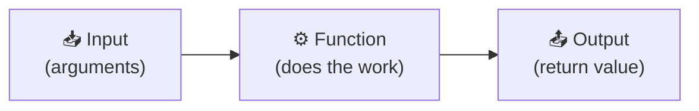
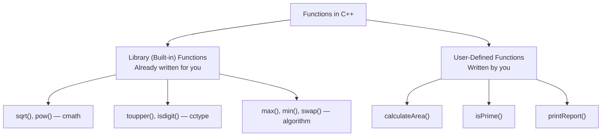
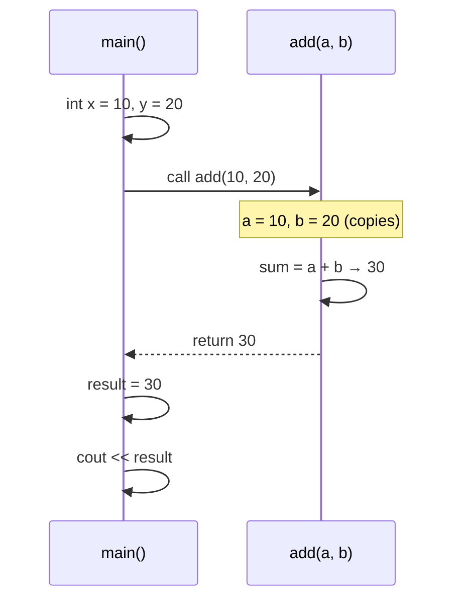
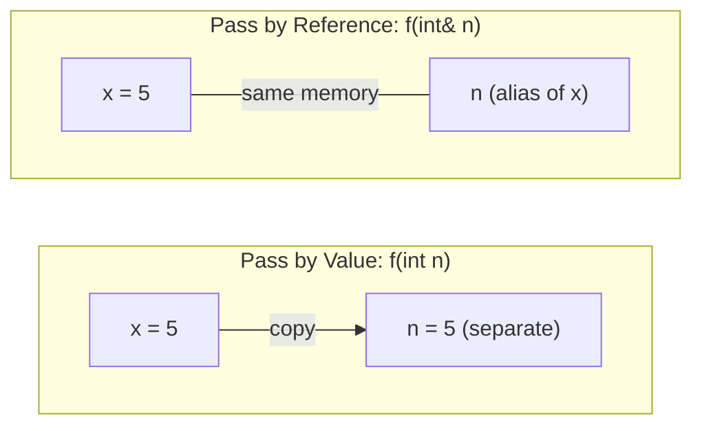
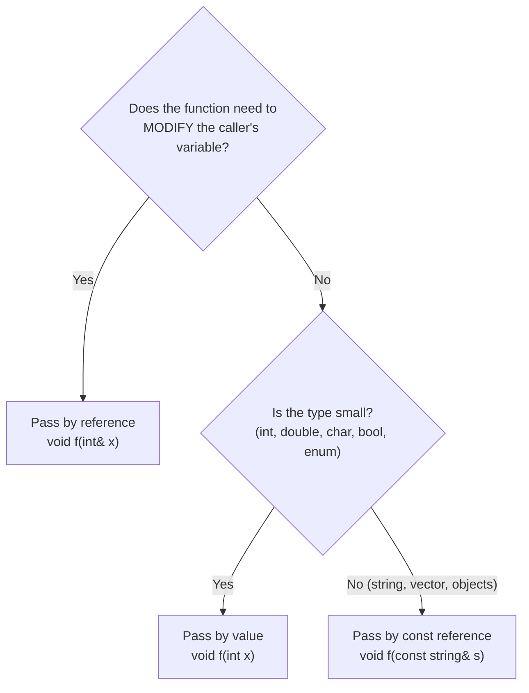
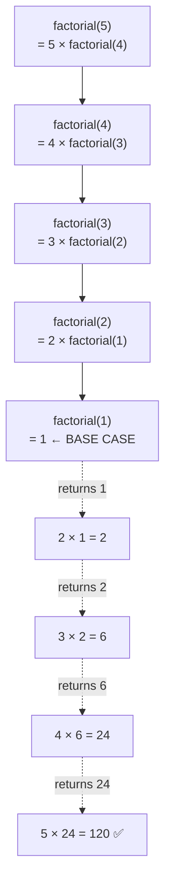
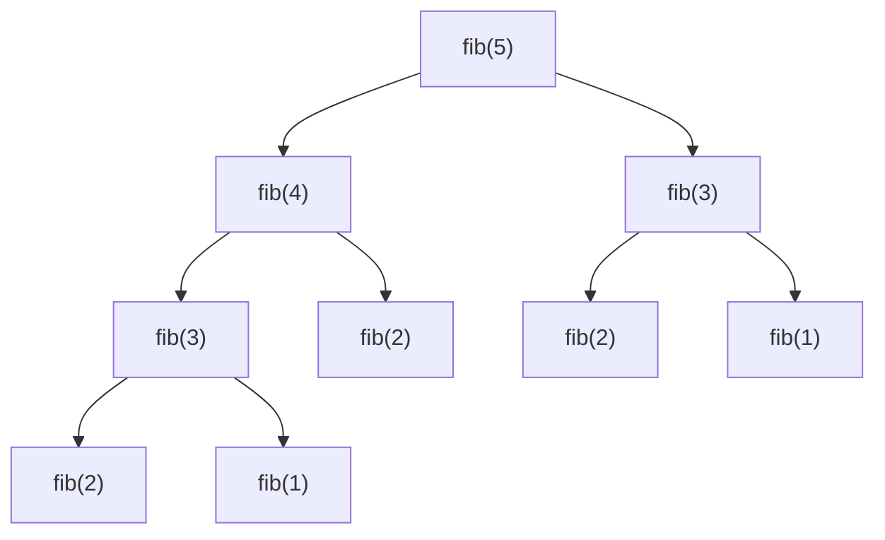

# 📘 Lesson 12: Functions in C++

> **Goal of this lesson:** Learn how to break programs into reusable, named blocks of code — define and call functions, pass data in and get results out, choose between pass-by-value and pass-by-reference, use default arguments and overloading, write recursive functions, and understand what happens in memory when a function is called.

> 🔗 *Lesson 3 showed where functions go in a program (prototypes and definitions). This lesson covers functions in full depth.*

> 💡 *Diagrams use **Mermaid**, which GitHub renders automatically.*

---

## 📑 Table of Contents

1. [What is a Function?](#1-what-is-a-function)
2. [Why Use Functions?](#2-why-use-functions)
3. [Types of Functions](#3-types-of-functions)
4. [Anatomy of a Function](#4-anatomy-of-a-function)
5. [Declaration, Definition, and Call](#5-declaration-definition-and-call)
6. [Parameters and Arguments](#6-parameters-and-arguments)
7. [Four Categories of Functions](#7-four-categories-of-functions)
8. [The `return` Statement](#8-the-return-statement)
9. [What Happens When a Function is Called](#9-what-happens-when-a-function-is-called)
10. [Pass by Value](#10-pass-by-value)
11. [Pass by Reference](#11-pass-by-reference)
12. [Pass by `const` Reference](#12-pass-by-const-reference)
13. [Pass by Pointer (Preview)](#13-pass-by-pointer-preview)
14. [Choosing How to Pass Parameters](#14-choosing-how-to-pass-parameters)
15. [Default Arguments](#15-default-arguments)
16. [Function Overloading](#16-function-overloading)
17. [Inline Functions](#17-inline-functions)
18. [Recursion](#18-recursion)
19. [Scope and Lifetime: `static` Local Variables](#19-scope-and-lifetime-static-local-variables)
20. [`constexpr` Functions](#20-constexpr-functions)
21. [Useful Library Functions](#21-useful-library-functions)
22. [Lambda Functions (Introduction)](#22-lambda-functions-introduction)
23. [Writing Good Functions](#23-writing-good-functions)
24. [Common Beginner Mistakes](#24-common-beginner-mistakes)
25. [Practice Exercises](#25-practice-exercises)
26. [Quick Quiz](#26-quick-quiz)
27. [Summary](#27-summary)

---

## 1. What is a Function?

A **function** is a **named block of code that performs a specific task**. You write it once and **call** it whenever you need it.

```cpp
int square(int n) {
    return n * n;
}

int main() {
    cout << square(5);    // 25
    cout << square(12);   // 144
}
```

☕ **Analogy: a coffee machine**
- You put in **inputs** (coffee beans, water) → **parameters**
- It does its **job** inside (you don't need to know how) → **function body**
- It gives you an **output** (coffee) → **return value**
- You can use it **again and again** → **calling the function**



You've already used functions: `main()`, `sqrt()`, `pow()`, `stoi()`, `to_string()`, `getline()`.

---

## 2. Why Use Functions?

### ❌ Without Functions — Repeated Code

```cpp
int main() {
    // Area of rectangle 1
    double l1 = 5, w1 = 3;
    cout << "Area: " << l1 * w1 << endl;

    // Area of rectangle 2
    double l2 = 8, w2 = 4;
    cout << "Area: " << l2 * w2 << endl;

    // Area of rectangle 3
    double l3 = 2.5, w3 = 6;
    cout << "Area: " << l3 * w3 << endl;
}
```

### ✅ With a Function

```cpp
void printArea(double length, double width) {
    cout << "Area: " << length * width << endl;
}

int main() {
    printArea(5, 3);
    printArea(8, 4);
    printArea(2.5, 6);
}
```

### Benefits

| Benefit | Meaning |
|---------|---------|
| ♻️ **Reusability** | Write once, use many times — **DRY**: *Don't Repeat Yourself* |
| 🧩 **Modularity** | Split a big problem into small, manageable pieces |
| 📖 **Readability** | `calculateTax()` explains itself; 20 lines of math don't |
| 🐛 **Easier debugging** | Test each function separately; fix a bug in **one** place |
| 👥 **Teamwork** | Different people can write different functions |
| 🙈 **Abstraction** | Use a function without knowing how it works inside (like `sqrt`) |

🏗️ **Think of a program like a building:** `main()` is the **manager** who coordinates. Functions are **specialist workers** — each does one job well.

---

## 3. Types of Functions



| | Library Functions | User-Defined Functions |
|--|------------------|-----------------------|
| Written by | C++ standard library | You |
| Need | `#include` the right header | Declaration before use |
| Examples | `sqrt`, `pow`, `strlen`, `max` | `add`, `isEven`, `printMenu` |

---

## 4. Anatomy of a Function

```cpp
  return type   name        parameter list
      │          │               │
      ▼          ▼               ▼
     int       add      (int a, int b)       ← function header (signature + return type)
     {                                        
         int sum = a + b;                     ← function body
         return sum;                          ← return statement
     }
```

| Part | Purpose | Example |
|------|---------|---------|
| **Return type** | Type of value sent back (`void` = nothing) | `int`, `double`, `bool`, `string`, `void` |
| **Name** | Identifier used to call it (Lesson 5: use a **verb**) | `add`, `calculateArea`, `isPrime` |
| **Parameter list** | Inputs, each with a type and name; can be empty `()` | `(int a, int b)` |
| **Body** | Statements inside `{ }` that do the work | `int sum = a + b;` |
| **`return`** | Sends a value back and ends the function | `return sum;` |

📌 The **function signature** = name + parameter types: `add(int, int)`. The compiler uses it to identify the function.

---

## 5. Declaration, Definition, and Call

### Declaration (Prototype)
Tells the compiler the function **exists** (Lesson 3).
```cpp
int add(int a, int b);     // ends with ;  — no body
int add(int, int);         // parameter names are optional
```

### Definition
Provides the actual **code**.
```cpp
int add(int a, int b) {
    return a + b;
}
```

### Call
**Runs** the function.
```cpp
int result = add(3, 4);    // result = 7
```

### Complete Program

```cpp
#include <iostream>
using namespace std;

int add(int a, int b);                // 1. declaration

int main() {
    int x = 10, y = 20;
    int sum = add(x, y);              // 3. call
    cout << "Sum = " << sum << endl;
    cout << "Sum = " << add(5, 7) << endl;   // call inside an expression
    return 0;
}

int add(int a, int b) {               // 2. definition
    return a + b;
}
```

**Output:**
```
Sum = 30
Sum = 12
```

### Ways to Use a Function Call

```cpp
int r = add(2, 3);                 // store the result
cout << add(2, 3);                 // print it directly
int big = add(add(1, 2), add(3, 4));   // use as an argument → add(3, 7) = 10
if (add(a, b) > 100) { ... }       // use in a condition
add(2, 3);                         // ignore the result (allowed, but pointless here)
```

---

## 6. Parameters and Arguments

| Term | Where | Also Called | Example |
|------|-------|-------------|---------|
| **Parameter** | In the function **definition** | Formal parameter | `int a, int b` |
| **Argument** | In the function **call** | Actual parameter | `add(10, 20)` → `10`, `20` |

```cpp
int multiply(int x, int y) {   // x, y → parameters
    return x * y;
}

int main() {
    int p = 4, q = 5;
    multiply(p, q);            // p, q → arguments
    multiply(3, 7);            // 3, 7 → arguments
}
```

📮 **Analogy:** A **parameter** is the empty **slot** on a form ("Name: _____"). An **argument** is what you **write in** the slot ("Riya").

### Rules
- Arguments must match parameters in **number**, **order**, and (convertible) **type**:

```cpp
double divide(double a, double b);

divide(10, 2);        // ✅ ints converted to double (Lesson 10)
divide(10);           // ❌ error: too few arguments
divide(10, 2, 3);     // ❌ error: too many arguments
divide("10", 2);      // ❌ error: cannot convert string literal to double
```

- **Order matters:**
```cpp
double power(double base, int exponent);
power(2, 10);    // 2¹⁰ = 1024
power(10, 2);    // 10² = 100  — different result!
```

---

## 7. Four Categories of Functions

Functions can be grouped by whether they **take arguments** and whether they **return a value**:

| Category | Arguments | Return Value | Example |
|----------|-----------|--------------|---------|
| 1 | ❌ No | ❌ No | `void printLine()` |
| 2 | ✅ Yes | ❌ No | `void greet(string name)` |
| 3 | ❌ No | ✅ Yes | `int readPositive()` |
| 4 | ✅ Yes | ✅ Yes | `int add(int a, int b)` |

```cpp
#include <iostream>
#include <string>
using namespace std;

// 1. No arguments, no return value
void printLine() {
    cout << "--------------------" << endl;
}

// 2. Arguments, no return value
void greet(string name) {
    cout << "Hello, " << name << "!" << endl;
}

// 3. No arguments, returns a value
int readPositive() {
    int n;
    do {
        cout << "Enter a positive number: ";
        cin >> n;
    } while (n <= 0);
    return n;
}

// 4. Arguments and returns a value
int square(int n) {
    return n * n;
}

int main() {
    printLine();
    greet("Riya");
    printLine();

    int num = readPositive();
    cout << num << " squared is " << square(num) << endl;
    return 0;
}
```

**Sample run:**
```
--------------------
Hello, Riya!
--------------------
Enter a positive number: -3
Enter a positive number: 6
6 squared is 36
```

📌 **Category 4 is the most reusable** — the function doesn't care where inputs come from or what happens to the output.

---

## 8. The `return` Statement

`return` does **two** things:
1. **Ends** the function immediately
2. **Sends a value back** to the caller (unless `void`)

### Returning a Value

```cpp
double average(double a, double b, double c) {
    return (a + b + c) / 3;    // expression returned directly
}
```

### `void` Functions
Return nothing. `return;` (with no value) can end them early:

```cpp
void printEligibility(int age) {
    if (age < 0) {
        cout << "Invalid age" << endl;
        return;                // exit early
    }
    cout << (age >= 18 ? "Eligible" : "Not eligible") << endl;
}
```

### Multiple `return` Statements

```cpp
string grade(int marks) {
    if (marks >= 90) return "A+";
    if (marks >= 75) return "A";
    if (marks >= 60) return "B";
    if (marks >= 40) return "C";
    return "F";
}
```
Only **one** `return` runs per call — the first one reached.

### Returning `bool` — "Is" Functions

```cpp
bool isEven(int n) {
    return n % 2 == 0;     // ✅ return the condition directly
}

// ❌ Unnecessarily long version
bool isEvenLong(int n) {
    if (n % 2 == 0) {
        return true;
    } else {
        return false;
    }
}
```

### ⚠️ Missing `return` in a Non-`void` Function

```cpp
int getMax(int a, int b) {
    if (a > b) {
        return a;
    }
    // ❌ no return when a <= b → UNDEFINED BEHAVIOUR (garbage value or crash)
}
```
`-Wall` warns: *"control reaches end of non-void function"*. Every path must `return` a value. (`main()` is the only exception — it returns 0 automatically.)

### Can a Function Return Multiple Values?
A function returns **one** value. To send back more, you can:
- Use **reference parameters** (Section 11) ✅
- Return a `struct` or `std::pair` (later lessons)

### Return Value Is Converted (Lesson 10)
```cpp
int half(double x) {
    return x / 2;          // 7.0 / 2 = 3.5 → converted to int 3
}
```

---

## 9. What Happens When a Function is Called

### Flow of Control



1. `main()` **pauses** at the call
2. Argument values are **copied** into the parameters
3. Control **jumps** to the function
4. The function body runs
5. `return` sends the value back and **jumps back** to where `main()` paused
6. `main()` **continues**

### The Call Stack

Each function call gets its own **stack frame** — a private area of memory holding its parameters, local variables, and the place to return to.

```
  Calling: main() → calculateTotal() → applyTax()

  ┌──────────────────────────┐  ← top (currently running)
  │ applyTax()               │
  │   amount = 1000          │
  │   rate   = 0.18          │
  ├──────────────────────────┤
  │ calculateTotal()         │
  │   price = 500, qty = 2   │
  ├──────────────────────────┤
  │ main()                   │
  │   total, ...             │
  └──────────────────────────┘  ← bottom
```

- When a function is **called** → a new frame is **pushed** on top
- When it **returns** → its frame is **popped** off, and its local variables **disappear**

🍽️ **Analogy:** A stack of plates — you add plates on top and remove from the top. The last function called is the first to finish (**LIFO**: Last In, First Out).

```cpp
#include <iostream>
using namespace std;

double applyTax(double amount) {
    cout << "  -> in applyTax" << endl;
    return amount * 1.18;
}

double calculateTotal(double price, int qty) {
    cout << " -> in calculateTotal" << endl;
    double total = applyTax(price * qty);
    cout << " <- back in calculateTotal" << endl;
    return total;
}

int main() {
    cout << "-> in main" << endl;
    double bill = calculateTotal(500, 2);
    cout << "<- back in main, bill = " << bill << endl;
    return 0;
}
```

**Output:**
```
-> in main
 -> in calculateTotal
  -> in applyTax
 <- back in calculateTotal
<- back in main, bill = 1180
```

---

## 10. Pass by Value

By default, C++ passes arguments **by value** — the function gets a **copy**. Changes inside the function **do not affect** the original.

```cpp
#include <iostream>
using namespace std;

void tryToChange(int n) {
    n = 100;                                   // changes the COPY only
    cout << "Inside function: n = " << n << endl;
}

int main() {
    int x = 5;
    tryToChange(x);
    cout << "In main: x = " << x << endl;      // still 5
    return 0;
}
```

**Output:**
```
Inside function: n = 100
In main: x = 5
```

```
   main()                tryToChange()
  ┌────────┐   copy     ┌────────┐
  │ x = 5  │ ─────────► │ n = 5  │  → n = 100
  └────────┘            └────────┘
   x unchanged ✅        copy destroyed when function ends
```

📄 **Analogy:** You give a friend a **photocopy** of your notes. Whatever they scribble on it, **your original stays clean**.

| ✅ Advantages | ❌ Disadvantages |
|--------------|-----------------|
| Original is safe from changes | Copying large data (long strings, big objects) is slow |
| Simple to understand | Function can't send changes back |

### The Classic Problem: Swap

```cpp
void swapValues(int a, int b) {
    int temp = a;
    a = b;
    b = temp;          // swaps the COPIES only
}

int main() {
    int x = 1, y = 2;
    swapValues(x, y);
    cout << x << " " << y;    // 1 2  ❌ not swapped!
}
```

The fix → **pass by reference** 👇

---

## 11. Pass by Reference

Add **`&`** after the type to pass by **reference**. The parameter becomes an **alias** (another name) for the **original variable** — no copy is made.

```cpp
#include <iostream>
using namespace std;

void swapValues(int& a, int& b) {    // & = reference
    int temp = a;
    a = b;
    b = temp;                         // changes the ORIGINALS
}

int main() {
    int x = 1, y = 2;
    swapValues(x, y);
    cout << "x = " << x << ", y = " << y << endl;   // x = 2, y = 1 ✅
    return 0;
}
```

```
   main()                   swapValues()
  ┌────────┐               
  │ x = 1  │ ◄──── a  (a IS x — same memory)
  │ y = 2  │ ◄──── b  (b IS y — same memory)
  └────────┘
```

📄 **Analogy:** Instead of a photocopy, you hand your friend your **original notebook**. Whatever they write, **you'll see it**.



### Use 1: Modify the Caller's Variables

```cpp
void applyDiscount(double& price, double percent) {
    price = price - price * percent / 100;
}

double cost = 1000;
applyDiscount(cost, 10);
cout << cost;    // 900
```

### Use 2: "Return" Multiple Values

```cpp
#include <iostream>
using namespace std;

void divide(int dividend, int divisor, int& quotient, int& remainder) {
    quotient = dividend / divisor;
    remainder = dividend % divisor;
}

int main() {
    int q, r;
    divide(17, 5, q, r);
    cout << "17 / 5 = " << q << " remainder " << r << endl;   // 3 remainder 2
    return 0;
}
```

```cpp
void getMinMax(int a, int b, int c, int& minVal, int& maxVal) {
    minVal = min({a, b, c});
    maxVal = max({a, b, c});
}
```

### ⚠️ Reference Arguments Must Be Variables

```cpp
void increment(int& n) { n++; }

int x = 5;
increment(x);      // ✅
increment(5);      // ❌ error: can't bind a non-const reference to a literal
increment(x + 1);  // ❌ error: x + 1 is a temporary value, not a variable
```

> 📚 References are covered in depth in a later lesson.

---

## 12. Pass by `const` Reference

What if you want the **speed** of a reference (no copying) but the **safety** of pass-by-value? Use **`const &`** (Lesson 6).

```cpp
#include <iostream>
#include <string>
using namespace std;

void printReport(const string& studentName, const string& remarks) {
    cout << studentName << ": " << remarks << endl;
    // studentName = "X";   // ❌ error: read-only
}

int main() {
    string name = "Aarav Sharma";
    string note = "Excellent performance in all subjects this semester...";
    printReport(name, note);       // no copies made ✅
    printReport("Riya", "Good");   // const& also accepts literals ✅
    return 0;
}
```

| | `string s` (value) | `string& s` (reference) | `const string& s` |
|--|-------------------|------------------------|-------------------|
| Copies the data? | ✅ Yes (slow for big data) | ❌ No | ❌ No |
| Function can modify original? | ❌ No | ✅ Yes | ❌ No |
| Accepts literals like `"Riya"`? | ✅ | ❌ | ✅ |

📌 **This is one of the most common patterns in professional C++.** For strings, vectors, and objects you only read → use `const &`.

---

## 13. Pass by Pointer (Preview)

> 🎓 *Pointers are covered in their own lesson. Recognize this pattern for now.*

Older C-style code passes the **address** of a variable using a pointer:

```cpp
void swapPtr(int* a, int* b) {
    int temp = *a;     // * reads the value at that address
    *a = *b;
    *b = temp;
}

int x = 1, y = 2;
swapPtr(&x, &y);       // & gives the address
```

In modern C++, **references are usually preferred** — cleaner syntax and can't be null.

---

## 14. Choosing How to Pass Parameters



| Method | Syntax | Copy? | Can Modify Original? | Use When |
|--------|--------|-------|---------------------|----------|
| By value | `f(int x)` | ✅ | ❌ | Small types you only read |
| By reference | `f(int& x)` | ❌ | ✅ | You **need** to change the original or return extra results |
| By const reference | `f(const string& s)` | ❌ | ❌ | Large types you only read |
| By pointer | `f(int* p)` | ❌ (copies address) | ✅ | C-style code, optional values (later) |

---

## 15. Default Arguments

Give parameters **default values** used when the caller doesn't supply them.

```cpp
#include <iostream>
#include <string>
using namespace std;

void greet(string name = "Student", string greeting = "Hello") {
    cout << greeting << ", " << name << "!" << endl;
}

int main() {
    greet();                       // Hello, Student!
    greet("Riya");                 // Hello, Riya!
    greet("Aarav", "Welcome");     // Welcome, Aarav!
    return 0;
}
```

### Practical Example

```cpp
double calculateTotal(double price, int quantity = 1, double taxRate = 0.18) {
    return price * quantity * (1 + taxRate);
}

calculateTotal(100);            // 118   (qty 1, 18% tax)
calculateTotal(100, 3);         // 354   (qty 3, 18% tax)
calculateTotal(100, 3, 0.05);   // 315   (qty 3, 5% tax)
```

### 📌 Rules

**Rule 1: Defaults must be at the end (right side)**
```cpp
void f(int a, int b = 2, int c = 3);    // ✅
void g(int a = 1, int b, int c);        // ❌ error: default arguments must be trailing
void h(int a = 1, int b = 2, int c);    // ❌ error
```

**Rule 2: You can't skip an argument in the middle**
```cpp
calculateTotal(100, , 0.05);   // ❌ syntax error — can't skip quantity
```

**Rule 3: Specify defaults only once — usually in the declaration**
```cpp
// Declaration (prototype) — put defaults here
void greet(string name = "Student", string greeting = "Hello");

// Definition — NO defaults repeated
void greet(string name, string greeting) {
    cout << greeting << ", " << name << "!" << endl;
}
```
Repeating them in both places → **error: default argument given for parameter 1**.

---

## 16. Function Overloading

**Overloading** means having **multiple functions with the same name** but **different parameter lists**. The compiler picks the right one based on the arguments.

```cpp
#include <iostream>
using namespace std;

int area(int side) {                      // square
    return side * side;
}

int area(int length, int width) {         // rectangle
    return length * width;
}

double area(double radius) {              // circle
    return 3.14159 * radius * radius;
}

int main() {
    cout << "Square   : " << area(4) << endl;       // calls area(int)
    cout << "Rectangle: " << area(4, 6) << endl;    // calls area(int, int)
    cout << "Circle   : " << area(2.0) << endl;     // calls area(double)
    return 0;
}
```

**Output:**
```
Square   : 16
Rectangle: 24
Circle   : 12.5664
```

🧑‍🏫 **Analogy:** The word **"play"** means different things: *play cricket*, *play guitar*, *play a video*. The **context** (arguments) tells you which meaning.

### Valid Ways to Overload

| Difference | Example |
|-----------|---------|
| Number of parameters | `print(int)` vs `print(int, int)` |
| Types of parameters | `print(int)` vs `print(double)` vs `print(string)` |
| Order of types | `show(int, double)` vs `show(double, int)` |

### ❌ Return Type Alone Is Not Enough

```cpp
int getValue();
double getValue();     // ❌ error: functions differ only in return type
```
When you call `getValue()`, the compiler can't tell which one you mean.

### ⚠️ Ambiguous Calls

```cpp
void show(int x);
void show(long x);

show(3.5);    // ❌ error: ambiguous — double converts equally well to int or long
```

```cpp
void print(int a);
void print(int a, int b = 0);

print(5);     // ❌ error: ambiguous — both match!
```

📌 Overloading is how library functions like `abs()` and `max()` work for `int`, `double`, and more.

---

## 17. Inline Functions

Calling a function has a small cost (creating a stack frame, jumping, returning). For **tiny** functions, the keyword `inline` **suggests** that the compiler paste the function body directly at each call:

```cpp
inline int cube(int x) {
    return x * x * x;
}

int main() {
    int v = cube(3);     // compiler may replace this with: int v = 3 * 3 * 3;
}
```

📌 Facts about `inline`:
- It's only a **hint** — modern compilers decide on their own and often inline small functions anyway (with `-O2`)
- Today, `inline` mainly matters for **defining functions in header files** without "multiple definition" linker errors (Lesson 8)
- ✅ Use for very small functions; ❌ not for large ones (makes the program bigger)
- Prefer `inline` / `constexpr` functions over `#define` macros (Lesson 6)

---

## 18. Recursion

A **recursive function** is a function that **calls itself**.

🪞 **Analogy:** Standing between two mirrors — each reflection contains a smaller reflection. Or Russian nesting dolls 🪆: open one, and there's a smaller one inside, until you reach the **smallest doll** that doesn't open.

### Two Essential Parts

| Part | Meaning | Doll Analogy |
|------|---------|-------------|
| **Base case** | The condition where the function **stops** calling itself | The smallest doll |
| **Recursive case** | The function calls itself with a **smaller** problem | Opening the next doll |

⚠️ **No base case = infinite recursion → stack overflow crash!**

### Example 1: Factorial

`n! = n × (n−1)!` and `0! = 1`

```cpp
#include <iostream>
using namespace std;

long long factorial(int n) {
    if (n <= 1) {                    // base case
        return 1;
    }
    return n * factorial(n - 1);     // recursive case
}

int main() {
    cout << "5! = " << factorial(5) << endl;   // 120
    return 0;
}
```

### How It Works: Going Down and Coming Back Up



### Call Stack During Recursion

```
 Calls going DOWN (pushing)          Returns coming UP (popping)
 ┌──────────────────┐
 │ factorial(1) → 1 │  ← base case reached
 ├──────────────────┤                  returns 1
 │ factorial(2)     │                  2 × 1 = 2
 ├──────────────────┤                  returns 2
 │ factorial(3)     │                  3 × 2 = 6
 ├──────────────────┤                  returns 6
 │ factorial(4)     │                  4 × 6 = 24
 ├──────────────────┤                  returns 24
 │ factorial(5)     │                  5 × 24 = 120
 ├──────────────────┤
 │ main()           │                  receives 120
 └──────────────────┘
```

### Example 2: Sum of Digits

```cpp
int sumDigits(int n) {
    if (n == 0) return 0;                    // base case
    return n % 10 + sumDigits(n / 10);       // last digit + sum of the rest
}
// sumDigits(472) = 2 + sumDigits(47) = 2 + 7 + sumDigits(4) = 2 + 7 + 4 + 0 = 13
```

### Example 3: Power

```cpp
long long power(int base, int exp) {
    if (exp == 0) return 1;                      // base case: x⁰ = 1
    return base * power(base, exp - 1);
}
// power(2, 10) = 1024
```

### Example 4: Fibonacci

`fib(0) = 0`, `fib(1) = 1`, `fib(n) = fib(n−1) + fib(n−2)`

```cpp
int fib(int n) {
    if (n <= 1) return n;                  // base cases: 0 and 1
    return fib(n - 1) + fib(n - 2);        // two recursive calls
}
// fib(10) = 55
```

⚠️ This version is **very slow** for large `n` — it recalculates the same values many times:


`fib(3)` is computed **twice**, `fib(2)` **three** times... `fib(40)` makes over **300 million** calls! The loop version from Lesson 11 is instant.

### Example 5: Print Numbers (Order Matters!)

```cpp
void countDown(int n) {
    if (n == 0) return;
    cout << n << " ";        // print BEFORE the recursive call
    countDown(n - 1);
}

void countUp(int n) {
    if (n == 0) return;
    countUp(n - 1);
    cout << n << " ";        // print AFTER the recursive call
}

// countDown(5) → 5 4 3 2 1
// countUp(5)   → 1 2 3 4 5
```

### Recursion vs Iteration

| | Recursion | Iteration (Loops) |
|--|-----------|-------------------|
| How it repeats | Function calls itself | `for` / `while` |
| Stops when | Base case reached | Condition becomes false |
| Memory | Uses a stack frame **per call** | Constant |
| Speed | Usually slower (call overhead) | Usually faster |
| Risk | **Stack overflow** if too deep | Infinite loop |
| Best for | Naturally recursive problems: trees, divide-and-conquer, backtracking | Simple repetition |
| Readability | Elegant for some problems | Clearer for simple counting |

### ⚠️ Stack Overflow

```cpp
int broken(int n) {
    return n + broken(n - 1);      // ❌ no base case
}
```
Each call adds a frame until the stack runs out of memory → **crash** (`Segmentation fault`).

### ✅ Recursion Checklist
1. Is there a **base case**?
2. Does every recursive call move **closer** to the base case?
3. Does the recursive call's result get **used** correctly?

---

## 19. Scope and Lifetime: `static` Local Variables

### Local Variables
Created when the function is called, **destroyed** when it returns (Lesson 2 — scope):

```cpp
void counter() {
    int count = 0;        // created fresh every call
    count++;
    cout << count << " ";
}

counter(); counter(); counter();   // 1 1 1
```

### `static` Local Variables
Created **once**, keep their value **between calls**, but are still only **visible** inside the function:

```cpp
#include <iostream>
using namespace std;

void counter() {
    static int count = 0;   // initialized only ONCE
    count++;
    cout << "Called " << count << " time(s)" << endl;
}

int main() {
    counter();
    counter();
    counter();
    return 0;
}
```

**Output:**
```
Called 1 time(s)
Called 2 time(s)
Called 3 time(s)
```

| Variable Kind | Visible Where | Lives How Long |
|---------------|---------------|----------------|
| Local | Inside its block | Until the block ends |
| `static` local | Inside its function | **Whole program** |
| Global | Whole file | Whole program |

✅ `static` local variables are a safer alternative to globals when only one function needs to remember a value.

---

## 20. `constexpr` Functions

(Lesson 6 preview.) A `constexpr` function **can** be evaluated **at compile time** when given constant arguments:

```cpp
constexpr int square(int x) {
    return x * x;
}

constexpr int AREA = square(12);   // computed by the compiler → 144

int main() {
    int n;
    cin >> n;
    cout << square(n);             // also works at runtime
}
```

✅ Use `constexpr` for small calculation functions whose inputs are often known in advance.

---

## 21. Useful Library Functions

### `<cmath>` — Math

| Function | Purpose | Example | Result |
|----------|---------|---------|--------|
| `sqrt(x)` | Square root | `sqrt(49)` | 7 |
| `cbrt(x)` | Cube root | `cbrt(27)` | 3 |
| `pow(x, y)` | x to the power y | `pow(2, 8)` | 256 |
| `abs(x)` / `fabs(x)` | Absolute value | `abs(-7)` | 7 |
| `round`, `floor`, `ceil` | Rounding (Lesson 10) | `ceil(4.1)` | 5 |
| `fmod(x, y)` | Decimal remainder | `fmod(7.5, 2)` | 1.5 |
| `log(x)`, `log10(x)` | Logarithms | `log10(1000)` | 3 |
| `sin`, `cos`, `tan` | Trig (radians) | `sin(0)` | 0 |
| `hypot(x, y)` | √(x² + y²) | `hypot(3, 4)` | 5 |

### `<cctype>` — Characters

| Function | Purpose | Example |
|----------|---------|---------|
| `isdigit(c)` | Is it 0–9? | `isdigit('5')` → true |
| `isalpha(c)` | Is it a letter? | `isalpha('a')` → true |
| `isalnum(c)` | Letter or digit? | `isalnum('#')` → false |
| `isupper(c)` / `islower(c)` | Case check | `isupper('Q')` → true |
| `isspace(c)` | Whitespace? | `isspace(' ')` → true |
| `toupper(c)` / `tolower(c)` | Change case | `toupper('b')` → `'B'` |

### `<algorithm>` and `<utility>`

| Function | Purpose | Example |
|----------|---------|---------|
| `max(a, b)` / `min(a, b)` | Larger / smaller | `max(4, 9)` → 9 |
| `max({a, b, c})` | Max of a list | `max({3, 8, 5})` → 8 |
| `swap(a, b)` | Swap two variables | `swap(x, y);` |

### `<cstdlib>` / `<random>` — Random Numbers

```cpp
#include <iostream>
#include <random>
using namespace std;

int main() {
    random_device rd;                          // seed source
    mt19937 gen(rd());                         // random number engine
    uniform_int_distribution<int> dice(1, 6);  // range 1 to 6

    cout << "You rolled: " << dice(gen) << endl;
    return 0;
}
```
💡 You'll also see the older `rand() % 6 + 1` with `srand(time(0))` — it works for simple games, but `<random>` is better quality.

---

## 22. Lambda Functions (Introduction)

> 🎓 *Preview — C++11. Lambdas become really useful with STL algorithms (later lessons).*

A **lambda** is a small, **unnamed function** written right where you need it.

### Syntax
```cpp
[capture](parameters) -> returnType { body }
```

### Examples

```cpp
#include <iostream>
using namespace std;

int main() {
    auto add = [](int a, int b) { return a + b; };
    cout << add(3, 4) << endl;                     // 7

    auto greet = []() { cout << "Hello from a lambda!" << endl; };
    greet();

    int bonus = 10;
    auto addBonus = [bonus](int marks) { return marks + bonus; };   // captures bonus
    cout << addBonus(75) << endl;                  // 85
    return 0;
}
```

| Part | Meaning |
|------|---------|
| `[]` | **Capture list** — which outside variables the lambda can use (`[bonus]`, `[&]`, `[=]`) |
| `(int a, int b)` | Parameters, like a normal function |
| `{ ... }` | Body |

---

## 23. Writing Good Functions

### ✅ Guidelines

| Guideline | ❌ Bad | ✅ Good |
|-----------|--------|---------|
| **One function, one job** | `processEverything()` that reads, calculates, and prints | `readMarks()`, `calculateAverage()`, `printReport()` |
| **Name with a verb** (Lesson 5) | `total()`, `data()` | `calculateTotal()`, `loadData()` |
| **Bool functions as questions** | `checkPrime()` | `isPrime()`, `hasPassed()` |
| **Keep functions short** | 200 lines | Usually under ~30 lines |
| **Few parameters** | `f(a, b, c, d, e, f, g)` | 3–4 at most; group the rest |
| **Return results instead of printing** | `void add(int a, int b) { cout << a + b; }` | `int add(int a, int b) { return a + b; }` |
| **No magic numbers** (Lesson 6) | `return price * 1.18;` | `return price * (1 + GST_RATE);` |
| **Avoid global variables** | Function reads/writes globals | Pass what it needs as parameters |
| **Use `const &` for big inputs** | `void f(string s)` | `void f(const string& s)` |

### 💡 Why "Return, Don't Print"?

```cpp
// ❌ Can only print — can't reuse the result
void printSquare(int n) { cout << n * n; }

// ✅ Flexible — print it, store it, compare it, add it...
int square(int n) { return n * n; }

cout << square(5);
int total = square(3) + square(4);     // 25
if (square(x) > 100) { ... }
```

### Example: Refactoring into Functions

```cpp
#include <iostream>
#include <string>
using namespace std;

constexpr int PASS_MARKS = 40;

double calculateAverage(int m1, int m2, int m3) {
    return (m1 + m2 + m3) / 3.0;
}

char getGrade(double average) {
    if (average >= 90) return 'A';
    if (average >= 75) return 'B';
    if (average >= 60) return 'C';
    if (average >= PASS_MARKS) return 'D';
    return 'F';
}

bool hasPassed(double average) {
    return average >= PASS_MARKS;
}

void printReport(const string& name, double average) {
    cout << "\n===== REPORT CARD =====" << endl;
    cout << "Name    : " << name << endl;
    cout << "Average : " << average << endl;
    cout << "Grade   : " << getGrade(average) << endl;
    cout << "Result  : " << (hasPassed(average) ? "PASS" : "FAIL") << endl;
}

int main() {
    string name;
    int m1, m2, m3;

    cout << "Student name: ";
    getline(cin, name);
    cout << "Marks in 3 subjects: ";
    cin >> m1 >> m2 >> m3;

    double avg = calculateAverage(m1, m2, m3);
    printReport(name, avg);
    return 0;
}
```

Notice how `main()` now reads like a **summary** of the program. 📖

---

## 24. Common Beginner Mistakes

| ❌ Mistake | ✅ Correct | Why |
|-----------|-----------|-----|
| Calling a function before declaring it | Add a prototype or define it above `main` | Compiler reads top to bottom |
| `int add(int a, b)` | `int add(int a, int b)` | Each parameter needs its own type |
| `int add(int a, int b);` followed by `{ ... }` | Remove the `;` in the definition | Semicolon ends the declaration |
| Forgetting `return` in a non-void function | Return on **every** path | Undefined behaviour |
| `return a, b;` to return two values | Use reference parameters or a struct | Comma operator returns only `b` |
| Defining a function inside another function | Define at file level | C++ doesn't allow nested function definitions (use lambdas) |
| Calling `add` instead of `add()` | Include parentheses | Without `()`, it's not a call |
| Expecting pass-by-value to change the original | Use `&` | Value passes a copy |
| `increment(5)` with `void increment(int& n)` | Pass a variable | Non-const references need variables |
| Defaults in both declaration and definition | Only in the declaration | Redefinition error |
| Default parameter before a non-default | Put defaults last | Must be trailing |
| Overloading only by return type | Change parameters | Not allowed |
| Recursion without a base case | Always add a base case | Stack overflow |
| Printing inside every function | Return values; print in one place | Reusability |
| Huge `main()` doing everything | Split into small functions | Readability and testing |

---

## 25. Practice Exercises

### 🟢 Easy

**Exercise 1:** Write a function `int cube(int n)` and print the cubes of 1 to 5.

**Exercise 2:** Write `bool isEven(int n)` and use it to print all even numbers between 1 and 20.

**Exercise 3:** Write `double celsiusToFahrenheit(double c)` and `double fahrenheitToCelsius(double f)`. Test both.

**Exercise 4:** Write `int maxOfThree(int a, int b, int c)` without using `std::max`.

### 🟡 Medium

**Exercise 5:** Write `bool isPrime(int n)` and use it to print all primes from 1 to 50.

**Exercise 6:** Predict the output:
```cpp
void change(int a, int& b) {
    a = a * 2;
    b = b * 2;
}

int main() {
    int x = 5, y = 5;
    change(x, y);
    cout << x << " " << y << endl;
}
```

**Exercise 7:** Write `void getCircleInfo(double radius, double& area, double& circumference)` that "returns" both values through references.

**Exercise 8:** Overload a function `printValue` to handle `int`, `double`, `char`, and `string`, printing the type along with the value:
```
int: 42
double: 3.14
char: A
string: Hello
```

**Exercise 9:** Write `double simpleInterest(double principal, double rate = 7.5, int years = 1)` and call it in three different ways.

**Exercise 10:** Write a function that uses a `static` variable to generate **unique ticket numbers** starting from 1001 each time it's called.

### 🔴 Challenge — Recursion

**Exercise 11:** Write recursive functions for:
- a) `int sumToN(int n)` — sum of 1 to n
- b) `int countDigits(int n)` — number of digits
- c) `int reverseNumber(int n, int rev = 0)` — reverse a number

**Exercise 12:** Write a recursive `int gcd(int a, int b)` using **Euclid's algorithm**: `gcd(a, b) = gcd(b, a % b)`, and `gcd(a, 0) = a`.

**Exercise 13:** Write a recursive function `bool isPalindrome(const string& s, int left, int right)` that checks whether a string is a palindrome.

**Exercise 14:** Write a recursive function to print the **binary** representation of a positive integer. Example: `13` → `1101`.

**Exercise 15:** **Tower of Hanoi.** Move `n` disks from rod A to rod C using rod B, following the rules (move one disk at a time; never place a larger disk on a smaller one). Print each move. How many moves for `n = 3`? For `n = 10`?

---

### ✅ Solutions

<details>
<summary>Click to view Exercise 1 solution</summary>

```cpp
#include <iostream>
using namespace std;

int cube(int n) {
    return n * n * n;
}

int main() {
    for (int i = 1; i <= 5; i++) {
        cout << i << "^3 = " << cube(i) << endl;
    }
    return 0;
}
```
</details>

<details>
<summary>Click to view Exercise 2 solution</summary>

```cpp
#include <iostream>
using namespace std;

bool isEven(int n) {
    return n % 2 == 0;
}

int main() {
    for (int i = 1; i <= 20; i++) {
        if (isEven(i)) cout << i << " ";
    }
    cout << endl;
    return 0;
}
```
</details>

<details>
<summary>Click to view Exercise 3 solution</summary>

```cpp
#include <iostream>
using namespace std;

double celsiusToFahrenheit(double c) {
    return c * 9.0 / 5.0 + 32;
}

double fahrenheitToCelsius(double f) {
    return (f - 32) * 5.0 / 9.0;
}

int main() {
    cout << "37 C = " << celsiusToFahrenheit(37) << " F" << endl;    // 98.6
    cout << "212 F = " << fahrenheitToCelsius(212) << " C" << endl;  // 100
    return 0;
}
```
</details>

<details>
<summary>Click to view Exercise 4 solution</summary>

```cpp
int maxOfThree(int a, int b, int c) {
    int largest = a;
    if (b > largest) largest = b;
    if (c > largest) largest = c;
    return largest;
}
```
</details>

<details>
<summary>Click to view Exercise 5 solution</summary>

```cpp
#include <iostream>
using namespace std;

bool isPrime(int n) {
    if (n < 2) return false;
    for (int i = 2; i * i <= n; i++) {
        if (n % i == 0) return false;
    }
    return true;
}

int main() {
    for (int i = 1; i <= 50; i++) {
        if (isPrime(i)) cout << i << " ";
    }
    cout << endl;
    return 0;
}
```
**Output:** `2 3 5 7 11 13 17 19 23 29 31 37 41 43 47`

💡 Notice how `return false;` inside the loop exits immediately — no `break` or flag needed!
</details>

<details>
<summary>Click to view Exercise 6 answer</summary>

**Output:**
```
5 10
```
- `a` is a **copy** of `x` → `x` stays 5
- `b` is a **reference** to `y` → `y` becomes 10
</details>

<details>
<summary>Click to view Exercise 7 solution</summary>

```cpp
#include <iostream>
using namespace std;

constexpr double PI = 3.14159;

void getCircleInfo(double radius, double& area, double& circumference) {
    area = PI * radius * radius;
    circumference = 2 * PI * radius;
}

int main() {
    double a, c;
    getCircleInfo(5, a, c);
    cout << "Area: " << a << ", Circumference: " << c << endl;
    return 0;
}
```
**Output:** `Area: 78.5397, Circumference: 31.4159`
</details>

<details>
<summary>Click to view Exercise 8 solution</summary>

```cpp
#include <iostream>
#include <string>
using namespace std;

void printValue(int v)            { cout << "int: " << v << endl; }
void printValue(double v)         { cout << "double: " << v << endl; }
void printValue(char v)           { cout << "char: " << v << endl; }
void printValue(const string& v)  { cout << "string: " << v << endl; }

int main() {
    printValue(42);
    printValue(3.14);
    printValue('A');
    printValue(string("Hello"));
    return 0;
}
```
💡 `printValue("Hello")` also works here, because `"Hello"` (a `const char*`) converts to `string`. Be careful, though: if you add a `printValue(bool)` overload, `printValue("Hello")` would pick the **bool** version, since a pointer-to-bool conversion is preferred over converting to `string`. Wrapping it in `string(...)` avoids that surprise.
</details>

<details>
<summary>Click to view Exercise 9 solution</summary>

```cpp
#include <iostream>
using namespace std;

double simpleInterest(double principal, double rate = 7.5, int years = 1) {
    return principal * rate * years / 100;
}

int main() {
    cout << simpleInterest(10000) << endl;           // 750   (7.5%, 1 year)
    cout << simpleInterest(10000, 8) << endl;        // 800   (8%, 1 year)
    cout << simpleInterest(10000, 8, 3) << endl;     // 2400  (8%, 3 years)
    return 0;
}
```
</details>

<details>
<summary>Click to view Exercise 10 solution</summary>

```cpp
#include <iostream>
using namespace std;

int nextTicketNumber() {
    static int ticket = 1000;
    ticket++;
    return ticket;
}

int main() {
    cout << "Ticket: " << nextTicketNumber() << endl;   // 1001
    cout << "Ticket: " << nextTicketNumber() << endl;   // 1002
    cout << "Ticket: " << nextTicketNumber() << endl;   // 1003
    return 0;
}
```
</details>

<details>
<summary>Click to view Exercise 11 solution</summary>

```cpp
#include <iostream>
using namespace std;

int sumToN(int n) {
    if (n == 0) return 0;
    return n + sumToN(n - 1);
}

int countDigits(int n) {
    if (n < 10) return 1;
    return 1 + countDigits(n / 10);
}

int reverseNumber(int n, int rev = 0) {
    if (n == 0) return rev;
    return reverseNumber(n / 10, rev * 10 + n % 10);
}

int main() {
    cout << sumToN(10) << endl;          // 55
    cout << countDigits(98765) << endl;  // 5
    cout << reverseNumber(1234) << endl; // 4321
    return 0;
}
```
</details>

<details>
<summary>Click to view Exercise 12 solution</summary>

```cpp
#include <iostream>
using namespace std;

int gcd(int a, int b) {
    if (b == 0) return a;
    return gcd(b, a % b);
}

int main() {
    cout << "gcd(48, 18) = " << gcd(48, 18) << endl;   // 6
    return 0;
}
```

**Trace:**
| Call | a | b | a % b |
|------|---|---|-------|
| gcd(48, 18) | 48 | 18 | 12 |
| gcd(18, 12) | 18 | 12 | 6 |
| gcd(12, 6) | 12 | 6 | 0 |
| gcd(6, 0) | 6 | 0 | → returns **6** |
</details>

<details>
<summary>Click to view Exercise 13 solution</summary>

```cpp
#include <iostream>
#include <string>
using namespace std;

bool isPalindrome(const string& s, int left, int right) {
    if (left >= right) return true;              // base case: crossed the middle
    if (s[left] != s[right]) return false;       // mismatch
    return isPalindrome(s, left + 1, right - 1);
}

int main() {
    string word = "racecar";
    cout << word << (isPalindrome(word, 0, word.length() - 1) ? " is" : " is not")
         << " a palindrome" << endl;
    return 0;
}
```
</details>

<details>
<summary>Click to view Exercise 14 solution</summary>

```cpp
#include <iostream>
using namespace std;

void printBinary(int n) {
    if (n > 1) {
        printBinary(n / 2);      // print higher bits first
    }
    cout << n % 2;
}

int main() {
    printBinary(13);   // 1101
    cout << endl;
    return 0;
}
```
💡 The recursive call happens **before** printing, so digits come out in the correct order (like `countUp` in Section 18).
</details>

<details>
<summary>Click to view Exercise 15 solution</summary>

```cpp
#include <iostream>
using namespace std;

int moves = 0;

void hanoi(int n, char from, char to, char via) {
    if (n == 0) return;
    hanoi(n - 1, from, via, to);                          // move n-1 disks out of the way
    cout << "Move disk " << n << " from " << from << " to " << to << endl;
    moves++;
    hanoi(n - 1, via, to, from);                          // move them onto the big disk
}

int main() {
    hanoi(3, 'A', 'C', 'B');
    cout << "Total moves: " << moves << endl;
    return 0;
}
```

**Output:**
```
Move disk 1 from A to C
Move disk 2 from A to B
Move disk 1 from C to B
Move disk 3 from A to C
Move disk 1 from B to A
Move disk 2 from B to C
Move disk 1 from A to C
Total moves: 7
```

Moves needed = **2ⁿ − 1** → `n = 3`: **7**, `n = 10`: **1023**.
</details>

---

## 26. Quick Quiz

**Q1.** What does a `void` function return?
- a) 0
- b) Nothing
- c) An empty string
- d) `NULL`

**Q2.** In `int add(int a, int b)`, what are `a` and `b`?
- a) Arguments
- b) Parameters
- c) Return values
- d) Global variables

**Q3.** What is printed?
```cpp
void f(int n) { n = 50; }
int main() { int x = 10; f(x); cout << x; }
```
- a) 50
- b) 10
- c) 0
- d) Error

**Q4.** What is printed?
```cpp
void f(int& n) { n = 50; }
int main() { int x = 10; f(x); cout << x; }
```
- a) 50
- b) 10
- c) 0
- d) Error

**Q5.** Which is the best parameter type for a large string the function only reads?
- a) `string s`
- b) `string& s`
- c) `const string& s`
- d) `string* s`

**Q6.** Which default argument declaration is **valid**?
- a) `void f(int a = 1, int b);`
- b) `void f(int a, int b = 2);`
- c) `void f(int a = 1, int b, int c = 3);`
- d) `void f(= 1 int a);`

**Q7.** Which pair is a **valid** overload?
- a) `int f(int);` and `double f(int);`
- b) `void f(int);` and `void f(double);`
- c) `void f(int a);` and `void f(int b);`
- d) None

**Q8.** What happens with a recursive function that has no base case?
- a) It returns 0
- b) Compile error
- c) Stack overflow at runtime
- d) It runs once

**Q9.** What is `factorial(4)` using the recursive definition?
- a) 4
- b) 10
- c) 24
- d) 16

**Q10.** What is printed?
```cpp
void tick() { static int c = 0; c++; cout << c; }
int main() { tick(); tick(); tick(); }
```
- a) 111
- b) 123
- c) 000
- d) 333

**Q11.** Which data structure keeps track of active function calls?
- a) Queue
- b) Heap
- c) Call stack
- d) Array

**Q12.** Why is "return the value" usually better than "print inside the function"?
- a) Printing is slower
- b) Returned values can be reused in many ways
- c) `cout` doesn't work inside functions
- d) It isn't better

<details>
<summary>✅ Click to view answers</summary>

| Q | Answer | Explanation |
|---|--------|-------------|
| 1 | b) | `void` = no return value |
| 2 | b) | Parameters are in the definition |
| 3 | b) 10 | Pass by value — copy changed |
| 4 | a) 50 | Pass by reference — original changed |
| 5 | c) | No copy, can't modify |
| 6 | b) | Defaults must be trailing |
| 7 | b) | Different parameter types |
| 8 | c) | Infinite calls fill the stack |
| 9 | c) 24 | 4 × 3 × 2 × 1 |
| 10 | b) 123 | `static` keeps its value |
| 11 | c) | Frames pushed on call, popped on return |
| 12 | b) | Store, compare, combine, print — caller decides |

</details>

---

## 27. Summary

- ✅ A **function** is a named, reusable block of code: **return type + name + parameters + body**.
- ✅ Functions give **reusability (DRY), modularity, readability, and easier debugging**.
- ✅ **Library functions** come from headers; **user-defined** functions are written by you.
- ✅ **Declaration** (prototype) → **definition** (body) → **call** (run it).
- ✅ **Parameters** are in the definition; **arguments** are in the call — must match in number, order, and type.
- ✅ `return` ends the function and sends back a value; every path of a non-void function must return.
- ✅ Each call gets a **stack frame** on the **call stack** (LIFO).
- ✅ **Pass by value** → copy (original safe); **by reference `&`** → alias (can modify); **by `const &`** → no copy, read-only.
- ✅ **Default arguments** must be trailing and specified once (in the declaration).
- ✅ **Overloading** = same name, different parameter lists (not just return type).
- ✅ `inline` is a hint for tiny functions; `constexpr` functions can run at compile time.
- ✅ **Recursion** = a function calling itself; needs a **base case** and progress toward it; watch for stack overflow and repeated work.
- ✅ `static` local variables **remember** values between calls.
- ✅ **Lambdas** are small unnamed functions: `[](int x) { return x * 2; }`.
- ✅ Good functions: **one job, verb names, few parameters, return instead of print**.

---


---

> 📝 *Tip for students: If you can't describe what a function does in one short sentence without using the word "and", it's probably doing too much — split it!*
