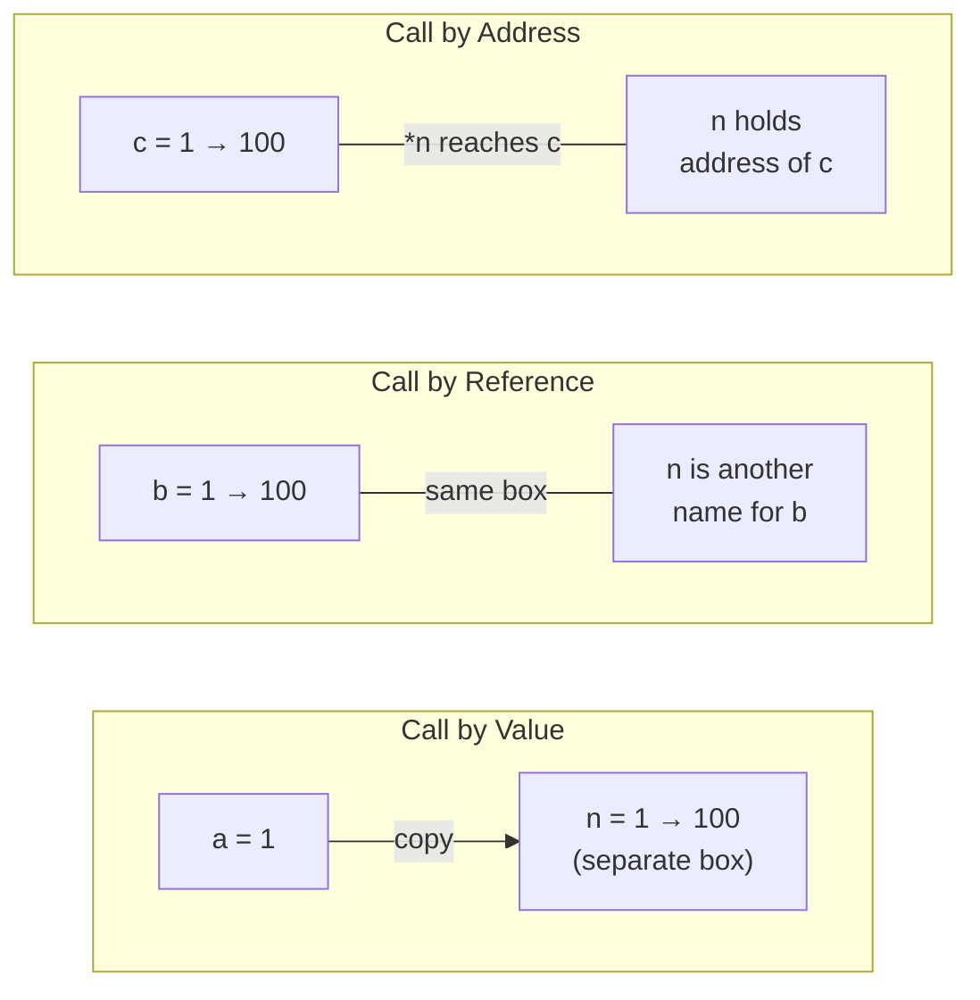
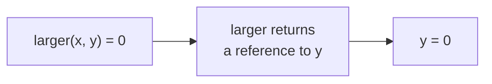
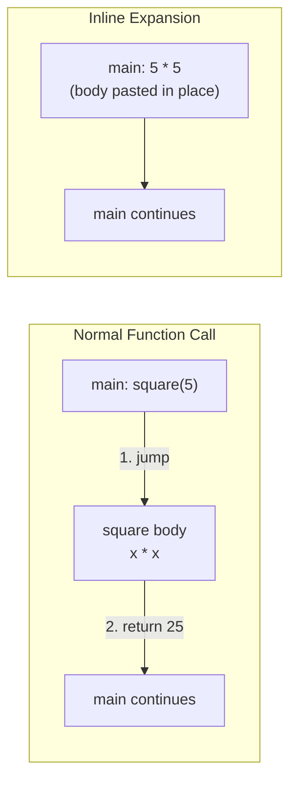
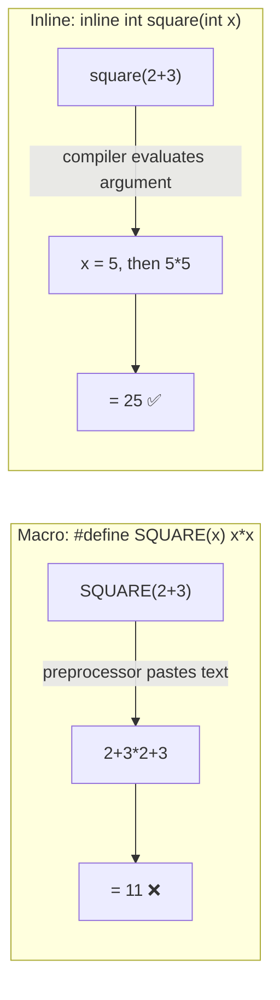
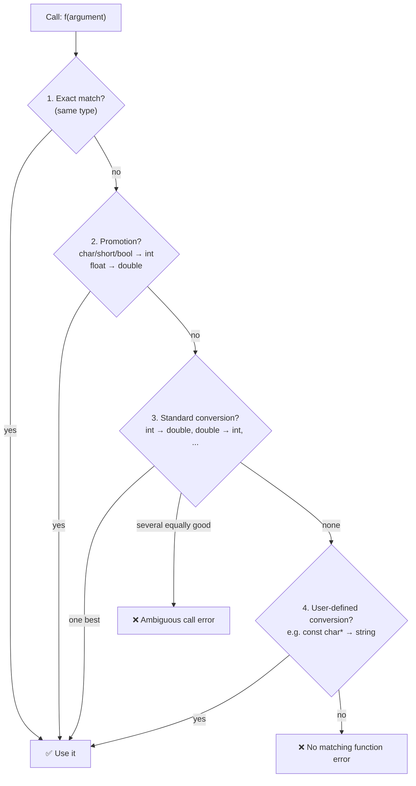
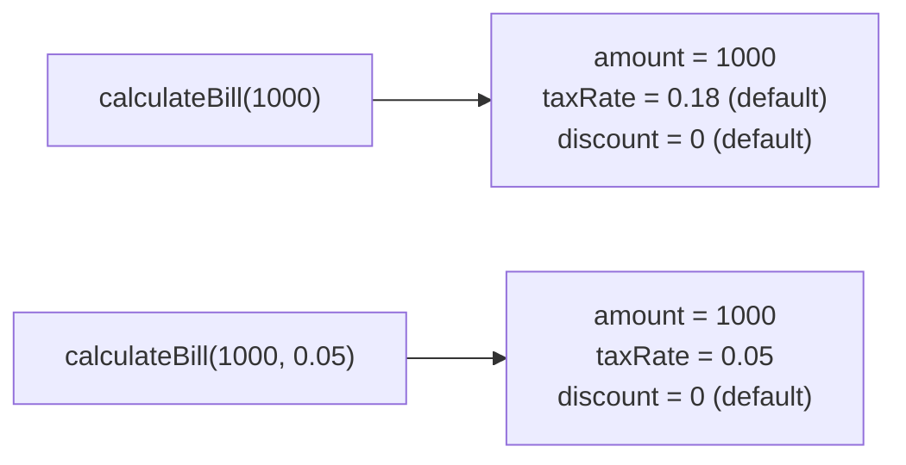
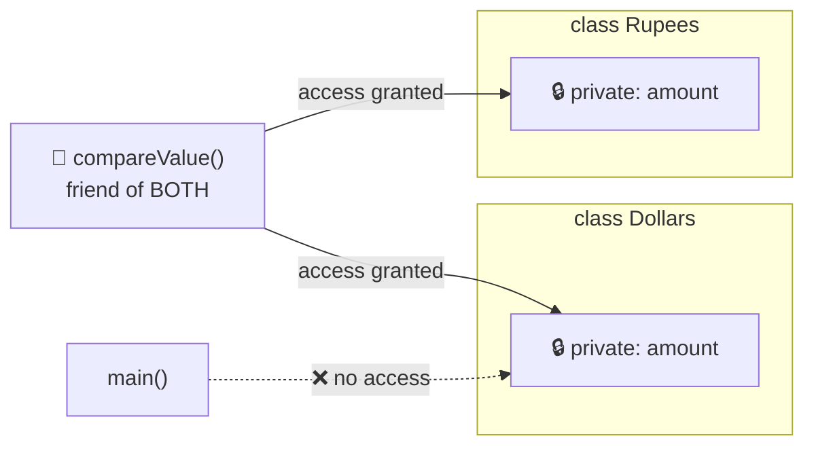
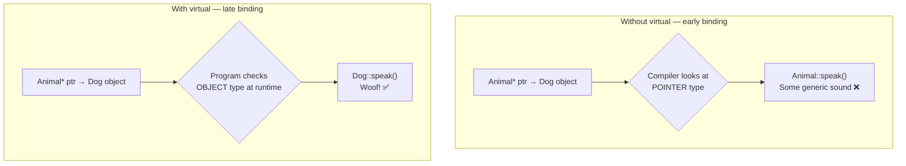
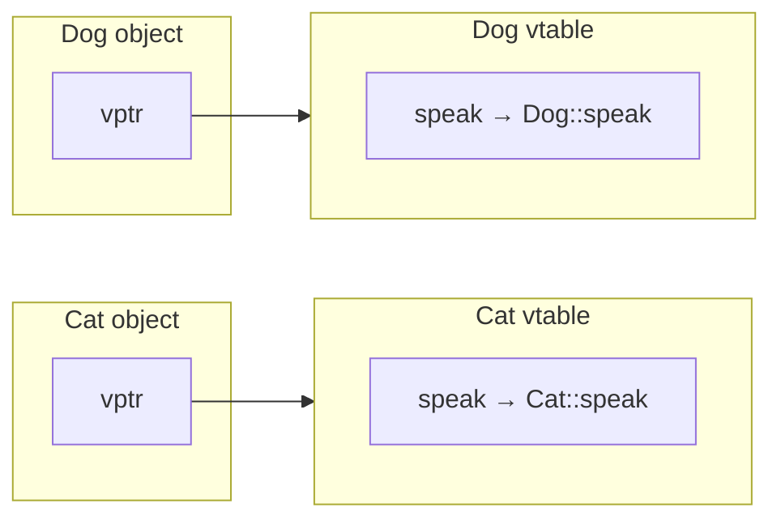
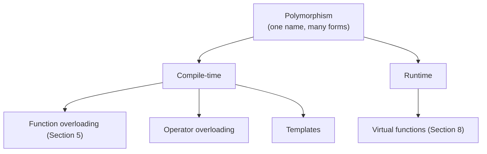

# 📘 Lesson 12 (Part 2): Advanced Functions in C++

> **Goal of this lesson:** Cover the complete functions syllabus — simple functions, call and return by reference, inline functions, macros vs inline functions, function overloading, default arguments, friend functions, and virtual functions — with examples, diagrams, and exercises for each.

> 🔗 *Part 1 (**Function-in-CPP.md**) introduced functions in depth. This part is organized by syllabus topic: topics already covered in Part 1 get a focused recap, and new topics (return by reference, macro vs inline, friend functions, virtual functions) are covered in full.*

> 💡 *Diagrams use **Mermaid**, which GitHub renders automatically.*

---

## 📑 Table of Contents

| # | Syllabus Topic | Section | Part 1 Coverage |
|---|----------------|---------|-----------------|
| 0 | *Class basics needed for topics 7–8* | [Section 0](#0-quick-class-primer) | New |
| 1 | Simple Functions | [Section 1](#1-simple-functions) | Recap |
| 2 | Call and Return by Reference | [Section 2](#2-call-and-return-by-reference) | Call: recap · **Return: new** |
| 3 | Inline Functions | [Section 3](#3-inline-functions) | Expanded |
| 4 | Macro vs Inline Functions | [Section 4](#4-macro-vs-inline-functions) | **New** |
| 5 | Function Overloading | [Section 5](#5-function-overloading) | Expanded |
| 6 | Default Arguments | [Section 6](#6-default-arguments) | Expanded |
| 7 | Friend Functions | [Section 7](#7-friend-functions) | **New** |
| 8 | Virtual Functions | [Section 8](#8-virtual-functions) | **New** |
| — | All topics compared | [Section 9](#9-all-topics-at-a-glance) | |
| — | Mistakes, exercises, quiz, summary | [Section 10](#10-common-beginner-mistakes) onward | |

---

## 0. Quick Class Primer

> 🎓 *Friend functions and virtual functions only make sense with **classes**. Classes get their own lessons later — here's just enough to follow this lesson.*

A **class** is a user-defined type that bundles **data** (member variables) and **functions** (member functions) together. An **object** is a variable of that class type.

```cpp
#include <iostream>
using namespace std;

class Student {
private:                       // only the class's own functions can access these
    int marks;

public:                        // anyone can access these
    void setMarks(int m) {     // member function
        marks = m;
    }
    int getMarks() {
        return marks;
    }
};

int main() {
    Student s;                 // s is an object of class Student
    s.setMarks(88);            // call a member function with the dot operator
    cout << s.getMarks() << endl;   // 88

    // s.marks = 50;           // ❌ error: 'marks' is private
    return 0;
}
```

| Term | Meaning |
|------|---------|
| **Class** | A blueprint: `class Student { ... };` (note the `;`) |
| **Object** | A real thing made from the blueprint: `Student s;` |
| **Member variable** | Data inside the class: `marks` |
| **Member function** | Function inside the class: `setMarks()` |
| **`private`** | Hidden — only member functions (and **friends**!) can access |
| **`public`** | Accessible from anywhere |
| **`.` operator** | Access a member through an object: `s.getMarks()` |
| **Inheritance** | `class Dog : public Animal` — Dog gets everything Animal has |

🏠 **Analogy:** A class is a **house blueprint**; objects are **actual houses** built from it. `private` rooms are bedrooms (family only); `public` rooms are the living room (guests welcome).

---

## 1. Simple Functions

A **simple function** is a named block of code that takes inputs (**parameters**), does one task, and optionally sends back a result (**return value**).

```cpp
  return type   name        parameters
      │          │               │
     int       add      (int a, int b)
     {
         return a + b;           ← body + return
     }
```

### Complete Example

```cpp
#include <iostream>
using namespace std;

int add(int a, int b);               // declaration (prototype)

int main() {
    int result = add(10, 20);        // call
    cout << "Sum = " << result << endl;
    return 0;
}

int add(int a, int b) {              // definition
    return a + b;
}
```

### Four Categories

| Category | Example | Use |
|----------|---------|-----|
| No arguments, no return | `void printLine()` | Fixed actions |
| Arguments, no return | `void greet(string name)` | Act on input |
| No arguments, return | `int readNumber()` | Produce a value |
| Arguments and return | `int square(int n)` | ✅ Most reusable |

```cpp
void printLine()        { cout << "----------" << endl; }
void greet(string name) { cout << "Hello, " << name << endl; }
int  readNumber()       { int n; cin >> n; return n; }
int  square(int n)      { return n * n; }
```

📌 **Key points** (details in Part 1):
- Declare before use (prototype or define above `main`)
- Arguments must match parameters in **number, order, and type**
- Every path of a non-`void` function must `return` a value
- Each call gets its own **stack frame**; local variables disappear when it returns

---

## 2. Call and Return by Reference

### 2.1 The Three Ways to Pass Arguments

```cpp
#include <iostream>
using namespace std;

void byValue(int n)      { n = 100; }    // gets a COPY
void byReference(int& n) { n = 100; }    // gets an ALIAS of the original
void byAddress(int* n)   { *n = 100; }   // gets the ADDRESS (pointer)

int main() {
    int a = 1, b = 1, c = 1;

    byValue(a);
    byReference(b);
    byAddress(&c);

    cout << "a = " << a << endl;   // 1   (unchanged)
    cout << "b = " << b << endl;   // 100 (changed)
    cout << "c = " << c << endl;   // 100 (changed)
    return 0;
}
```



| Feature | Call by Value | Call by Reference | Call by Address |
|---------|---------------|-------------------|-----------------|
| Syntax (parameter) | `int n` | `int& n` | `int* n` |
| Syntax (call) | `f(x)` | `f(x)` | `f(&x)` |
| Copy made? | ✅ Yes | ❌ No | Only the address |
| Can modify original? | ❌ No | ✅ Yes | ✅ Yes |
| Can be null? | — | ❌ Never | ⚠️ Yes (`nullptr`) |
| Accepts literals (`f(5)`)? | ✅ | ❌ (unless `const&`) | ❌ |
| Style | C and C++ | **C++** ✅ | C-style |

### Classic Example: Swap

```cpp
void swapByValue(int a, int b)      { int t = a; a = b; b = t; }   // ❌ swaps copies
void swapByReference(int& a, int& b) { int t = a; a = b; b = t; }  // ✅ swaps originals

int x = 1, y = 2;
swapByValue(x, y);       // x = 1, y = 2
swapByReference(x, y);   // x = 2, y = 1 ✅
```

### Call by `const` Reference — Fast and Safe

```cpp
void printName(const string& name) {   // no copy, can't modify
    cout << name << endl;
}
```

📌 **Rule of thumb:**
- Small type, read only → **by value** (`int n`)
- Need to modify → **by reference** (`int& n`)
- Large type, read only → **by const reference** (`const string& s`)

---

### 2.2 Return by Reference ⭐ (New)

Normally a function returns a **copy** of a value. With `&` after the return type, it returns a **reference** — an alias to an existing variable.

```cpp
int  getValue();       // return by value     → gives back a COPY
int& getReference();   // return by reference → gives back the VARIABLE ITSELF
```

### Example: A Function on the Left Side of `=`

Because the result **is** the original variable, you can **assign to a function call**!

```cpp
#include <iostream>
using namespace std;

int& larger(int& a, int& b) {
    return (a > b) ? a : b;     // returns the variable itself, not a copy
}

int main() {
    int x = 10, y = 25;

    cout << "Larger: " << larger(x, y) << endl;   // 25

    larger(x, y) = 0;           // assigns 0 to whichever is larger (y)!
    cout << "x = " << x << ", y = " << y << endl; // x = 10, y = 0

    larger(x, y) += 5;          // x is now larger → x becomes 15
    cout << "x = " << x << ", y = " << y << endl; // x = 15, y = 0
    return 0;
}
```

**Output:**
```
Larger: 25
x = 10, y = 0
x = 15, y = 0
```



### Example: Counter Using a `static` Variable

```cpp
#include <iostream>
using namespace std;

int& counter() {
    static int count = 0;    // lives for the whole program
    return count;            // ✅ safe: count still exists after return
}

int main() {
    counter()++;             // modify through the returned reference
    counter()++;
    counter() += 10;
    cout << "Count: " << counter() << endl;   // 12
    return 0;
}
```

### Example: Getter That Allows Editing (Class)

```cpp
class Student {
private:
    int marks = 0;
public:
    int& marksRef() { return marks; }          // returns reference to the member
    const int& getMarks() const { return marks; }   // read-only reference
};

int main() {
    Student s;
    s.marksRef() = 92;                 // edits the private member through the reference
    cout << s.getMarks() << endl;      // 92
}
```

### 💡 You've Already Used Return by Reference!

This is how `cout` chaining works:
```cpp
cout << "A" << "B" << "C";
```
`operator<<` **returns a reference to `cout`**, so the next `<<` works on the same `cout`:
```
((cout << "A") << "B") << "C"
     returns cout  → cout << "B"  → returns cout → cout << "C"
```

### ⛔ The Golden Rule: Never Return a Reference to a Local Variable

```cpp
int& badFunction() {
    int local = 42;
    return local;     // ❌ DANGER: local is destroyed when the function returns!
}

int main() {
    int& r = badFunction();   // r refers to memory that no longer exists
    cout << r;                // ❌ undefined behaviour — garbage or crash
}
```

```
  During badFunction():        After it returns:
  ┌──────────────────┐         ┌──────────────────┐
  │ local = 42       │ ◄── r   │ (destroyed) ???  │ ◄── r  💥 dangling reference
  └──────────────────┘         └──────────────────┘
```

g++ warns: *"reference to local variable 'local' returned"*.

✅ **Safe to return by reference:**
- A **parameter passed by reference** (`larger` example)
- A **`static`** local variable
- A **global** variable
- A **member variable** of an object that still exists

❌ **Never:** a normal local variable or a temporary value.

### Return by Value vs Return by Reference

| | Return by Value | Return by Reference |
|--|----------------|---------------------|
| Syntax | `int f()` | `int& f()` |
| Returns | A **copy** | The **original variable** |
| Can appear on left of `=`? | ❌ | ✅ |
| Copy cost | Copies data | No copy |
| Safe with local variables? | ✅ Yes | ❌ **Never** |
| Typical use | Most functions | Chaining (`cout <<`), accessors, operators |

---

## 3. Inline Functions

### The Cost of a Function Call

Calling a function isn't free. The program must:
1. Save the current position
2. Copy arguments into a new stack frame
3. Jump to the function's code
4. Run the body
5. Copy the return value back
6. Jump back and remove the frame

For a **tiny** function like `return x * x;`, this overhead can take longer than the actual work! 🐢

### The Solution: `inline`

The `inline` keyword **requests** that the compiler **replace each call with the function's body**, removing the call overhead.

### Syntax
```cpp
inline returnType name(parameters) {
    // short body
}
```

### Example

```cpp
#include <iostream>
using namespace std;

inline int square(int x) {
    return x * x;
}

inline double celsiusToF(double c) {
    return c * 9.0 / 5.0 + 32;
}

int main() {
    cout << square(5) << endl;        // compiler may turn this into: cout << 5 * 5
    cout << celsiusToF(37) << endl;   // may become: cout << 37 * 9.0 / 5.0 + 32
    return 0;
}
```



### ⚠️ `inline` Is Only a Request

The compiler **decides**. It may **ignore** `inline` when the function:
- Is **large** or complex
- Contains **loops** or **`switch`**
- Is **recursive**
- Contains **`static`** variables
- Is called through a **function pointer**

…and modern compilers often inline small functions **automatically** with optimization (`-O2`), even without the keyword.

### Implicitly Inline Functions

| Function | Inline automatically? |
|----------|----------------------|
| Member function **defined inside** a class body | ✅ Yes |
| `constexpr` function | ✅ Yes |
| Member function defined **outside** the class | ❌ No (add `inline` if defined in a header) |

```cpp
class Circle {
    double r;
public:
    double area() { return 3.14159 * r * r; }   // implicitly inline ✅
};
```

### Modern Meaning of `inline`

Today, `inline` mostly means: *"this function may be **defined in a header file** included by many `.cpp` files without causing a **multiple definition** linker error"* (Lesson 8).

### Advantages and Disadvantages

| ✅ Advantages | ❌ Disadvantages |
|--------------|-----------------|
| No function call overhead | **Larger executable** (body copied at every call) |
| Can be faster for tiny functions | Changing an inline function in a header forces **recompiling** every file that includes it |
| Type-safe (unlike macros) | Overuse can **slow down** programs (bigger code, worse CPU cache use) |
| Allows compiler optimizations across the call | Only a hint — not guaranteed |

📌 **When to use:** small (1–3 line), frequently called functions — getters, setters, tiny math helpers.

---

## 4. Macro vs Inline Functions

Before `inline` existed, C programmers used **macros** (`#define`, Lesson 6) to avoid call overhead. Both seem to do the same thing — but they work **very differently**.

| | Macro | Inline Function |
|--|-------|-----------------|
| Handled by | **Preprocessor** (before compilation) | **Compiler** |
| How it works | **Blind text replacement** | A real function the compiler may expand |



### Problem 1: Operator Precedence

```cpp
#include <iostream>
using namespace std;

#define SQUARE(x) x * x

inline int square(int x) { return x * x; }

int main() {
    cout << "Macro : " << SQUARE(2 + 3) << endl;   // 2 + 3 * 2 + 3 = 11 ❌
    cout << "Inline: " << square(2 + 3) << endl;   // 5 * 5 = 25         ✅
    return 0;
}
```

Adding parentheses helps: `#define SQUARE(x) ((x) * (x))` — but doesn't fix the next problem.

### Problem 2: Arguments Evaluated More Than Once (Side Effects)

```cpp
#include <iostream>
using namespace std;

#define MAX(a, b) ((a) > (b) ? (a) : (b))

inline int maxInline(int a, int b) { return (a > b) ? a : b; }

int main() {
    int x = 5, y = 3;
    int m1 = MAX(x++, y);          // expands to ((x++) > (y) ? (x++) : (y))
    cout << "Macro : result = " << m1 << ", x = " << x << endl;

    x = 5;
    int m2 = maxInline(x++, y);    // x++ evaluated exactly once
    cout << "Inline: result = " << m2 << ", x = " << x << endl;
    return 0;
}
```

**Output:**
```
Macro : result = 6, x = 7
Inline: result = 5, x = 6
```

😱 The macro incremented `x` **twice** and returned the wrong value! The text `x++` was pasted **twice** into the expansion.

### Problem 3: No Type Checking

```cpp
#define DOUBLE_IT(x) ((x) * 2)
string s = "hi";
DOUBLE_IT(s);              // error appears in the expanded code — confusing message

inline int doubleIt(int x) { return x * 2; }
doubleIt(s);               // ✅ clear error: cannot convert 'string' to 'int'
```

### Problem 4: No Scope

```cpp
void f() {
    #define LIMIT 10       // affects the REST of the file, not just f()
}
int LIMIT = 5;             // ❌ becomes: int 10 = 5;
```
Inline functions follow normal scope rules and can live in **namespaces** and **classes**.

### Problem 5: Can't Access Class Members Properly

Macros know nothing about classes, `private` members, or `this`. Inline functions can be **member functions**.

### Problem 6: Hard to Debug

The debugger never sees `SQUARE` — only the pasted text. Inline functions appear by name in error messages and (in debug builds) in the debugger.

### 📊 Complete Comparison

| Feature | Macro (`#define`) | Inline Function |
|---------|-------------------|-----------------|
| Processed by | Preprocessor | Compiler |
| Mechanism | Text substitution | Function call possibly replaced by body |
| Type checking | ❌ None | ✅ Full |
| Arguments evaluated | Possibly **multiple times** | Exactly **once** |
| Precedence problems | ⚠️ Yes (needs heavy parentheses) | ❌ No |
| Respects scope / namespaces | ❌ No | ✅ Yes |
| Can be a class member | ❌ No | ✅ Yes |
| Can access `private` members | ❌ No | ✅ Yes (as member/friend) |
| Recursion | ❌ Impossible | ✅ Allowed (just won't be inlined) |
| Return statement | ❌ No (it's an expression) | ✅ Yes |
| Debugging | ❌ Hard | ✅ Easier |
| Error messages | Confusing (refer to expanded code) | Clear |
| Guaranteed expansion | ✅ Always (it's text) | ❌ Compiler decides |
| Recommended in C++ | ❌ Avoid for functions | ✅ Yes |

### ✅ Bottom Line

> **In modern C++, use `inline` (or `constexpr`) functions instead of function-like macros.** Keep `#define` for things only the preprocessor can do: include guards and conditional compilation.

---

## 5. Function Overloading

**Function overloading** = multiple functions with the **same name** but **different parameter lists**. The compiler chooses the correct one based on the arguments — at **compile time**.

```cpp
#include <iostream>
#include <string>
using namespace std;

void display(int n)                { cout << "Integer: " << n << endl; }
void display(double d)             { cout << "Double : " << d << endl; }
void display(const string& s)      { cout << "String : " << s << endl; }
void display(int n, int times) {
    for (int i = 0; i < times; i++) cout << n << " ";
    cout << endl;
}

int main() {
    display(42);              // display(int)
    display(3.14);            // display(double)
    display(string("Hi"));    // display(const string&)
    display(7, 3);            // display(int, int)
    return 0;
}
```

**Output:**
```
Integer: 42
Double : 3.14
String : Hi
7 7 7
```

### ✅ Valid Ways to Overload

| Differ By | Example |
|-----------|---------|
| Number of parameters | `area(int)` / `area(int, int)` |
| Type of parameters | `area(int)` / `area(double)` |
| Order of parameter types | `f(int, double)` / `f(double, int)` |

### ❌ Invalid Overloads

```cpp
int    getData();
double getData();            // ❌ differs only in return type

void f(int a);
void f(int b);               // ❌ parameter NAMES don't matter — same signature

void g(int x);
void g(const int x);         // ❌ top-level const on a value parameter doesn't count
```

### How the Compiler Picks: Overload Resolution

The compiler ranks each candidate and picks the **best match**:



```cpp
void show(int x)    { cout << "int"; }
void show(double x) { cout << "double"; }

show(5);        // int     — exact match
show(5.5);      // double  — exact match
show('A');      // int     — promotion (char → int)
show(5.5f);     // double  — promotion (float → double)
```

### ⚠️ Ambiguity

```cpp
void show(int x);
void show(long x);
show(5.5);      // ❌ ambiguous: double → int and double → long are equally good

void print(int a);
void print(int a, int b = 0);
print(5);       // ❌ ambiguous: both can accept one argument
```

### Overloading vs Default Arguments

Sometimes either works:

```cpp
// Overloading
double area(double side)              { return side * side; }
double area(double len, double wid)  { return len * wid; }

// Default argument
double area(double len, double wid = -1) {
    return (wid < 0) ? len * len : len * wid;
}
```

| Use Overloading When | Use Default Arguments When |
|----------------------|---------------------------|
| Different **types** need different logic | Same logic, some values **usually the same** |
| Behaviour genuinely differs | Just saving the caller from typing common values |

📌 Overloading is **compile-time polymorphism** ("many forms" resolved by the compiler). Compare with **virtual functions** in Section 8 (**runtime** polymorphism).

---

## 6. Default Arguments

**Default arguments** give parameters a value that's used when the caller **leaves them out**.

```cpp
#include <iostream>
using namespace std;

double calculateBill(double amount, double taxRate = 0.18, double discount = 0) {
    double afterDiscount = amount - amount * discount;
    return afterDiscount + afterDiscount * taxRate;
}

int main() {
    cout << calculateBill(1000) << endl;              // 1180  (18% tax, no discount)
    cout << calculateBill(1000, 0.05) << endl;        // 1050  (5% tax, no discount)
    cout << calculateBill(1000, 0.18, 0.10) << endl;  // 1062  (18% tax, 10% discount)
    return 0;
}
```



### 📌 Rules

| # | Rule | ✅ Valid | ❌ Invalid |
|---|------|---------|-----------|
| 1 | Defaults must be **trailing** (rightmost) | `f(int a, int b = 2, int c = 3)` | `f(int a = 1, int b)` |
| 2 | Arguments fill **left to right**; can't skip one | `f(1, 2)` | `f(1, , 3)` |
| 3 | Specify defaults **only once** — normally in the declaration | Prototype: `void f(int a = 5);` Definition: `void f(int a) {...}` | Defaults in both |
| 4 | Default can be a constant, global, or expression | `int f(int x = MAX * 2);` | A local variable of the caller |

### Default Arguments in Class Member Functions

```cpp
class Account {
    double balance;
public:
    void deposit(double amount = 100);   // default in the declaration
};

void Account::deposit(double amount) {   // no default repeated here
    balance += amount;
}
```

### Advantages and Cautions

| ✅ Advantages | ⚠️ Cautions |
|--------------|------------|
| Fewer overloads needed | Can cause **ambiguity** with overloads |
| Simpler calls for common cases | Changing a default in a header changes behaviour for every caller (recompile needed) |
| Easy to add new optional parameters without breaking old calls | Too many defaults make calls unclear |

---

## 7. Friend Functions

### The Problem

`private` members are hidden from everything outside the class (Section 0). But sometimes an **outside function** legitimately needs access — for example, a function that works with **two different classes** at once.

### The Solution

A **friend function** is a **non-member function** that is granted access to a class's `private` and `protected` members. The class declares it with the keyword **`friend`**.

🏠 **Analogy:** Your house's bedroom is private. But you can give a **trusted friend** a key. They're **not family** (not a member), but they can **enter private rooms** because **you** invited them. They can't invite themselves!

### Syntax

```cpp
class ClassName {
    // ...
    friend returnType functionName(parameters);   // declaration inside the class
};

returnType functionName(parameters) {             // defined like a normal function
    // can access private members of ClassName objects
}
```

### Example 1: Basic Friend Function

```cpp
#include <iostream>
using namespace std;

class Box {
private:
    double length, width, height;

public:
    Box(double l, double w, double h) {    // constructor: sets up a new Box
        length = l; width = w; height = h;
    }

    friend double calculateVolume(const Box& b);   // grant access
};

// Not a member — no Box:: and no 'friend' keyword here
double calculateVolume(const Box& b) {
    return b.length * b.width * b.height;          // ✅ can read private members
}

int main() {
    Box myBox(2, 3, 4);
    cout << "Volume: " << calculateVolume(myBox) << endl;   // called like a normal function
    // cout << myBox.length;                                // ❌ main is not a friend
    return 0;
}
```

**Output:**
```
Volume: 24
```

> 💡 A **constructor** (`Box(double l, ...)`) is a special member function that runs automatically when an object is created. Covered in the Classes lesson.

### Example 2: A Friend of Two Classes ⭐ (Main Use Case)

Compare private data from **two different classes**:

```cpp
#include <iostream>
using namespace std;

class Rupees;                       // forward declaration: "Rupees exists"

class Dollars {
private:
    double amount;
public:
    Dollars(double a) { amount = a; }
    friend void compareValue(const Dollars& d, const Rupees& r);
};

class Rupees {
private:
    double amount;
public:
    Rupees(double a) { amount = a; }
    friend void compareValue(const Dollars& d, const Rupees& r);
};

void compareValue(const Dollars& d, const Rupees& r) {
    const double RATE = 83.0;                       // example exchange rate
    double dollarsInRupees = d.amount * RATE;       // private of Dollars ✅
    if (dollarsInRupees > r.amount) {               // private of Rupees ✅
        cout << "Dollars amount is worth more" << endl;
    } else if (dollarsInRupees < r.amount) {
        cout << "Rupees amount is worth more" << endl;
    } else {
        cout << "Both are equal" << endl;
    }
}

int main() {
    Dollars d(10);
    Rupees r(1000);
    compareValue(d, r);    // 830 < 1000 → Rupees amount is worth more
    return 0;
}
```



📌 Notice the **forward declaration** `class Rupees;` — `Dollars` mentions `Rupees` before it's fully defined.

### Example 3: Friend Function for Printing (Preview)

The most common real-world use — overloading `<<` so objects can be printed with `cout`:

```cpp
class Point {
    int x, y;
public:
    Point(int a, int b) { x = a; y = b; }
    friend ostream& operator<<(ostream& out, const Point& p);   // return by reference!
};

ostream& operator<<(ostream& out, const Point& p) {
    out << "(" << p.x << ", " << p.y << ")";
    return out;          // returning the stream by reference enables chaining (Section 2.2)
}

// cout << Point(3, 4) << endl;   → (3, 4)
```
> 📚 Operator overloading is covered in a later lesson.

### Friend Class

An entire class can be a friend — **all** its member functions get access:

```cpp
class Engine {
private:
    int horsepower = 150;
    friend class Mechanic;       // Mechanic can access everything in Engine
};

class Mechanic {
public:
    void inspect(const Engine& e) {
        cout << "Horsepower: " << e.horsepower << endl;   // ✅
    }
};
```

### 📌 Properties of Friend Functions

| Property | Explanation |
|----------|-------------|
| **Not a member** | Not in the class's scope — defined without `ClassName::` |
| **Called like a normal function** | `calculateVolume(b)`, **not** `b.calculateVolume()` |
| **Accesses members through objects** | Must use `b.length`, not just `length` |
| **Declared inside the class** | With `friend`; the definition outside has no `friend` keyword |
| **`public`/`private` placement doesn't matter** | Friendship works the same in either section |
| **Granted, not taken** | Only the class can declare its friends |
| **Not mutual** | If A is a friend of B, B is **not** automatically a friend of A |
| **Not inherited** | A friend of the base class is not a friend of derived classes |
| **Not transitive** | A friend of a friend is **not** a friend |

### Member Function vs Friend Function

| | Member Function | Friend Function |
|--|-----------------|-----------------|
| Declared | Inside class | Inside class with `friend` |
| Defined outside as | `void Box::show()` | `void show(Box b)` |
| Called as | `obj.show()` | `show(obj)` |
| Has `this` pointer | ✅ | ❌ |
| Accesses private members | Directly: `length` | Via object: `b.length` |
| Can work with two classes' private data | ❌ (only its own class) | ✅ |
| Inherited | ✅ | ❌ |

### ⚠️ Use Friends Sparingly

Friend functions **weaken encapsulation** (the protection of private data). Use them when there's a clear reason:
- ✅ Operations needing private data of **two or more** classes
- ✅ Operator overloading like `<<` and `>>`
- ❌ Not as a shortcut to avoid writing proper public member functions

---

## 8. Virtual Functions

> 🎓 *Uses inheritance and pointers. Focus on the idea; full details come in the OOP lessons.*

### 8.1 The Problem: Base Class Pointers

With inheritance, a **base class pointer** can point to a **derived class object** — a Dog **is an** Animal. But which function runs?

```cpp
#include <iostream>
using namespace std;

class Animal {
public:
    void speak() { cout << "Some generic sound" << endl; }
};

class Dog : public Animal {
public:
    void speak() { cout << "Woof!" << endl; }
};

class Cat : public Animal {
public:
    void speak() { cout << "Meow!" << endl; }
};

int main() {
    Animal* a1 = new Dog();
    Animal* a2 = new Cat();

    a1->speak();      // "Some generic sound" 😕  (wanted Woof!)
    a2->speak();      // "Some generic sound" 😕  (wanted Meow!)

    delete a1;
    delete a2;
    return 0;
}
```

The compiler only sees the **pointer type** (`Animal*`), so it calls `Animal::speak()` — decided at **compile time**. This is called **early (static) binding**.

> 💡 `->` calls a member function through a **pointer** (like `.` for objects). Pointers get their own lesson later.

### 8.2 The Solution: `virtual`

Mark the base class function **`virtual`**. Now the program checks the **actual object type at runtime** — **late (dynamic) binding**.

```cpp
#include <iostream>
using namespace std;

class Animal {
public:
    virtual void speak() { cout << "Some generic sound" << endl; }   // ⭐ virtual
    virtual ~Animal() {}                                              // virtual destructor (8.6)
};

class Dog : public Animal {
public:
    void speak() override { cout << "Woof!" << endl; }   // 'override' (8.5)
};

class Cat : public Animal {
public:
    void speak() override { cout << "Meow!" << endl; }
};

int main() {
    Animal* a1 = new Dog();
    Animal* a2 = new Cat();

    a1->speak();      // Woof! ✅
    a2->speak();      // Meow! ✅

    delete a1;
    delete a2;
    return 0;
}
```

**Output:**
```
Woof!
Meow!
```



🎮 **Analogy:** A TV remote's **"Power"** button (base class interface). Point it at a **Sony** TV or an **LG** TV — the same button press does the right thing for **whichever TV is actually there**. That's a virtual function.

### 8.3 Why It's Powerful: Polymorphism

**Polymorphism** = "many forms". One piece of code works with **many types**:

```cpp
#include <iostream>
using namespace std;

class Shape {
public:
    virtual double area() const { return 0; }
    virtual const char* name() const { return "Shape"; }
    virtual ~Shape() {}
};

class Circle : public Shape {
    double r;
public:
    Circle(double radius) { r = radius; }
    double area() const override { return 3.14159 * r * r; }
    const char* name() const override { return "Circle"; }
};

class Rectangle : public Shape {
    double l, w;
public:
    Rectangle(double len, double wid) { l = len; w = wid; }
    double area() const override { return l * w; }
    const char* name() const override { return "Rectangle"; }
};

// ONE function works for EVERY kind of shape — even ones written later!
void printArea(const Shape& s) {
    cout << s.name() << " area: " << s.area() << endl;
}

int main() {
    Circle c(2);
    Rectangle r(3, 4);

    printArea(c);     // Circle area: 12.5664
    printArea(r);     // Rectangle area: 12
    return 0;
}
```

📌 Virtual functions work through **pointers (`Shape*`)** or **references (`Shape&`)** to the base class. If you add a `Triangle` class next year, `printArea` works with it **without any changes**. 🎉

### 8.4 How It Works: The Virtual Table (vtable)

> 🎓 *An implementation detail used by most compilers — good for understanding, not required for writing code.*

- Every class with virtual functions gets a hidden **vtable**: a table of pointers to its versions of the virtual functions.
- Every object of that class stores a hidden **vptr** pointing to its class's vtable.
- A virtual call follows: **object → vptr → vtable → correct function**.



This small lookup is why virtual calls are **slightly slower** than normal calls, and why each object is slightly **larger** (the hidden pointer).

### 8.5 The `override` and `final` Keywords (C++11)

**`override`** tells the compiler: *"I intend to override a base virtual function — check it!"*

```cpp
class Animal {
public:
    virtual void speak() const;
};

class Dog : public Animal {
public:
    void speak() override;          // ❌ error: doesn't override (missing const)
    void speek() const override;    // ❌ error: typo caught!
    void speak() const override;    // ✅ correct
};
```

Without `override`, those mistakes would silently create **new, unrelated** functions — and the virtual call would never reach them. ✅ **Always use `override`.**

**`final`** prevents further overriding:
```cpp
class Dog : public Animal {
public:
    void speak() const override final;   // no class derived from Dog can override speak
};
```

### 8.6 Virtual Destructors

If you `delete` a derived object through a base pointer, the base class **must** have a **virtual destructor** — otherwise the derived part is never cleaned up (**undefined behaviour**, often a memory leak).

```cpp
class Base {
public:
    virtual ~Base() { cout << "Base destroyed" << endl; }   // ✅ virtual
};

class Derived : public Base {
public:
    ~Derived() { cout << "Derived destroyed" << endl; }
};

int main() {
    Base* p = new Derived();
    delete p;
}
```

**Output:**
```
Derived destroyed
Base destroyed
```
Without `virtual`, only `Base destroyed` would (typically) print.

📌 **Rule:** If a class has **any** virtual function, give it a **virtual destructor**.

### 8.7 Pure Virtual Functions and Abstract Classes

Sometimes a base class **can't** provide a sensible version — what's the area of a generic "Shape"? Make it **pure virtual** with `= 0`:

```cpp
class Shape {
public:
    virtual double area() const = 0;   // pure virtual: no body here
    virtual ~Shape() {}
};
```

| Concept | Meaning |
|---------|---------|
| **Pure virtual function** | Declared with `= 0`; derived classes **must** override it |
| **Abstract class** | A class with at least one pure virtual function |
| **Can you create objects of it?** | ❌ No — `Shape s;` is an error |
| **Can you have pointers/references to it?** | ✅ Yes — `Shape* p = new Circle(2);` |
| **Concrete class** | A derived class that overrides **all** pure virtual functions |

```cpp
#include <iostream>
using namespace std;

class Shape {
public:
    virtual double area() const = 0;
    virtual ~Shape() {}
};

class Square : public Shape {
    double side;
public:
    Square(double s) { side = s; }
    double area() const override { return side * side; }
};

int main() {
    // Shape s;                 // ❌ error: cannot declare variable of abstract type
    Shape* shape = new Square(5);
    cout << "Area: " << shape->area() << endl;   // 25
    delete shape;
    return 0;
}
```

📋 **Analogy:** An abstract class is a **contract** or **job description**: "Every shape *must* be able to calculate its area." Each concrete shape fulfils the contract its own way.

### 8.8 Rules of Virtual Functions

| Rule | |
|------|--|
| Declared with `virtual` in the **base** class | Derived versions are automatically virtual |
| Dynamic binding works only through **pointers or references** | Calling on an object directly uses its own type |
| The overriding function must have the **same signature** | Use `override` to check |
| **Cannot** be `static` | Static functions don't belong to an object |
| **Constructors cannot** be virtual | The object's type isn't complete yet |
| **Destructors should** be virtual in base classes | Section 8.6 |
| Virtual calls inside constructors/destructors don't dispatch to derived versions | The derived part doesn't exist yet / anymore |

### 8.9 Compile-Time vs Runtime Polymorphism

| | Compile-Time Polymorphism | Runtime Polymorphism |
|--|--------------------------|---------------------|
| Achieved by | **Function overloading**, operator overloading, templates | **Virtual functions** |
| Decided by | Compiler, from **argument types** | Program, from **actual object type** |
| Binding | Early / static | Late / dynamic |
| Speed | Faster | Slight overhead (vtable lookup) |
| Needs inheritance | ❌ No | ✅ Yes |
| Example | `area(int)` vs `area(double)` | `shape->area()` for Circle vs Square |



---

## 9. All Topics at a Glance

| Topic | Keyword / Syntax | One-Line Purpose | Key Rule |
|-------|------------------|------------------|----------|
| Simple function | `int f(int x) { ... }` | Reusable named block of code | Declare before use |
| Call by reference | `void f(int& x)` | Modify caller's variable / avoid copies | Argument must be a variable (unless `const&`) |
| Return by reference | `int& f(...)` | Return the variable itself (can be assigned to) | **Never** return a reference to a local |
| Inline function | `inline int f(...)` | Remove call overhead for tiny functions | Only a request to the compiler |
| Macro | `#define F(x) ...` | Text replacement before compiling | Avoid for functions in C++ |
| Function overloading | Same name, different parameters | One name for related operations | Return type alone can't differ |
| Default arguments | `void f(int a, int b = 5)` | Optional parameters | Trailing only; specify once |
| Friend function | `friend void f(A&);` | Outside function accessing private data | Granted by the class; not inherited |
| Virtual function | `virtual void f();` | Call the derived version through a base pointer/reference | Use `override`; virtual destructor |

---

## 10. Common Beginner Mistakes

| ❌ Mistake | ✅ Correct | Topic |
|-----------|-----------|-------|
| Expecting `void f(int x)` to change the caller's variable | `void f(int& x)` | Call by reference |
| `f(5)` with `void f(int& x)` | Pass a variable, or use `const int&` | Call by reference |
| Returning a reference to a local variable | Return by value, or reference a static/parameter/member | Return by reference |
| Expecting `inline` to always inline | It's a hint; the compiler decides | Inline |
| `#define SQUARE(x) x*x` | `inline int square(int x)` | Macro vs inline |
| `MAX(x++, y)` with a macro | Use an inline function | Macro vs inline |
| Overloading by return type only | Change the parameters | Overloading |
| Overload + default argument making calls ambiguous | Use one approach | Overloading / Defaults |
| `void f(int a = 1, int b)` | `void f(int a, int b = 1)` | Default arguments |
| Defaults in both declaration and definition | Only in the declaration | Default arguments |
| `Box::calculateVolume(...)` for a friend | `calculateVolume(...)` — it's not a member | Friend |
| `b.calculateVolume()` for a friend | `calculateVolume(b)` | Friend |
| Using `length` directly inside a friend | `b.length` — access through the object | Friend |
| Forgetting the forward declaration for a two-class friend | `class Rupees;` before first use | Friend |
| Forgetting `virtual` in the base class | Add `virtual` to the base function | Virtual |
| Calling virtual functions on objects (`Animal a = dog;`) expecting dynamic dispatch | Use pointers or references | Virtual |
| Misspelling an override (silently creates a new function) | Always write `override` | Virtual |
| No virtual destructor in a polymorphic base class | `virtual ~Base() {}` | Virtual |
| `Shape s;` where `Shape` is abstract | Create a concrete derived object | Pure virtual |

---

## 11. Practice Exercises

### 1️⃣ Simple Functions

**Exercise 1:** Write `double average(int a, int b, int c)` and `char grade(double avg)` (A ≥ 90, B ≥ 75, C ≥ 60, D ≥ 40, else F). Read three marks and print the average and grade.

### 2️⃣ Call and Return by Reference

**Exercise 2:** Write `void sortTwo(int& a, int& b)` that rearranges two numbers so that `a <= b`.

**Exercise 3:** Predict the output:
```cpp
int& pick(int& a, int& b, bool first) {
    return first ? a : b;
}

int main() {
    int x = 1, y = 2;
    pick(x, y, true) = 10;
    pick(x, y, false) += 5;
    cout << x << " " << y << endl;
}
```

**Exercise 4:** What's wrong with this function? Fix it in two different ways.
```cpp
int& makeDouble(int n) {
    int result = n * 2;
    return result;
}
```

### 3️⃣ & 4️⃣ Inline Functions and Macros

**Exercise 5:** Write inline functions `cube(int)`, `isEven(int)`, and `absolute(int)`. Test each.

**Exercise 6:** Predict the output, then explain the difference:
```cpp
#define TRIPLE(x) x * 3
inline int triple(int x) { return x * 3; }

int main() {
    cout << TRIPLE(2 + 1) << " " << triple(2 + 1) << endl;
}
```

**Exercise 7:** Write **5 differences** between macros and inline functions, with a small code example for at least two of them.

### 5️⃣ Function Overloading

**Exercise 8:** Overload `volume()` for a cube `(double side)`, a cuboid `(double l, double w, double h)`, and a cylinder `(double r, double h, bool isCylinder)`. Then answer: is the third overload good design? Suggest a better alternative.

**Exercise 9:** Which calls are ambiguous or invalid?
```cpp
void f(int);
void f(double);
void g(int, double);
void g(double, int);

f(10);        // a
f(10.5f);     // b
f('x');       // c
g(1, 2);      // d
g(1.0, 2);    // e
```

### 6️⃣ Default Arguments

**Exercise 10:** Write `void printBorder(char symbol = '*', int length = 20)` and call it three ways. Then explain why `void printBorder(char symbol = '*', int length)` fails to compile.

### 7️⃣ Friend Functions

**Exercise 11:** Create a class `Rectangle` with private `length` and `width`. Write a **friend function** `double perimeter(const Rectangle& r)`.

**Exercise 12:** Create classes `Marks1` (Semester 1) and `Marks2` (Semester 2), each with a private `int score`. Write a **single friend function** `int totalMarks(const Marks1&, const Marks2&)`.

### 8️⃣ Virtual Functions

**Exercise 13:** Create a base class `Employee` with a virtual function `double salary() const`. Derive `FullTime` (fixed monthly salary) and `PartTime` (hours × rate). Use a base class pointer to print each employee's salary.

**Exercise 14:** Predict the output with and without the `virtual` keyword:
```cpp
class Base {
public:
    virtual void show() { cout << "Base" << endl; }
};
class Derived : public Base {
public:
    void show() override { cout << "Derived" << endl; }
};

int main() {
    Base* p = new Derived();
    p->show();
    Derived d;
    Base b = d;      // copy only the Base part ("slicing")
    b.show();
    delete p;
}
```

**Exercise 15:** Make `Shape` an **abstract class** with pure virtual functions `area()` and `perimeter()`. Implement `Circle` and `Square`, and write one function `void report(const Shape& s)` that prints both values for any shape.

---

### ✅ Solutions

<details>
<summary>Click to view Exercise 1 solution</summary>

```cpp
#include <iostream>
using namespace std;

double average(int a, int b, int c) {
    return (a + b + c) / 3.0;
}

char grade(double avg) {
    if (avg >= 90) return 'A';
    if (avg >= 75) return 'B';
    if (avg >= 60) return 'C';
    if (avg >= 40) return 'D';
    return 'F';
}

int main() {
    int m1, m2, m3;
    cout << "Enter 3 marks: ";
    cin >> m1 >> m2 >> m3;

    double avg = average(m1, m2, m3);
    cout << "Average: " << avg << ", Grade: " << grade(avg) << endl;
    return 0;
}
```
</details>

<details>
<summary>Click to view Exercise 2 solution</summary>

```cpp
#include <iostream>
using namespace std;

void sortTwo(int& a, int& b) {
    if (a > b) {
        int temp = a;
        a = b;
        b = temp;
    }
}

int main() {
    int x = 9, y = 4;
    sortTwo(x, y);
    cout << x << " " << y << endl;   // 4 9
    return 0;
}
```
</details>

<details>
<summary>Click to view Exercise 3 answer</summary>

**Output:**
```
10 7
```
- `pick(x, y, true)` returns a reference to `x` → `x = 10`
- `pick(x, y, false)` returns a reference to `y` → `y = 2 + 5 = 7`
</details>

<details>
<summary>Click to view Exercise 4 solution</summary>

**Problem:** `result` is a local variable — it's destroyed when the function returns, so the returned reference is **dangling** (undefined behaviour).

**Fix 1 — return by value:**
```cpp
int makeDouble(int n) {
    return n * 2;
}
```

**Fix 2 — modify the caller's variable through a reference parameter:**
```cpp
int& makeDouble(int& n) {
    n *= 2;
    return n;      // ✅ n refers to the caller's variable, which still exists
}
```
</details>

<details>
<summary>Click to view Exercise 5 solution</summary>

```cpp
#include <iostream>
using namespace std;

inline int cube(int x)      { return x * x * x; }
inline bool isEven(int x)   { return x % 2 == 0; }
inline int absolute(int x)  { return x < 0 ? -x : x; }

int main() {
    cout << cube(3) << endl;                       // 27
    cout << boolalpha << isEven(10) << endl;       // true
    cout << absolute(-15) << endl;                 // 15
    return 0;
}
```
</details>

<details>
<summary>Click to view Exercise 6 answer</summary>

**Output:**
```
5 9
```
- **Macro:** `TRIPLE(2 + 1)` → text becomes `2 + 1 * 3` → `2 + 3` = **5**
- **Inline:** `triple(2 + 1)` → argument evaluated first (`x = 3`) → `3 * 3` = **9**

The macro does blind text replacement, so operator precedence breaks the calculation. The inline function evaluates its argument like a normal function.
</details>

<details>
<summary>Click to view Exercise 7 answer</summary>

1. **Processing:** macros are expanded by the **preprocessor**; inline functions are handled by the **compiler**.
2. **Type checking:** macros have none; inline functions are fully type-checked.
3. **Argument evaluation:** macros may evaluate arguments **multiple times**; inline functions evaluate each **once**.
   ```cpp
   #define SQR(x) ((x) * (x))
   int i = 3;
   // SQR(i++) expands to ((i++) * (i++)) → modifies i twice (undefined behaviour)
   inline int sqr(int x) { return x * x; }
   // sqr(i++) → 9, and i becomes 4 ✅
   ```
4. **Precedence:** macros need extra parentheses; inline functions don't.
   ```cpp
   #define HALF(x) x / 2
   HALF(10 + 4)     // 10 + 4 / 2 = 12 ❌
   ```
5. **Scope:** macros ignore scope and namespaces; inline functions respect them and can be class members.
6. **Debugging:** macros are invisible to the debugger; inline functions have names.
</details>

<details>
<summary>Click to view Exercise 8 solution</summary>

```cpp
#include <iostream>
using namespace std;

const double PI = 3.14159;

double volume(double side) {                         // cube
    return side * side * side;
}

double volume(double l, double w, double h) {        // cuboid
    return l * w * h;
}

double volume(double r, double h, bool isCylinder) { // cylinder (questionable!)
    return PI * r * r * h;
}

int main() {
    cout << volume(3) << endl;            // 27
    cout << volume(2, 3, 4) << endl;      // 24
    cout << volume(1, 5, true) << endl;   // 15.708
    return 0;
}
```

**Is the `bool` trick good design?** ❌ No. The extra `bool` exists only to make the signature different — the call `volume(1, 5, true)` doesn't explain itself, and it's easy to confuse with other overloads.

**Better:** use **clearly named functions** when the meaning differs:
```cpp
double cubeVolume(double side);
double cuboidVolume(double l, double w, double h);
double cylinderVolume(double r, double h);
```
📌 Overload only when the functions do **the same kind of thing** for **different types or argument counts**.
</details>

<details>
<summary>Click to view Exercise 9 answer</summary>

| Call | Result | Reason |
|------|--------|--------|
| a) `f(10)` | `f(int)` | Exact match |
| b) `f(10.5f)` | `f(double)` | Promotion float → double |
| c) `f('x')` | `f(int)` | Promotion char → int |
| d) `g(1, 2)` | ❌ **Ambiguous** | Each overload needs one int → double conversion |
| e) `g(1.0, 2)` | `g(double, int)` | Exact match |
</details>

<details>
<summary>Click to view Exercise 10 solution</summary>

```cpp
#include <iostream>
using namespace std;

void printBorder(char symbol = '*', int length = 20) {
    for (int i = 0; i < length; i++) cout << symbol;
    cout << endl;
}

int main() {
    printBorder();            // ********************
    printBorder('=');         // ====================
    printBorder('-', 10);     // ----------
    return 0;
}
```

**Why `void printBorder(char symbol = '*', int length)` fails:** default arguments must be **trailing**. Arguments fill parameters from left to right, so if the first parameter had a default and the second didn't, a call like `printBorder(10)` couldn't work.
</details>

<details>
<summary>Click to view Exercise 11 solution</summary>

```cpp
#include <iostream>
using namespace std;

class Rectangle {
private:
    double length, width;
public:
    Rectangle(double l, double w) { length = l; width = w; }
    friend double perimeter(const Rectangle& r);
};

double perimeter(const Rectangle& r) {
    return 2 * (r.length + r.width);
}

int main() {
    Rectangle rect(5, 3);
    cout << "Perimeter: " << perimeter(rect) << endl;   // 16
    return 0;
}
```
</details>

<details>
<summary>Click to view Exercise 12 solution</summary>

```cpp
#include <iostream>
using namespace std;

class Marks2;    // forward declaration

class Marks1 {
private:
    int score;
public:
    Marks1(int s) { score = s; }
    friend int totalMarks(const Marks1& a, const Marks2& b);
};

class Marks2 {
private:
    int score;
public:
    Marks2(int s) { score = s; }
    friend int totalMarks(const Marks1& a, const Marks2& b);
};

int totalMarks(const Marks1& a, const Marks2& b) {
    return a.score + b.score;
}

int main() {
    Marks1 sem1(420);
    Marks2 sem2(455);
    cout << "Total: " << totalMarks(sem1, sem2) << endl;   // 875
    return 0;
}
```
</details>

<details>
<summary>Click to view Exercise 13 solution</summary>

```cpp
#include <iostream>
#include <string>
using namespace std;

class Employee {
protected:                       // accessible in derived classes
    string name;
public:
    Employee(const string& n) { name = n; }
    virtual double salary() const = 0;   // pure virtual
    string getName() const { return name; }
    virtual ~Employee() {}
};

class FullTime : public Employee {
    double monthly;
public:
    FullTime(const string& n, double m) : Employee(n) { monthly = m; }
    double salary() const override { return monthly; }
};

class PartTime : public Employee {
    double hours, rate;
public:
    PartTime(const string& n, double h, double r) : Employee(n) { hours = h; rate = r; }
    double salary() const override { return hours * rate; }
};

int main() {
    Employee* e1 = new FullTime("Ananya", 55000);
    Employee* e2 = new PartTime("Rohan", 80, 300);

    cout << e1->getName() << ": Rs. " << e1->salary() << endl;   // 55000
    cout << e2->getName() << ": Rs. " << e2->salary() << endl;   // 24000

    delete e1;
    delete e2;
    return 0;
}
```
> 💡 `: Employee(n)` passes the name to the base class constructor — covered in the Inheritance lesson.
</details>

<details>
<summary>Click to view Exercise 14 answer</summary>

**With `virtual`:**
```
Derived
Base
```

**Without `virtual`** (and without `override`, which would then be an error):
```
Base
Base
```

- `p->show()` → `p` points to a `Derived` object. With `virtual`, **late binding** picks `Derived::show()`. Without it, the pointer type (`Base*`) decides.
- `b.show()` → `b` is a **`Base` object** (only the Base part was copied — called **object slicing**). Calling on an object (not a pointer/reference) always uses the object's own type → `Base` in both cases.
</details>

<details>
<summary>Click to view Exercise 15 solution</summary>

```cpp
#include <iostream>
using namespace std;

class Shape {
public:
    virtual double area() const = 0;
    virtual double perimeter() const = 0;
    virtual const char* name() const = 0;
    virtual ~Shape() {}
};

class Circle : public Shape {
    double r;
public:
    Circle(double radius) { r = radius; }
    double area() const override      { return 3.14159 * r * r; }
    double perimeter() const override { return 2 * 3.14159 * r; }
    const char* name() const override { return "Circle"; }
};

class Square : public Shape {
    double s;
public:
    Square(double side) { s = side; }
    double area() const override      { return s * s; }
    double perimeter() const override { return 4 * s; }
    const char* name() const override { return "Square"; }
};

void report(const Shape& sh) {
    cout << sh.name() << " -> Area: " << sh.area()
         << ", Perimeter: " << sh.perimeter() << endl;
}

int main() {
    Circle c(3);
    Square sq(4);
    report(c);     // Circle -> Area: 28.2743, Perimeter: 18.8495
    report(sq);    // Square -> Area: 16, Perimeter: 16
    return 0;
}
```
</details>

---

## 12. Quick Quiz

**Q1.** Which parameter declaration lets a function modify the caller's variable?
- a) `int x`
- b) `int& x`
- c) `const int& x`
- d) `int x = 0`

**Q2.** What's wrong with returning a reference to a local variable?
- a) Nothing
- b) It's slower
- c) The variable is destroyed, leaving a dangling reference
- d) It doesn't compile at all

**Q3.** Which statement about `inline` is true?
- a) The compiler must always inline the function
- b) It's a request; the compiler may ignore it
- c) It makes recursive functions faster
- d) It's processed by the preprocessor

**Q4.** With `#define SQ(x) x*x`, what is `SQ(1+2)`?
- a) 9
- b) 5
- c) 3
- d) Error

**Q5.** Which is **NOT** an advantage of inline functions over macros?
- a) Type checking
- b) Arguments evaluated once
- c) Guaranteed expansion at every call
- d) Respect scope

**Q6.** Function overloading requires functions to differ in:
- a) Return type only
- b) Parameter list
- c) Function body
- d) Parameter names

**Q7.** Which default argument declaration is valid?
- a) `void f(int a = 1, int b);`
- b) `void f(int a, int b = 2, int c);`
- c) `void f(int a, int b = 2, int c = 3);`
- d) `void f(int = 1 a);`

**Q8.** A friend function is:
- a) A member function of the class
- b) A non-member function given access to private members
- c) A function that can only be called once
- d) Automatically inherited by derived classes

**Q9.** How do you call a friend function `show` of class `A` with object `obj`?
- a) `obj.show()`
- b) `A::show()`
- c) `show(obj)`
- d) `obj->show()`

**Q10.** What does the `virtual` keyword enable?
- a) Compile-time binding
- b) Runtime (dynamic) binding through base pointers/references
- c) Faster function calls
- d) Access to private members

**Q11.** A class with at least one pure virtual function is called:
- a) A friend class
- b) An inline class
- c) An abstract class
- d) A virtual class

**Q12.** Function overloading is an example of ______, and virtual functions are an example of ______.
- a) runtime polymorphism; compile-time polymorphism
- b) compile-time polymorphism; runtime polymorphism
- c) encapsulation; inheritance
- d) abstraction; encapsulation

<details>
<summary>✅ Click to view answers</summary>

| Q | Answer | Explanation |
|---|--------|-------------|
| 1 | b) | Non-const reference is an alias to the original |
| 2 | c) | Locals die when the function returns |
| 3 | b) | Only a hint |
| 4 | b) 5 | Expands to `1+2*1+2` |
| 5 | c) | Macros are always expanded; inline is not guaranteed |
| 6 | b) | Number, types, or order of parameters |
| 7 | c) | Defaults must be trailing |
| 8 | b) | Non-member with granted access |
| 9 | c) | Called like a normal function |
| 10 | b) | Late binding based on the actual object |
| 11 | c) | Cannot be instantiated |
| 12 | b) | Overloading → compile time; virtual → runtime |

</details>

---

## 13. Summary

- ✅ **Simple functions:** return type + name + parameters + body; declare before use; four categories by arguments/return value.
- ✅ **Call by value** copies; **call by reference (`&`)** works on the original; **`const &`** avoids copies safely; **call by address** uses pointers.
- ✅ **Return by reference (`int& f()`)** returns the variable itself — can be assigned to (`f() = 5`) and enables chaining (`cout << a << b`). **Never** return a reference to a local variable.
- ✅ **Inline functions** request that the compiler paste the body at the call site to remove call overhead — best for tiny functions; only a hint.
- ✅ **Macros** are blind text replacement: no type checking, precedence bugs, repeated argument evaluation, no scope. **Prefer inline/constexpr functions.**
- ✅ **Function overloading:** same name, different parameter lists; resolved at compile time (exact match → promotion → conversion); return type alone isn't enough; watch for ambiguity.
- ✅ **Default arguments:** trailing only, filled left to right, specified once (in the declaration).
- ✅ **Friend functions:** non-member functions granted access to private data by the class; called like normal functions; not inherited, not mutual, not transitive; use sparingly.
- ✅ **Virtual functions:** enable **runtime polymorphism** — a base pointer/reference calls the **derived** version. Use `override`, give base classes a **virtual destructor**, and use **pure virtual (`= 0`)** functions to create **abstract classes**.

---

### ⏮️ Previous Lesson
👈 **Lesson 12 (Part 1): Functions in C++** (`Function-in-CPP.md`)

### ⏭️ Next Lesson
👉 **Lesson 13: Arrays in C++**

---

> 📝 *Tip for students: Remember the four "who decides?" questions — Macro: the preprocessor pastes text. Inline: the compiler decides. Overloading: the compiler picks by argument types. Virtual: the running program picks by the real object type.*
