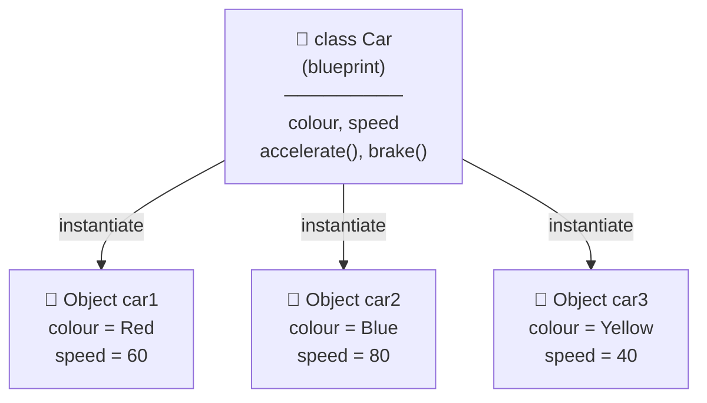
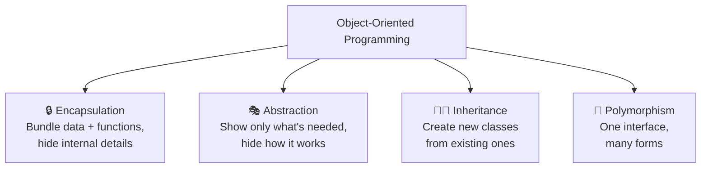
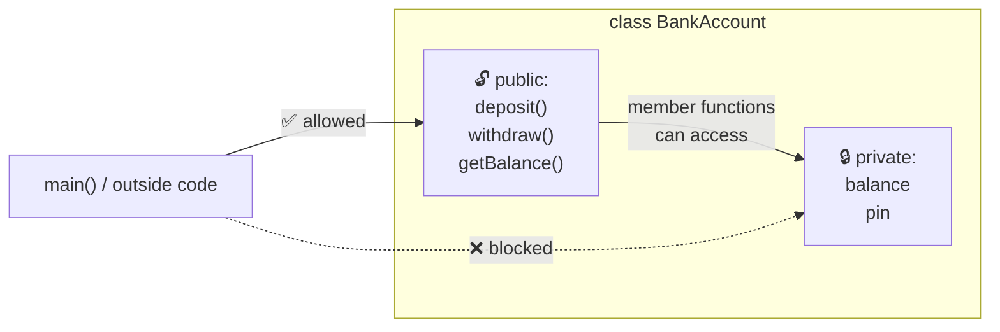
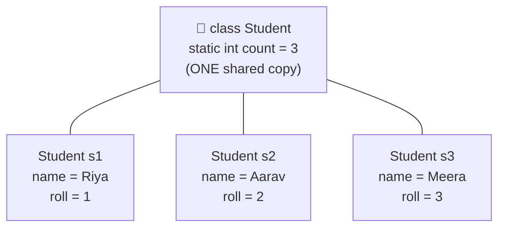
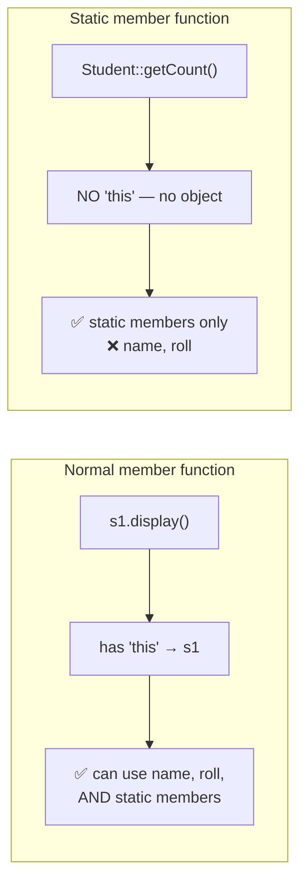
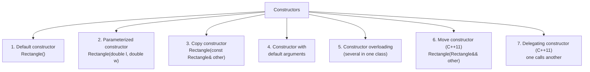
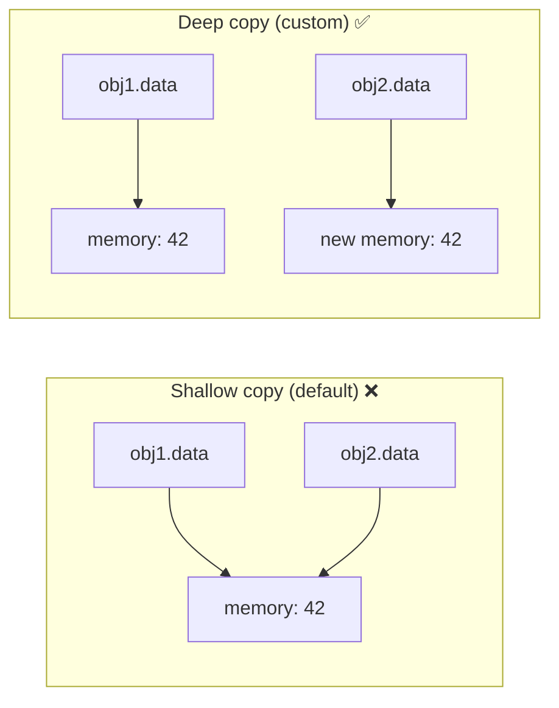
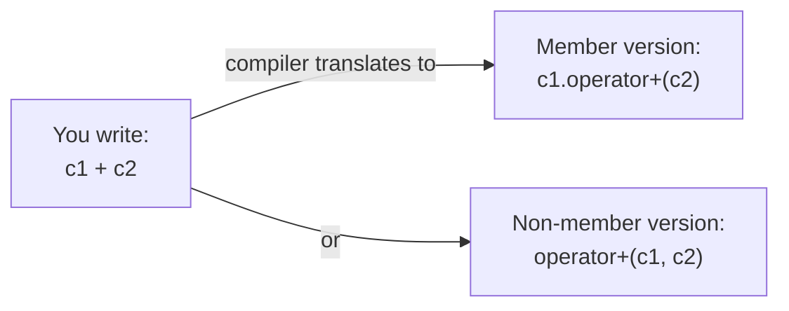
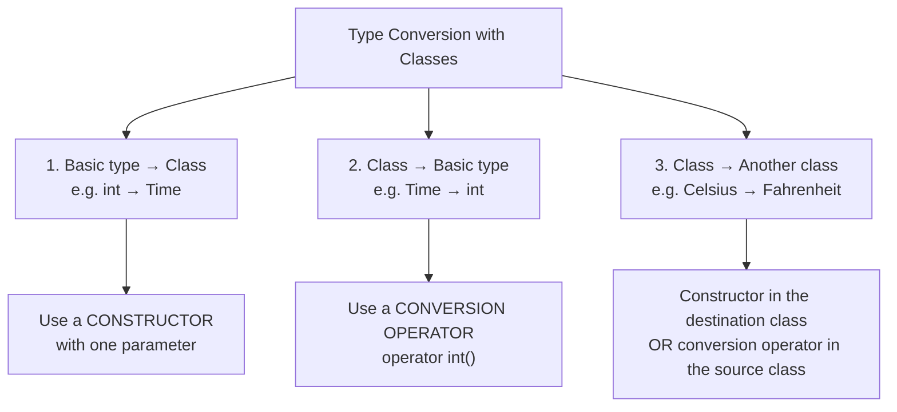
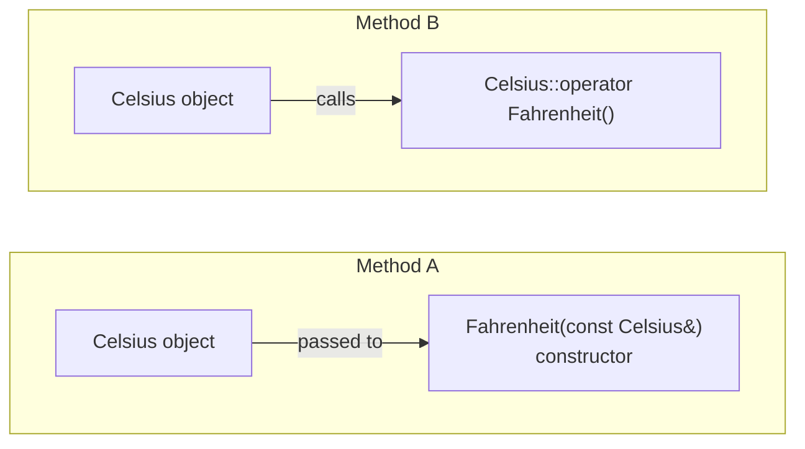

> **Goal of this lesson:** Learn Object-Oriented Programming (OOP) in C++ — create classes and objects, protect data with `private` and `public`, share data with `static` members, set up and clean up objects with constructors and destructors, make your own types work with operators like `+` and `<<`, and convert between classes and built-in types.

> 💡 *Diagrams use **Mermaid**, which GitHub renders automatically.*

---

## 📑 Table of Contents

| # | Syllabus Topic | Section |
|---|----------------|---------|
| 1 | Basics of Objects and Classes | [Section 1](#1-basics-of-objects-and-classes) |
| 2 | Private and Public Members | [Section 2](#2-private-and-public-members) |
| 3 | Static Data Members | [Section 3](#3-static-data-members) |
| 4 | Static Function Members | [Section 4](#4-static-function-members) |
| 5 | Constructors and Their Types | [Section 5](#5-constructors-and-their-types) |
| 6 | Destructors | [Section 6](#6-destructors) |
| 7 | Operator Overloading | [Section 7](#7-operator-overloading) |
| 8 | Type Conversion | [Section 8](#8-type-conversion-with-classes) |
| — | Complete Example: Everything Together | [Section 9](#9-complete-example-everything-together) |
| — | All Topics at a Glance | [Section 10](#10-all-topics-at-a-glance) |
| — | Mistakes, Exercises, Quiz, Summary | [Section 11](#11-common-beginner-mistakes) onward |

**Detailed contents:**

- [1. Basics of Objects and Classes](#1-basics-of-objects-and-classes)
  - [1.1 Why OOP?](#11-why-oop) · [1.2 Class and Object](#12-what-are-classes-and-objects) · [1.3 Defining a Class](#13-defining-a-class) · [1.4 Creating Objects](#14-creating-objects-and-accessing-members) · [1.5 Member Functions Outside the Class](#15-defining-member-functions-outside-the-class) · [1.6 Memory](#16-how-objects-are-stored-in-memory) · [1.7 The `this` Pointer](#17-the-this-pointer) · [1.8 `const` Member Functions](#18-const-member-functions) · [1.9 Objects with Functions](#19-objects-as-function-arguments-and-return-values) · [1.10 Arrays of Objects](#110-arrays-of-objects) · [1.11 `class` vs `struct`](#111-class-vs-struct) · [1.12 Four Pillars of OOP](#112-the-four-pillars-of-oop)
- [2. Private and Public Members](#2-private-and-public-members)
- [3. Static Data Members](#3-static-data-members)
- [4. Static Function Members](#4-static-function-members)
- [5. Constructors and Their Types](#5-constructors-and-their-types)
- [6. Destructors](#6-destructors)
- [7. Operator Overloading](#7-operator-overloading)
- [8. Type Conversion with Classes](#8-type-conversion-with-classes)

---

## 1. Basics of Objects and Classes

### 1.1 Why OOP?

So far we've written **procedural** programs: data in variables, and separate functions that work on that data.

```cpp
// Procedural style — data and functions are separate
string studentName = "Riya";
int studentRoll = 12;
double studentMarks = 88.5;

void printStudent(string name, int roll, double marks) { ... }
bool hasPassed(double marks) { ... }
```

With 100 students and 20 functions, it gets messy: which variables belong together? Who is allowed to change `studentMarks`?

**Object-Oriented Programming (OOP)** bundles **data** and the **functions that work on it** into a single unit called a **class**.

```cpp
// OOP style — data and functions together
class Student {
    string name;
    int roll;
    double marks;
public:
    void print();
    bool hasPassed();
};
```

| Procedural Programming | Object-Oriented Programming |
|------------------------|-----------------------------|
| Focus on **functions** (actions) | Focus on **objects** (things) |
| Data and functions are separate | Data and functions are bundled together |
| Data is often global and unprotected | Data can be hidden (`private`) |
| Harder to manage in large programs | Scales well to large programs |
| Example language: C | Examples: C++, Java, Python, C# |

🌍 **Real-world thinking:** The world is made of **objects** — students, cars, bank accounts. Each has **properties** (what it *is*) and **behaviours** (what it *does*). OOP lets code mirror the real world.

| Real-World Object | Properties (Data) | Behaviours (Functions) |
|-------------------|-------------------|------------------------|
| 🚗 Car | colour, speed, fuel | accelerate(), brake(), refuel() |
| 🏦 Bank account | account number, balance | deposit(), withdraw(), getBalance() |
| 🎓 Student | name, roll number, marks | study(), takeExam(), getGrade() |
| 📱 Phone | brand, battery level | call(), charge(), takePhoto() |

---

### 1.2 What Are Classes and Objects?

| Term | Meaning | Analogy |
|------|---------|---------|
| **Class** | A **blueprint** or template that defines data and functions | 📐 Blueprint of a house |
| **Object** | A real **instance** created from a class | 🏠 An actual house built from the blueprint |
| **Data members** | Variables inside a class (attributes / properties) | Rooms, colour, number of floors |
| **Member functions** | Functions inside a class (methods / behaviours) | Open door, switch on lights |
| **Instantiation** | Creating an object from a class | Building a house |



📌 **One class, many objects.** Every object has its **own copy** of the data, but they all follow the **same blueprint**.

🍪 **Another analogy:** A class is a **cookie cutter**; objects are the **cookies**. Same shape, but each cookie can have different toppings (data values).

---

### 1.3 Defining a Class

### Syntax

```cpp
class ClassName {
private:
    // data members (usually private)

public:
    // member functions (usually public)
};   // ⚠️ semicolon required!
```

### Example

```cpp
class Rectangle {
private:
    double length;          // data members
    double width;

public:
    void setDimensions(double l, double w) {   // member functions
        length = l;
        width = w;
    }

    double area() {
        return length * width;
    }

    double perimeter() {
        return 2 * (length + width);
    }
};
```

📌 Defining a class creates a **new data type** — just like `int` or `string`, but designed by you. **No memory is used** until you create an object.

---

### 1.4 Creating Objects and Accessing Members

```cpp
#include <iostream>
using namespace std;

class Rectangle {
private:
    double length;
    double width;

public:
    void setDimensions(double l, double w) {
        length = l;
        width = w;
    }
    double area() { return length * width; }
    double perimeter() { return 2 * (length + width); }
};

int main() {
    Rectangle r1;                      // create an object
    Rectangle r2, r3;                  // create several objects

    r1.setDimensions(5, 3);            // call member functions with the dot operator
    r2.setDimensions(10, 2);

    cout << "r1 area      : " << r1.area() << endl;
    cout << "r1 perimeter : " << r1.perimeter() << endl;
    cout << "r2 area      : " << r2.area() << endl;
    return 0;
}
```

**Output:**
```
r1 area      : 15
r1 perimeter : 16
r2 area      : 20
```

### The Dot Operator `.`

```
   objectName . memberName
       r1     .    area()
```

| Access | Syntax |
|--------|--------|
| Call a member function | `r1.area()` |
| Access a public data member | `r1.length` (only if `length` is public) |
| Through a pointer (later lesson) | `ptr->area()` |

---

### 1.5 Defining Member Functions Outside the Class

For longer functions, **declare** inside the class and **define** outside using the **scope resolution operator `::`** (Lesson 4).

```cpp
#include <iostream>
#include <string>
using namespace std;

class Student {
private:
    string name;
    int roll;
    double marks;

public:
    void setData(string n, int r, double m);   // declarations only
    void display();
    bool hasPassed();
};

// Definitions outside the class
void Student::setData(string n, int r, double m) {
    name = n;
    roll = r;
    marks = m;
}

void Student::display() {
    cout << "Roll " << roll << ": " << name << " (" << marks << ")" << endl;
}

bool Student::hasPassed() {
    return marks >= 40;
}

int main() {
    Student s;
    s.setData("Riya Sharma", 12, 88.5);
    s.display();
    cout << "Passed? " << (s.hasPassed() ? "Yes" : "No") << endl;
    return 0;
}
```

**Output:**
```
Roll 12: Riya Sharma (88.5)
Passed? Yes
```

```
   void  Student :: display ( )
          │      │
     class name  "belongs to"
```

| Inside the Class | Outside the Class (`::`) |
|------------------|-------------------------|
| Good for short functions (1–3 lines) | Good for longer functions |
| Automatically `inline` (Lesson 12 Part 2) | Not inline by default |
| Class becomes long and hard to scan | Class stays a clean summary |

📌 In real projects: the class goes in a **header file** (`Student.h`) and the definitions in a **source file** (`Student.cpp`) — Lesson 3, Section 12.

---

### 1.6 How Objects Are Stored in Memory

- Each object gets its **own copy** of the **data members**.
- **Member functions** are stored **once** and **shared** by all objects.

```
  Student s1;          Student s2;          Member functions (shared, stored once)
 ┌──────────────┐     ┌──────────────┐     ┌──────────────────────┐
 │ name = Riya  │     │ name = Aarav │     │ setData()            │
 │ roll = 12    │     │ roll = 7     │     │ display()            │
 │ marks = 88.5 │     │ marks = 72.0 │     │ hasPassed()          │
 └──────────────┘     └──────────────┘     └──────────────────────┘
```

So how does `display()` know **which** object's `name` to print? ➡️ The **`this`** pointer.

```cpp
cout << sizeof(Student);   // size of data members only (functions don't add to object size)
```

---

### 1.7 The `this` Pointer

Inside every (non-static) member function, C++ provides a hidden pointer called **`this`**, which points to the **object that called the function**.

```cpp
s1.display();   // inside display(), this → s1
s2.display();   // inside display(), this → s2
```

### Use 1: Resolve Name Conflicts

When a parameter has the **same name** as a data member, the parameter **hides** the member (shadowing — Lesson 5). Use `this->` to mean the member:

```cpp
class Student {
    string name;
    int roll;
public:
    void setData(string name, int roll) {
        this->name = name;      // this->name = member, name = parameter
        this->roll = roll;
    }
};
```

### Use 2: Method Chaining (Return `*this` by Reference)

```cpp
#include <iostream>
using namespace std;

class Counter {
    int value = 0;
public:
    Counter& add(int n) {
        value += n;
        return *this;           // return this object by reference (Lesson 12 Part 2)
    }
    void show() { cout << "Value: " << value << endl; }
};

int main() {
    Counter c;
    c.add(5).add(10).add(3).show();   // chaining → Value: 18
    return 0;
}
```

| Expression | Meaning |
|------------|---------|
| `this` | Address of the current object (a pointer) |
| `*this` | The current object itself |
| `this->member` | A member of the current object |

---

### 1.8 `const` Member Functions

A member function marked **`const`** promises **not to modify** the object. Put `const` **after** the parameter list:

```cpp
class Circle {
    double radius;
public:
    void setRadius(double r) { radius = r; }           // modifies → not const
    double area() const { return 3.14159 * radius * radius; }   // only reads → const ✅
    // void bad() const { radius = 5; }                // ❌ error: object is read-only here
};
```

### Why It Matters

`const` objects can call **only** `const` member functions:

```cpp
const Circle c;        // (needs a constructor — Section 5)
c.area();              // ✅ allowed
c.setRadius(3);        // ❌ error: can't modify a const object
```

And `const &` parameters (Lesson 12) are `const` objects:

```cpp
void printArea(const Circle& c) {
    cout << c.area();  // ✅ works ONLY because area() is const
}
```

✅ **Rule:** mark **every** member function that doesn't change the object as `const` (getters, display functions, calculations).

---

### 1.9 Objects as Function Arguments and Return Values

Objects can be passed to and returned from functions like any other type (Lesson 12):

```cpp
#include <iostream>
#include <cmath>
using namespace std;

class Point {
public:
    double x = 0, y = 0;
};

double distanceFromOrigin(const Point& p) {    // pass by const reference ✅
    return sqrt(p.x * p.x + p.y * p.y);
}

void moveRight(Point& p, double amount) {      // pass by reference to modify
    p.x += amount;
}

Point midpoint(const Point& a, const Point& b) {   // return an object
    Point m;
    m.x = (a.x + b.x) / 2;
    m.y = (a.y + b.y) / 2;
    return m;
}

int main() {
    Point p1, p2;
    p1.x = 3; p1.y = 4;
    p2.x = 7; p2.y = 10;

    cout << distanceFromOrigin(p1) << endl;          // 5
    moveRight(p1, 2);
    cout << p1.x << endl;                            // 5
    Point m = midpoint(p1, p2);
    cout << "(" << m.x << ", " << m.y << ")" << endl;   // (6, 7)
    return 0;
}
```

📌 Pass objects by **`const &`** when reading, by **`&`** when modifying. Passing by value copies the whole object.

---

### 1.10 Arrays of Objects

```cpp
#include <iostream>
#include <string>
using namespace std;

class Product {
public:
    string name;
    double price;
};

int main() {
    Product items[3];                  // array of 3 objects

    items[0].name = "Pen";      items[0].price = 10;
    items[1].name = "Notebook"; items[1].price = 45;
    items[2].name = "Bag";      items[2].price = 650;

    double total = 0;
    for (int i = 0; i < 3; i++) {
        cout << items[i].name << ": Rs. " << items[i].price << endl;
        total += items[i].price;
    }
    cout << "Total: Rs. " << total << endl;
    return 0;
}
```
> 📚 Arrays are covered fully in the Arrays lesson.

---

### 1.11 `class` vs `struct`

In C++, `class` and `struct` are **almost identical**. The only difference is the **default access**:

| | `class` | `struct` |
|--|---------|----------|
| Default member access | **`private`** | **`public`** |
| Default inheritance | `private` | `public` |
| Can have functions, constructors, etc.? | ✅ | ✅ |
| Typical use | Objects with behaviour and protected data | Simple bundles of public data |

```cpp
class A { int x; };    // x is private
struct B { int x; };   // x is public

A a; a.x = 5;          // ❌ error
B b; b.x = 5;          // ✅
```

📌 **Convention:** use `struct` for plain data (like `Point {x, y}`), and `class` when there's data to protect and behaviour to provide.

---

### 1.12 The Four Pillars of OOP



| Pillar | Meaning | Where You'll See It |
|--------|---------|---------------------|
| **Encapsulation** | Data and functions bundled; data protected | This lesson (Sections 1–2) |
| **Abstraction** | Users see *what* an object does, not *how* | This lesson (public interface) |
| **Inheritance** | `class Dog : public Animal` | Inheritance lesson |
| **Polymorphism** | Overloading, operator overloading, virtual functions | Lesson 12 Part 2, Section 7 of this lesson |

🚗 **Abstraction analogy:** You drive a car using the steering wheel, pedals, and gear — the **public interface**. You don't need to know how the engine's fuel injection works — that's **hidden**.

---

## 2. Private and Public Members

### 2.1 Access Specifiers

**Access specifiers** control **who can access** class members.

| Specifier | Accessible From | Typical Use |
|-----------|-----------------|-------------|
| **`private`** | Only member functions (and friends) of the **same class** | Data members |
| **`public`** | **Anywhere** in the program | Member functions (the interface) |
| **`protected`** | Same class **and derived classes** | Data for inheritance (later lesson) |



### 2.2 Example: Why Private Matters

#### ❌ Everything Public — Dangerous

```cpp
class BankAccount {
public:
    double balance;
};

int main() {
    BankAccount acc;
    acc.balance = 1000;
    acc.balance = -50000;      // 😱 nothing stops invalid data!
}
```

#### ✅ Private Data + Public Functions — Safe

```cpp
#include <iostream>
#include <string>
using namespace std;

class BankAccount {
private:
    string owner;
    double balance = 0;

public:
    void setOwner(const string& name) {
        owner = name;
    }

    void deposit(double amount) {
        if (amount <= 0) {
            cout << "Deposit must be positive!" << endl;
            return;
        }
        balance += amount;
    }

    bool withdraw(double amount) {
        if (amount <= 0 || amount > balance) {
            cout << "Withdrawal of " << amount << " rejected!" << endl;
            return false;
        }
        balance -= amount;
        return true;
    }

    double getBalance() const {
        return balance;
    }
};

int main() {
    BankAccount acc;
    acc.setOwner("Riya");
    acc.deposit(5000);
    acc.withdraw(1200);
    acc.withdraw(10000);       // rejected
    acc.deposit(-300);         // rejected

    cout << "Balance: " << acc.getBalance() << endl;   // 3800
    // acc.balance = -50000;   // ❌ error: 'balance' is private
    return 0;
}
```

**Output:**
```
Withdrawal of 10000 rejected!
Deposit must be positive!
Balance: 3800
```

🏧 **Analogy:** An ATM. You can't open the machine and take cash (private data). You use the **buttons** (public functions), which **check** your PIN and balance before giving money.

### 2.3 Getters and Setters

**Getters** (accessors) read private data; **setters** (mutators) change it — with **validation**.

```cpp
class Student {
private:
    int age;
    double marks;

public:
    // Getters — usually const
    int getAge() const { return age; }
    double getMarks() const { return marks; }

    // Setters — validate before storing
    void setAge(int a) {
        if (a >= 5 && a <= 100) age = a;
        else cout << "Invalid age!" << endl;
    }
    void setMarks(double m) {
        if (m >= 0 && m <= 100) marks = m;
        else cout << "Marks must be 0-100!" << endl;
    }
};
```

💡 Not every member needs a setter. If something should never change after creation (like a roll number or account number), provide **only a getter** — a **read-only** property.

### 2.4 Encapsulation and Data Hiding

| Term | Meaning |
|------|---------|
| **Encapsulation** | Bundling data and functions into one unit (the class) |
| **Data hiding** | Making data `private` so it can only be changed through controlled functions |

### Benefits

| Benefit | Explanation |
|---------|-------------|
| 🛡️ **Validity** | Data can't be set to invalid values |
| 🔧 **Flexibility** | You can change the internal implementation without breaking code that uses the class |
| 🐛 **Easier debugging** | If `balance` is wrong, only a few functions could have changed it |
| 📖 **Clear interface** | Users see only the public functions they need |

### 2.5 Rules and Facts

```cpp
class Example {
    int a;              // private by default in a class!
public:
    int b;
private:
    int c;
public:                 // specifiers can appear multiple times, in any order
    void show();
};
```

- In a **`class`**, members are **`private` by default**; in a **`struct`**, **`public`** by default.
- Access is per **class**, not per object — a member function can access private members of **another object of the same class**:

```cpp
class Box {
    double volume;
public:
    bool isBiggerThan(const Box& other) const {
        return volume > other.volume;   // ✅ allowed: same class
    }
};
```

- `friend` functions (Lesson 12 Part 2) can also access private members.

---

## 3. Static Data Members

### 3.1 The Problem

Each object has its **own copy** of normal data members. What if you need data **shared by all objects** — like a count of how many students exist?

```cpp
class Student {
    int count = 0;     // ❌ each student has its own count — useless!
};
```

### 3.2 The Solution: `static`

A **static data member** belongs to the **class itself**, not to any one object. There is **exactly one copy**, shared by all objects.



🏫 **Analogy:** In a classroom, each student has their **own notebook** (normal data member), but there's **one whiteboard** (static data member) that **everyone shares**. If one student writes on it, everyone sees the change.

### 3.3 Syntax: Declare Inside, Define Outside

```cpp
class Student {
    static int count;          // 1. DECLARATION inside the class
};

int Student::count = 0;        // 2. DEFINITION outside the class (allocates memory)
                               //    no 'static' keyword here
```

⚠️ Forgetting the definition outside → **linker error**: `undefined reference to 'Student::count'` (Lesson 8).

### Modern Alternative (C++17): `inline static`

```cpp
class Student {
    inline static int count = 0;   // ✅ declared AND defined inside the class
};
```

### 3.4 Example: Counting Objects

```cpp
#include <iostream>
#include <string>
using namespace std;

class Student {
private:
    string name;
    int rollNo;

public:
    static int count;                    // shared by all Students

    void setData(const string& n) {
        name = n;
        count++;                         // every new student increases the shared count
        rollNo = count;                  // use it to assign a unique roll number
    }

    void display() const {
        cout << "Roll " << rollNo << ": " << name
             << " (total students: " << count << ")" << endl;
    }
};

int Student::count = 0;                  // definition

int main() {
    Student s1, s2, s3;
    s1.setData("Riya");
    s2.setData("Aarav");
    s3.setData("Meera");

    s1.display();
    s2.display();
    s3.display();

    cout << "Count via class name: " << Student::count << endl;
    cout << "Count via object    : " << s1.count << endl;   // also works, but less clear
    return 0;
}
```

**Output:**
```
Roll 1: Riya (total students: 3)
Roll 2: Aarav (total students: 3)
Roll 3: Meera (total students: 3)
Count via class name: 3
Count via object    : 3
```

📌 Notice: all three objects print **`total students: 3`** — they all see the **same** `count`.

### 3.5 Static Constants

```cpp
class Exam {
public:
    static const int MAX_MARKS = 100;        // integral const: can initialize inside
    static constexpr double PASS_PERCENT = 40.0;   // constexpr works for any literal type
};

cout << Exam::MAX_MARKS;                     // 100
```

### 3.6 Properties of Static Data Members

| Property | Normal Data Member | Static Data Member |
|----------|-------------------|--------------------|
| Copies | One **per object** | **One per class** (shared) |
| Created when | Object is created | Program starts (before `main`) |
| Destroyed when | Object is destroyed | Program ends |
| Memory location | Inside each object | Separate, outside all objects |
| Counted in `sizeof(object)` | ✅ Yes | ❌ No |
| Access | `obj.member` | `ClassName::member` (preferred) or `obj.member` |
| Exists with zero objects? | ❌ | ✅ Yes |
| Default value if not initialized | Garbage (local objects) | **0** |

### 3.7 Common Uses

- 🔢 Counting objects created
- 🆔 Generating unique IDs (roll numbers, ticket numbers, order IDs)
- ⚙️ Settings shared by all objects (interest rate for all accounts, tax rate)
- 📏 Class-wide constants (`MAX_MARKS`)

```cpp
class SavingsAccount {
    double balance;
public:
    static double interestRate;     // same rate for every account
    double yearlyInterest() const { return balance * interestRate / 100; }
};
double SavingsAccount::interestRate = 6.5;

// Bank changes the rate for EVERYONE in one line:
SavingsAccount::interestRate = 7.0;
```

---

## 4. Static Function Members

### 4.1 What Are They?

A **static member function** belongs to the **class**, not to any object. It can be called **without creating any object**:

```cpp
ClassName::functionName();
```

### 4.2 Example

```cpp
#include <iostream>
#include <string>
using namespace std;

class Student {
private:
    string name;
    static int count;                 // private static data

public:
    void setName(const string& n) {
        name = n;
        count++;
    }

    static int getCount() {           // static member function
        return count;                 // ✅ can access static data
        // return name;               // ❌ error: no object, so no 'name'!
    }
};

int Student::count = 0;

int main() {
    cout << "Students: " << Student::getCount() << endl;   // 0 — no objects needed!

    Student a, b;
    a.setName("Riya");
    b.setName("Aarav");

    cout << "Students: " << Student::getCount() << endl;   // 2
    return 0;
}
```

**Output:**
```
Students: 0
Students: 2
```

### 4.3 Why Can't Static Functions Access Normal Members?

A static function is **not called on an object**, so it has **no `this` pointer**. If it tried to use `name`, the question is: *whose* name? There's no answer.



### 4.4 Example: ID Generator

```cpp
#include <iostream>
using namespace std;

class Ticket {
private:
    int id;
    static int nextId;

    static int generateId() {         // private static helper
        return nextId++;
    }

public:
    void create() {
        id = generateId();
    }
    int getId() const { return id; }

    static void resetCounter(int start) {
        nextId = start;
    }
};

int Ticket::nextId = 1001;

int main() {
    Ticket t1, t2, t3;
    t1.create();
    t2.create();
    Ticket::resetCounter(5000);       // called without any object
    t3.create();

    cout << t1.getId() << " " << t2.getId() << " " << t3.getId() << endl;
    return 0;
}
```

**Output:**
```
1001 1002 5000
```

### 4.5 Example: Utility Class

Static functions are great for **helper functions** that don't need object data:

```cpp
class MathUtils {
public:
    static int square(int x) { return x * x; }
    static bool isEven(int x) { return x % 2 == 0; }
    static double celsiusToF(double c) { return c * 9.0 / 5.0 + 32; }
};

cout << MathUtils::square(7);          // 49 — no object needed
cout << MathUtils::celsiusToF(100);    // 212
```
(In modern C++, a **namespace** (Lesson 4) often does this job just as well.)

### 4.6 Static vs Non-Static Member Functions

| Feature | Non-Static Member Function | Static Member Function |
|---------|---------------------------|------------------------|
| Belongs to | Each object | The class |
| Called with | `obj.func()` | `ClassName::func()` (or `obj.func()`) |
| Needs an object? | ✅ Yes | ❌ No |
| Has `this` pointer? | ✅ Yes | ❌ No |
| Access non-static members | ✅ Yes | ❌ No (only through an object parameter) |
| Access static members | ✅ Yes | ✅ Yes |
| Can be `const` | ✅ Yes | ❌ No (no object to protect) |
| Can be `virtual` | ✅ Yes | ❌ No |

### 4.7 Static Members Summary

| | Static Data Member | Static Member Function |
|--|-------------------|------------------------|
| Declared with | `static int count;` | `static int getCount();` |
| Defined outside as | `int Student::count = 0;` | `int Student::getCount() { ... }` (no `static`) |
| Number of copies | One per class | One per class (like all functions) |
| Accessed via | `Student::count` | `Student::getCount()` |
| Purpose | Shared data | Functions that work with shared data / no object |

---

## 5. Constructors and Their Types

### 5.1 The Problem: Uninitialized Objects

```cpp
Rectangle r;
cout << r.area();      // ❌ length and width hold garbage values!
r.setDimensions(5, 3); // you might forget to call this
```

### 5.2 What is a Constructor?

A **constructor** is a special member function that is **automatically called when an object is created**. Its job is to **initialize** the object.

🏠 **Analogy:** When a new house is built, the builder **sets everything up** — fixes the doors, connects electricity, paints the walls — **before** anyone moves in. You don't have to remember to do it yourself.

### 5.3 Rules of Constructors

| Rule | Example |
|------|---------|
| Has the **same name** as the class | `Rectangle()` |
| Has **no return type** — not even `void` | ~~`void Rectangle()`~~ |
| Called **automatically** when an object is created | `Rectangle r;` calls it |
| Usually **`public`** | |
| Can be **overloaded** (many constructors) | `Rectangle()`, `Rectangle(double, double)` |
| Can have **default arguments** | `Rectangle(double l = 1, double w = 1)` |
| **Cannot** be `virtual`, `static`, or `const` | |

### 5.4 Types of Constructors



---

### 5.5 Type 1: Default Constructor

Takes **no arguments**. Called when an object is created with no values.

```cpp
#include <iostream>
using namespace std;

class Rectangle {
    double length, width;
public:
    Rectangle() {                       // default constructor
        length = 1;
        width = 1;
        cout << "Default constructor called" << endl;
    }
    double area() const { return length * width; }
};

int main() {
    Rectangle r;                        // constructor runs automatically
    cout << "Area: " << r.area() << endl;   // 1 — no garbage!
    return 0;
}
```

**Output:**
```
Default constructor called
Area: 1
```

### Compiler-Generated Default Constructor

If you write **no constructors at all**, the compiler creates an **empty** default constructor for you (members of built-in types are left uninitialized).

⚠️ **But** — if you write **any** constructor, the compiler **stops** generating the default one:

```cpp
class Box {
    double side;
public:
    Box(double s) { side = s; }     // only a parameterized constructor
};

Box b1(5);     // ✅
Box b2;        // ❌ error: no default constructor exists
```

✅ Bring it back with `= default` (C++11):
```cpp
class Box {
    double side = 1;                // default member initializer
public:
    Box() = default;                // ask the compiler to generate it
    Box(double s) { side = s; }
};
```

### ⚠️ The "Most Vexing Parse"

```cpp
Rectangle r();     // ❌ NOT an object! This declares a FUNCTION named r returning Rectangle
Rectangle r;       // ✅ object using default constructor
Rectangle r{};     // ✅ also fine (brace initialization)
```

---

### 5.6 Type 2: Parameterized Constructor

Takes **arguments** so each object can start with **different values**.

```cpp
#include <iostream>
#include <string>
using namespace std;

class Student {
    string name;
    int roll;
    double marks;
public:
    Student(string n, int r, double m) {     // parameterized constructor
        name = n;
        roll = r;
        marks = m;
    }
    void display() const {
        cout << roll << ". " << name << " - " << marks << endl;
    }
};

int main() {
    Student s1("Riya", 1, 88.5);          // implicit call
    Student s2 = Student("Aarav", 2, 74); // explicit call
    Student s3{"Meera", 3, 91};           // brace initialization (C++11) ✅

    s1.display();
    s2.display();
    s3.display();
    return 0;
}
```

**Output:**
```
1. Riya - 88.5
2. Aarav - 74
3. Meera - 91
```

---

### 5.7 Member Initializer List ⭐

A better way to initialize members — **before** the constructor body runs:

```cpp
class Student {
    string name;
    int roll;
    double marks;
public:
    // Assignment in the body (works, but members are first default-created, then assigned)
    Student(string n, int r, double m) {
        name = n; roll = r; marks = m;
    }

    // ✅ Initializer list — members are created directly with these values
    Student(string n, int r, double m) : name(n), roll(r), marks(m) {
    }
};
```

*(Choose one of the two — not both in the same class.)*

```
   Student(string n, int r, double m) : name(n), roll(r), marks(m) { }
                                      │
                         colon starts the initializer list
```

### When the Initializer List Is **Required**

| Member Type | Why |
|-------------|-----|
| `const` members | Can't be assigned after creation |
| Reference members (`int&`) | Must be bound when created |
| Members of a class **without a default constructor** | Must be constructed with arguments |
| Base class with parameters (Inheritance) | Must be initialized first |

```cpp
class Account {
    const int accountNumber;      // const — can never change
    double balance;
public:
    Account(int num, double bal) : accountNumber(num), balance(bal) { }   // ✅
    // Account(int num, double bal) { accountNumber = num; }             // ❌ error
};
```

⚠️ Members are initialized in the **order they're declared in the class**, not the order in the list. Keep the list in the same order to avoid bugs (`-Wall` warns with `-Wreorder`).

✅ **Best practice:** always prefer the initializer list.

---

### 5.8 Type 3: Copy Constructor

Creates a **new object as a copy of an existing object**.

### Syntax
```cpp
ClassName(const ClassName& other)
```

```cpp
#include <iostream>
#include <string>
using namespace std;

class Student {
    string name;
    int roll;
public:
    Student(string n, int r) : name(n), roll(r) {
        cout << "Parameterized constructor: " << name << endl;
    }

    Student(const Student& other) : name(other.name), roll(other.roll) {
        cout << "Copy constructor: copying " << other.name << endl;
    }

    void display() const { cout << roll << ". " << name << endl; }
};

int main() {
    Student s1("Riya", 1);
    Student s2(s1);          // copy constructor
    Student s3 = s1;         // also copy constructor (NOT assignment!)

    s2.display();
    s3.display();
    return 0;
}
```

**Output:**
```
Parameterized constructor: Riya
Copy constructor: copying Riya
Copy constructor: copying Riya
1. Riya
1. Riya
```

### When Is the Copy Constructor Called?

| Situation | Example |
|-----------|---------|
| 1. Creating an object from another | `Student s2(s1);` or `Student s2 = s1;` |
| 2. Passing an object **by value** | `void f(Student s);` → `f(s1);` |
| 3. Returning an object **by value** | `Student make() { ... return s; }` (often optimized away — *copy elision*) |

⚠️ **Copy constructor vs assignment:**
```cpp
Student s2 = s1;    // NEW object being created → copy CONSTRUCTOR
s2 = s1;            // s2 already exists → copy ASSIGNMENT operator (Section 7)
```

### Why Must the Parameter Be a Reference?

```cpp
Student(Student other);   // ❌ error
```
Passing **by value** would need a copy… which calls the copy constructor… which needs a copy… → **infinite recursion**. The compiler rejects it. Use `const Student&`.

### Default Copy Constructor

If you don't write one, the compiler generates one that **copies every member** one by one (**memberwise copy**). That's fine for `int`, `double`, `string`… but **not** for raw pointers. 👇

### Shallow Copy vs Deep Copy (Preview)

> 🎓 *Uses pointers and dynamic memory (`new`/`delete`) — covered in later lessons. Focus on the idea.*

If a class holds a **pointer** to memory it allocated, the default copy copies only the **address** — both objects then share the **same** memory:



```cpp
class Wallet {
    int* amount;
public:
    Wallet(int a) { amount = new int(a); }

    // ✅ Deep copy: allocate NEW memory and copy the value
    Wallet(const Wallet& other) { amount = new int(*other.amount); }

    ~Wallet() { delete amount; }     // destructor (Section 6)
};
```

With a shallow copy, changing one object's value changes the other's, and when both destructors run, the **same memory is deleted twice** → crash. 💥

📌 **Rule of Three:** if a class needs a custom **destructor**, it almost certainly needs a custom **copy constructor** and **copy assignment operator** too.

---

### 5.9 Type 4: Constructor with Default Arguments

```cpp
#include <iostream>
using namespace std;

class Time {
    int hours, minutes;
public:
    Time(int h = 0, int m = 0) : hours(h), minutes(m) { }   // works as 3 constructors!
    void show() const { cout << hours << "h " << minutes << "m" << endl; }
};

int main() {
    Time t1;           // 0h 0m   — acts as a default constructor
    Time t2(5);        // 5h 0m
    Time t3(5, 30);    // 5h 30m

    t1.show(); t2.show(); t3.show();
    return 0;
}
```

📌 A constructor whose parameters **all** have defaults also counts as the **default constructor**.

---

### 5.10 Type 5: Constructor Overloading

A class can have **several constructors** with different parameter lists (Lesson 12 Part 2 — overloading):

```cpp
#include <iostream>
#include <string>
using namespace std;

class Book {
    string title;
    string author;
    double price;
public:
    Book() : title("Untitled"), author("Unknown"), price(0) { }
    Book(string t) : title(t), author("Unknown"), price(0) { }
    Book(string t, string a, double p) : title(t), author(a), price(p) { }

    void show() const {
        cout << title << " by " << author << " - Rs. " << price << endl;
    }
};

int main() {
    Book b1;
    Book b2("C++ Basics");
    Book b3("Learn OOP", "R. Kumar", 499);

    b1.show();
    b2.show();
    b3.show();
    return 0;
}
```

**Output:**
```
Untitled by Unknown - Rs. 0
C++ Basics by Unknown - Rs. 0
Learn OOP by R. Kumar - Rs. 499
```

---

### 5.11 Type 6: Delegating Constructors (C++11)

One constructor can **call another** constructor of the same class to avoid repeating code:

```cpp
class Book {
    string title, author;
    double price;
public:
    Book(string t, string a, double p) : title(t), author(a), price(p) { }   // main one
    Book(string t) : Book(t, "Unknown", 0) { }                               // delegates
    Book() : Book("Untitled") { }                                            // delegates
};
```

---

### 5.12 Type 7: Move Constructor (C++11 — Awareness)

```cpp
ClassName(ClassName&& other)
```
Instead of **copying** data from a temporary object that's about to be destroyed, it **steals** (moves) the data — much faster for large objects. You'll learn this with **move semantics** in advanced lessons.

---

### 5.13 The `explicit` Keyword

A constructor with **one parameter** allows **automatic conversion** (Section 8). Mark it `explicit` to prevent surprises:

```cpp
class Meters {
    double value;
public:
    explicit Meters(double v) : value(v) { }
};

Meters m1(5.0);      // ✅
Meters m2 = 5.0;     // ❌ error: implicit conversion blocked by 'explicit'
```

---

### 5.14 Constructors Summary

| Type | Syntax | Called When |
|------|--------|-------------|
| Default | `A()` | `A obj;` |
| Parameterized | `A(int x, int y)` | `A obj(1, 2);` |
| Copy | `A(const A& other)` | `A b(a);`, `A b = a;`, pass/return by value |
| Default arguments | `A(int x = 0, int y = 0)` | Any of `A obj;`, `A obj(1);`, `A obj(1, 2);` |
| Overloaded | Several of the above | Best match chosen |
| Delegating | `A() : A(0, 0) { }` | Calls another constructor |
| Move | `A(A&& other)` | From temporaries (advanced) |
| Compiler default | (none written) | Only if **no** constructor is declared |

---

## 6. Destructors

### 6.1 What is a Destructor?

A **destructor** is a special member function that is **automatically called when an object is destroyed**. Its job is **cleanup** — releasing memory, closing files, etc.

🏨 **Analogy:** **Checking out** of a hotel. The constructor is **check-in** (you get a room and key). The destructor is **check-out** (return the key, clear the room) — and it happens **automatically** when your stay ends.

### 6.2 Syntax

```cpp
class ClassName {
public:
    ~ClassName() {      // tilde ~ + class name
        // cleanup code
    }
};
```

### 6.3 Rules of Destructors

| Rule | |
|------|--|
| Same name as the class, prefixed with **`~`** | `~Student()` |
| **No return type** | |
| **No parameters** | |
| **Only one** per class — cannot be overloaded | |
| Called **automatically** — you almost never call it yourself | |
| Can (and should, in base classes) be **`virtual`** | Lesson 12 Part 2 |
| If you don't write one, the compiler generates one | |

### 6.4 When Is a Destructor Called?

| Situation | Example |
|-----------|---------|
| A **local object** goes out of scope | End of a function or `{ }` block |
| A **global/static** object at program end | After `main()` returns |
| A **dynamically created** object is deleted | `delete ptr;` |
| A **temporary** object finishes its expression | `Student("X").display();` |

### 6.5 Example: Tracing Constructor and Destructor Calls

```cpp
#include <iostream>
#include <string>
using namespace std;

class Demo {
    string name;
public:
    Demo(string n) : name(n) {
        cout << "Constructor: " << name << endl;
    }
    ~Demo() {
        cout << "Destructor : " << name << endl;
    }
};

Demo globalObj("Global");

void function() {
    Demo f("InsideFunction");
    cout << "  ...function running..." << endl;
}   // f destroyed here

int main() {
    cout << "== main starts ==" << endl;
    Demo a("A");
    Demo b("B");

    {
        Demo c("BlockC");
        cout << "  ...inside block..." << endl;
    }   // c destroyed here

    function();
    cout << "== main ends ==" << endl;
    return 0;
}   // b, then a destroyed here; then globalObj
```

**Output:**
```
Constructor: Global
== main starts ==
Constructor: A
Constructor: B
Constructor: BlockC
  ...inside block...
Destructor : BlockC
Constructor: InsideFunction
  ...function running...
Destructor : InsideFunction
== main ends ==
Destructor : B
Destructor : A
Destructor : Global
```

### 6.6 Order of Destruction: Reverse of Construction

Objects are destroyed in the **reverse order** they were created — **Last In, First Out** (like the call stack, Lesson 12):

```
  Created:    A  →  B
  Destroyed:  B  →  A
```

🍽️ **Analogy:** A stack of plates — the last plate placed on top is the first one removed.

### 6.7 Object Lifecycle


### 6.8 Why Destructors Matter: Releasing Resources

When a class **acquires a resource** (dynamic memory, a file, a network connection), the destructor **releases** it — so you can never forget:

```cpp
#include <iostream>
using namespace std;

class Marks {
    int* scores;          // pointer to dynamically allocated memory (preview)
    int count;
public:
    Marks(int n) : count(n) {
        scores = new int[n];          // acquire memory
        cout << "Allocated memory for " << n << " scores" << endl;
    }
    ~Marks() {
        delete[] scores;              // release memory automatically
        cout << "Released memory" << endl;
    }
};

int main() {
    Marks m(5);
    // ... use m ...
    return 0;
}   // destructor runs → no memory leak ✅
```

**Output:**
```
Allocated memory for 5 scores
Released memory
```

📌 This pattern is called **RAII** — *Resource Acquisition Is Initialization*: acquire in the **constructor**, release in the **destructor**. It's one of the most important ideas in C++. `string`, `vector`, and file streams all work this way.

### 6.9 Example: Constructor + Destructor + Static Counter

```cpp
#include <iostream>
using namespace std;

class Player {
    static int active;
public:
    Player()  { active++; cout << "Player joined. Active: " << active << endl; }
    ~Player() { active--; cout << "Player left.   Active: " << active << endl; }
    static int getActive() { return active; }
};

int Player::active = 0;

int main() {
    Player p1;
    {
        Player p2;
        Player p3;
    }   // p3 and p2 leave
    cout << "Still playing: " << Player::getActive() << endl;
    return 0;
}
```

**Output:**
```
Player joined. Active: 1
Player joined. Active: 2
Player joined. Active: 3
Player left.   Active: 2
Player left.   Active: 1
Still playing: 1
Player left.   Active: 0
```

### 6.10 Constructor vs Destructor

| Feature | Constructor | Destructor |
|---------|-------------|------------|
| Purpose | Initialize the object | Clean up the object |
| Name | `ClassName` | `~ClassName` |
| Called | When the object is **created** | When the object is **destroyed** |
| Parameters | ✅ Allowed | ❌ None |
| Overloading | ✅ Many allowed | ❌ Only one |
| Return type | None | None |
| Can be `virtual` | ❌ No | ✅ Yes (should be, in base classes) |
| Order (several objects) | Order of creation | **Reverse** order |

---

## 7. Operator Overloading

### 7.1 What is Operator Overloading?

**Operator overloading** lets you give operators like `+`, `-`, `==`, and `<<` a **meaning for your own classes**.

```cpp
int a = 3 + 4;                     // + works on ints (built-in)
string s = string("Hi") + " there";   // + works on strings (the library overloaded it!)
Complex c = c1 + c2;               // + on YOUR class — only if you overload it
```

Without overloading:
```cpp
Complex c3 = c1.add(c2);           // works, but awkward
```
With overloading:
```cpp
Complex c3 = c1 + c2;              // ✅ natural, readable
```

📌 Operator overloading is a form of **compile-time polymorphism** — the same operator symbol works differently for different types.

### 7.2 Syntax

An overloaded operator is just a function named **`operator` followed by the symbol**:

```cpp
returnType operator+(parameters) { ... }
```



### 7.3 Which Operators Can Be Overloaded?

| ✅ Can Be Overloaded | ❌ Cannot Be Overloaded |
|---------------------|------------------------|
| Arithmetic: `+ - * / %` | `::` scope resolution |
| Relational: `== != < > <= >=` | `.` member access |
| Logical: `! && \|\|` | `.*` member pointer access |
| Bitwise: `& \| ^ ~ << >>` | `?:` ternary |
| Assignment: `= += -= *= /=` | `sizeof` |
| Increment/decrement: `++ --` | `typeid` |
| Subscript `[]`, call `()`, `->` | `alignof`, `noexcept` |
| Stream: `<<` `>>` | |
| `new`, `delete` | |

### 7.4 Rules of Operator Overloading

1. ❌ You **can't create new operators** (no `**` for power).
2. ❌ You **can't change precedence** or **associativity** (`*` still beats `+`).
3. ❌ You **can't change the number of operands** (`+` is still binary).
4. ❌ At least one operand must be a **user-defined type** — you can't change how `int + int` works.
5. ⚠️ `=`, `[]`, `()`, `->` **must** be member functions.
6. ✅ Keep the **natural meaning** — `+` should add, not subtract!

---

### 7.5 Overloading Binary Operators (Member Function)

A binary operator as a **member** takes **one** parameter — the **right** operand. The **left** operand is the object itself (`this`).

```cpp
#include <iostream>
using namespace std;

class Complex {
    double real, imag;
public:
    Complex(double r = 0, double i = 0) : real(r), imag(i) { }

    // c1 + c2  →  c1.operator+(c2)
    Complex operator+(const Complex& other) const {
        return Complex(real + other.real, imag + other.imag);
    }

    Complex operator-(const Complex& other) const {
        return Complex(real - other.real, imag - other.imag);
    }

    // (a + bi)(c + di) = (ac - bd) + (ad + bc)i
    Complex operator*(const Complex& other) const {
        return Complex(real * other.real - imag * other.imag,
                       real * other.imag + imag * other.real);
    }

    bool operator==(const Complex& other) const {
        return real == other.real && imag == other.imag;
    }

    bool operator!=(const Complex& other) const {
        return !(*this == other);       // reuse ==
    }

    void show() const {
        cout << real << (imag >= 0 ? " + " : " - ") << (imag >= 0 ? imag : -imag) << "i" << endl;
    }
};

int main() {
    Complex c1(3, 4), c2(1, -2);

    Complex sum = c1 + c2;
    Complex diff = c1 - c2;
    Complex prod = c1 * c2;

    cout << "c1 + c2 = "; sum.show();
    cout << "c1 - c2 = "; diff.show();
    cout << "c1 * c2 = "; prod.show();
    cout << "c1 == c2? " << (c1 == c2 ? "yes" : "no") << endl;
    return 0;
}
```

**Output:**
```
c1 + c2 = 4 + 2i
c1 - c2 = 2 + 6i
c1 * c2 = 11 - 2i
c1 == c2? no
```

```
   c1 + c2
   │    │
   │    └── passed as 'other'
   └── the object 'this' points to
```

### 7.6 Overloading Compound Assignment (`+=`)

Return **`*this` by reference** so it can be chained (Lesson 12 Part 2 — return by reference):

```cpp
Complex& operator+=(const Complex& other) {
    real += other.real;
    imag += other.imag;
    return *this;
}

// c1 += c2;   → c1 changes
```

---

### 7.7 Overloading Unary Operators

A unary operator as a **member** takes **no** parameters.

### Unary Minus

```cpp
Complex operator-() const {            // -c1
    return Complex(-real, -imag);
}
```

### Increment `++`: Prefix vs Postfix

The **postfix** version takes a **dummy `int` parameter** just to tell them apart:

```cpp
#include <iostream>
using namespace std;

class Counter {
    int value;
public:
    Counter(int v = 0) : value(v) { }

    Counter& operator++() {            // PREFIX: ++c
        ++value;
        return *this;                  // return the updated object
    }

    Counter operator++(int) {          // POSTFIX: c++   (int is a dummy)
        Counter old = *this;           // save the old value
        ++value;
        return old;                    // return the OLD value (by value)
    }

    int get() const { return value; }
};

int main() {
    Counter c(5);

    Counter a = ++c;     // c becomes 6, a = 6
    cout << "After ++c: c = " << c.get() << ", a = " << a.get() << endl;

    Counter b = c++;     // b = 6 (old), c becomes 7
    cout << "After c++: c = " << c.get() << ", b = " << b.get() << endl;
    return 0;
}
```

**Output:**
```
After ++c: c = 6, a = 6
After c++: c = 7, b = 6
```

| | Prefix `++c` | Postfix `c++` |
|--|-------------|--------------|
| Signature | `Counter& operator++()` | `Counter operator++(int)` |
| Returns | Updated object **by reference** | **Old** copy **by value** |
| Behaviour | Same as `++x` for ints (Lesson 9) | Same as `x++` for ints |

---

### 7.8 Overloading Stream Operators `<<` and `>>` (Friend Functions)

To write `cout << c1;`, the **left** operand is `cout` (an `ostream`), **not** your object — so it **can't** be a member of your class. Make it a **friend** (Lesson 12 Part 2) to access private data:

```cpp
#include <iostream>
using namespace std;

class Complex {
    double real, imag;
public:
    Complex(double r = 0, double i = 0) : real(r), imag(i) { }

    Complex operator+(const Complex& o) const { return Complex(real + o.real, imag + o.imag); }

    friend ostream& operator<<(ostream& out, const Complex& c);
    friend istream& operator>>(istream& in, Complex& c);
};

ostream& operator<<(ostream& out, const Complex& c) {
    out << c.real << (c.imag >= 0 ? " + " : " - ")
        << (c.imag >= 0 ? c.imag : -c.imag) << "i";
    return out;                 // return the stream → allows chaining
}

istream& operator>>(istream& in, Complex& c) {
    in >> c.real >> c.imag;     // c is NOT const — we modify it
    return in;
}

int main() {
    Complex a, b;
    cout << "Enter real and imaginary parts of a: ";
    cin >> a;
    cout << "Enter real and imaginary parts of b: ";
    cin >> b;

    cout << "a = " << a << ", b = " << b << endl;
    cout << "a + b = " << a + b << endl;
    return 0;
}
```

**Sample run:**
```
Enter real and imaginary parts of a: 3 4
Enter real and imaginary parts of b: 1 -6
a = 3 + 4i, b = 1 - 6i
a + b = 4 - 2i
```

### Why Return `ostream&`?

```cpp
cout << a << b << endl;
// = ((cout << a) << b) << endl
//       returns cout → cout << b → returns cout → cout << endl
```

---

### 7.9 Member vs Non-Member (Friend) Operators

| | Member Function | Non-Member (Friend) Function |
|--|-----------------|-----------------------------|
| Binary operator parameters | **1** (right operand) | **2** (both operands) |
| Unary operator parameters | **0** | **1** |
| Left operand must be | An object of **your class** | Anything |
| Example | `c1 + c2` → `c1.operator+(c2)` | `cout << c` → `operator<<(cout, c)` |
| **Required** for | `=`, `[]`, `()`, `->` | `<<`, `>>` with streams; `5 + c` (left side not your class) |

### The `5 + c` Problem

```cpp
Complex c(3, 4);
Complex r1 = c + 5;     // ✅ member: c.operator+(Complex(5)) — 5 converted (Section 8)
Complex r2 = 5 + c;     // ❌ with a member operator+: 5 is not an object!
```
✅ Fix: make `operator+` a **non-member** (friend) taking two `Complex` parameters — then **both** sides can be converted.

---

### 7.10 Overloading the Subscript Operator `[]`

```cpp
#include <iostream>
using namespace std;

class Marks {
    int scores[5] = {78, 85, 92, 66, 70};
public:
    int& operator[](int index) {           // return by reference → allows assignment
        if (index < 0 || index >= 5) {
            cout << "Index out of range! Returning first element." << endl;
            return scores[0];
        }
        return scores[index];
    }
};

int main() {
    Marks m;
    cout << m[2] << endl;     // 92
    m[2] = 95;                // works because operator[] returns int&
    cout << m[2] << endl;     // 95
    m[10];                    // safe: range is checked
    return 0;
}
```

---

### 7.11 Overloading the Assignment Operator `=`

The compiler generates a default `=` that copies all members (like the copy constructor). For classes with pointers you write your own (Rule of Three, Section 5.8):

```cpp
class Wallet {
    int* amount;
public:
    Wallet(int a) : amount(new int(a)) { }
    Wallet(const Wallet& o) : amount(new int(*o.amount)) { }

    Wallet& operator=(const Wallet& other) {
        if (this != &other) {             // 1. guard against self-assignment (w = w)
            *amount = *other.amount;      // 2. copy the VALUE, not the pointer
        }
        return *this;                     // 3. return *this for chaining (a = b = c)
    }

    ~Wallet() { delete amount; }
};
```

---

### 7.12 Complete Operator Overloading Example: `Fraction`

```cpp
#include <iostream>
#include <numeric>     // std::gcd (C++17)
using namespace std;

class Fraction {
    int num, den;

    void simplify() {
        int g = gcd(num, den);
        num /= g;
        den /= g;
        if (den < 0) { num = -num; den = -den; }   // keep the sign in the numerator
    }

public:
    Fraction(int n = 0, int d = 1) : num(n), den(d) {
        if (den == 0) { cout << "Denominator 0! Using 1." << endl; den = 1; }
        simplify();
    }

    Fraction operator+(const Fraction& o) const { return Fraction(num * o.den + o.num * den, den * o.den); }
    Fraction operator-(const Fraction& o) const { return Fraction(num * o.den - o.num * den, den * o.den); }
    Fraction operator*(const Fraction& o) const { return Fraction(num * o.num, den * o.den); }
    Fraction operator/(const Fraction& o) const { return Fraction(num * o.den, den * o.num); }

    bool operator==(const Fraction& o) const { return num == o.num && den == o.den; }
    bool operator<(const Fraction& o) const  { return num * o.den < o.num * den; }

    friend ostream& operator<<(ostream& out, const Fraction& f) {
        out << f.num;
        if (f.den != 1) out << "/" << f.den;
        return out;
    }
};

int main() {
    Fraction a(1, 2), b(1, 3);

    cout << a << " + " << b << " = " << a + b << endl;
    cout << a << " - " << b << " = " << a - b << endl;
    cout << a << " * " << b << " = " << a * b << endl;
    cout << a << " / " << b << " = " << a / b << endl;
    cout << boolalpha;
    cout << "2/4 == 1/2 ? " << (Fraction(2, 4) == a) << endl;
    cout << a << " < " << b << " ? " << (a < b) << endl;
    return 0;
}
```

**Output:**
```
1/2 + 1/3 = 5/6
1/2 - 1/3 = 1/6
1/2 * 1/3 = 1/6
1/2 / 1/3 = 3/2
2/4 == 1/2 ? true
1/2 < 1/3 ? false
```

💡 Notice: a friend function can also be **defined inside** the class (like `operator<<` here).

### 7.13 Operator Overloading Summary

| Operator | Typical Signature (member) | Notes |
|----------|---------------------------|-------|
| `a + b` | `T operator+(const T& b) const` | Returns a new object |
| `a += b` | `T& operator+=(const T& b)` | Returns `*this` by reference |
| `-a` | `T operator-() const` | Unary |
| `++a` | `T& operator++()` | Prefix |
| `a++` | `T operator++(int)` | Postfix (dummy `int`) |
| `a == b` | `bool operator==(const T& b) const` | Returns `bool` |
| `a < b` | `bool operator<(const T& b) const` | Needed for sorting |
| `a[i]` | `T& operator[](int i)` | Must be member |
| `a = b` | `T& operator=(const T& b)` | Must be member; check self-assignment |
| `cout << a` | `friend ostream& operator<<(ostream&, const T&)` | Non-member |
| `cin >> a` | `friend istream& operator>>(istream&, T&)` | Non-member |

---

## 8. Type Conversion with Classes

### 8.1 Three Situations

Lesson 10 covered conversions between **built-in** types (`int` ↔ `double`). With classes, there are **three new situations**:



| Conversion | Method | Defined In |
|------------|--------|-----------|
| Basic → Class | Single-argument **constructor** | Destination class |
| Class → Basic | **Conversion operator** `operator type()` | Source class |
| Class → Class | **Constructor** taking the source class | Destination class |
| | **or** conversion operator `operator Dest()` | Source class |

---

### 8.2 Case 1: Basic Type → Class Type

Use a **constructor that takes one argument** of the basic type. It's called a **conversion constructor**.

```cpp
#include <iostream>
using namespace std;

class Time {
    int hours, minutes;
public:
    Time() : hours(0), minutes(0) { }

    Time(int totalMinutes) {               // conversion constructor: int → Time
        hours = totalMinutes / 60;
        minutes = totalMinutes % 60;
    }

    void show() const { cout << hours << "h " << minutes << "m" << endl; }
};

int main() {
    int duration = 135;

    Time t1 = duration;     // implicit conversion: calls Time(135)
    Time t2(200);           // direct
    Time t3;
    t3 = 95;                // also converts: creates Time(95), then assigns

    t1.show();   // 2h 15m
    t2.show();   // 3h 20m
    t3.show();   // 1h 35m
    return 0;
}
```

**Output:**
```
2h 15m
3h 20m
1h 35m
```

### ⚠️ Unexpected Conversions and `explicit`

Implicit conversion can cause surprises:

```cpp
void printTime(const Time& t) { t.show(); }

printTime(500);       // compiles! 500 silently becomes Time(500) — was that intended?
```

Mark the constructor **`explicit`** to require a visible conversion:

```cpp
class Time {
public:
    explicit Time(int totalMinutes) { ... }
};

Time t1 = 135;                    // ❌ error: implicit conversion not allowed
Time t2(135);                     // ✅
Time t3 = Time(135);              // ✅
Time t4 = static_cast<Time>(135); // ✅
printTime(500);                   // ❌ error
printTime(Time(500));             // ✅ intent is clear
```

✅ **Best practice:** make single-argument constructors `explicit` **unless** you specifically want automatic conversion (like `Complex c = 5;` meaning 5 + 0i).

---

### 8.3 Case 2: Class Type → Basic Type

Use a **conversion operator** (also called a **casting operator function**):

### Syntax
```cpp
operator targetType() const {
    return value;
}
```

📌 Special features:
- **No return type** written before `operator` (the target type **is** the return type)
- **No parameters**
- Must be a **member function**
- Usually `const`

```cpp
#include <iostream>
using namespace std;

class Time {
    int hours, minutes;
public:
    Time(int h, int m) : hours(h), minutes(m) { }

    operator int() const {                 // Time → int (total minutes)
        return hours * 60 + minutes;
    }

    operator double() const {              // Time → double (hours as decimal)
        return hours + minutes / 60.0;
    }
};

int main() {
    Time t(2, 30);

    int totalMin = t;                      // implicit: calls operator int()
    double totalHrs = t;                   // implicit: calls operator double()
    int alsoMin = static_cast<int>(t);     // explicit

    cout << "Minutes: " << totalMin << endl;    // 150
    cout << "Hours  : " << totalHrs << endl;    // 2.5
    cout << "Again  : " << alsoMin << endl;     // 150
    return 0;
}
```

### `explicit` Conversion Operators (C++11)

```cpp
class Account {
    double balance;
public:
    Account(double b) : balance(b) { }

    explicit operator bool() const {       // "is this account usable?"
        return balance > 0;
    }
};

Account acc(500);
if (acc) { cout << "Active"; }             // ✅ allowed in conditions
bool ok = static_cast<bool>(acc);          // ✅ explicit cast
// int n = acc + 5;                        // ❌ blocked — prevents nonsense like bool → int math
```

---

### 8.4 Case 3: One Class Type → Another Class Type

Two ways. Use **only one** of them for any given pair — having both causes **ambiguity errors**.

#### Method A: Constructor in the **Destination** Class

```cpp
#include <iostream>
using namespace std;

class Celsius {
    double temp;
public:
    Celsius(double t) : temp(t) { }
    double getTemp() const { return temp; }
};

class Fahrenheit {
    double temp;
public:
    Fahrenheit(double t) : temp(t) { }

    Fahrenheit(const Celsius& c) {             // ⭐ Celsius → Fahrenheit
        temp = c.getTemp() * 9.0 / 5.0 + 32;
    }

    void show() const { cout << temp << " F" << endl; }
};

int main() {
    Celsius c(100);
    Fahrenheit f = c;        // uses Fahrenheit(const Celsius&)
    f.show();                // 212 F
    return 0;
}
```

#### Method B: Conversion Operator in the **Source** Class

```cpp
#include <iostream>
using namespace std;

class Fahrenheit {
    double temp;
public:
    Fahrenheit(double t) : temp(t) { }
    void show() const { cout << temp << " F" << endl; }
};

class Celsius {
    double temp;
public:
    Celsius(double t) : temp(t) { }

    operator Fahrenheit() const {              // ⭐ Celsius → Fahrenheit
        return Fahrenheit(temp * 9.0 / 5.0 + 32);
    }
};

int main() {
    Celsius c(37);
    Fahrenheit f = c;        // uses Celsius::operator Fahrenheit()
    f.show();                // 98.6 F
    return 0;
}
```

### Which Method to Choose?

| | Constructor in Destination | Conversion Operator in Source |
|--|---------------------------|------------------------------|
| Written in | Destination class (`Fahrenheit`) | Source class (`Celsius`) |
| Needs access to source's data via | Public getters (or friendship) | Its own members directly |
| Use when | You control the **destination** class | You control the **source** class, or converting to a class you can't edit |



---

### 8.5 Type Conversion Summary

| From → To | Method | Where | Example Signature |
|-----------|--------|-------|-------------------|
| Basic → Basic | Implicit / `static_cast` | Built in | `double d = 5;` (Lesson 10) |
| Basic → Class | Conversion constructor | Destination class | `Time(int minutes)` |
| Class → Basic | Conversion operator | Source class | `operator int() const` |
| Class → Class | Constructor | Destination class | `Fahrenheit(const Celsius& c)` |
| Class → Class | Conversion operator | Source class | `operator Fahrenheit() const` |

✅ **Best practices:**
- Use **`explicit`** on constructors and conversion operators unless automatic conversion is clearly helpful
- Provide **only one** conversion path between any two types
- Prefer named functions (`toMinutes()`, `toFahrenheit()`) when the conversion isn't obvious

---

## 9. Complete Example: Everything Together

This program uses **all 8 topics** in one class:

```cpp
#include <iostream>
#include <string>
using namespace std;

class Money {
private:                                          // [2] private data
    long long paise;                              // store in paise to avoid decimal errors
    static int objectCount;                       // [3] static data member

public:
    // [5] Constructors
    Money() : paise(0) { objectCount++; }                               // default
    explicit Money(double rupees)                                       // parameterized + [8] basic → class
        : paise(static_cast<long long>(rupees * 100 + 0.5)) { objectCount++; }
    Money(const Money& other) : paise(other.paise) { objectCount++; }   // copy

    // [6] Destructor
    ~Money() { objectCount--; }

    // [4] Static member function
    static int getObjectCount() { return objectCount; }

    // [1] Ordinary const member function
    double rupees() const { return paise / 100.0; }

    // [7] Operator overloading
    Money operator+(const Money& o) const { Money r; r.paise = paise + o.paise; return r; }
    Money operator-(const Money& o) const { Money r; r.paise = paise - o.paise; return r; }
    Money& operator+=(const Money& o) { paise += o.paise; return *this; }
    bool operator<(const Money& o) const { return paise < o.paise; }

    friend ostream& operator<<(ostream& out, const Money& m) {
        out << "Rs. " << m.paise / 100 << "." << (m.paise % 100 < 10 ? "0" : "") << m.paise % 100;
        return out;
    }

    // [8] Class → basic type
    explicit operator double() const { return rupees(); }
};

int Money::objectCount = 0;                       // [3] definition

int main() {
    Money price(249.99);
    Money tax(45.00);
    Money total = price + tax;

    cout << "Price : " << price << endl;
    cout << "Tax   : " << tax << endl;
    cout << "Total : " << total << endl;

    total += Money(10.50);
    cout << "Total + tip : " << total << endl;

    cout << "Cheaper item is price? " << (price < tax ? "yes" : "no") << endl;
    cout << "As double: " << static_cast<double>(total) << endl;
    cout << "Money objects alive: " << Money::getObjectCount() << endl;
    return 0;
}
```

**Output:**
```
Price : Rs. 249.99
Tax   : Rs. 45.00
Total : Rs. 294.99
Total + tip : Rs. 305.49
Cheaper item is price? no
As double: 305.49
Money objects alive: 3
```

| Topic | Where in the Code |
|-------|-------------------|
| 1. Classes & objects | `class Money`, `Money price(...)`, `rupees()` |
| 2. Private & public | `paise` is private; functions are public |
| 3. Static data member | `objectCount` |
| 4. Static member function | `getObjectCount()` |
| 5. Constructors | Default, parameterized, copy |
| 6. Destructor | `~Money()` decreases the count |
| 7. Operator overloading | `+`, `-`, `+=`, `<`, `<<` |
| 8. Type conversion | `explicit Money(double)` and `explicit operator double()` |

---

## 10. All Topics at a Glance

| Topic | Key Syntax | Remember |
|-------|-----------|----------|
| Class & object | `class A { ... };` `A obj;` | Semicolon after class; dot operator |
| Member function outside | `void A::f() { }` | `::` connects it to the class |
| `this` | `this->x = x;` `return *this;` | Points to the calling object |
| `const` member function | `int get() const;` | Doesn't modify; callable on const objects |
| Private / public | `private:` `public:` | Class default = private; struct default = public |
| Static data member | `static int n;` + `int A::n = 0;` | One copy shared by all objects |
| Static function | `static int f();` → `A::f()` | No `this`; only static members |
| Default constructor | `A()` | Lost if you write any other constructor |
| Parameterized constructor | `A(int x) : x(x) { }` | Prefer initializer lists |
| Copy constructor | `A(const A& other)` | Parameter must be a reference |
| Destructor | `~A()` | One, no params; reverse order; RAII |
| Binary operator (member) | `A operator+(const A& b) const` | One parameter |
| Unary operator (member) | `A operator-() const` | No parameters |
| Postfix `++` | `A operator++(int)` | Dummy `int` |
| Stream operator | `friend ostream& operator<<(ostream&, const A&)` | Non-member, return the stream |
| Basic → class | `A(int x)` | Use `explicit` to block implicit |
| Class → basic | `operator int() const` | No return type, no params |
| Class → class | `B(const A& a)` or `A::operator B()` | Only one of the two |

---

## 11. Common Beginner Mistakes

| ❌ Mistake | ✅ Correct | Topic |
|-----------|-----------|-------|
| `class A { ... }` (no `;`) | `class A { ... };` | Basics |
| Accessing private data from `main` | Use public member functions | Access |
| Forgetting `public:` (everything private by default) | Add `public:` before the interface | Access |
| `Rectangle r();` to create an object | `Rectangle r;` or `Rectangle r{};` | Basics |
| Forgetting `ClassName::` when defining outside | `void Student::display() { }` | Basics |
| Parameter shadows member: `name = name;` | `this->name = name;` or use an initializer list | Basics |
| Getter not marked `const` | `int get() const` | Basics |
| Declaring a static member but not defining it | `int Student::count = 0;` outside the class | Static data |
| Writing `static` again in the outside definition | `int Student::count = 0;` (no `static`) | Static data |
| Using normal members inside a static function | Static functions can only use static members | Static functions |
| Giving a constructor a return type | `Student()` — no `void` | Constructors |
| Expecting a default constructor after writing a parameterized one | Add `A() = default;` or your own | Constructors |
| Copy constructor parameter by value | `A(const A& other)` | Constructors |
| `const` member assigned in the constructor body | Use the initializer list | Constructors |
| Initializer list order differs from declaration order | Match the declaration order | Constructors |
| Destructor with parameters or overloads | Exactly one, no parameters | Destructors |
| Calling the destructor manually | Let it run automatically | Destructors |
| Shallow copy of pointer members | Write copy constructor, `=`, and destructor (Rule of Three) | Constructors/Destructors |
| Trying to overload `::`, `.`, `?:`, `sizeof` | These can't be overloaded | Operators |
| Making `operator<<` a member | Make it a (friend) non-member | Operators |
| Postfix `++` without the dummy `int` | `A operator++(int)` | Operators |
| `+=` returning by value | Return `*this` by reference | Operators |
| `+` that doesn't add (surprising meaning) | Keep natural meaning | Operators |
| Writing a return type for a conversion operator | `operator int() const` | Type conversion |
| Both a converting constructor and a conversion operator for the same pair | Choose one | Type conversion |
| Silent conversions causing bugs | Use `explicit` | Type conversion |

---

## 12. Practice Exercises

### 1️⃣ Basics of Objects and Classes

**Exercise 1:** Create a class `Circle` with a private `radius`, a member function `setRadius(double)`, and `const` member functions `area()` and `circumference()`. Create two circles and print their values.

**Exercise 2:** Create a class `Employee` with `name`, `id`, and `salary`. Define `setData()` and `display()` **outside** the class using `::`. Use `this->` to handle parameters that have the same names as the members.

### 2️⃣ Private and Public Members

**Exercise 3:** Create a class `Temperature` with a private `celsius` value. Provide a setter that rejects values below −273.15 (absolute zero) and getters `getCelsius()` and `getFahrenheit()`.

**Exercise 4:** Identify every error:
```cpp
class Account {
    double balance;
    void addInterest() { balance *= 1.05; }
public
    void deposit(double a) { balance += a; }
}

int main() {
    Account acc;
    acc.deposit(1000);
    acc.balance = 5000;
    acc.addInterest();
}
```

### 3️⃣ & 4️⃣ Static Members

**Exercise 5:** Create a class `Order` where each new order automatically gets a unique order number starting at 1001 (use a `static` data member). Add a `static` function `totalOrders()`.

**Exercise 6:** Create a class `Car` with a static data member `taxRate` shared by all cars, and a static function `setTaxRate(double)`. Show that changing it once affects all cars' tax calculations.

### 5️⃣ Constructors

**Exercise 7:** Create a class `Book` with three constructors: default, one taking only `title`, and one taking `title`, `author`, and `price`. Use **initializer lists** (or delegating constructors).

**Exercise 8:** Predict the output:
```cpp
class Test {
    int x;
public:
    Test() : x(0) { cout << "Default "; }
    Test(int v) : x(v) { cout << "Param(" << v << ") "; }
    Test(const Test& t) : x(t.x) { cout << "Copy(" << t.x << ") "; }
};

void f(Test t) { }

int main() {
    Test a;
    Test b(5);
    Test c = b;
    f(c);
    a = b;
    cout << endl;
}
```

### 6️⃣ Destructors

**Exercise 9:** Predict the order of output:
```cpp
class Box {
    char id;
public:
    Box(char c) : id(c) { cout << "+" << id << " "; }
    ~Box() { cout << "-" << id << " "; }
};

int main() {
    Box a('A');
    {
        Box b('B');
        Box c('C');
    }
    Box d('D');
    cout << endl;
}
```

**Exercise 10:** Create a class `Visitor` that increases a static counter in its constructor and decreases it in its destructor. Demonstrate the count changing as objects enter and leave scope.

### 7️⃣ Operator Overloading

**Exercise 11:** Create a class `Point` with `x` and `y`. Overload `+`, `-`, `==`, unary `-`, and `<<`.

**Exercise 12:** Create a class `Distance` (feet and inches, where 12 inches = 1 foot). Overload `+` so that inches carry over correctly (e.g., 5'8" + 3'7" = 9'3"). Overload `>` to compare two distances, and `<<` to print as `5'8"`.

**Exercise 13:** Create a class `Counter` and overload both prefix and postfix `++` and `--`. Demonstrate the difference.

### 8️⃣ Type Conversion

**Exercise 14:** Create a class `Meters`.
- a) Allow `Meters m = 5.5;` (basic → class)
- b) Allow `double d = m;` (class → basic)
- c) Then make the constructor `explicit` and show which lines stop compiling.

**Exercise 15:** Create classes `Rupees` and `Dollars`. Implement conversion from `Dollars` to `Rupees` **twice**: once using a constructor in `Rupees`, and once using a conversion operator in `Dollars` (in separate programs). Use 1 USD = 83 INR.

### 🏆 Mini Project

**Exercise 16:** Build a `Student` class that uses all eight topics:
- Private name, roll number, and three subject marks
- A static counter that assigns roll numbers automatically
- A static function returning how many students exist
- Default, parameterized, and copy constructors
- A destructor that prints a message and updates the count
- Overloaded `<<` (report card) and `>` (compare by total marks)
- A conversion operator to `double` that returns the average

---

### ✅ Solutions

<details>
<summary>Click to view Exercise 1 solution</summary>

```cpp
#include <iostream>
using namespace std;

class Circle {
private:
    double radius = 0;
public:
    void setRadius(double r) {
        if (r >= 0) radius = r;
    }
    double area() const { return 3.14159 * radius * radius; }
    double circumference() const { return 2 * 3.14159 * radius; }
};

int main() {
    Circle c1, c2;
    c1.setRadius(3);
    c2.setRadius(7.5);

    cout << "c1: area = " << c1.area() << ", circumference = " << c1.circumference() << endl;
    cout << "c2: area = " << c2.area() << ", circumference = " << c2.circumference() << endl;
    return 0;
}
```
</details>

<details>
<summary>Click to view Exercise 2 solution</summary>

```cpp
#include <iostream>
#include <string>
using namespace std;

class Employee {
private:
    string name;
    int id;
    double salary;
public:
    void setData(const string& name, int id, double salary);
    void display() const;
};

void Employee::setData(const string& name, int id, double salary) {
    this->name = name;
    this->id = id;
    this->salary = salary;
}

void Employee::display() const {
    cout << "ID " << id << ": " << name << ", Salary: Rs. " << salary << endl;
}

int main() {
    Employee e;
    e.setData("Kavya Iyer", 501, 62000);
    e.display();
    return 0;
}
```
</details>

<details>
<summary>Click to view Exercise 3 solution</summary>

```cpp
#include <iostream>
using namespace std;

class Temperature {
private:
    double celsius = 0;
public:
    bool setCelsius(double c) {
        if (c < -273.15) {
            cout << "Invalid: below absolute zero!" << endl;
            return false;
        }
        celsius = c;
        return true;
    }
    double getCelsius() const { return celsius; }
    double getFahrenheit() const { return celsius * 9.0 / 5.0 + 32; }
};

int main() {
    Temperature t;
    t.setCelsius(-300);        // rejected
    t.setCelsius(36.6);
    cout << t.getCelsius() << " C = " << t.getFahrenheit() << " F" << endl;   // 36.6 C = 97.88 F
    return 0;
}
```
</details>

<details>
<summary>Click to view Exercise 4 answer</summary>

**Errors:**
1. `public` is missing its colon → `public:`
2. The class is missing its closing semicolon → `};`
3. `acc.balance = 5000;` → `balance` is private
4. `acc.addInterest();` → `addInterest()` is private (declared before `public:`)
5. (Logic issue) `balance` is never initialized — it starts with garbage

**Fixed:**
```cpp
class Account {
    double balance = 0;
public:
    void deposit(double a) { if (a > 0) balance += a; }
    void addInterest() { balance *= 1.05; }
    double getBalance() const { return balance; }
};

int main() {
    Account acc;
    acc.deposit(1000);
    acc.addInterest();
    cout << acc.getBalance();    // 1050
}
```
</details>

<details>
<summary>Click to view Exercise 5 solution</summary>

```cpp
#include <iostream>
#include <string>
using namespace std;

class Order {
private:
    int orderNumber;
    string item;
    static int nextNumber;
    static int count;
public:
    Order(const string& itemName) : orderNumber(nextNumber++), item(itemName) {
        count++;
    }
    void show() const { cout << "Order #" << orderNumber << ": " << item << endl; }
    static int totalOrders() { return count; }
};

int Order::nextNumber = 1001;
int Order::count = 0;

int main() {
    Order o1("Laptop"), o2("Mouse"), o3("Keyboard");
    o1.show();
    o2.show();
    o3.show();
    cout << "Total orders: " << Order::totalOrders() << endl;
    return 0;
}
```

**Output:**
```
Order #1001: Laptop
Order #1002: Mouse
Order #1003: Keyboard
Total orders: 3
```
</details>

<details>
<summary>Click to view Exercise 6 solution</summary>

```cpp
#include <iostream>
#include <string>
using namespace std;

class Car {
private:
    string model;
    double price;
    static double taxRate;
public:
    Car(const string& m, double p) : model(m), price(p) { }
    static void setTaxRate(double rate) { taxRate = rate; }
    double tax() const { return price * taxRate / 100; }
    void show() const { cout << model << ": tax = Rs. " << tax() << endl; }
};

double Car::taxRate = 18;

int main() {
    Car a("Hatchback", 600000), b("SUV", 1500000);
    a.show();   // 108000
    b.show();   // 270000

    Car::setTaxRate(28);      // change once...
    a.show();   // 168000     ...affects all cars
    b.show();   // 420000
    return 0;
}
```
</details>

<details>
<summary>Click to view Exercise 7 solution</summary>

```cpp
#include <iostream>
#include <string>
using namespace std;

class Book {
private:
    string title, author;
    double price;
public:
    Book(const string& t, const string& a, double p) : title(t), author(a), price(p) { }
    Book(const string& t) : Book(t, "Unknown", 0) { }       // delegating
    Book() : Book("Untitled") { }                           // delegating

    void show() const { cout << title << " by " << author << " (Rs. " << price << ")" << endl; }
};

int main() {
    Book b1;
    Book b2("Data Structures");
    Book b3("OOP in C++", "A. Rao", 550);
    b1.show();
    b2.show();
    b3.show();
    return 0;
}
```
</details>

<details>
<summary>Click to view Exercise 8 answer</summary>

**Output:**
```
Default Param(5) Copy(5) Copy(5) 
```
- `Test a;` → **Default**
- `Test b(5);` → **Param(5)**
- `Test c = b;` → new object from existing → **Copy(5)**
- `f(c);` → pass by value → **Copy(5)**
- `a = b;` → `a` already exists → **copy assignment**, not the copy constructor → nothing printed
</details>

<details>
<summary>Click to view Exercise 9 answer</summary>

**Output:**
```
+A +B +C -C -B +D 
-D -A
```
Explanation:
- `A` created
- Inside the block: `B`, `C` created; at `}` destroyed in **reverse**: `C`, `B`
- `D` created; `endl` prints the newline
- At the end of `main`: `D`, then `A` (reverse order)

*(The final `-D -A` prints after the newline.)*
</details>

<details>
<summary>Click to view Exercise 10 solution</summary>

```cpp
#include <iostream>
using namespace std;

class Visitor {
    static int inside;
public:
    Visitor()  { inside++; cout << "Entered. Inside: " << inside << endl; }
    ~Visitor() { inside--; cout << "Left.    Inside: " << inside << endl; }
    static int count() { return inside; }
};

int Visitor::inside = 0;

int main() {
    Visitor v1;
    {
        Visitor v2, v3;
        cout << "Museum has " << Visitor::count() << " visitors" << endl;
    }
    cout << "Museum has " << Visitor::count() << " visitors" << endl;
    return 0;
}
```
</details>

<details>
<summary>Click to view Exercise 11 solution</summary>

```cpp
#include <iostream>
using namespace std;

class Point {
    double x, y;
public:
    Point(double x = 0, double y = 0) : x(x), y(y) { }

    Point operator+(const Point& o) const { return Point(x + o.x, y + o.y); }
    Point operator-(const Point& o) const { return Point(x - o.x, y - o.y); }
    Point operator-() const { return Point(-x, -y); }
    bool operator==(const Point& o) const { return x == o.x && y == o.y; }

    friend ostream& operator<<(ostream& out, const Point& p) {
        return out << "(" << p.x << ", " << p.y << ")";
    }
};

int main() {
    Point a(2, 3), b(5, -1);
    cout << a << " + " << b << " = " << a + b << endl;   // (7, 2)
    cout << a << " - " << b << " = " << a - b << endl;   // (-3, 4)
    cout << "-a = " << -a << endl;                       // (-2, -3)
    cout << boolalpha << (a == Point(2, 3)) << endl;     // true
    return 0;
}
```
💡 `Point(double x = 0, double y = 0) : x(x), y(y)` works because in the initializer list, `x(...)` always refers to the **member**, and the `x` inside the parentheses refers to the **parameter**.
</details>

<details>
<summary>Click to view Exercise 12 solution</summary>

```cpp
#include <iostream>
using namespace std;

class Distance {
    int feet, inches;
    void normalize() {
        feet += inches / 12;
        inches %= 12;
    }
public:
    Distance(int f = 0, int i = 0) : feet(f), inches(i) { normalize(); }

    Distance operator+(const Distance& o) const {
        return Distance(feet + o.feet, inches + o.inches);   // constructor normalizes
    }

    bool operator>(const Distance& o) const {
        return (feet * 12 + inches) > (o.feet * 12 + o.inches);
    }

    friend ostream& operator<<(ostream& out, const Distance& d) {
        return out << d.feet << "'" << d.inches << "\"";
    }
};

int main() {
    Distance d1(5, 8), d2(3, 7);
    Distance total = d1 + d2;
    cout << d1 << " + " << d2 << " = " << total << endl;          // 5'8" + 3'7" = 9'3"
    cout << boolalpha << (d1 > d2) << endl;                        // true
    return 0;
}
```
</details>

<details>
<summary>Click to view Exercise 13 solution</summary>

```cpp
#include <iostream>
using namespace std;

class Counter {
    int value;
public:
    Counter(int v = 0) : value(v) { }

    Counter& operator++()   { ++value; return *this; }          // prefix
    Counter operator++(int) { Counter old = *this; ++value; return old; }   // postfix
    Counter& operator--()   { --value; return *this; }
    Counter operator--(int) { Counter old = *this; --value; return old; }

    int get() const { return value; }
};

int main() {
    Counter c(10);
    cout << (++c).get() << " ";   // 11 (incremented first)
    cout << (c++).get() << " ";   // 11 (old value), c becomes 12
    cout << c.get() << " ";       // 12
    cout << (--c).get() << " ";   // 11
    cout << (c--).get() << " ";   // 11 (old value), c becomes 10
    cout << c.get() << endl;      // 10
    return 0;
}
```
</details>

<details>
<summary>Click to view Exercise 14 solution</summary>

```cpp
#include <iostream>
using namespace std;

class Meters {
    double value;
public:
    Meters(double v) : value(v) { }             // a) basic → class
    operator double() const { return value; }   // b) class → basic
};

int main() {
    Meters m = 5.5;          // a)
    double d = m;            // b)
    cout << d << endl;       // 5.5
    double doubled = m * 2;  // works: m converts to double
    cout << doubled << endl; // 11
    return 0;
}
```

**c)** With `explicit Meters(double v)`:
```cpp
Meters m = 5.5;              // ❌ error: implicit conversion blocked
Meters m2(5.5);              // ✅
Meters m3 = Meters(5.5);     // ✅
```
(The `double d = m;` line still works unless the **conversion operator** is also made `explicit`, in which case you'd need `static_cast<double>(m)`.)
</details>

<details>
<summary>Click to view Exercise 15 solution</summary>

**Program 1 — constructor in `Rupees` (destination):**
```cpp
#include <iostream>
using namespace std;

const double RATE = 83.0;

class Dollars {
    double amount;
public:
    Dollars(double a) : amount(a) { }
    double getAmount() const { return amount; }
};

class Rupees {
    double amount;
public:
    Rupees(double a) : amount(a) { }
    Rupees(const Dollars& d) : amount(d.getAmount() * RATE) { }   // Dollars → Rupees
    void show() const { cout << "Rs. " << amount << endl; }
};

int main() {
    Dollars usd(25);
    Rupees inr = usd;
    inr.show();      // Rs. 2075
    return 0;
}
```

**Program 2 — conversion operator in `Dollars` (source):**
```cpp
#include <iostream>
using namespace std;

const double RATE = 83.0;

class Rupees {
    double amount;
public:
    Rupees(double a) : amount(a) { }
    void show() const { cout << "Rs. " << amount << endl; }
};

class Dollars {
    double amount;
public:
    Dollars(double a) : amount(a) { }
    operator Rupees() const { return Rupees(amount * RATE); }    // Dollars → Rupees
};

int main() {
    Dollars usd(25);
    Rupees inr = usd;
    inr.show();      // Rs. 2075
    return 0;
}
```
⚠️ Don't use **both** methods in the same program — the compiler won't know which to pick (ambiguity error).
</details>

<details>
<summary>Click to view Exercise 16 solution (Mini Project)</summary>

```cpp
#include <iostream>
#include <string>
using namespace std;

class Student {
private:
    string name;
    int roll;
    int marks[3];
    static int nextRoll;
    static int alive;

public:
    // Default constructor
    Student() : Student("Unnamed", 0, 0, 0) { }

    // Parameterized constructor
    Student(const string& n, int m1, int m2, int m3)
        : name(n), roll(nextRoll++), marks{m1, m2, m3} {
        alive++;
        cout << "[+] Created " << name << " (roll " << roll << ")" << endl;
    }

    // Copy constructor — the copy gets a NEW roll number
    Student(const Student& other)
        : name(other.name + " (copy)"), roll(nextRoll++),
          marks{other.marks[0], other.marks[1], other.marks[2]} {
        alive++;
        cout << "[+] Copied " << other.name << " -> roll " << roll << endl;
    }

    // Destructor
    ~Student() {
        alive--;
        cout << "[-] Removed " << name << " (roll " << roll << ")" << endl;
    }

    // Static function
    static int count() { return alive; }

    int total() const { return marks[0] + marks[1] + marks[2]; }

    // Operator overloading
    bool operator>(const Student& other) const { return total() > other.total(); }

    friend ostream& operator<<(ostream& out, const Student& s) {
        out << "----- Report Card -----\n"
            << "Roll  : " << s.roll << "\n"
            << "Name  : " << s.name << "\n"
            << "Marks : " << s.marks[0] << ", " << s.marks[1] << ", " << s.marks[2] << "\n"
            << "Total : " << s.total() << "\n"
            << "Avg   : " << static_cast<double>(s);
        return out;
    }

    // Type conversion: class → double (average)
    explicit operator double() const { return total() / 3.0; }
};

int Student::nextRoll = 1;
int Student::alive = 0;

int main() {
    Student a("Riya", 88, 92, 79);
    Student b("Aarav", 75, 81, 90);

    cout << a << "\n\n" << b << "\n\n";

    cout << (a > b ? "Riya" : "Aarav") << " has the higher total.\n";
    cout << "Students alive: " << Student::count() << "\n";

    {
        Student c = a;     // copy constructor
        cout << "Students alive: " << Student::count() << "\n";
    }                      // c destroyed

    cout << "Students alive: " << Student::count() << "\n";
    return 0;
}
```
</details>

---

## 13. Quick Quiz

**Q1.** A class is best described as:
- a) A variable
- b) A blueprint for creating objects
- c) A function
- d) A header file

**Q2.** What is the default access in a `class`?
- a) public
- b) protected
- c) private
- d) None

**Q3.** Which operator accesses a member through an object?
- a) `::`
- b) `.`
- c) `->`
- d) `#`

**Q4.** How many copies of a static data member exist for 10 objects?
- a) 10
- b) 0
- c) 1
- d) 11

**Q5.** Where must a (non-inline) static data member be defined?
- a) Inside `main()`
- b) Outside the class, e.g. `int A::count = 0;`
- c) In the constructor
- d) It doesn't need a definition

**Q6.** A static member function **cannot**:
- a) Be called using the class name
- b) Access static data members
- c) Access non-static data members directly
- d) Return a value

**Q7.** Which is TRUE about constructors?
- a) They return `void`
- b) They have the same name as the class and no return type
- c) Only one is allowed per class
- d) They must be called manually

**Q8.** Why must a copy constructor's parameter be a reference?
- a) For speed only
- b) Passing by value would call the copy constructor infinitely
- c) It's just a style rule
- d) References are required for all constructors

**Q9.** `Student s2 = s1;` calls:
- a) The default constructor
- b) The copy constructor
- c) The assignment operator
- d) The destructor

**Q10.** In what order are local objects destroyed?
- a) Order of creation
- b) Reverse order of creation
- c) Alphabetical order
- d) Random order

**Q11.** Which operator **cannot** be overloaded?
- a) `+`
- b) `==`
- c) `::`
- d) `[]`

**Q12.** How does the compiler distinguish postfix `++` from prefix `++`?
- a) Different names
- b) Postfix takes a dummy `int` parameter
- c) Prefix returns `void`
- d) It can't

**Q13.** Why is `operator<<` for `cout` usually a non-member friend?
- a) Members can't return references
- b) The left operand is `ostream`, not your class
- c) Friends are faster
- d) It's required for all operators

**Q14.** Which converts a class to `int`?
- a) `int operator()`
- b) `operator int() const`
- c) `int convert()`
- d) `explicit int()`

**Q15.** What does `explicit` on a single-argument constructor do?
- a) Makes it faster
- b) Prevents implicit conversions using that constructor
- c) Makes it private
- d) Allows it to return a value

<details>
<summary>✅ Click to view answers</summary>

| Q | Answer | Explanation |
|---|--------|-------------|
| 1 | b) | Objects are made from the class blueprint |
| 2 | c) private | `struct` defaults to public |
| 3 | b) `.` | `->` is through a pointer |
| 4 | c) 1 | Shared by all objects |
| 5 | b) | Allocates memory for it |
| 6 | c) | No `this` pointer |
| 7 | b) | Same name, no return type |
| 8 | b) | Pass by value needs a copy → recursion |
| 9 | b) | Creating a new object from an existing one |
| 10 | b) | LIFO |
| 11 | c) `::` | Also `.`, `?:`, `sizeof`, `.*` |
| 12 | b) | `operator++(int)` |
| 13 | b) | Member operators need your object on the left |
| 14 | b) | Conversion operator: no return type, no params |
| 15 | b) | Requires a visible conversion |

</details>

---

## 14. Summary

### 1️⃣ Basics of Objects and Classes
- ✅ A **class** is a blueprint (data + functions); an **object** is an instance of it.
- ✅ Access members with **`.`**; define member functions outside with **`ClassName::`**.
- ✅ Each object has its own data; member functions are shared. **`this`** points to the calling object.
- ✅ Mark non-modifying functions **`const`**; pass objects by `const &`.
- ✅ `class` defaults to private, `struct` to public.

### 2️⃣ Private and Public Members
- ✅ **`private`** → only the class (and friends); **`public`** → everyone; **`protected`** → class + derived classes.
- ✅ **Encapsulation**: private data + public functions with validation (getters and setters).

### 3️⃣ Static Data Members
- ✅ **One copy shared** by all objects; belongs to the class.
- ✅ Declare inside (`static int count;`), define outside (`int A::count = 0;`) — or use `inline static` (C++17).
- ✅ Used for counters, unique IDs, and shared settings.

### 4️⃣ Static Function Members
- ✅ Called as **`ClassName::func()`** — no object needed.
- ✅ No `this` pointer → can access **only static members**.

### 5️⃣ Constructors
- ✅ Automatically called on creation; same name as the class; no return type.
- ✅ Types: **default, parameterized, copy**, default arguments, overloaded, delegating, move.
- ✅ Prefer **member initializer lists**; required for `const` and reference members.
- ✅ Copy constructor takes `const ClassName&`; beware **shallow copies** of pointers (Rule of Three).

### 6️⃣ Destructors
- ✅ `~ClassName()` — automatic, one per class, no parameters, no return type.
- ✅ Objects are destroyed in **reverse order** of creation.
- ✅ Release resources in the destructor (**RAII**).

### 7️⃣ Operator Overloading
- ✅ Define `operator+`, `operator==`, `operator<<`, etc. for your classes.
- ✅ Member binary operators take **1** parameter; unary take **0**; postfix `++` takes a dummy `int`.
- ✅ `<<` and `>>` are non-member **friends** that return the stream by reference.
- ✅ Can't create new operators or change precedence; `::`, `.`, `?:`, `sizeof` can't be overloaded.

### 8️⃣ Type Conversion
- ✅ **Basic → class**: single-argument constructor.
- ✅ **Class → basic**: conversion operator `operator type() const`.
- ✅ **Class → class**: constructor in the destination **or** conversion operator in the source (not both).
- ✅ Use **`explicit`** to prevent surprising automatic conversions.


> 📝 *Tip for students: When designing a class, ask four questions — What data does it hold? (data members) What can it do? (member functions) What should outsiders never touch? (private) How should it be born and how should it die? (constructor and destructor)*
