> **Goal of this lesson:** Learn how to create new classes from existing ones — understand the "is-a" relationship, all five types of inheritance (single, multiple, multilevel, hierarchical, hybrid), how `protected` members and inheritance modes control access, how derived classes override base class functions, and how virtual base classes solve the diamond problem.

> 🔗 *Builds on Lesson 13 (Objects and Classes) and Lesson 12 Part 2 (Virtual Functions).*

> 💡 *Diagrams use **Mermaid**, which GitHub renders automatically.*

---

## 📑 Table of Contents

| # | Syllabus Topic | Section |
|---|----------------|---------|
| 1 | Concept of Inheritance | [Section 1](#1-concept-of-inheritance) |
| 2 | Single Inheritance | [Section 2](#2-single-inheritance) |
| 3 | Multiple Inheritance | [Section 3](#3-multiple-inheritance) |
| 4 | Multilevel Inheritance | [Section 4](#4-multilevel-inheritance) |
| 5 | Hierarchical Inheritance | [Section 5](#5-hierarchical-inheritance) |
| 6 | Hybrid Inheritance | [Section 6](#6-hybrid-inheritance) |
| 7 | Protected Members | [Section 7](#7-protected-members) |
| 8 | Function Overriding | [Section 8](#8-function-overriding) |
| 9 | Virtual Base Class | [Section 9](#9-virtual-base-class) |
| — | Complete Example: All Types Together | [Section 10](#10-complete-example-a-college-management-system) |
| — | All Topics at a Glance | [Section 11](#11-all-topics-at-a-glance) |
| — | Mistakes, Exercises, Quiz, Summary | [Section 12](#12-common-beginner-mistakes) onward |

---

## 1. Concept of Inheritance

### 1.1 What is Inheritance?

**Inheritance** is the mechanism by which a **new class** acquires the **data members and member functions** of an **existing class**. The new class can then **add** its own features and **change** inherited behaviour.

👨‍👩‍👧 **Analogy:** Children inherit features from their parents — eye colour, surname, family traditions — and also develop their **own** unique traits. In C++, a **derived class** inherits from a **base class** in the same way.

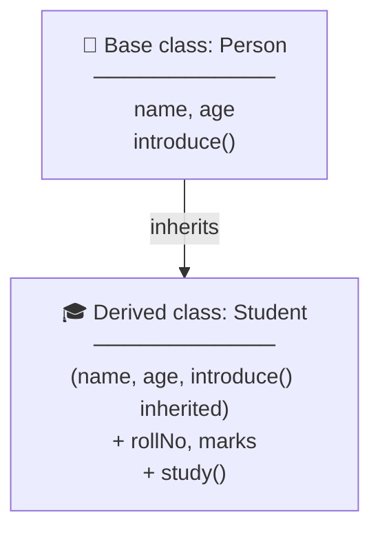

### 1.2 Terminology

| Term | Also Called | Meaning |
|------|-------------|---------|
| **Base class** | Parent class, superclass | The existing class being inherited from |
| **Derived class** | Child class, subclass | The new class that inherits |
| **Inheritance** | Derivation | The process of creating a derived class |
| **Is-a relationship** | | A derived object **is a** kind of base object |

### 1.3 The "Is-A" Test ✅

Use inheritance only when the sentence **"Derived *is a* Base"** makes sense:

| Relationship | Is-a? | Use Inheritance? |
|--------------|-------|------------------|
| A **Student** is a **Person** | ✅ | ✅ `class Student : public Person` |
| A **Car** is a **Vehicle** | ✅ | ✅ |
| A **Circle** is a **Shape** | ✅ | ✅ |
| A **SavingsAccount** is a **BankAccount** | ✅ | ✅ |
| A **Car** is an **Engine** | ❌ (a car **has an** engine) | ❌ Use **composition** |
| A **Library** is a **Book** | ❌ (a library **has** books) | ❌ Use composition |

### Is-A vs Has-A

```cpp
// IS-A → inheritance
class Car : public Vehicle { };

// HAS-A → composition (an object inside another object)
class Car {
    Engine engine;        // a Car HAS AN Engine
    Wheel wheels[4];      // a Car HAS Wheels
};
```

📌 **Rule:** "is-a" → inheritance; "has-a" → composition (a member object).

### 1.4 Why Use Inheritance?

| Benefit | Explanation |
|---------|-------------|
| ♻️ **Code reusability** | Write common code **once** in the base class; all derived classes get it |
| 🧩 **Extensibility** | Add new features to existing classes without changing them |
| 🌳 **Natural hierarchy** | Model real-world relationships (Animal → Dog, Cat) |
| 🔧 **Easier maintenance** | Fix a bug in the base class → fixed for every derived class |
| 🔄 **Polymorphism** | Treat different derived objects through one base type (Section 8) |

### ❌ Without Inheritance — Repeated Code

```cpp
class Student {
    string name; int age;
    int rollNo;
public:
    void introduce() { cout << "I am " << name; }
};

class Teacher {
    string name; int age;             // 😩 repeated
    string subject;
public:
    void introduce() { cout << "I am " << name; }   // 😩 repeated
};
```

### ✅ With Inheritance

```cpp
class Person {
protected:
    string name; int age;
public:
    void introduce() { cout << "I am " << name; }
};

class Student : public Person { int rollNo; };        // gets name, age, introduce()
class Teacher : public Person { string subject; };    // gets them too
```

### 1.5 Syntax

```cpp
class DerivedClass : accessMode BaseClass {
    // new members of the derived class
};
```

```
   class Student : public Person
         │          │       │
     derived    access    base
      class      mode     class
```

| Access Mode | Meaning | Use |
|-------------|---------|-----|
| `public` | Public stays public, protected stays protected | ✅ **Almost always** — models "is-a" |
| `protected` | Public and protected become protected | Rare |
| `private` | Public and protected become private | Rare ("implemented in terms of") |

⚠️ If you **omit** the mode, a `class` defaults to **`private`** inheritance! Always write `public` explicitly.

(Full details in [Section 7](#7-protected-members).)

### 1.6 What Is and Isn't Inherited

| Inherited ✅ | Not Inherited ❌ |
|-------------|-----------------|
| Public data members and functions | **Constructors** (but they're **called**, Section 2.3) |
| Protected data members and functions | **Destructor** (but it's **called**) |
| Private data members (**exist** in the object but are **not accessible** directly) | **Friend** functions/classes (Lesson 12 Part 2) |
| Static members (shared) | Copy assignment operator `=` |

💡 **Private members are inherited but locked.** The derived object **contains** them in memory, but derived class code can't touch them directly — only through the base class's public or protected functions.

### 1.7 Types of Inheritance

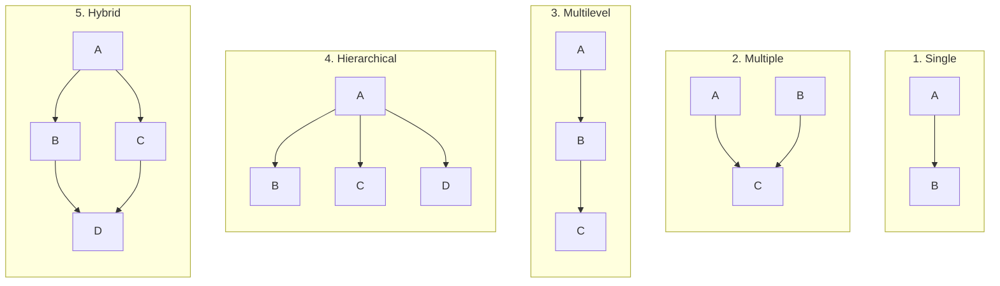

*(Arrows point from base to derived.)*

| Type | Structure | Example |
|------|-----------|---------|
| **Single** | One base → one derived | Person → Student |
| **Multiple** | Many bases → one derived | Camera + Phone → Smartphone |
| **Multilevel** | Chain: A → B → C | Person → Employee → Manager |
| **Hierarchical** | One base → many derived | Shape → Circle, Rectangle, Triangle |
| **Hybrid** | Combination of two or more types | Diamond: Person → Student, Employee → TeachingAssistant |

---

## 2. Single Inheritance

**One derived class inherits from one base class.**

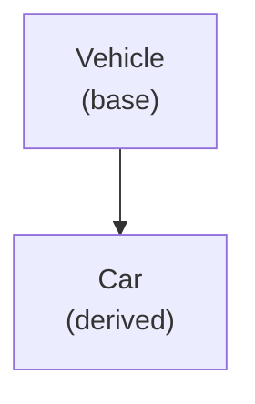

### 2.1 Basic Example

```cpp
#include <iostream>
#include <string>
using namespace std;

class Vehicle {                              // base class
public:
    string brand;
    int wheels;

    void start() {
        cout << brand << " is starting..." << endl;
    }
    void showInfo() {
        cout << "Brand: " << brand << ", Wheels: " << wheels << endl;
    }
};

class Car : public Vehicle {                 // derived class
public:
    int seats;

    void playMusic() {
        cout << brand << " is playing music 🎵" << endl;   // uses inherited 'brand'
    }
};

int main() {
    Car myCar;
    myCar.brand = "Maruti";      // inherited from Vehicle
    myCar.wheels = 4;            // inherited
    myCar.seats = 5;             // Car's own

    myCar.start();               // inherited function
    myCar.showInfo();            // inherited function
    myCar.playMusic();           // Car's own function
    return 0;
}
```

**Output:**
```
Maruti is starting...
Brand: Maruti, Wheels: 4
Maruti is playing music 🎵
```

### What a `Car` Object Contains

```
  Car myCar
 ┌──────────────────────────┐
 │  ── Vehicle part ──      │
 │  brand  = "Maruti"       │  ← inherited
 │  wheels = 4              │  ← inherited
 │  ── Car part ──          │
 │  seats  = 5              │  ← added by Car
 └──────────────────────────┘
  Functions available: start(), showInfo()  [inherited]
                       playMusic()          [own]
```

📌 A derived object **contains a complete base object inside it**, plus its own additions.

### 2.2 Accessing Private Base Members

Private members of the base **exist** in the derived object but **can't** be accessed directly:

```cpp
class Account {
private:
    double balance = 0;
public:
    void deposit(double a) { balance += a; }
    double getBalance() const { return balance; }
};

class SavingsAccount : public Account {
public:
    void addInterest() {
        // balance *= 1.05;                       // ❌ error: 'balance' is private
        deposit(getBalance() * 0.05);             // ✅ use public functions
    }
};
```

➡️ This is exactly why **`protected`** exists (Section 7).

### 2.3 Constructors and Destructors in Inheritance

When a derived object is created:
1. The **base class constructor** runs **first** (build the foundation)
2. Then the **derived class constructor** runs

When it's destroyed — **reverse order**:
1. The **derived destructor** runs **first**
2. Then the **base destructor**

🏢 **Analogy:** Building a house — the **foundation** (base) is built before the **upper floors** (derived). Demolishing it — the **upper floors** come down before the foundation.

```cpp
#include <iostream>
using namespace std;

class Base {
public:
    Base()  { cout << "1. Base constructor" << endl; }
    ~Base() { cout << "4. Base destructor" << endl; }
};

class Derived : public Base {
public:
    Derived()  { cout << "2. Derived constructor" << endl; }
    ~Derived() { cout << "3. Derived destructor" << endl; }
};

int main() {
    Derived d;
    return 0;
}
```

**Output:**
```
1. Base constructor
2. Derived constructor
3. Derived destructor
4. Base destructor
```

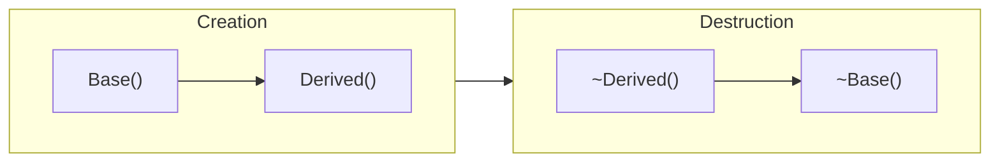

### 2.4 Passing Arguments to the Base Constructor

If the base class needs arguments, the derived constructor passes them using the **member initializer list** (Lesson 13):

```cpp
#include <iostream>
#include <string>
using namespace std;

class Person {
protected:
    string name;
    int age;
public:
    Person(const string& n, int a) : name(n), age(a) {
        cout << "Person constructor: " << name << endl;
    }
    void introduce() const {
        cout << "Hi, I'm " << name << ", " << age << " years old." << endl;
    }
};

class Student : public Person {
private:
    int rollNo;
    double marks;
public:
    Student(const string& n, int a, int r, double m)
        : Person(n, a),            // ⭐ call the base constructor FIRST
          rollNo(r), marks(m) {
        cout << "Student constructor: roll " << rollNo << endl;
    }

    void showResult() const {
        cout << name << " (roll " << rollNo << ") scored " << marks << endl;
    }
};

int main() {
    Student s("Riya", 19, 12, 88.5);
    s.introduce();      // inherited
    s.showResult();     // own
    return 0;
}
```

**Output:**
```
Person constructor: Riya
Student constructor: roll 12
Hi, I'm Riya, 19 years old.
Riya (roll 12) scored 88.5
```

```
   Student(...) : Person(n, a), rollNo(r), marks(m) { }
                  ───────────   ─────────────────────
                  base first     then own members
```

⚠️ If the base class has **no default constructor**, the derived constructor **must** call a base constructor explicitly — otherwise: *error: no matching function for call to 'Person::Person()'*.

💡 **C++11 shortcut — inheriting constructors:**
```cpp
class Student : public Person {
public:
    using Person::Person;      // Student can be created with Person's constructors
};
```

### 2.5 Base Pointers and References (Upcasting)

Because a Student **is a** Person, a base pointer or reference can refer to a derived object:

```cpp
Student s("Riya", 19, 12, 88.5);

Person& ref = s;        // ✅ a Student is a Person
Person* ptr = &s;       // ✅
ref.introduce();        // ✅ Person functions are available
// ref.showResult();    // ❌ Person doesn't know about Student's functions
```

This is called **upcasting** (derived → base) and is the foundation of **polymorphism** (Section 8.5).

⚠️ **Object slicing:** copying a derived object **into** a base **object** (not pointer/reference) keeps only the base part:
```cpp
Person p = s;           // only the Person part is copied — Student data is "sliced off"
```

---

## 3. Multiple Inheritance

**One derived class inherits from two or more base classes.**

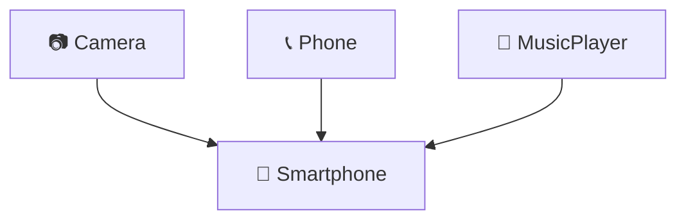

### 3.1 Syntax

```cpp
class Derived : public Base1, public Base2, public Base3 {
    // ...
};
```

⚠️ Write the access mode for **each** base: `class C : public A, B` makes `B` **private**!

### 3.2 Example

```cpp
#include <iostream>
using namespace std;

class Camera {
protected:
    int megapixels;
public:
    Camera(int mp) : megapixels(mp) {
        cout << "Camera constructor" << endl;
    }
    void takePhoto() const {
        cout << "📷 Photo taken with " << megapixels << " MP camera" << endl;
    }
};

class Phone {
protected:
    string number;
public:
    Phone(const string& num) : number(num) {
        cout << "Phone constructor" << endl;
    }
    void call(const string& to) const {
        cout << "📞 Calling " << to << " from " << number << endl;
    }
};

class Smartphone : public Camera, public Phone {
    string os;
public:
    Smartphone(int mp, const string& num, const string& system)
        : Camera(mp), Phone(num), os(system) {
        cout << "Smartphone constructor" << endl;
    }
    void showSpecs() const {
        cout << os << " phone | " << number << " | " << megapixels << " MP" << endl;
    }
};

int main() {
    Smartphone s(50, "98765-43210", "Android");
    s.takePhoto();     // from Camera
    s.call("Mom");     // from Phone
    s.showSpecs();     // own
    return 0;
}
```

**Output:**
```
Camera constructor
Phone constructor
Smartphone constructor
📷 Photo taken with 50 MP camera
📞 Calling Mom from 98765-43210
Android phone | 98765-43210 | 50 MP
```

### 3.3 Constructor Order in Multiple Inheritance

Base constructors run in the order the bases are **listed in the class declaration**:

```cpp
class Smartphone : public Camera, public Phone     // ← THIS order decides
```

**Not** the order in the initializer list. Destructors run in **reverse**.

| Step | Constructors | Destructors |
|------|-------------|-------------|
| 1 | `Camera()` | `~Smartphone()` |
| 2 | `Phone()` | `~Phone()` |
| 3 | `Smartphone()` | `~Camera()` |

### 3.4 The Ambiguity Problem

What if **both** base classes have a member with the **same name**?

```cpp
#include <iostream>
using namespace std;

class Printer {
public:
    void powerOn() { cout << "Printer powering on" << endl; }
    void status()  { cout << "Printer: ready" << endl; }
};

class Scanner {
public:
    void powerOn() { cout << "Scanner powering on" << endl; }
    void scan()    { cout << "Scanning document" << endl; }
};

class AllInOne : public Printer, public Scanner { };

int main() {
    AllInOne device;
    device.status();          // ✅ only in Printer
    device.scan();            // ✅ only in Scanner
    // device.powerOn();      // ❌ error: request for member 'powerOn' is ambiguous
    return 0;
}
```

### Solution 1: Scope Resolution `::`

```cpp
device.Printer::powerOn();     // Printer powering on
device.Scanner::powerOn();     // Scanner powering on
```

### Solution 2: Override in the Derived Class ✅ (Better)

```cpp
class AllInOne : public Printer, public Scanner {
public:
    void powerOn() {                 // one clear version for AllInOne
        Printer::powerOn();
        Scanner::powerOn();
        cout << "All-in-one ready!" << endl;
    }
};

device.powerOn();    // ✅ no ambiguity
```

**Output:**
```
Printer powering on
Scanner powering on
All-in-one ready!
```

### 3.5 Pros and Cons of Multiple Inheritance

| ✅ Advantages | ❌ Disadvantages |
|--------------|-----------------|
| Combine features from several classes | **Name ambiguity** |
| Models objects with several roles (smartphone = camera + phone) | **Diamond problem** (Section 9) |
| | More complex to understand and maintain |

📌 Java and C# don't allow multiple inheritance of classes — C++ does, but use it **carefully**. A common safe style: inherit from **one** main base class plus **interface-like** classes (classes with only pure virtual functions).

---

## 4. Multilevel Inheritance

**A class is derived from a class that is itself derived from another** — a chain.

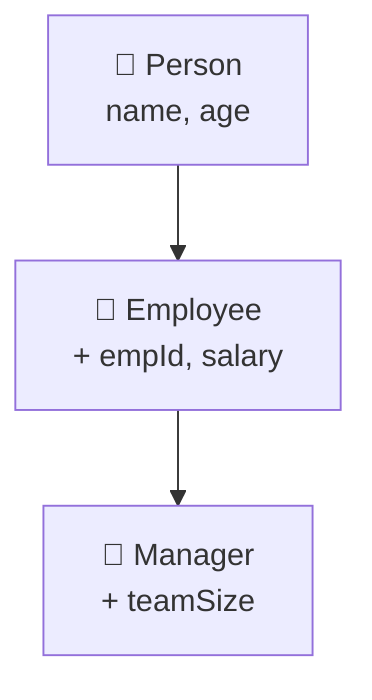

👴👨👦 **Analogy:** Grandparent → Parent → Child. The child inherits from the parent, who inherited from the grandparent — so the child gets traits from **both**.

### 4.1 Example

```cpp
#include <iostream>
#include <string>
using namespace std;

class Person {                                    // Level 1: grandparent
protected:
    string name;
public:
    Person(const string& n) : name(n) {
        cout << "Person constructor" << endl;
    }
    ~Person() { cout << "Person destructor" << endl; }
    void introduce() const { cout << "Name: " << name << endl; }
};

class Employee : public Person {                  // Level 2: parent
protected:
    int empId;
    double salary;
public:
    Employee(const string& n, int id, double sal)
        : Person(n), empId(id), salary(sal) {
        cout << "Employee constructor" << endl;
    }
    ~Employee() { cout << "Employee destructor" << endl; }
    void showJob() const {
        cout << "Employee #" << empId << ", Salary: Rs. " << salary << endl;
    }
};

class Manager : public Employee {                 // Level 3: child
    int teamSize;
public:
    Manager(const string& n, int id, double sal, int team)
        : Employee(n, id, sal), teamSize(team) {   // calls only its DIRECT base
        cout << "Manager constructor" << endl;
    }
    ~Manager() { cout << "Manager destructor" << endl; }
    void showTeam() const {
        cout << name << " manages " << teamSize << " people" << endl;   // 'name' from Person
    }
};

int main() {
    Manager m("Kavya", 501, 95000, 8);
    cout << "-----" << endl;
    m.introduce();      // from Person (level 1)
    m.showJob();        // from Employee (level 2)
    m.showTeam();       // own (level 3)
    cout << "-----" << endl;
    return 0;
}
```

**Output:**
```
Person constructor
Employee constructor
Manager constructor
-----
Name: Kavya
Employee #501, Salary: Rs. 95000
Kavya manages 8 people
-----
Manager destructor
Employee destructor
Person destructor
```

### 4.2 Constructor Chain

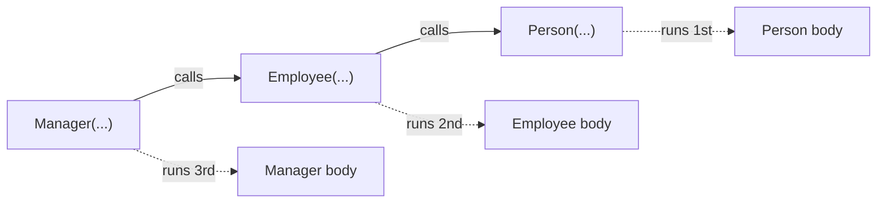

📌 Each class calls **only its direct base's** constructor. Construction flows **top → down** (Person → Employee → Manager); destruction flows **bottom → up**.

### 4.3 What Each Level Can Access

| Class | Own Members | Inherited From |
|-------|-------------|----------------|
| `Person` | name, introduce() | — |
| `Employee` | empId, salary, showJob() | Person |
| `Manager` | teamSize, showTeam() | Employee **and** Person |

💡 Keep chains **short** (2–3 levels). Deep chains become hard to understand — a change at the top affects everything below.

---

## 5. Hierarchical Inheritance

**Multiple derived classes inherit from a single base class.**

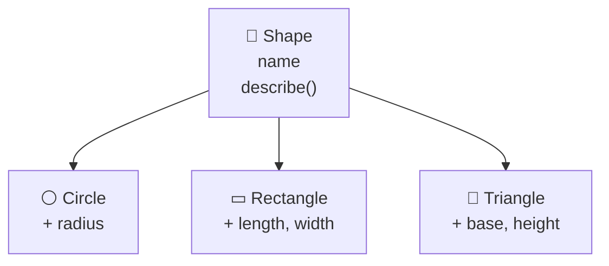

🌳 **Analogy:** A tree trunk (base) with many branches (derived classes). Every branch shares the same trunk but grows in its own direction.

### 5.1 Example

```cpp
#include <iostream>
#include <string>
using namespace std;

class Shape {
protected:
    string name;
public:
    Shape(const string& n) : name(n) { }
    void describe() const {
        cout << "This is a " << name << endl;
    }
};

class Circle : public Shape {
    double radius;
public:
    Circle(double r) : Shape("Circle"), radius(r) { }
    double area() const { return 3.14159 * radius * radius; }
};

class Rectangle : public Shape {
    double length, width;
public:
    Rectangle(double l, double w) : Shape("Rectangle"), length(l), width(w) { }
    double area() const { return length * width; }
};

class Triangle : public Shape {
    double base, height;
public:
    Triangle(double b, double h) : Shape("Triangle"), base(b), height(h) { }
    double area() const { return 0.5 * base * height; }
};

int main() {
    Circle c(3);
    Rectangle r(4, 5);
    Triangle t(6, 2);

    c.describe(); cout << "  Area: " << c.area() << endl;
    r.describe(); cout << "  Area: " << r.area() << endl;
    t.describe(); cout << "  Area: " << t.area() << endl;
    return 0;
}
```

**Output:**
```
This is a Circle
  Area: 28.2743
This is a Rectangle
  Area: 20
This is a Triangle
  Area: 6
```

### 5.2 Another Example: Bank Accounts

```cpp
#include <iostream>
#include <string>
using namespace std;

class Account {
protected:
    string holder;
    double balance;
public:
    Account(const string& h, double b) : holder(h), balance(b) { }
    void deposit(double amt) { if (amt > 0) balance += amt; }
    void show() const { cout << holder << ": Rs. " << balance << endl; }
};

class SavingsAccount : public Account {
    double interestRate;
public:
    SavingsAccount(const string& h, double b, double rate)
        : Account(h, b), interestRate(rate) { }
    void addInterest() { balance += balance * interestRate / 100; }
};

class CurrentAccount : public Account {
    double overdraftLimit;
public:
    CurrentAccount(const string& h, double b, double limit)
        : Account(h, b), overdraftLimit(limit) { }
    bool withdraw(double amt) {
        if (amt > balance + overdraftLimit) {
            cout << "Overdraft limit exceeded!" << endl;
            return false;
        }
        balance -= amt;
        return true;
    }
};

int main() {
    SavingsAccount s("Riya", 10000, 6);
    CurrentAccount c("TechCorp", 5000, 20000);

    s.addInterest();
    c.withdraw(15000);     // allowed: goes to -10000 within the overdraft
    c.withdraw(20000);     // exceeds limit

    s.show();
    c.show();
    return 0;
}
```

**Output:**
```
Overdraft limit exceeded!
Riya: Rs. 10600
TechCorp: Rs. -10000
```

📌 **Hierarchical inheritance + virtual functions = polymorphism.** All shapes share a base, so one function can work with any of them (Section 8.5).

---

## 6. Hybrid Inheritance

**Hybrid inheritance** is a **combination of two or more types** of inheritance in one program.

### 6.1 Example: Hierarchical + Multiple

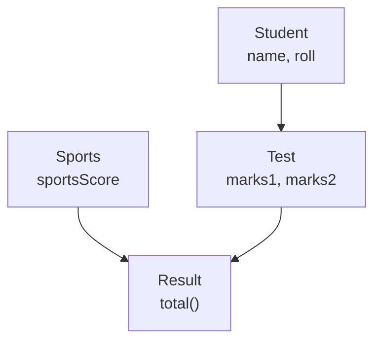

Here:
- `Student → Test` is **single** (or multilevel when `Result` is added)
- `Test` + `Sports` → `Result` is **multiple**
- Together → **hybrid**

```cpp
#include <iostream>
#include <string>
using namespace std;

class Student {
protected:
    string name;
    int roll;
public:
    Student(const string& n, int r) : name(n), roll(r) { }
    void showStudent() const { cout << "Roll " << roll << ": " << name << endl; }
};

class Test : public Student {                       // single / multilevel part
protected:
    double marks1, marks2;
public:
    Test(const string& n, int r, double m1, double m2)
        : Student(n, r), marks1(m1), marks2(m2) { }
    void showMarks() const { cout << "Marks: " << marks1 << ", " << marks2 << endl; }
};

class Sports {                                      // separate base
protected:
    double sportsScore;
public:
    Sports(double s) : sportsScore(s) { }
    void showSports() const { cout << "Sports score: " << sportsScore << endl; }
};

class Result : public Test, public Sports {         // multiple part
public:
    Result(const string& n, int r, double m1, double m2, double s)
        : Test(n, r, m1, m2), Sports(s) { }
    void showResult() const {
        showStudent();
        showMarks();
        showSports();
        cout << "Total: " << marks1 + marks2 + sportsScore << endl;
    }
};

int main() {
    Result r("Aarav", 7, 82, 76, 9.5);
    r.showResult();
    return 0;
}
```

**Output:**
```
Roll 7: Aarav
Marks: 82, 76
Sports score: 9.5
Total: 167.5
```

### 6.2 The Most Famous Hybrid: The Diamond

The **diamond** shape combines **hierarchical** (one base → two derived) and **multiple** (two bases → one derived) inheritance:

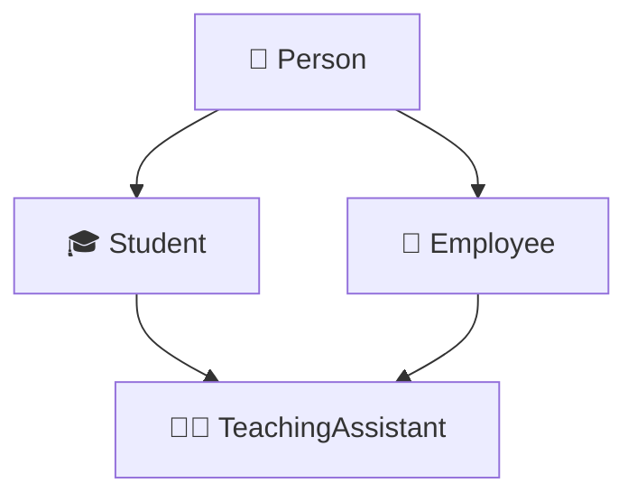

A **TeachingAssistant** is both a Student (attends classes) **and** an Employee (gets paid). But this creates a serious problem — `TeachingAssistant` gets **two copies** of `Person`! ➡️ Solved by **virtual base classes** in [Section 9](#9-virtual-base-class).

---

## 7. Protected Members

### 7.1 The Problem

| Specifier | Problem for Inheritance |
|-----------|------------------------|
| `private` | Derived classes **can't** access it — too strict |
| `public` | **Everyone** can access it — no protection |

We need a middle ground: **accessible to derived classes, but hidden from outside code.**

### 7.2 The `protected` Access Specifier

```cpp
class Base {
private:
    int a;      // only Base
protected:
    int b;      // Base AND derived classes
public:
    int c;      // everyone
};
```

| Access From | `private` | `protected` | `public` |
|-------------|-----------|-------------|----------|
| Same class | ✅ | ✅ | ✅ |
| Derived class | ❌ | ✅ | ✅ |
| Friend of the class | ✅ | ✅ | ✅ |
| Outside code (`main`, other classes) | ❌ | ❌ | ✅ |

🏠 **Analogy:**
- **Private** → your personal diary 📔 (only you)
- **Protected** → family recipes 🍲 (you and your children)
- **Public** → your front porch 🏡 (anyone)

### 7.3 Example

```cpp
#include <iostream>
using namespace std;

class Account {
private:
    int pin = 1234;              // only Account
protected:
    double balance = 0;          // Account + derived classes
public:
    void deposit(double amt) { if (amt > 0) balance += amt; }
    double getBalance() const { return balance; }
};

class SavingsAccount : public Account {
public:
    void addInterest(double rate) {
        balance += balance * rate / 100;    // ✅ protected: accessible here
        // pin = 0000;                      // ❌ private: not accessible
    }
};

int main() {
    SavingsAccount s;
    s.deposit(10000);
    s.addInterest(5);
    cout << "Balance: " << s.getBalance() << endl;   // 10500

    // s.balance = 1000000;      // ❌ protected: not accessible from main
    return 0;
}
```

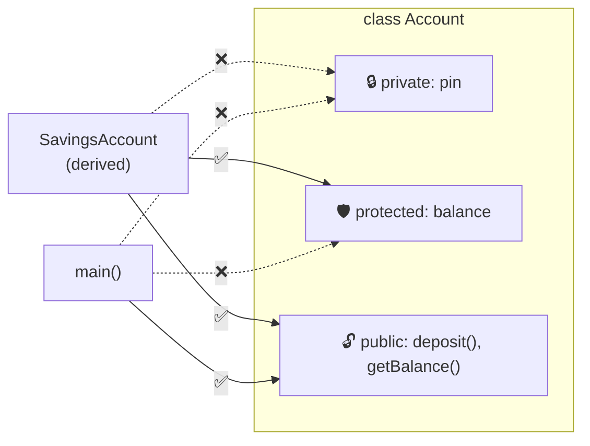

### 7.4 Modes of Inheritance (Visibility Modes)

The **access mode** in `class Derived : MODE Base` changes how inherited members appear **in the derived class** (and to classes derived from it):

| Base Member → | `public` inheritance | `protected` inheritance | `private` inheritance |
|---------------|---------------------|------------------------|----------------------|
| **public** | public | protected | private |
| **protected** | protected | protected | private |
| **private** | not accessible | not accessible | not accessible |

🧠 **Memory trick:** the inheritance mode sets a **maximum** visibility. Members can only become **more** restrictive, never less.

```cpp
class Base {
public:    int pub = 1;
protected: int prot = 2;
private:   int priv = 3;
};

class PublicDerived : public Base {
    // pub  → public
    // prot → protected
    // priv → not accessible
};

class ProtectedDerived : protected Base {
    // pub  → protected
    // prot → protected
};

class PrivateDerived : private Base {
    // pub  → private
    // prot → private
};

int main() {
    PublicDerived a;    a.pub;    // ✅
    ProtectedDerived b; // b.pub; // ❌ now protected
    PrivateDerived c;   // c.pub; // ❌ now private
}
```

### Effect on Further Derivation

```cpp
class GrandChild : public PrivateDerived {
    void test() {
        // pub;   // ❌ private in PrivateDerived → inaccessible here
    }
};
```

| Mode | Meaning | When Used |
|------|---------|-----------|
| `public` | "is-a" — derived **is a** base; base pointers can point to it | ✅ **Default choice** |
| `protected` | Hide the base interface from outside, keep it for further derivation | Rare |
| `private` | "implemented-in-terms-of" — reuse code without "is-a" | Rare (composition usually better) |

⚠️ Remember: **`class D : B`** (no mode) = **private** inheritance. **`struct D : B`** = public.

### 7.5 When to Use `protected`

| Use `protected` for... | Keep `private` for... |
|------------------------|----------------------|
| Data derived classes genuinely need to read/modify | Data with rules that must always be enforced (e.g., balance can't go negative) |
| Helper functions meant for derived classes | Implementation details |

💡 **Good practice:** many developers keep data **private** and provide **protected functions** for derived classes. This keeps validation rules in one place:

```cpp
class Account {
private:
    double balance = 0;
protected:
    void adjustBalance(double amount) {       // controlled access for derived classes
        if (balance + amount >= 0) balance += amount;
    }
public:
    double getBalance() const { return balance; }
};
```

---

## 8. Function Overriding

### 8.1 What is Function Overriding?

**Function overriding** happens when a **derived class** provides its **own version** of a function that already exists in the **base class**, with the **same name and same parameters**.

```cpp
#include <iostream>
using namespace std;

class Animal {
public:
    void speak() const { cout << "Some generic animal sound" << endl; }
    void eat() const   { cout << "Eating..." << endl; }
};

class Dog : public Animal {
public:
    void speak() const { cout << "Woof! Woof!" << endl; }    // overrides Animal::speak
};

class Cat : public Animal {
public:
    void speak() const { cout << "Meow!" << endl; }          // overrides Animal::speak
};

int main() {
    Animal a;
    Dog d;
    Cat c;

    a.speak();    // Some generic animal sound
    d.speak();    // Woof! Woof!   ← Dog's version
    c.speak();    // Meow!         ← Cat's version
    d.eat();      // Eating...     ← not overridden, inherited as-is
    return 0;
}
```

🎵 **Analogy:** Every musician knows how to "perform" (base function). A **singer** performs by singing, a **guitarist** by playing guitar, a **dancer** by dancing. Same action name — each does it their own way.

### 8.2 Rules for Overriding

| Rule | |
|------|--|
| Requires **inheritance** | Base and derived class |
| **Same name** | `speak` |
| **Same parameter list** | `()` and `()` |
| **Same (or compatible) return type** | `void` and `void` |
| **Same `const`-ness** | Both `const` or both not |
| For **runtime** polymorphism, the base function must be **`virtual`** | Section 8.5 |

### 8.3 Calling the Base Version from the Derived Class

Use the **scope resolution operator** to reuse the base logic and then **extend** it:

```cpp
#include <iostream>
#include <string>
using namespace std;

class Employee {
protected:
    string name;
    double salary;
public:
    Employee(const string& n, double s) : name(n), salary(s) { }
    void display() const {
        cout << "Name: " << name << ", Salary: Rs. " << salary << endl;
    }
};

class Manager : public Employee {
    string department;
public:
    Manager(const string& n, double s, const string& d) : Employee(n, s), department(d) { }
    void display() const {
        Employee::display();                          // ⭐ reuse base version
        cout << "Department: " << department << endl; // then add more
    }
};

int main() {
    Manager m("Kavya", 95000, "Engineering");
    m.display();               // Manager's version
    m.Employee::display();     // can also call the base version from outside
    return 0;
}
```

**Output:**
```
Name: Kavya, Salary: Rs. 95000
Department: Engineering
Name: Kavya, Salary: Rs. 95000
```

### 8.4 Overriding vs Overloading

| Feature | Function Overloading (Lesson 12 Part 2) | Function Overriding |
|---------|----------------------------------------|---------------------|
| Where | **Same** class (or scope) | **Base and derived** classes |
| Name | Same | Same |
| Parameters | **Must differ** | **Must be the same** |
| Inheritance needed | ❌ No | ✅ Yes |
| Resolved at | Compile time | Compile time, or **runtime** if `virtual` |
| Purpose | Same operation for different inputs | Change inherited behaviour |
| Example | `area(int)` / `area(double)` | `Animal::speak()` / `Dog::speak()` |

### ⚠️ Name Hiding

If a derived class declares a function with the same name but **different** parameters, it **hides all** base versions with that name:

```cpp
class Base {
public:
    void show()      { cout << "Base::show()" << endl; }
    void show(int x) { cout << "Base::show(int)" << endl; }
};

class Derived : public Base {
public:
    void show(double d) { cout << "Derived::show(double)" << endl; }
};

int main() {
    Derived d;
    d.show(3.5);      // Derived::show(double)
    // d.show();      // ❌ error: Base::show() is HIDDEN
    d.show(5);        // ⚠️ calls Derived::show(double) — 5 converted to 5.0!
}
```

✅ Fix: bring the base versions back with **`using`**:
```cpp
class Derived : public Base {
public:
    using Base::show;               // un-hide all Base::show overloads
    void show(double d) { ... }
};
```

### 8.5 The Problem with Base Pointers → `virtual`

Overriding **without** `virtual` works when calling through the **object itself**. But through a **base pointer or reference**, the **base** version runs (**early binding** — decided by the pointer type at compile time):

```cpp
void makeItSpeak(const Animal& a) {
    a.speak();
}

Dog d;
makeItSpeak(d);     // "Some generic animal sound" 😕 — not Woof!
```

✅ Make the base function **`virtual`** for **late binding** (decided by the actual object at runtime — Lesson 12 Part 2, Section 8):

```cpp
#include <iostream>
using namespace std;

class Animal {
public:
    virtual void speak() const { cout << "Some generic animal sound" << endl; }
    virtual ~Animal() { }                          // virtual destructor
};

class Dog : public Animal {
public:
    void speak() const override { cout << "Woof! Woof!" << endl; }
};

class Cat : public Animal {
public:
    void speak() const override { cout << "Meow!" << endl; }
};

void makeItSpeak(const Animal& a) {
    a.speak();                                     // runtime decision ✅
}

int main() {
    Dog d;
    Cat c;
    makeItSpeak(d);    // Woof! Woof!
    makeItSpeak(c);    // Meow!

    Animal* zoo[] = { new Dog(), new Cat(), new Dog() };
    for (Animal* a : zoo) {
        a->speak();
        delete a;
    }
    return 0;
}
```

**Output:**
```
Woof! Woof!
Meow!
Woof! Woof!
Meow!
Woof! Woof!
```

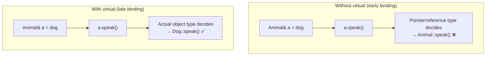

### 8.6 `override` and `final` Keywords (C++11)

```cpp
class Dog : public Animal {
public:
    void speak() const override;      // ✅ compiler verifies it really overrides
    void speek() const override;      // ❌ error: typo caught — doesn't override anything
    void speak() override;            // ❌ error: missing const — signature differs
};
```

```cpp
class Puppy final : public Dog { };                 // no class can inherit from Puppy
class Dog : public Animal {
    void speak() const override final;              // no class can override speak() further
};
```

✅ **Always write `override`** when overriding — it turns silent bugs into compile errors.

### 8.7 Static vs Dynamic Binding Summary

| | Static (Early) Binding | Dynamic (Late) Binding |
|--|-----------------------|-----------------------|
| When decided | Compile time | Runtime |
| Based on | Type of the pointer/reference/object | Type of the **actual object** |
| Requires | Nothing special | `virtual` function + pointer/reference |
| Speed | Faster | Slight overhead (vtable lookup) |
| Example | Overloading; non-virtual overriding | Virtual function overriding |

---

## 9. Virtual Base Class

### 9.1 The Diamond Problem

In hybrid inheritance (Section 6.2), when two classes inherit from the **same base**, and a fourth class inherits from **both**, the fourth class gets **two copies** of the base:

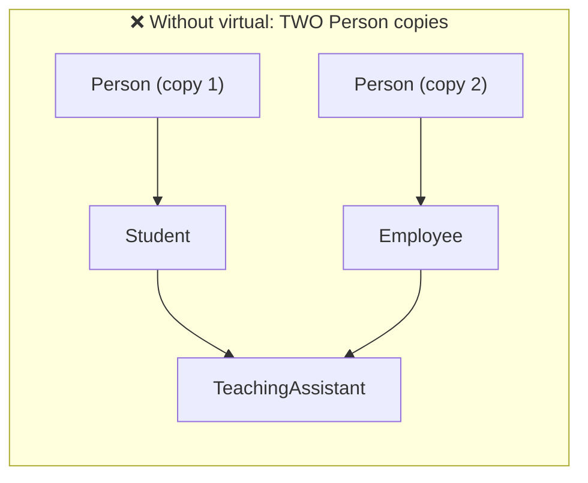

### 9.2 Demonstrating the Problem

```cpp
#include <iostream>
#include <string>
using namespace std;

class Person {
public:
    string name;
    Person() { cout << "Person constructor" << endl; }
};

class Student : public Person {
public:
    Student() { cout << "Student constructor" << endl; }
};

class Employee : public Person {
public:
    Employee() { cout << "Employee constructor" << endl; }
};

class TeachingAssistant : public Student, public Employee {
public:
    TeachingAssistant() { cout << "TeachingAssistant constructor" << endl; }
};

int main() {
    TeachingAssistant ta;
    // ta.name = "Riya";            // ❌ error: request for member 'name' is ambiguous
    ta.Student::name = "Riya";      // works, but...
    ta.Employee::name = "Priya";    // ...a SECOND, different name! 😱

    cout << ta.Student::name << " vs " << ta.Employee::name << endl;
    return 0;
}
```

**Output:**
```
Person constructor
Student constructor
Person constructor
Employee constructor
TeachingAssistant constructor
Riya vs Priya
```

😱 **Problems:**
1. `Person` constructor runs **twice**
2. The TA has **two names** — one person with two identities makes no sense
3. `ta.name` is **ambiguous** → compile error
4. **Wasted memory** — duplicate data
5. Even converting `TeachingAssistant*` to `Person*` is ambiguous

```
  TeachingAssistant object (without virtual)
 ┌────────────────────────────┐
 │ Student part               │
 │   ┌──────────────────────┐ │
 │   │ Person: name="Riya"  │ │  ← copy 1
 │   └──────────────────────┘ │
 │ Employee part              │
 │   ┌──────────────────────┐ │
 │   │ Person: name="Priya" │ │  ← copy 2 😱
 │   └──────────────────────┘ │
 └────────────────────────────┘
```

### 9.3 The Solution: `virtual` Inheritance

Declare the **intermediate** classes with **`virtual public`**. Then all paths **share one** copy of the base, called a **virtual base class**:

```cpp
class Student  : virtual public Person { ... };    // ⭐
class Employee : virtual public Person { ... };    // ⭐
class TeachingAssistant : public Student, public Employee { ... };
```

(`virtual public` and `public virtual` mean the same thing.)

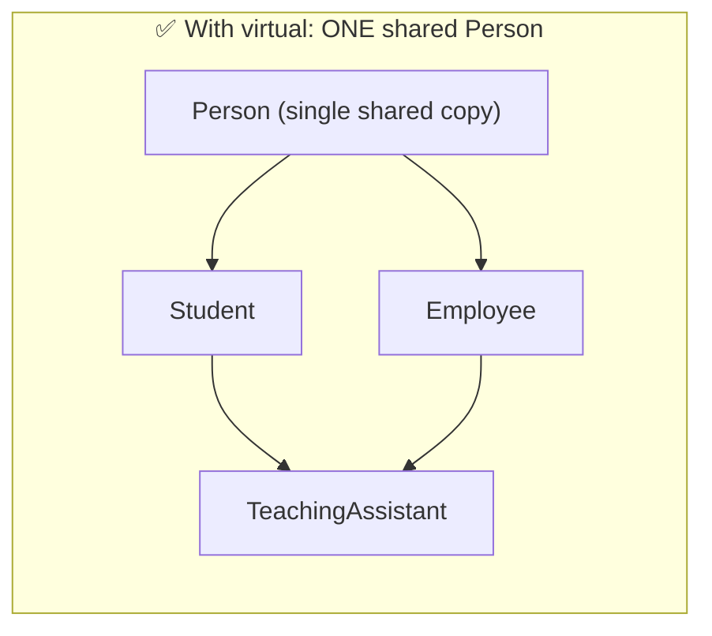

### 9.4 Fixed Example

```cpp
#include <iostream>
#include <string>
using namespace std;

class Person {
public:
    string name;
    Person() { cout << "Person constructor" << endl; }
};

class Student : virtual public Person {
public:
    Student() { cout << "Student constructor" << endl; }
};

class Employee : virtual public Person {
public:
    Employee() { cout << "Employee constructor" << endl; }
};

class TeachingAssistant : public Student, public Employee {
public:
    TeachingAssistant() { cout << "TeachingAssistant constructor" << endl; }
};

int main() {
    TeachingAssistant ta;
    ta.name = "Riya";                     // ✅ no ambiguity — only ONE name
    cout << "Name: " << ta.name << endl;
    cout << "Via Student : " << ta.Student::name << endl;
    cout << "Via Employee: " << ta.Employee::name << endl;
    return 0;
}
```

**Output:**
```
Person constructor
Student constructor
Employee constructor
TeachingAssistant constructor
Name: Riya
Via Student : Riya
Via Employee: Riya
```

✅ `Person` constructor runs **once**, and there's **one** `name` shared by both paths.

### 9.5 Constructors with Virtual Base Classes ⚠️

With virtual inheritance, the **most-derived class** (the one actually being created) is responsible for calling the **virtual base's** constructor **directly**. Calls from the intermediate classes are **ignored**.

```cpp
#include <iostream>
#include <string>
using namespace std;

class Person {
protected:
    string name;
public:
    Person(const string& n) : name(n) {
        cout << "Person(" << name << ")" << endl;
    }
};

class Student : virtual public Person {
protected:
    int roll;
public:
    Student(const string& n, int r) : Person(n), roll(r) {
        cout << "Student(roll " << roll << ")" << endl;
    }
};

class Employee : virtual public Person {
protected:
    double salary;
public:
    Employee(const string& n, double s) : Person(n), salary(s) {
        cout << "Employee(salary " << salary << ")" << endl;
    }
};

class TeachingAssistant : public Student, public Employee {
    string course;
public:
    TeachingAssistant(const string& n, int r, double s, const string& c)
        : Person(n),                       // ⭐ MUST call the virtual base directly
          Student(n, r),                   // its Person(n) call is ignored
          Employee(n, s),                  // its Person(n) call is ignored
          course(c) {
        cout << "TeachingAssistant(" << course << ")" << endl;
    }

    void show() const {
        cout << name << " | roll " << roll << " | Rs. " << salary << " | TA for " << course << endl;
    }
};

int main() {
    TeachingAssistant ta("Riya", 21, 15000, "C++ Lab");
    ta.show();
    return 0;
}
```

**Output:**
```
Person(Riya)
Student(roll 21)
Employee(salary 15000)
TeachingAssistant(C++ Lab)
Riya | roll 21 | Rs. 15000 | TA for C++ Lab
```

⚠️ If `TeachingAssistant` doesn't call `Person(...)` itself, the compiler tries `Person`'s **default** constructor — and fails if it doesn't exist.

### Constructor Order with Virtual Bases

1. **Virtual base classes first** (once only)
2. Then non-virtual bases, in declaration order
3. Then members
4. Then the derived class's own constructor body

Destructors run in exactly the **reverse** order.

### 9.6 Virtual Base Class vs Virtual Function

These share the word `virtual` but solve **different** problems:

| | Virtual Base Class | Virtual Function |
|--|-------------------|------------------|
| Syntax | `class B : virtual public A` | `virtual void f();` |
| Problem solved | **Duplicate** base copies (diamond problem) | Calling the **derived** version through a base pointer |
| Applies to | Inheritance relationship | Member functions |
| Used in | Multiple / hybrid inheritance | Any inheritance (polymorphism) |

### 9.7 Summary: Diamond Problem

| | Without `virtual` | With `virtual` |
|--|------------------|----------------|
| Copies of base | 2 | **1** |
| Base constructor runs | Twice | **Once** |
| `obj.baseMember` | ❌ Ambiguous | ✅ Works |
| Who constructs the base | Each intermediate class | The **most-derived** class |
| Memory | Wasted | Efficient (small pointer overhead) |

---

## 10. Complete Example: A College Management System

One program using **every** concept from this lesson:

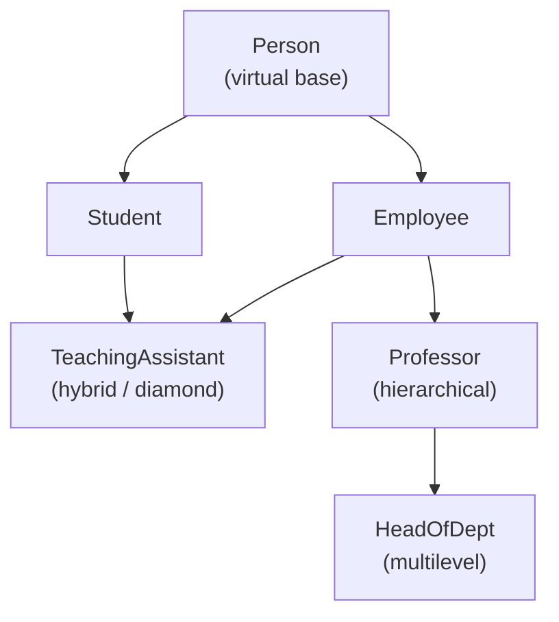

```cpp
#include <iostream>
#include <string>
using namespace std;

// ========== Base class ==========
class Person {
protected:                                        // [7] protected members
    string name;
    int age;
public:
    Person(const string& n, int a) : name(n), age(a) { }
    virtual void display() const {                // [8] virtual for overriding
        cout << "Name: " << name << ", Age: " << age << endl;
    }
    virtual string role() const { return "Person"; }
    virtual ~Person() { }
};

// ========== Hierarchical + virtual base ==========
class Student : virtual public Person {           // [9] virtual base class
protected:
    int roll;
public:
    Student(const string& n, int a, int r) : Person(n, a), roll(r) { }
    void display() const override {               // [8] function overriding
        Person::display();
        cout << "  Roll: " << roll << endl;
    }
    string role() const override { return "Student"; }
};

class Employee : virtual public Person {          // [9] virtual base class
protected:
    double salary;
public:
    Employee(const string& n, int a, double s) : Person(n, a), salary(s) { }
    void display() const override {
        Person::display();
        cout << "  Salary: Rs. " << salary << endl;
    }
    string role() const override { return "Employee"; }
};

// ========== Hybrid (diamond) ==========
class TeachingAssistant : public Student, public Employee {   // [3] multiple, [6] hybrid
    string course;
public:
    TeachingAssistant(const string& n, int a, int r, double s, const string& c)
        : Person(n, a), Student(n, a, r), Employee(n, a, s), course(c) { }
    void display() const override {
        Person::display();
        cout << "  Roll: " << roll << ", Stipend: Rs. " << salary
             << ", Assists: " << course << endl;
    }
    string role() const override { return "Teaching Assistant"; }
};

// ========== Single + multilevel ==========
class Professor : public Employee {               // [2] single (from Employee)
protected:
    string subject;
public:
    Professor(const string& n, int a, double s, const string& sub)
        : Person(n, a), Employee(n, a, s), subject(sub) { }
    void display() const override {
        Employee::display();
        cout << "  Teaches: " << subject << endl;
    }
    string role() const override { return "Professor"; }
};

class HeadOfDept : public Professor {             // [4] multilevel
    string department;
public:
    HeadOfDept(const string& n, int a, double s, const string& sub, const string& dept)
        : Person(n, a), Professor(n, a, s, sub), department(dept) { }
    void display() const override {
        Professor::display();
        cout << "  Heads: " << department << " department" << endl;
    }
    string role() const override { return "Head of Department"; }
};

// ========== Polymorphism in action ==========
void printProfile(const Person& p) {
    cout << "[" << p.role() << "]" << endl;
    p.display();
    cout << endl;
}

int main() {
    Student s("Aarav", 19, 101);
    TeachingAssistant ta("Riya", 23, 205, 15000, "C++ Lab");
    Professor prof("Dr. Mehta", 45, 120000, "Data Structures");
    HeadOfDept hod("Dr. Iyer", 52, 180000, "Algorithms", "Computer Science");

    printProfile(s);
    printProfile(ta);
    printProfile(prof);
    printProfile(hod);
    return 0;
}
```

**Output:**
```
[Student]
Name: Aarav, Age: 19
  Roll: 101

[Teaching Assistant]
Name: Riya, Age: 23
  Roll: 205, Stipend: Rs. 15000, Assists: C++ Lab

[Professor]
Name: Dr. Mehta, Age: 45
  Salary: Rs. 120000
  Teaches: Data Structures

[Head of Department]
Name: Dr. Iyer, Age: 52
  Salary: Rs. 180000
  Teaches: Algorithms
  Heads: Computer Science department

```

📌 Notice: because `Person` is a **virtual** base, **every** class below it (even `Professor` and `HeadOfDept`) must call `Person(n, a)` in its initializer list — the most-derived class always constructs the virtual base.

| Topic | Where in the Code |
|-------|-------------------|
| 1. Concept | Person → specialized roles ("is-a") |
| 2. Single | `Professor : Employee` |
| 3. Multiple | `TeachingAssistant : Student, Employee` |
| 4. Multilevel | `Person → Employee → Professor → HeadOfDept` |
| 5. Hierarchical | `Person → Student`, `Person → Employee` |
| 6. Hybrid | The diamond around `TeachingAssistant` |
| 7. Protected | `name`, `age`, `roll`, `salary`, `subject` |
| 8. Overriding | `display()` and `role()` in every class |
| 9. Virtual base | `virtual public Person` |

---

## 11. All Topics at a Glance

| Topic | Syntax | Key Point |
|-------|--------|-----------|
| Concept | `class D : public B` | "is-a" relationship; reuse and extend |
| Single | `class B : public A` | One base, one derived |
| Multiple | `class C : public A, public B` | Ambiguity → `A::f()` or override |
| Multilevel | `A → B → C` | Each class calls only its direct base constructor |
| Hierarchical | `A → B`, `A → C`, `A → D` | Common base for related classes |
| Hybrid | Combination | Often forms a diamond |
| Protected | `protected:` | Accessible in derived classes, hidden outside |
| Inheritance modes | `public` / `protected` / `private` | Set the maximum visibility of inherited members |
| Overriding | Same signature in derived class | `virtual` + `override` for runtime polymorphism |
| Call base version | `Base::func()` | Reuse then extend |
| Name hiding | Different parameters hide base overloads | Fix with `using Base::func;` |
| Virtual base class | `class B : virtual public A` | One shared copy; most-derived class constructs it |
| Constructor order | Base → Derived (virtual bases first) | Destructors in reverse |

---

## 12. Common Beginner Mistakes

| ❌ Mistake | ✅ Correct | Topic |
|-----------|-----------|-------|
| `class Student : Person` (no mode) | `class Student : public Person` | Defaults to **private** inheritance! |
| `class C : public A, B` | `class C : public A, public B` | Each base needs its own mode |
| Using inheritance for "has-a" (`Car : Engine`) | Composition: `Engine engine;` member | Concept |
| Accessing base `private` members in derived class | Make them `protected`, or use public/protected functions | Protected |
| Accessing `protected` members from `main` | Use public functions | Protected |
| Not calling the base constructor when it has no default | `Derived(...) : Base(args) { }` | Constructors |
| Calling the base constructor inside the body | Use the initializer list | Constructors |
| Expecting the initializer-list order to decide base construction order | Declaration order decides | Multiple |
| Calling an ambiguous member in multiple inheritance | `obj.A::f()` or override in derived | Multiple |
| Expecting base pointer calls to use the derived version without `virtual` | Mark the base function `virtual` | Overriding |
| Typo or signature mismatch in an "override" | Always write `override` | Overriding |
| Different parameters hiding base overloads | `using Base::func;` | Overriding |
| Forgetting a virtual destructor in a polymorphic base | `virtual ~Base() { }` | Overriding |
| Diamond without `virtual` | `class B : virtual public A` on **both** middle classes | Virtual base |
| `virtual` on only one middle class | Both paths must be virtual | Virtual base |
| Most-derived class not constructing the virtual base | Call `VirtualBase(args)` in its initializer list | Virtual base |
| Confusing virtual base classes with virtual functions | Different features, different problems | Virtual base |
| Very deep inheritance chains | Keep hierarchies shallow; prefer composition | Design |

---

## 13. Practice Exercises

### 1️⃣ Concept of Inheritance

**Exercise 1:** For each pair, say whether it's **is-a** (inheritance) or **has-a** (composition):
a) Dog / Animal  b) Car / Wheel  c) Manager / Employee  d) Computer / Keyboard  e) Square / Shape  f) School / Classroom

### 2️⃣ Single Inheritance

**Exercise 2:** Create a base class `Vehicle` (brand, speed, `displayInfo()`) and a derived class `Bike` (engineCC, `showEngine()`). Use constructors with initializer lists.

**Exercise 3:** Predict the output:
```cpp
class A {
public:
    A()  { cout << "A+ "; }
    ~A() { cout << "A- "; }
};
class B : public A {
public:
    B()  { cout << "B+ "; }
    ~B() { cout << "B- "; }
};
int main() {
    B obj;
    cout << "| ";
}
```

### 3️⃣ Multiple Inheritance

**Exercise 4:** Create classes `Teacher` (subject) and `Researcher` (researchArea), and derive `Professor` from both. Display all details.

**Exercise 5:** Both `Wifi` and `Bluetooth` classes have a `connect()` function. Derive `SmartSpeaker` from both. Show **two** ways to resolve the ambiguity.

### 4️⃣ Multilevel Inheritance

**Exercise 6:** Create `Animal → Mammal → Dog`. Each class has a constructor that prints a message and a function (`breathe()`, `feedMilk()`, `bark()`). Create a `Dog` and call all three functions. Predict the constructor/destructor order.

### 5️⃣ Hierarchical Inheritance

**Exercise 7:** Create a base class `Employee` (name, baseSalary) and derived classes `Developer` (bonus), `Designer` (projectCount × 2000 incentive), and `Intern` (fixed stipend). Each has a `totalPay()` function.

### 6️⃣ Hybrid Inheritance

**Exercise 8:** Implement this hybrid structure and print a student's full report:
```
Student → Exam
Exam + Sports → Result
```

### 7️⃣ Protected Members

**Exercise 9:** Which lines cause compile errors? Explain each.
```cpp
class Base {
private:   int a = 1;
protected: int b = 2;
public:    int c = 3;
};

class Derived : public Base {
public:
    void test() {
        a = 10;     // line 1
        b = 20;     // line 2
        c = 30;     // line 3
    }
};

int main() {
    Derived d;
    d.a = 1;        // line 4
    d.b = 2;        // line 5
    d.c = 3;        // line 6
}
```

**Exercise 10:** Fill in the visibility of `x` (public in Base) and `y` (protected in Base) in each derived class:

| Inheritance | `x` becomes | `y` becomes |
|-------------|-------------|-------------|
| `class D1 : public Base` | ? | ? |
| `class D2 : protected Base` | ? | ? |
| `class D3 : private Base` | ? | ? |

### 8️⃣ Function Overriding

**Exercise 11:** Create a base class `Payment` with a virtual function `process(double amount)`. Override it in `CardPayment` (2% fee), `UPIPayment` (no fee), and `CashPayment` (prints "Pay at counter"). Process payments through a `Payment&` parameter.

**Exercise 12:** Predict the output, then predict it again if `virtual` is removed:
```cpp
class Base {
public:
    virtual void show() { cout << "Base "; }
    void greet() { cout << "Hello from Base "; }
};
class Derived : public Base {
public:
    void show() override { cout << "Derived "; }
    void greet() { cout << "Hello from Derived "; }
};
int main() {
    Derived d;
    Base* p = &d;
    p->show();
    p->greet();
    d.greet();
}
```

### 9️⃣ Virtual Base Class

**Exercise 13:** Create the diamond `Device → (Printer, Scanner) → Copier`, where `Device` has a `serialNumber` and a constructor that prints a message.
- a) Without `virtual` — show the problem (two constructor calls, ambiguous `serialNumber`)
- b) With `virtual` — fix it, making sure `Copier` constructs `Device` correctly

**Exercise 14:** Explain why, in the following program, `Person` is constructed with `"Unknown"` and not `"Riya"`. Then fix it.
```cpp
class Person {
public:
    string name;
    Person(const string& n = "Unknown") : name(n) { }
};
class Student  : virtual public Person { public: Student(const string& n)  : Person(n) { } };
class Employee : virtual public Person { public: Employee(const string& n) : Person(n) { } };
class TA : public Student, public Employee {
public:
    TA(const string& n) : Student(n), Employee(n) { }
};

int main() {
    TA t("Riya");
    cout << t.name;     // prints "Unknown" — why?
}
```

### 🏆 Mini Project

**Exercise 15:** Build a **Vehicle Rental System**:
- Base `Vehicle` (protected: regNumber, dailyRate; virtual `rentCost(int days)`, virtual `describe()`, virtual destructor)
- `Car` and `Bike` derived from `Vehicle` (hierarchical) — override `rentCost` (cars: +₹500 insurance per rental; bikes: 10% discount for 7+ days)
- `ElectricCar` derived from `Car` (multilevel) — override `describe()` to add battery range
- A function `printInvoice(const Vehicle& v, int days)` that works for any vehicle

---

### ✅ Solutions

<details>
<summary>Click to view Exercise 1 answers</summary>

| Pair | Relationship | Design |
|------|-------------|--------|
| a) Dog / Animal | **is-a** | `class Dog : public Animal` |
| b) Car / Wheel | **has-a** | `Wheel wheels[4];` inside Car |
| c) Manager / Employee | **is-a** | `class Manager : public Employee` |
| d) Computer / Keyboard | **has-a** | `Keyboard keyboard;` inside Computer |
| e) Square / Shape | **is-a** | `class Square : public Shape` |
| f) School / Classroom | **has-a** | Classrooms are members of School |
</details>

<details>
<summary>Click to view Exercise 2 solution</summary>

```cpp
#include <iostream>
#include <string>
using namespace std;

class Vehicle {
protected:
    string brand;
    int speed;
public:
    Vehicle(const string& b, int s) : brand(b), speed(s) { }
    void displayInfo() const {
        cout << "Brand: " << brand << ", Top speed: " << speed << " km/h" << endl;
    }
};

class Bike : public Vehicle {
    int engineCC;
public:
    Bike(const string& b, int s, int cc) : Vehicle(b, s), engineCC(cc) { }
    void showEngine() const {
        cout << brand << " has a " << engineCC << "cc engine" << endl;
    }
};

int main() {
    Bike b("Royal Enfield", 130, 350);
    b.displayInfo();
    b.showEngine();
    return 0;
}
```
</details>

<details>
<summary>Click to view Exercise 3 answer</summary>

**Output:**
```
A+ B+ | B- A-
```
Base constructed first, derived destroyed first.
</details>

<details>
<summary>Click to view Exercise 4 solution</summary>

```cpp
#include <iostream>
#include <string>
using namespace std;

class Teacher {
protected:
    string subject;
public:
    Teacher(const string& s) : subject(s) { }
    void teach() const { cout << "Teaches " << subject << endl; }
};

class Researcher {
protected:
    string researchArea;
public:
    Researcher(const string& r) : researchArea(r) { }
    void research() const { cout << "Researches " << researchArea << endl; }
};

class Professor : public Teacher, public Researcher {
    string name;
public:
    Professor(const string& n, const string& s, const string& r)
        : Teacher(s), Researcher(r), name(n) { }
    void profile() const {
        cout << "Prof. " << name << endl;
        teach();
        research();
    }
};

int main() {
    Professor p("Sharma", "Operating Systems", "Distributed Computing");
    p.profile();
    return 0;
}
```
</details>

<details>
<summary>Click to view Exercise 5 solution</summary>

```cpp
#include <iostream>
using namespace std;

class Wifi {
public:
    void connect() { cout << "Connected via Wi-Fi" << endl; }
};

class Bluetooth {
public:
    void connect() { cout << "Connected via Bluetooth" << endl; }
};

// Way 2: override in the derived class
class SmartSpeaker : public Wifi, public Bluetooth {
public:
    void connect() {
        Wifi::connect();
        Bluetooth::connect();
    }
};

int main() {
    SmartSpeaker s;

    // Way 1: scope resolution
    s.Wifi::connect();
    s.Bluetooth::connect();

    // Way 2: the derived class's own connect()
    s.connect();
    return 0;
}
```
</details>

<details>
<summary>Click to view Exercise 6 solution</summary>

```cpp
#include <iostream>
using namespace std;

class Animal {
public:
    Animal()  { cout << "Animal created" << endl; }
    ~Animal() { cout << "Animal destroyed" << endl; }
    void breathe() const { cout << "Breathing..." << endl; }
};

class Mammal : public Animal {
public:
    Mammal()  { cout << "Mammal created" << endl; }
    ~Mammal() { cout << "Mammal destroyed" << endl; }
    void feedMilk() const { cout << "Feeding milk..." << endl; }
};

class Dog : public Mammal {
public:
    Dog()  { cout << "Dog created" << endl; }
    ~Dog() { cout << "Dog destroyed" << endl; }
    void bark() const { cout << "Woof!" << endl; }
};

int main() {
    Dog d;
    d.breathe();
    d.feedMilk();
    d.bark();
    return 0;
}
```

**Output:**
```
Animal created
Mammal created
Dog created
Breathing...
Feeding milk...
Woof!
Dog destroyed
Mammal destroyed
Animal destroyed
```
</details>

<details>
<summary>Click to view Exercise 7 solution</summary>

```cpp
#include <iostream>
#include <string>
using namespace std;

class Employee {
protected:
    string name;
    double baseSalary;
public:
    Employee(const string& n, double s) : name(n), baseSalary(s) { }
    string getName() const { return name; }
};

class Developer : public Employee {
    double bonus;
public:
    Developer(const string& n, double s, double b) : Employee(n, s), bonus(b) { }
    double totalPay() const { return baseSalary + bonus; }
};

class Designer : public Employee {
    int projectCount;
public:
    Designer(const string& n, double s, int p) : Employee(n, s), projectCount(p) { }
    double totalPay() const { return baseSalary + projectCount * 2000; }
};

class Intern : public Employee {
public:
    Intern(const string& n, double stipend) : Employee(n, stipend) { }
    double totalPay() const { return baseSalary; }
};

int main() {
    Developer dev("Aarav", 70000, 10000);
    Designer des("Meera", 60000, 4);
    Intern in("Kabir", 15000);

    cout << dev.getName() << ": Rs. " << dev.totalPay() << endl;   // 80000
    cout << des.getName() << ": Rs. " << des.totalPay() << endl;   // 68000
    cout << in.getName()  << ": Rs. " << in.totalPay()  << endl;   // 15000
    return 0;
}
```
💡 With a **virtual** `totalPay()` in `Employee`, all three could be handled by one function — try it!
</details>

<details>
<summary>Click to view Exercise 8 solution</summary>

See Section 6.1 — the `Student → Test`, `Test + Sports → Result` example is exactly this structure. Rename `Test` to `Exam` and add any extra fields you like.
</details>

<details>
<summary>Click to view Exercise 9 answers</summary>

| Line | Error? | Reason |
|------|--------|--------|
| 1 `a = 10;` | ❌ | `a` is private in Base |
| 2 `b = 20;` | ✅ | protected is accessible in derived classes |
| 3 `c = 30;` | ✅ | public |
| 4 `d.a = 1;` | ❌ | private |
| 5 `d.b = 2;` | ❌ | protected is not accessible from outside (main) |
| 6 `d.c = 3;` | ✅ | public, and public inheritance keeps it public |
</details>

<details>
<summary>Click to view Exercise 10 answers</summary>

| Inheritance | `x` (public in Base) | `y` (protected in Base) |
|-------------|----------------------|-------------------------|
| `public` | **public** | **protected** |
| `protected` | **protected** | **protected** |
| `private` | **private** | **private** |
</details>

<details>
<summary>Click to view Exercise 11 solution</summary>

```cpp
#include <iostream>
using namespace std;

class Payment {
public:
    virtual void process(double amount) const {
        cout << "Processing Rs. " << amount << endl;
    }
    virtual ~Payment() { }
};

class CardPayment : public Payment {
public:
    void process(double amount) const override {
        double fee = amount * 0.02;
        cout << "Card: Rs. " << amount << " + fee Rs. " << fee
             << " = Rs. " << amount + fee << endl;
    }
};

class UPIPayment : public Payment {
public:
    void process(double amount) const override {
        cout << "UPI: Rs. " << amount << " (no fee)" << endl;
    }
};

class CashPayment : public Payment {
public:
    void process(double amount) const override {
        cout << "Cash: Pay Rs. " << amount << " at counter" << endl;
    }
};

void checkout(const Payment& method, double amount) {
    method.process(amount);           // correct version chosen at runtime
}

int main() {
    CardPayment card;
    UPIPayment upi;
    CashPayment cash;

    checkout(card, 1000);
    checkout(upi, 1000);
    checkout(cash, 1000);
    return 0;
}
```

**Output:**
```
Card: Rs. 1000 + fee Rs. 20 = Rs. 1020
UPI: Rs. 1000 (no fee)
Cash: Pay Rs. 1000 at counter
```
</details>

<details>
<summary>Click to view Exercise 12 answer</summary>

**With `virtual` on `show()`:**
```
Derived Hello from Base Hello from Derived
```
- `p->show()` → `show` is virtual → **Derived**
- `p->greet()` → `greet` is **not** virtual → pointer type (`Base*`) decides → **Base**
- `d.greet()` → called on a `Derived` object → **Derived**

**Without `virtual`** (also remove `override`, or it won't compile):
```
Base Hello from Base Hello from Derived
```
</details>

<details>
<summary>Click to view Exercise 13 solution</summary>

**a) Without `virtual`:**
```cpp
#include <iostream>
using namespace std;

class Device {
public:
    int serialNumber;
    Device(int sn = 0) : serialNumber(sn) { cout << "Device constructor" << endl; }
};
class Printer : public Device { public: Printer() : Device(1) { } };
class Scanner : public Device { public: Scanner() : Device(2) { } };
class Copier : public Printer, public Scanner { };

int main() {
    Copier c;                           // "Device constructor" printed TWICE
    // cout << c.serialNumber;          // ❌ ambiguous
    cout << c.Printer::serialNumber << " " << c.Scanner::serialNumber << endl;   // 1 2
}
```

**b) With `virtual`:**
```cpp
#include <iostream>
using namespace std;

class Device {
public:
    int serialNumber;
    Device(int sn) : serialNumber(sn) { cout << "Device constructor (" << sn << ")" << endl; }
};

class Printer : virtual public Device {
public:
    Printer(int sn) : Device(sn) { cout << "Printer constructor" << endl; }
};

class Scanner : virtual public Device {
public:
    Scanner(int sn) : Device(sn) { cout << "Scanner constructor" << endl; }
};

class Copier : public Printer, public Scanner {
public:
    Copier(int sn) : Device(sn), Printer(sn), Scanner(sn) {   // Copier constructs Device
        cout << "Copier constructor" << endl;
    }
};

int main() {
    Copier c(9001);
    cout << "Serial: " << c.serialNumber << endl;   // ✅ one shared serialNumber
    return 0;
}
```

**Output:**
```
Device constructor (9001)
Printer constructor
Scanner constructor
Copier constructor
Serial: 9001
```
</details>

<details>
<summary>Click to view Exercise 14 answer</summary>

**Why:** With virtual inheritance, the **most-derived class** (`TA`) constructs the virtual base (`Person`). The `Person(n)` calls in `Student` and `Employee` are **ignored** when building a `TA`. Since `TA` doesn't call `Person(...)` itself, the compiler uses `Person`'s **default** argument → `"Unknown"`.

**Fix:** call `Person(n)` directly in `TA`'s initializer list:
```cpp
class TA : public Student, public Employee {
public:
    TA(const string& n) : Person(n), Student(n), Employee(n) { }
};
// t.name → "Riya" ✅
```
</details>

<details>
<summary>Click to view Exercise 15 solution (Mini Project)</summary>

```cpp
#include <iostream>
#include <string>
using namespace std;

class Vehicle {
protected:
    string regNumber;
    double dailyRate;
public:
    Vehicle(const string& reg, double rate) : regNumber(reg), dailyRate(rate) { }
    virtual double rentCost(int days) const { return dailyRate * days; }
    virtual void describe() const { cout << "Vehicle " << regNumber; }
    virtual ~Vehicle() { }
};

class Car : public Vehicle {
protected:
    int seats;
public:
    Car(const string& reg, double rate, int s) : Vehicle(reg, rate), seats(s) { }
    double rentCost(int days) const override {
        return Vehicle::rentCost(days) + 500;           // insurance
    }
    void describe() const override {
        cout << "Car " << regNumber << " (" << seats << " seats)";
    }
};

class Bike : public Vehicle {
public:
    Bike(const string& reg, double rate) : Vehicle(reg, rate) { }
    double rentCost(int days) const override {
        double cost = Vehicle::rentCost(days);
        return (days >= 7) ? cost * 0.9 : cost;         // 10% weekly discount
    }
    void describe() const override {
        cout << "Bike " << regNumber;
    }
};

class ElectricCar : public Car {
    int rangeKm;
public:
    ElectricCar(const string& reg, double rate, int s, int range)
        : Car(reg, rate, s), rangeKm(range) { }
    void describe() const override {
        Car::describe();
        cout << " [Electric, " << rangeKm << " km range]";
    }
};

void printInvoice(const Vehicle& v, int days) {
    cout << "----- INVOICE -----" << endl;
    v.describe();
    cout << endl << "Days: " << days << endl;
    cout << "Total: Rs. " << v.rentCost(days) << endl << endl;
}

int main() {
    Car car("MH-12-AB-1234", 2000, 5);
    Bike bike("KA-05-XY-9876", 500);
    ElectricCar ev("DL-01-EV-0001", 2500, 5, 450);

    printInvoice(car, 3);
    printInvoice(bike, 7);
    printInvoice(ev, 2);
    return 0;
}
```

**Output:**
```
----- INVOICE -----
Car MH-12-AB-1234 (5 seats)
Days: 3
Total: Rs. 6500

----- INVOICE -----
Bike KA-05-XY-9876
Days: 7
Total: Rs. 3150

----- INVOICE -----
Car DL-01-EV-0001 (5 seats) [Electric, 450 km range]
Days: 2
Total: Rs. 5500

```
</details>

---

## 14. Quick Quiz

**Q1.** Inheritance models which relationship?
- a) has-a
- b) is-a
- c) uses-a
- d) part-of

**Q2.** What is the default inheritance mode for `class D : B`?
- a) public
- b) protected
- c) private
- d) virtual

**Q3.** In single inheritance, which constructor runs first?
- a) Derived
- b) Base
- c) Depends on the compiler
- d) Neither

**Q4.** In `class C : public A, public B`, which base constructor runs first?
- a) B
- b) A
- c) The one listed first in C's initializer list
- d) Random

**Q5.** `Person → Employee → Manager` is an example of:
- a) Multiple inheritance
- b) Hierarchical inheritance
- c) Multilevel inheritance
- d) Hybrid inheritance

**Q6.** `Shape → Circle`, `Shape → Square`, `Shape → Triangle` is:
- a) Single
- b) Multiple
- c) Multilevel
- d) Hierarchical

**Q7.** Protected members are accessible from:
- a) Everywhere
- b) Only the same class
- c) The same class and derived classes
- d) Only `main()`

**Q8.** With `private` inheritance, a base class's `public` member becomes ______ in the derived class.
- a) public
- b) protected
- c) private
- d) inaccessible

**Q9.** Function overriding requires:
- a) Same name, different parameters, same class
- b) Same name, same parameters, base and derived classes
- c) Different names
- d) Only `static` functions

**Q10.** How do you call the base class version of an overridden function `show()`?
- a) `super.show()`
- b) `base->show()`
- c) `Base::show()`
- d) `show(Base)`

**Q11.** Without `virtual`, calling an overridden function through a base pointer calls:
- a) The derived version
- b) The base version
- c) Both
- d) A compile error

**Q12.** What problem do virtual base classes solve?
- a) Slow function calls
- b) Duplicate copies of a common base in the diamond problem
- c) Private member access
- d) Operator ambiguity

**Q13.** With a virtual base class, who calls the virtual base's constructor?
- a) The first intermediate class
- b) Every intermediate class
- c) The most-derived class
- d) Nobody

**Q14.** Which keyword makes the compiler check that a function really overrides a base function?
- a) `virtual`
- b) `override`
- c) `final`
- d) `explicit`

**Q15.** Which is **not** inherited?
- a) Public member functions
- b) Protected data members
- c) Constructors
- d) Static data members

<details>
<summary>✅ Click to view answers</summary>

| Q | Answer | Explanation |
|---|--------|-------------|
| 1 | b) | Derived **is a** base |
| 2 | c) | `class` defaults to private; always write `public` |
| 3 | b) | Foundation first |
| 4 | b) A | Declaration order decides |
| 5 | c) | A chain of levels |
| 6 | d) | One base, many derived |
| 7 | c) | Plus friends |
| 8 | c) | Private inheritance makes everything private |
| 9 | b) | Same signature across base/derived |
| 10 | c) | Scope resolution |
| 11 | b) | Early binding by pointer type |
| 12 | b) | One shared base copy |
| 13 | c) | Intermediate calls are ignored |
| 14 | b) | `override` |
| 15 | c) | Constructors are called, not inherited (unless `using Base::Base;`) |

</details>

---

## 15. Summary

### 1️⃣ Concept of Inheritance
- ✅ A **derived class** acquires the members of a **base class** and can add or change behaviour.
- ✅ Use inheritance for **"is-a"**; use composition for **"has-a"**.
- ✅ Syntax: `class Derived : public Base { };` — always write the mode.
- ✅ Constructors, destructors, friends, and `operator=` aren't inherited (constructors/destructors are **called**).

### 2️⃣ Single Inheritance
- ✅ One base → one derived.
- ✅ Base constructor runs **first**; destructors run in **reverse**.
- ✅ Pass arguments to the base via the initializer list: `Derived(...) : Base(args)`.

### 3️⃣ Multiple Inheritance
- ✅ Several bases → one derived: `class C : public A, public B`.
- ✅ Bases constructed in **declaration order**.
- ✅ Same-name members cause **ambiguity** → use `A::member` or override.

### 4️⃣ Multilevel Inheritance
- ✅ A chain: A → B → C. Each class calls only its **direct** base constructor.

### 5️⃣ Hierarchical Inheritance
- ✅ One base → many derived classes; perfect for polymorphism.

### 6️⃣ Hybrid Inheritance
- ✅ A combination of types — often forming a **diamond**.

### 7️⃣ Protected Members
- ✅ `protected` = accessible in the class **and derived classes**, hidden from outside.
- ✅ Inheritance modes (`public`/`protected`/`private`) set the **maximum** visibility of inherited members.

### 8️⃣ Function Overriding
- ✅ Derived class redefines a base function with the **same signature**.
- ✅ Call the base version with `Base::func()`.
- ✅ Use **`virtual`** in the base for runtime polymorphism through pointers/references; write **`override`** in derived classes; give polymorphic bases a **virtual destructor**.
- ✅ Different parameters **hide** base overloads → `using Base::func;`.

### 9️⃣ Virtual Base Class
- ✅ Solves the **diamond problem**: `class B : virtual public A` on **both** middle classes.
- ✅ Only **one** shared copy of the base; constructed **once**.
- ✅ The **most-derived class** must call the virtual base's constructor.

---


---

> 📝 *Tip for students: Before writing `class X : public Y`, say it out loud: "X **is a** Y." If it sounds wrong, don't use inheritance — put a Y inside X instead!*
