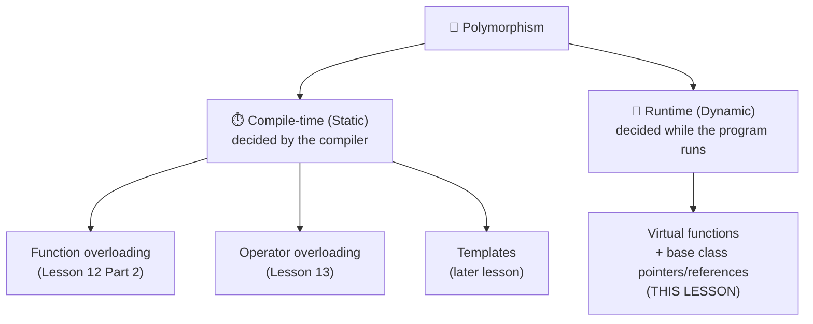
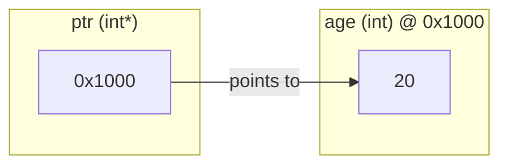
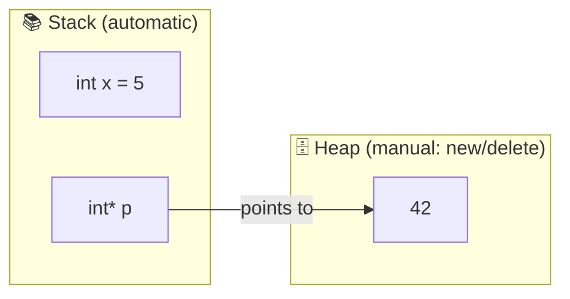
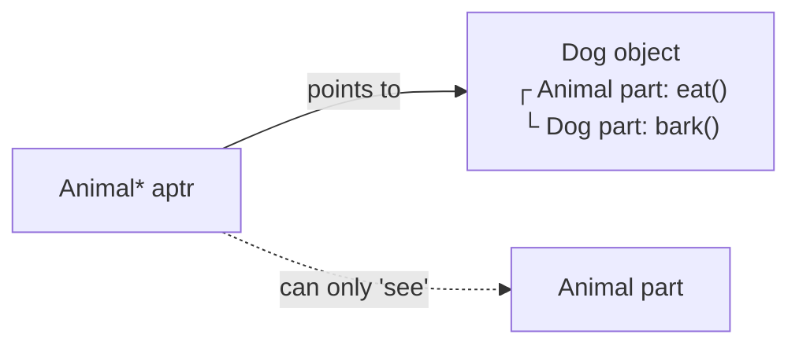
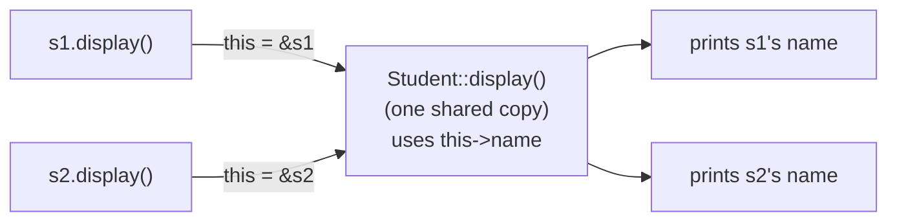
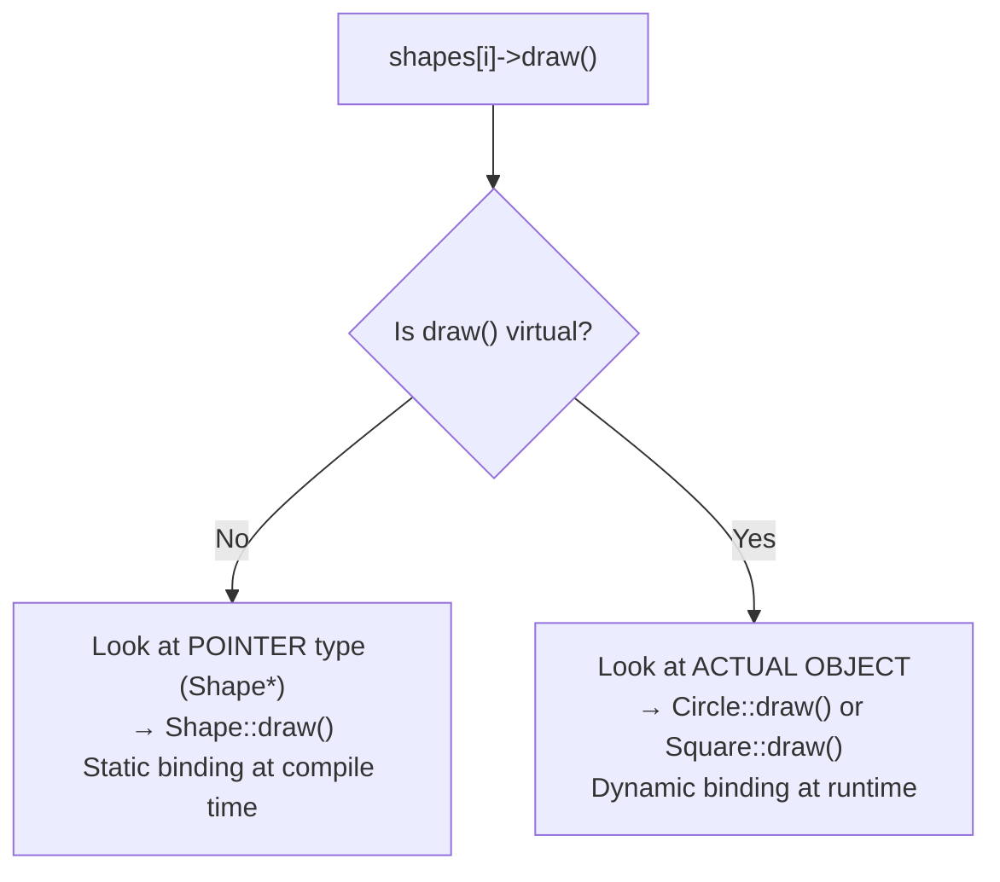
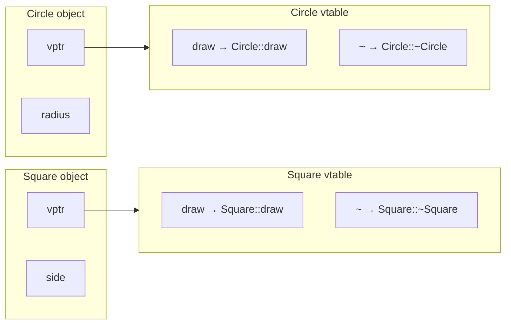
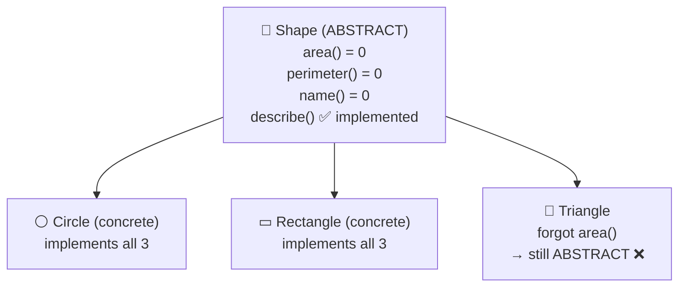
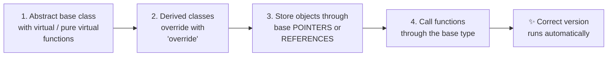

> **Goal of this lesson:** Master pointers (the tool that makes runtime polymorphism possible), use pointers with objects, understand the `this` pointer in depth, and implement polymorphism with virtual functions, pure virtual functions, and abstract classes.

> 🔗 *Builds on Lesson 12 Part 2 (virtual functions intro), Lesson 13 (Objects and Classes), and Lesson 14 (Inheritance). Topics previewed earlier are covered here in full depth.*

> 💡 *Diagrams use **Mermaid**, which GitHub renders automatically.*

---

## 📑 Table of Contents

| # | Syllabus Topic | Section |
|---|----------------|---------|
| 0 | What is Polymorphism? (overview) | [Section 0](#0-what-is-polymorphism) |
| 1 | Pointers in C++ | [Section 1](#1-pointers-in-c) |
| 2 | Pointers and Objects | [Section 2](#2-pointers-and-objects) |
| 3 | `this` Pointer | [Section 3](#3-the-this-pointer) |
| 4 | Virtual Functions | [Section 4](#4-virtual-functions) |
| 5 | Pure Virtual Functions | [Section 5](#5-pure-virtual-functions-and-abstract-classes) |
| 6 | Implementing Polymorphism | [Section 6](#6-implementing-polymorphism) |
| — | All Topics at a Glance | [Section 7](#7-all-topics-at-a-glance) |
| — | Mistakes, Exercises, Quiz, Summary | [Section 8](#8-common-beginner-mistakes) onward |

---

## 0. What is Polymorphism?

**Polymorphism** comes from Greek: *poly* = many, *morph* = forms. It means **one interface, many forms** — the same function call or operator behaves differently depending on the type it works with.

🗣️ **Analogy:** The word **"open"** — *open* a door, *open* a file, *open* a bank account. One word, different actions depending on **what** you're opening.

📱 **Another analogy:** Pressing a phone's **"Share"** button sends a photo through WhatsApp, email, or Bluetooth — depending on which app you choose. The button (interface) is the same; the action (form) differs.

### Two Types of Polymorphism



| | Compile-Time Polymorphism | Runtime Polymorphism |
|--|--------------------------|---------------------|
| Also called | Static / early binding | Dynamic / late binding |
| Decided | When compiling | While running |
| Achieved by | Overloading (functions, operators), templates | **Virtual functions** + **pointers/references** |
| Needs inheritance | ❌ | ✅ |
| Speed | Faster | Slight overhead |
| Flexibility | Less | More — new types work with old code |

📌 **Runtime polymorphism needs pointers (or references).** That's why this lesson starts with pointers!

---

## 1. Pointers in C++

### 1.1 Memory and Addresses

Every variable lives somewhere in **memory (RAM)**. Each memory location has a unique number called its **address**.

🏠 **Analogy:** Memory is a long street of houses. Each house has a **house number** (address) and **someone living in it** (value).

```
  Variable:      age          marks         grade
              ┌────────┐   ┌────────┐   ┌────────┐
  Value:      │   20   │   │  88.5  │   │  'A'   │
              └────────┘   └────────┘   └────────┘
  Address:     0x1000       0x1004       0x100C
```

### The Address-of Operator `&`

```cpp
#include <iostream>
using namespace std;

int main() {
    int age = 20;
    cout << "Value  : " << age << endl;     // 20
    cout << "Address: " << &age << endl;    // e.g. 0x7ffd5c3a1b4c
    return 0;
}
```
*(The address varies every time you run the program.)*

### 1.2 What is a Pointer?

A **pointer** is a **variable that stores the memory address of another variable**.

```cpp
int age = 20;
int* ptr = &age;     // ptr stores the address of age
```



📮 **Analogy:** A pointer is like a **slip of paper with a house address written on it**. The paper isn't the house — but it tells you **where to find** the house.

### 1.3 Declaring and Using Pointers

```cpp
dataType* pointerName;
```

| Declaration | Meaning |
|-------------|---------|
| `int* p;` | Pointer to an `int` |
| `double* d;` | Pointer to a `double` |
| `char* c;` | Pointer to a `char` |
| `Student* s;` | Pointer to a `Student` object |

⚠️ The `*` belongs to **each** variable:
```cpp
int* a, b;      // a is a pointer, b is a plain int! 😱
int *a, *b;     // both are pointers
```
💡 Declare one pointer per line to avoid confusion.

### The Two Pointer Operators

| Operator | Name | Meaning | Example |
|----------|------|---------|---------|
| `&` | Address-of | "Give me the address of..." | `&age` |
| `*` | Dereference | "Go to the address and get the value" | `*ptr` |

```cpp
#include <iostream>
using namespace std;

int main() {
    int age = 20;
    int* ptr = &age;

    cout << "age        = " << age << endl;     // 20
    cout << "&age       = " << &age << endl;    // address of age
    cout << "ptr        = " << ptr << endl;     // same address
    cout << "*ptr       = " << *ptr << endl;    // 20 (value at that address)
    cout << "&ptr       = " << &ptr << endl;    // address of the pointer itself

    *ptr = 25;                                  // change age THROUGH the pointer
    cout << "age is now = " << age << endl;     // 25
    return 0;
}
```

**Output** (addresses vary):
```
age        = 20
&age       = 0x7ffc8a2b1d3c
ptr        = 0x7ffc8a2b1d3c
*ptr       = 20
&ptr       = 0x7ffc8a2b1d40
age is now = 25
```

🧠 **Memory trick:**
- `&` → "**a**ddress" (both start with "a" sound — **&** = **a**nd = **a**ddress)
- `*` → "**value at**" (go to the address)

### The Many Meanings of `*` and `&`

| Context | `*` means | `&` means |
|---------|-----------|-----------|
| In a declaration | `int* p` → p is a **pointer** | `int& r` → r is a **reference** |
| In an expression | `*p` → **dereference** | `&x` → **address of** |
| Between two values | `a * b` → multiply | `a & b` → bitwise AND |

### 1.4 Null Pointers

A pointer that points to **nothing** should be set to **`nullptr`** (C++11):

```cpp
int* p = nullptr;      // ✅ points nowhere — safe to check

if (p != nullptr) {    // or simply: if (p)
    cout << *p;
} else {
    cout << "Pointer is null" << endl;
}
```

⚠️ Dereferencing a null pointer → **crash** (`Segmentation fault`).

📌 Older code uses `NULL` or `0`. Prefer `nullptr` — it's type-safe.

### 1.5 Pointer Size

All pointers have the **same size** (on a given system), no matter what they point to — they all just store an address:

```cpp
cout << sizeof(int*) << " " << sizeof(double*) << " " << sizeof(char*);
// 8 8 8  (on a 64-bit system)
```

### 1.6 Pointers and Arrays

An array's name acts like a **pointer to its first element**:

```cpp
#include <iostream>
using namespace std;

int main() {
    int marks[5] = {78, 85, 92, 66, 70};
    int* p = marks;                 // same as &marks[0]

    cout << *p << endl;             // 78
    cout << *(p + 1) << endl;       // 85
    cout << *(p + 2) << endl;       // 92
    cout << p[3] << endl;           // 66  — pointers can use [] too

    for (int i = 0; i < 5; i++) {
        cout << *(marks + i) << " ";   // same as marks[i]
    }
    cout << endl;
    return 0;
}
```

📌 **`arr[i]` is exactly the same as `*(arr + i)`.**

### 1.7 Pointer Arithmetic

Adding 1 to a pointer moves it to the **next element**, not the next byte. It moves by `sizeof(type)` bytes:

```
  int marks[5]   (each int = 4 bytes)
  ┌──────┬──────┬──────┬──────┬──────┐
  │  78  │  85  │  92  │  66  │  70  │
  └──────┴──────┴──────┴──────┴──────┘
  0x100  0x104  0x108  0x10C  0x110
    ▲      ▲      ▲
    p     p+1    p+2      (p + 1 adds 4 bytes, not 1)
```

| Operation | Meaning |
|-----------|---------|
| `p + n` | Address n elements ahead |
| `p - n` | Address n elements back |
| `p++`, `p--` | Move to the next / previous element |
| `p2 - p1` | Number of elements between two pointers (same array) |
| `p1 == p2`, `p1 < p2` | Compare positions |

```cpp
int nums[] = {10, 20, 30, 40};
int* p = nums;
p++;                       // now points to 20
p += 2;                    // now points to 40
cout << *p;                // 40
cout << (p - nums);        // 3 (elements from the start)
```

⚠️ Moving a pointer **outside** the array and dereferencing it is **undefined behaviour**.

### 1.8 Pointers and Functions (Pass by Address)

Recall from Lesson 12 — functions can modify the caller's variables through pointers:

```cpp
#include <iostream>
using namespace std;

void doubleIt(int* n) {
    if (n != nullptr) {      // always check!
        *n = *n * 2;
    }
}

int main() {
    int x = 7;
    doubleIt(&x);            // pass the ADDRESS
    cout << x << endl;       // 14
    return 0;
}
```

### Pointers vs References

| Feature | Pointer (`int* p`) | Reference (`int& r`) |
|---------|-------------------|---------------------|
| Stores | An address | Is an alias (another name) |
| Can be null | ✅ `nullptr` | ❌ Never |
| Can be reassigned | ✅ Point elsewhere | ❌ Bound once forever |
| Must be initialized | ❌ (but should be) | ✅ Always |
| Access value | `*p` | `r` (no special syntax) |
| Pointer arithmetic | ✅ | ❌ |
| Use when | Optional values, dynamic memory, arrays, reseating | Default choice for parameters |

### 1.9 Dynamic Memory: `new` and `delete`

Normal variables are created on the **stack** and disappear automatically when their scope ends. Sometimes you need memory that:
- has a size known only **at runtime**, or
- must **outlive** the function that created it.

Use **`new`** to allocate memory on the **heap** (free store) and **`delete`** to release it.



| | Stack | Heap |
|--|-------|------|
| Created by | Declaring a variable | `new` |
| Freed by | Automatically at end of scope | **You**, with `delete` |
| Size | Small, fixed | Large |
| Speed | Very fast | Slower |
| Lifetime | Until the block ends | Until you `delete` it |

### Single Values

```cpp
int* p = new int;          // allocate one int (uninitialized)
*p = 42;

int* q = new int(100);     // allocate and initialize
cout << *q;                // 100

delete p;                  // free memory
delete q;
p = nullptr;               // good habit: avoid dangling pointers
q = nullptr;
```

### Dynamic Arrays

```cpp
#include <iostream>
using namespace std;

int main() {
    int n;
    cout << "How many students? ";
    cin >> n;

    int* marks = new int[n];           // size decided at runtime ✅

    for (int i = 0; i < n; i++) {
        cout << "Marks of student " << i + 1 << ": ";
        cin >> marks[i];
    }

    int total = 0;
    for (int i = 0; i < n; i++) total += marks[i];
    cout << "Average: " << static_cast<double>(total) / n << endl;

    delete[] marks;                    // ⚠️ [] for arrays!
    marks = nullptr;
    return 0;
}
```

| Allocate | Free |
|----------|------|
| `new T` | `delete p;` |
| `new T[n]` | `delete[] p;` |

⚠️ Mixing them (`new[]` with `delete`) → **undefined behaviour**.

### 1.10 Pointer Dangers ⚠️

| Problem | Cause | Example | Prevention |
|---------|-------|---------|-----------|
| **Wild pointer** | Uninitialized pointer | `int* p; *p = 5;` | Always initialize (`= nullptr`) |
| **Null dereference** | Using a null pointer | `int* p = nullptr; *p = 5;` | Check `if (p)` before use |
| **Dangling pointer** | Pointing to freed or destroyed memory | `delete p; *p = 5;` | Set to `nullptr` after `delete` |
| **Memory leak** | Forgetting `delete` | `new int[1000];` with no `delete[]` | Pair every `new` with `delete`, or use smart pointers |
| **Double delete** | Deleting twice | `delete p; delete p;` | Set to `nullptr` (`delete nullptr` is safe) |
| **Out of bounds** | Pointer arithmetic past the array | `*(arr + 10)` for a 5-element array | Track array size |
| **Returning address of a local** | Local is destroyed | `int* f() { int x; return &x; }` | Return by value or allocate properly |

```cpp
// Memory leak example
void leaky() {
    int* data = new int[1000];
    // ... forgot delete[] data;
}   // pointer is gone, but the 1000 ints are still allocated forever! 💧
```

### 1.11 `const` and Pointers

| Declaration | Can change the value? | Can change where it points? | Read as |
|-------------|----------------------|----------------------------|---------|
| `int* p` | ✅ | ✅ | pointer to int |
| `const int* p` | ❌ | ✅ | pointer to **const int** |
| `int* const p` | ✅ | ❌ | **const pointer** to int |
| `const int* const p` | ❌ | ❌ | const pointer to const int |

🧠 **Trick:** read **right to left**. `int* const p` → "p is a **const pointer** to an int".

```cpp
int a = 10, b = 20;

const int* p1 = &a;
// *p1 = 5;      // ❌ value is read-only
p1 = &b;         // ✅ can point elsewhere

int* const p2 = &a;
*p2 = 5;         // ✅ can change value
// p2 = &b;      // ❌ pointer is fixed
```

### 1.12 Pointer to Pointer

```cpp
int x = 5;
int* p = &x;       // pointer to int
int** pp = &p;     // pointer to pointer to int

cout << **pp;      // 5
```
```
  pp ──► p ──► x (5)
```
Used for 2D dynamic arrays and functions that change where a pointer points.

### 1.13 Smart Pointers (Modern C++ Preview)

Manual `new`/`delete` is error-prone. Modern C++ provides **smart pointers** (in `<memory>`) that **delete automatically** (RAII — Lesson 13):

```cpp
#include <iostream>
#include <memory>
using namespace std;

int main() {
    unique_ptr<int> p = make_unique<int>(42);   // C++14
    cout << *p << endl;                         // 42
    return 0;
}   // memory freed automatically — no delete needed ✅
```

| Smart Pointer | Ownership |
|---------------|-----------|
| `unique_ptr` | One owner only |
| `shared_ptr` | Many owners; freed when the last one is gone |
| `weak_ptr` | Observes a `shared_ptr` without owning |

📌 In this lesson we use raw pointers to **learn how things work**. In real projects, prefer smart pointers (see Section 6.6).

---

## 2. Pointers and Objects

### 2.1 Pointer to an Object

A pointer can store the address of an **object**, just like any variable:

```cpp
Student s("Riya", 88);
Student* ptr = &s;
```

### 2.2 The Arrow Operator `->`

To access members through a pointer, use **`->`**:

```cpp
ptr->display();        // same as (*ptr).display()
```

| Access Through | Syntax | Example |
|----------------|--------|---------|
| Object | `.` | `s.display()` |
| Pointer | `->` | `ptr->display()` |
| Pointer (long form) | `(*ptr).` | `(*ptr).display()` |

⚠️ `*ptr.display()` is **wrong** — `.` has higher precedence than `*`. That's why `->` exists!

```cpp
#include <iostream>
#include <string>
using namespace std;

class Student {
    string name;
    double marks;
public:
    Student(const string& n, double m) : name(n), marks(m) { }
    void display() const { cout << name << ": " << marks << endl; }
    void setMarks(double m) { marks = m; }
};

int main() {
    Student s("Riya", 88);
    Student* ptr = &s;

    s.display();           // via object
    ptr->display();        // via pointer
    (*ptr).display();      // via dereferenced pointer

    ptr->setMarks(95);     // modifies s through the pointer
    s.display();           // Riya: 95
    return 0;
}
```

**Output:**
```
Riya: 88
Riya: 88
Riya: 88
Riya: 95
```

### 2.3 Dynamic Objects with `new` and `delete`

```cpp
#include <iostream>
#include <string>
using namespace std;

class Book {
    string title;
public:
    Book(const string& t) : title(t) { cout << "Created: " << title << endl; }
    ~Book() { cout << "Destroyed: " << title << endl; }
    void read() const { cout << "Reading " << title << endl; }
};

int main() {
    Book* b = new Book("C++ Primer");    // constructor runs
    b->read();
    delete b;                            // destructor runs
    b = nullptr;

    cout << "--- end of main ---" << endl;
    return 0;
}
```

**Output:**
```
Created: C++ Primer
Reading C++ Primer
Destroyed: C++ Primer
--- end of main ---
```

| | Stack Object | Heap Object |
|--|-------------|-------------|
| Create | `Book b("X");` | `Book* b = new Book("X");` |
| Access | `b.read()` | `b->read()` |
| Destroy | Automatic at end of scope | **`delete b;`** (manual) |
| Forgetting cleanup | Impossible | **Memory leak**, destructor never runs |

### 2.4 Dynamic Arrays of Objects

```cpp
#include <iostream>
using namespace std;

class Counter {
    int value;
public:
    Counter() : value(0) { }            // default constructor needed for new Counter[n]
    void set(int v) { value = v; }
    int get() const { return value; }
};

int main() {
    int n = 3;
    Counter* arr = new Counter[n];      // n objects, default-constructed

    for (int i = 0; i < n; i++) arr[i].set((i + 1) * 10);
    for (int i = 0; i < n; i++) cout << arr[i].get() << " ";   // 10 20 30
    cout << endl;

    delete[] arr;                       // destroys all n objects
    return 0;
}
```

### 2.5 Array of Pointers to Objects

Each element is a pointer to a separately created object:

```cpp
#include <iostream>
#include <string>
using namespace std;

class Player {
    string name;
public:
    Player(const string& n) : name(n) { }
    void show() const { cout << "Player: " << name << endl; }
};

int main() {
    Player* team[3];
    team[0] = new Player("Virat");
    team[1] = new Player("Rohit");
    team[2] = new Player("Bumrah");

    for (int i = 0; i < 3; i++) team[i]->show();

    for (int i = 0; i < 3; i++) {
        delete team[i];                 // delete each object
        team[i] = nullptr;
    }
    return 0;
}
```

```
  team[0] ──► Player("Virat")
  team[1] ──► Player("Rohit")
  team[2] ──► Player("Bumrah")
```

📌 This pattern — **an array of base-class pointers** — is the heart of runtime polymorphism (Section 6).

### 2.6 Base Class Pointer to a Derived Object ⭐

From Lesson 14: a derived object **is a** base object, so a **base pointer** can point to a **derived object** (**upcasting**):

```cpp
#include <iostream>
using namespace std;

class Animal {
public:
    void eat() const { cout << "Animal eating" << endl; }
};

class Dog : public Animal {
public:
    void bark() const { cout << "Woof!" << endl; }
};

int main() {
    Dog d;
    Animal* aptr = &d;      // ✅ upcasting: always allowed (public inheritance)

    aptr->eat();            // ✅ Animal functions are available
    // aptr->bark();        // ❌ error: Animal doesn't have bark()

    // Dog* dptr = aptr;    // ❌ downcasting needs an explicit cast
    return 0;
}
```



| | Upcasting | Downcasting |
|--|-----------|-------------|
| Direction | Derived* → Base* | Base* → Derived* |
| Safe? | ✅ Always | ⚠️ Only if the object really is that type |
| Implicit? | ✅ Yes | ❌ Needs `static_cast` or `dynamic_cast` |

📌 Through a base pointer, you can only call **base** functions. And for **overridden** functions, **which version** runs depends on `virtual` — Section 4!

---

## 3. The `this` Pointer

### 3.1 What is `this`?

Inside every **non-static member function**, C++ automatically provides a hidden pointer named **`this`** that holds the **address of the object that called the function**.

```cpp
s1.display();   // inside display(), this == &s1
s2.display();   // inside display(), this == &s2
```

### 3.2 Why Does `this` Exist?

Member functions are stored **once** and **shared** by all objects (Lesson 13). When `display()` runs, how does it know **whose** data to use? The compiler secretly passes the object's address:

```cpp
// What you write:
s1.display();

// What the compiler effectively does:
Student::display(&s1);          // passes the object's address as a hidden parameter

// Inside, every member access becomes:
cout << this->name;             // this == &s1
```



### 3.3 Proving It: Printing `this`

```cpp
#include <iostream>
using namespace std;

class Demo {
public:
    void whoAmI() const {
        cout << "this = " << this << endl;
    }
};

int main() {
    Demo a, b;
    cout << "&a   = " << &a << endl;
    a.whoAmI();
    cout << "&b   = " << &b << endl;
    b.whoAmI();
    return 0;
}
```

**Output** (addresses vary):
```
&a   = 0x7ffd1a2b3c4e
this = 0x7ffd1a2b3c4e
&b   = 0x7ffd1a2b3c4f
this = 0x7ffd1a2b3c4f
```
`this` always equals the calling object's address ✅

### 3.4 Uses of `this`

#### Use 1: Resolve Name Conflicts

```cpp
class Rectangle {
    double length, width;
public:
    void set(double length, double width) {
        this->length = length;       // member = parameter
        this->width = width;
    }
};
```
Without `this->`, `length = length;` assigns the parameter to **itself** — the member is never changed!

#### Use 2: Return the Current Object (Method Chaining)

Return `*this` **by reference**:

```cpp
#include <iostream>
#include <string>
using namespace std;

class Pizza {
    string size = "Medium";
    string toppings;
    bool extraCheese = false;
public:
    Pizza& setSize(const string& s)    { size = s; return *this; }
    Pizza& addTopping(const string& t) { toppings += t + " "; return *this; }
    Pizza& withExtraCheese()           { extraCheese = true; return *this; }

    void order() const {
        cout << size << " pizza with " << toppings
             << (extraCheese ? "+ extra cheese" : "") << endl;
    }
};

int main() {
    Pizza p;
    p.setSize("Large").addTopping("Paneer").addTopping("Onion").withExtraCheese().order();
    return 0;
}
```

**Output:**
```
Large pizza with Paneer Onion + extra cheese
```

| Expression | Type | Meaning |
|------------|------|---------|
| `this` | `Pizza*` | Address of the current object |
| `*this` | `Pizza&` (when returned by reference) | The current object itself |

⚠️ If you return `Pizza` (by **value**) instead of `Pizza&`, each call in the chain modifies a **copy**, not the original!

#### Use 3: Check for Self-Assignment

```cpp
Wallet& operator=(const Wallet& other) {
    if (this == &other) return *this;   // a = a; → nothing to do
    // ... copy data ...
    return *this;
}
```

#### Use 4: Pass the Current Object to Another Function

```cpp
class Student;
void registerStudent(Student* s);

class Student {
public:
    void enroll() {
        registerStudent(this);     // "register ME"
    }
};
```

#### Use 5: Compare Objects

```cpp
bool isSameAs(const Student& other) const {
    return this == &other;         // same object in memory?
}
```

### 3.5 Facts About `this`

| Fact | Detail |
|------|--------|
| Available in | **Non-static** member functions only |
| **Not** available in | **Static** member functions (no object — Lesson 13) and friend functions |
| Type in a normal member function of `X` | `X*` |
| Type in a **`const`** member function | `const X*` — that's why const functions can't modify members |
| Can you reassign it? | ❌ No — `this = &other;` is an error |
| Is it stored inside the object? | ❌ No — passed as a hidden argument |
| Can it be `nullptr`? | ❌ Never in valid code |

```cpp
class Box {
    int side;
public:
    void grow() { this->side++; }              // this is Box*
    int get() const { return this->side; }     // this is const Box*
    // void bad() const { this->side++; }      // ❌ can't modify through const Box*
    static void info() {
        // cout << this;                       // ❌ no 'this' in a static function
    }
};
```

---

## 4. Virtual Functions

### 4.1 The Problem: Base Pointers Call Base Functions

```cpp
#include <iostream>
using namespace std;

class Shape {
public:
    void draw() const { cout << "Drawing a generic shape" << endl; }
};

class Circle : public Shape {
public:
    void draw() const { cout << "Drawing a circle ⚪" << endl; }
};

class Square : public Shape {
public:
    void draw() const { cout << "Drawing a square ⬜" << endl; }
};

int main() {
    Shape* shapes[2] = { new Circle(), new Square() };

    for (int i = 0; i < 2; i++) {
        shapes[i]->draw();      // 😕 always "generic shape"
    }

    for (int i = 0; i < 2; i++) delete shapes[i];
    return 0;
}
```

**Output:**
```
Drawing a generic shape
Drawing a generic shape
```

The compiler sees `Shape*`, so it **binds** the call to `Shape::draw()` at **compile time** (**static / early binding**). It doesn't look at the actual object.

### 4.2 The Solution: `virtual`

A **virtual function** is a member function declared with the keyword **`virtual`** in the base class. When called through a **base pointer or reference**, the program chooses the version based on the **actual object type at runtime** (**dynamic / late binding**).

```cpp
#include <iostream>
using namespace std;

class Shape {
public:
    virtual void draw() const { cout << "Drawing a generic shape" << endl; }   // ⭐
    virtual ~Shape() { }
};

class Circle : public Shape {
public:
    void draw() const override { cout << "Drawing a circle ⚪" << endl; }
};

class Square : public Shape {
public:
    void draw() const override { cout << "Drawing a square ⬜" << endl; }
};

int main() {
    Shape* shapes[2] = { new Circle(), new Square() };

    for (int i = 0; i < 2; i++) {
        shapes[i]->draw();      // ✅ correct version for each object
    }

    for (int i = 0; i < 2; i++) delete shapes[i];
    return 0;
}
```

**Output:**
```
Drawing a circle ⚪
Drawing a square ⬜
```



🎮 **Analogy:** A game controller's **"A" button** (base interface). In a racing game it accelerates, in a football game it passes, in an adventure game it jumps. The **same button press** does the right thing for **whatever game is loaded** (actual object).

### 4.3 Virtual Works Through Pointers AND References

```cpp
void render(const Shape& s) {     // reference to base
    s.draw();                     // virtual → correct version
}

Circle c;
Square sq;
render(c);     // Drawing a circle ⚪
render(sq);    // Drawing a square ⬜
```

⚠️ But **not** through a plain **object** (copy) — that causes **object slicing**:

```cpp
void renderCopy(Shape s) {        // by VALUE → only the Shape part is copied
    s.draw();                     // always Shape::draw()
}
renderCopy(c);   // Drawing a generic shape 😕
```

| Called Through | Virtual Dispatch? |
|----------------|-------------------|
| `Shape* p = &circle; p->draw();` | ✅ Yes |
| `Shape& r = circle; r.draw();` | ✅ Yes |
| `Shape s = circle; s.draw();` | ❌ No (sliced copy) |
| `circle.draw();` | Uses `Circle::draw()` directly (object's own type) |

### 4.4 How Virtual Functions Work: The vtable

> 🎓 *An implementation detail used by all major compilers. Understanding it explains the rules.*

1. Every class with virtual functions has a hidden **vtable** (virtual table) — a table of pointers to that class's versions of each virtual function.
2. Every object of such a class contains a hidden **vptr** (virtual pointer) pointing to its class's vtable.
3. A virtual call follows: **object → vptr → vtable → function**.



```cpp
class NoVirtual   { int x; void f() { } };
class WithVirtual { int x; virtual void f() { } };

cout << sizeof(NoVirtual) << " " << sizeof(WithVirtual);   // typically 4 16
// WithVirtual is bigger because of the hidden vptr (+ padding)
```

📌 Consequences:
- Virtual calls are **slightly slower** (one extra lookup)
- Objects are **slightly larger** (the vptr)
- Usually negligible — the flexibility is worth it

### 4.5 Rules of Virtual Functions

| Rule | Explanation |
|------|-------------|
| Declare `virtual` in the **base** class | Derived overrides are automatically virtual |
| Override with the **same signature** | Name, parameters, `const` must match |
| Use **`override`** in derived classes | Compiler catches mistakes |
| Dispatch works through **pointers/references** | Not through copies |
| Can't be **`static`** | Static functions have no object |
| Can be a **friend** of another class | But a friend function itself can't be virtual |
| **Constructors** can't be virtual | The object's type isn't complete yet |
| **Destructors** should be virtual in base classes | See 4.7 |
| Virtual calls inside constructors/destructors use the **current** class's version | Derived part doesn't exist yet / anymore |
| Return type must match (or be a covariant pointer/reference) | `Base* clone()` → `Derived* clone()` is allowed |

### 4.6 The `override` and `final` Specifiers

```cpp
class Shape {
public:
    virtual void draw() const;
    virtual double area() const;
};

class Circle : public Shape {
public:
    void draw() const override;        // ✅
    void draw() override;              // ❌ missing const → doesn't match → error
    double Area() const override;      // ❌ capital A → no such base function → error
};
```

Without `override`, the last two would compile **silently** as brand-new functions — and polymorphism would mysteriously not work.

```cpp
class Circle final : public Shape { };            // no class may derive from Circle
class Square : public Shape {
    void draw() const override final;             // no further overriding of draw()
};
```

### 4.7 Virtual Destructors ⭐

When you `delete` a derived object through a **base pointer**, the base destructor **must** be virtual. Otherwise only the base destructor runs → the derived part is never cleaned up (**undefined behaviour**, usually a leak).

```cpp
#include <iostream>
using namespace std;

class Base {
public:
    Base() { cout << "Base constructor" << endl; }
    ~Base() { cout << "Base destructor" << endl; }              // ❌ NOT virtual
};

class Derived : public Base {
    int* data;
public:
    Derived() : data(new int[100]) { cout << "Derived constructor (allocated)" << endl; }
    ~Derived() { delete[] data; cout << "Derived destructor (freed)" << endl; }
};

int main() {
    Base* p = new Derived();
    delete p;          // ⚠️ only ~Base() runs → 100 ints leaked!
    return 0;
}
```

**Typical output:**
```
Base constructor
Derived constructor (allocated)
Base destructor
```

✅ **Fix:**
```cpp
virtual ~Base() { cout << "Base destructor" << endl; }
```

**Output:**
```
Base constructor
Derived constructor (allocated)
Derived destructor (freed)
Base destructor
```

📌 **Rule:** if a class has **any** virtual function (or is meant to be a base class used through pointers), give it a **virtual destructor**.

### 4.8 Virtual Calls Inside Constructors

```cpp
#include <iostream>
using namespace std;

class Base {
public:
    Base() { hello(); }                              // called during construction
    virtual void hello() const { cout << "Hello from Base" << endl; }
    virtual ~Base() { }
};

class Derived : public Base {
public:
    void hello() const override { cout << "Hello from Derived" << endl; }
};

int main() {
    Derived d;       // prints "Hello from Base" — NOT Derived!
    d.hello();       // now prints "Hello from Derived"
    return 0;
}
```

**Output:**
```
Hello from Base
Hello from Derived
```

While `Base`'s constructor runs, the `Derived` part **doesn't exist yet**, so the object still behaves like a `Base`. ✅ **Avoid calling virtual functions in constructors and destructors.**

### 4.9 Calling the Base Version

A derived override can still use the base implementation:

```cpp
class Employee {
public:
    virtual double salary() const { return 50000; }
    virtual ~Employee() { }
};

class Manager : public Employee {
public:
    double salary() const override {
        return Employee::salary() + 20000;     // base version + bonus
    }
};
```

---

## 5. Pure Virtual Functions and Abstract Classes

### 5.1 The Problem

What should `Shape::area()` return for a generic shape? There's **no sensible answer**. A "shape" by itself is just an **idea** — only specific shapes (circle, square) have real areas.

```cpp
class Shape {
public:
    virtual double area() const { return 0; }   // 😕 meaningless placeholder
};
```

Worse, nothing **forces** derived classes to override it. Forget to override `area()` in `Triangle`, and every triangle silently has area 0.

### 5.2 Pure Virtual Functions

A **pure virtual function** has **no implementation** in the base class and is declared with **`= 0`**:

```cpp
virtual returnType functionName(parameters) = 0;
```

```cpp
class Shape {
public:
    virtual double area() const = 0;        // pure virtual: "every shape MUST provide this"
    virtual double perimeter() const = 0;
    virtual ~Shape() { }
};
```

📋 **Analogy:** A **job description** says "Must be able to drive" — it doesn't drive anything itself. Each **employee** (derived class) who takes the job must actually know how to drive their own way.

### 5.3 Abstract Classes

A class with **at least one** pure virtual function is an **abstract class**.

| Abstract Class | Concrete Class |
|----------------|----------------|
| Has ≥ 1 pure virtual function | All pure virtual functions are overridden |
| ❌ **Cannot create objects** | ✅ Can create objects |
| ✅ Can have pointers and references | ✅ |
| Defines an **interface/contract** | Provides the **implementation** |

```cpp
#include <iostream>
using namespace std;

class Shape {                                       // abstract
public:
    virtual double area() const = 0;
    virtual double perimeter() const = 0;
    virtual const char* name() const = 0;
    virtual ~Shape() { }

    void describe() const {                         // normal function using pure virtuals
        cout << name() << ": area = " << area()
             << ", perimeter = " << perimeter() << endl;
    }
};

class Circle : public Shape {                       // concrete
    double r;
public:
    Circle(double radius) : r(radius) { }
    double area() const override      { return 3.14159 * r * r; }
    double perimeter() const override { return 2 * 3.14159 * r; }
    const char* name() const override { return "Circle"; }
};

class Rectangle : public Shape {                    // concrete
    double l, w;
public:
    Rectangle(double len, double wid) : l(len), w(wid) { }
    double area() const override      { return l * w; }
    double perimeter() const override { return 2 * (l + w); }
    const char* name() const override { return "Rectangle"; }
};

int main() {
    // Shape s;                       // ❌ error: cannot declare variable 's' to be of abstract type
    Shape* s1 = new Circle(2);        // ✅ pointer to abstract type is fine
    Shape* s2 = new Rectangle(3, 4);

    s1->describe();
    s2->describe();

    delete s1;
    delete s2;
    return 0;
}
```

**Output:**
```
Circle: area = 12.5664, perimeter = 12.5664
Rectangle: area = 12, perimeter = 14
```

💡 Notice `describe()` — a **normal** function in the abstract class that calls **pure virtual** functions. It works for every shape, even future ones. This is called the **Template Method** pattern.



### 5.4 A Derived Class That Doesn't Override Everything Stays Abstract

```cpp
class Triangle : public Shape {
public:
    double perimeter() const override { return 12; }
    const char* name() const override { return "Triangle"; }
    // area() NOT overridden
};

Triangle t;   // ❌ error: cannot declare variable 't' to be of abstract type 'Triangle'
              //    note: because the following virtual functions are pure: area()
```

✅ This is a **feature** — the compiler **forces** every concrete shape to implement `area()`. You can't forget!

### 5.5 What Abstract Classes Can Contain

Abstract classes are **not empty shells**. They can have:

| Member | Allowed? |
|--------|----------|
| Pure virtual functions | ✅ (at least one) |
| Normal virtual functions with bodies | ✅ |
| Non-virtual functions | ✅ |
| Data members | ✅ |
| Constructors | ✅ (called by derived constructors) |
| Destructor | ✅ (should be virtual) |
| Static members | ✅ |

```cpp
#include <iostream>
#include <string>
using namespace std;

class Employee {                          // abstract base with data and a constructor
protected:
    string name;
    int id;
public:
    Employee(const string& n, int i) : name(n), id(i) { }
    virtual ~Employee() { }

    virtual double calculatePay() const = 0;     // pure virtual
    virtual string type() const { return "Employee"; }   // normal virtual with default

    void printPayslip() const {                  // non-virtual, uses the virtuals
        cout << "[" << type() << "] #" << id << " " << name
             << " : Rs. " << calculatePay() << endl;
    }
};

class Permanent : public Employee {
    double monthlySalary;
public:
    Permanent(const string& n, int i, double s) : Employee(n, i), monthlySalary(s) { }
    double calculatePay() const override { return monthlySalary; }
    string type() const override { return "Permanent"; }
};

class Contract : public Employee {
    double hourlyRate;
    int hours;
public:
    Contract(const string& n, int i, double r, int h) : Employee(n, i), hourlyRate(r), hours(h) { }
    double calculatePay() const override { return hourlyRate * hours; }
    string type() const override { return "Contract"; }   // optional: without it, "Employee" is used
};

int main() {
    Permanent p("Kavya", 101, 85000);
    Contract c("Rahul", 202, 750, 120);

    p.printPayslip();
    c.printPayslip();
    return 0;
}
```

**Output:**
```
[Permanent] #101 Kavya : Rs. 85000
[Contract] #202 Rahul : Rs. 90000
```

### 5.6 Interfaces

An **interface** is an abstract class with **only** pure virtual functions (plus a virtual destructor) and **no data**. It describes **what** something can do, with **zero** implementation.

```cpp
class Printable {
public:
    virtual void print() const = 0;
    virtual ~Printable() = default;
};

class Saveable {
public:
    virtual bool save(const string& filename) const = 0;
    virtual ~Saveable() = default;
};

// A class can implement SEVERAL interfaces (safe multiple inheritance — Lesson 14)
class Report : public Printable, public Saveable {
public:
    void print() const override { cout << "Printing report..." << endl; }
    bool save(const string& f) const override {
        cout << "Saving report to " << f << endl;
        return true;
    }
};
```

| | Abstract Class | Interface (C++ style) |
|--|----------------|----------------------|
| Pure virtual functions | ≥ 1 | All |
| Data members | ✅ Allowed | ❌ None |
| Implemented functions | ✅ Allowed | ❌ None (except destructor) |
| Constructor | ✅ Can have | Usually none |
| Multiple inheritance | Use carefully | ✅ Safe and common |

📌 C++ has no `interface` keyword (unlike Java/C#) — it's just a convention.

### 5.7 Pure Virtual Function **with** a Body (Advanced)

A pure virtual function **can** have a definition (outside the class). The class is still abstract, but derived classes can call the base version:

```cpp
class Logger {
public:
    virtual void log(const string& msg) const = 0;
    virtual ~Logger() = default;
};

void Logger::log(const string& msg) const {            // default implementation
    cout << "[LOG] " << msg << endl;
}

class FileLogger : public Logger {
public:
    void log(const string& msg) const override {
        Logger::log(msg);                             // reuse the default
        cout << "  (also written to file)" << endl;
    }
};
```

💡 A **pure virtual destructor** (`virtual ~Base() = 0;`) is allowed but **must** have a body: `Base::~Base() { }`.

### 5.8 Virtual vs Pure Virtual

| Feature | Virtual Function | Pure Virtual Function |
|---------|------------------|----------------------|
| Syntax | `virtual void f() { ... }` | `virtual void f() = 0;` |
| Base implementation | ✅ Required | ❌ None (optional definition outside) |
| Must derived class override? | ❌ Optional | ✅ Yes (to be concrete) |
| Makes the class abstract? | ❌ No | ✅ Yes |
| Can create base objects? | ✅ Yes | ❌ No |
| Use when | A sensible default exists | No sensible default; every subclass must decide |

---

## 6. Implementing Polymorphism

### 6.1 The Recipe



| Step | What to Do |
|------|-----------|
| 1 | Create a base class with **virtual** (or **pure virtual**) functions and a **virtual destructor** |
| 2 | Derive classes and **override** those functions (use `override`) |
| 3 | Refer to objects using **base class pointers or references** |
| 4 | Call the virtual functions through the base type |

### 6.2 Example 1: Payroll System

```cpp
#include <iostream>
#include <string>
using namespace std;

class Employee {
protected:
    string name;
public:
    Employee(const string& n) : name(n) { }
    virtual ~Employee() { }
    virtual double pay() const = 0;
    virtual string role() const = 0;
    string getName() const { return name; }
};

class Salaried : public Employee {
    double monthly;
public:
    Salaried(const string& n, double m) : Employee(n), monthly(m) { }
    double pay() const override { return monthly; }
    string role() const override { return "Salaried"; }
};

class Hourly : public Employee {
    double rate;
    int hours;
public:
    Hourly(const string& n, double r, int h) : Employee(n), rate(r), hours(h) { }
    double pay() const override {
        int overtime = hours > 160 ? hours - 160 : 0;
        return rate * (hours - overtime) + rate * 1.5 * overtime;
    }
    string role() const override { return "Hourly"; }
};

class Commission : public Employee {
    double base, sales, percent;
public:
    Commission(const string& n, double b, double s, double p)
        : Employee(n), base(b), sales(s), percent(p) { }
    double pay() const override { return base + sales * percent / 100; }
    string role() const override { return "Commission"; }
};

int main() {
    const int N = 3;
    Employee* staff[N] = {
        new Salaried("Ananya", 70000),
        new Hourly("Rahul", 400, 180),
        new Commission("Meera", 20000, 500000, 5)
    };

    double total = 0;
    for (int i = 0; i < N; i++) {
        cout << staff[i]->getName() << " (" << staff[i]->role() << "): Rs. "
             << staff[i]->pay() << endl;
        total += staff[i]->pay();
    }
    cout << "Total payroll: Rs. " << total << endl;

    for (int i = 0; i < N; i++) delete staff[i];
    return 0;
}
```

**Output:**
```
Ananya (Salaried): Rs. 70000
Rahul (Hourly): Rs. 76000
Meera (Commission): Rs. 45000
Total payroll: Rs. 191000
```

✨ The loop **doesn't know or care** what kind of employee each one is. Add a new `Intern` class tomorrow — the loop works **unchanged**. This is the **Open/Closed Principle**: open for extension, closed for modification.

### 6.3 Example 2: Without vs With Polymorphism

#### ❌ Without Polymorphism — `if/else` Chains

```cpp
enum class Type { Circle, Square, Triangle };

double area(Type t, double a, double b) {
    if (t == Type::Circle)        return 3.14159 * a * a;
    else if (t == Type::Square)   return a * a;
    else if (t == Type::Triangle) return 0.5 * a * b;
    return 0;
}
// Adding a Hexagon means editing EVERY function like this 😩
```

#### ✅ With Polymorphism

```cpp
double totalArea(Shape* shapes[], int n) {
    double sum = 0;
    for (int i = 0; i < n; i++) sum += shapes[i]->area();   // no if/else!
    return sum;
}
// Adding a Hexagon: write ONE new class. Nothing else changes. 🎉
```

| | `if/else` / `switch` on type | Polymorphism |
|--|-----------------------------|--------------|
| Adding a new type | Edit every function | Add one new class |
| Risk of forgetting a case | High | Compiler enforces (pure virtual) |
| Code organization | Logic scattered | Each class owns its behaviour |

### 6.4 Example 3: Notification System (Interface)

```cpp
#include <iostream>
#include <string>
using namespace std;

class Notifier {                                   // interface
public:
    virtual void send(const string& to, const string& msg) const = 0;
    virtual ~Notifier() = default;
};

class EmailNotifier : public Notifier {
public:
    void send(const string& to, const string& msg) const override {
        cout << "📧 Email to " << to << ": " << msg << endl;
    }
};

class SMSNotifier : public Notifier {
public:
    void send(const string& to, const string& msg) const override {
        cout << "📱 SMS to " << to << ": " << msg.substr(0, 20) << "..." << endl;
    }
};

class WhatsAppNotifier : public Notifier {
public:
    void send(const string& to, const string& msg) const override {
        cout << "💬 WhatsApp to " << to << ": " << msg << " ✅✅" << endl;
    }
};

// This function works with ANY notifier — present or future
void notifyExamResult(const Notifier& n, const string& student) {
    n.send(student, "Your semester results have been published!");
}

int main() {
    EmailNotifier email;
    SMSNotifier sms;
    WhatsAppNotifier wa;

    notifyExamResult(email, "riya@college.edu");
    notifyExamResult(sms, "98765-43210");
    notifyExamResult(wa, "Aarav");
    return 0;
}
```

**Output:**
```
📧 Email to riya@college.edu: Your semester results have been published!
📱 SMS to 98765-43210: Your semester result...
💬 WhatsApp to Aarav: Your semester results have been published! ✅✅
```

### 6.5 Downcasting with `dynamic_cast`

Sometimes you need a **derived-only** function from a base pointer. Use **`dynamic_cast`** (Lesson 10) to check the real type safely:

```cpp
#include <iostream>
using namespace std;

class Animal {
public:
    virtual void speak() const = 0;
    virtual ~Animal() = default;
};

class Dog : public Animal {
public:
    void speak() const override { cout << "Woof!" << endl; }
    void fetch() const { cout << "  Dog fetches the ball 🎾" << endl; }
};

class Cat : public Animal {
public:
    void speak() const override { cout << "Meow!" << endl; }
};

int main() {
    Animal* pets[] = { new Dog(), new Cat(), new Dog() };

    for (Animal* a : pets) {
        a->speak();
        if (Dog* d = dynamic_cast<Dog*>(a)) {   // nullptr if not a Dog
            d->fetch();
        }
    }

    for (Animal* a : pets) delete a;
    return 0;
}
```

**Output:**
```
Woof!
  Dog fetches the ball 🎾
Meow!
Woof!
  Dog fetches the ball 🎾
```

⚠️ If you find yourself using `dynamic_cast` a lot, it often means a **virtual function** would be a better design.

### 6.6 Modern C++: Polymorphism with Smart Pointers and `vector`

Manual `new`/`delete` is risky (Section 1.10). Modern C++ combines **`unique_ptr`** with **`vector`** (a resizable array — later lesson):

```cpp
#include <iostream>
#include <memory>
#include <vector>
using namespace std;

class Shape {
public:
    virtual double area() const = 0;
    virtual const char* name() const = 0;
    virtual ~Shape() = default;
};

class Circle : public Shape {
    double r;
public:
    Circle(double r) : r(r) { }
    double area() const override { return 3.14159 * r * r; }
    const char* name() const override { return "Circle"; }
};

class Square : public Shape {
    double s;
public:
    Square(double s) : s(s) { }
    double area() const override { return s * s; }
    const char* name() const override { return "Square"; }
};

int main() {
    vector<unique_ptr<Shape>> shapes;
    shapes.push_back(make_unique<Circle>(1.5));
    shapes.push_back(make_unique<Square>(4));
    shapes.push_back(make_unique<Circle>(3));

    double total = 0;
    for (const auto& s : shapes) {
        cout << s->name() << ": " << s->area() << endl;
        total += s->area();
    }
    cout << "Total area: " << total << endl;
    return 0;
}   // ✅ every Shape is deleted automatically — no leaks, no delete
```

**Output:**
```
Circle: 7.06858
Square: 16
Circle: 28.2743
Total area: 51.3429
```

### 6.7 Compile-Time vs Runtime Polymorphism — Side by Side

```cpp
#include <iostream>
using namespace std;

// ===== Compile-time: function overloading =====
void print(int x)    { cout << "int: " << x << endl; }
void print(double x) { cout << "double: " << x << endl; }

// ===== Runtime: virtual functions =====
class Animal {
public:
    virtual void sound() const = 0;
    virtual ~Animal() = default;
};
class Dog : public Animal { public: void sound() const override { cout << "Woof" << endl; } };
class Cow : public Animal { public: void sound() const override { cout << "Moo" << endl; } };

int main() {
    print(5);         // compiler decides: print(int)
    print(5.5);       // compiler decides: print(double)

    int choice;
    cout << "1 = Dog, 2 = Cow: ";
    cin >> choice;

    Animal* a = (choice == 1) ? static_cast<Animal*>(new Dog()) : new Cow();
    a->sound();       // decided at RUNTIME — the compiler couldn't know the user's choice!
    delete a;
    return 0;
}
```

📌 This example proves the difference: the compiler **cannot** know which animal the user will choose, so the decision **must** happen at runtime.

### 6.8 Benefits of Polymorphism

| Benefit | Explanation |
|---------|-------------|
| 🔌 **Extensibility** | Add new types without changing existing code |
| ♻️ **Reusability** | One function works with many types |
| 🧹 **Cleaner code** | Replaces long `if/else`/`switch` chains on type |
| 🛡️ **Safety** | Pure virtual functions force derived classes to implement required behaviour |
| 🧩 **Loose coupling** | Code depends on the abstract interface, not concrete classes |
| 🧪 **Testability** | Swap real implementations with test versions (e.g., a fake `Notifier`) |

---

## 7. All Topics at a Glance

| Topic | Key Syntax | Remember |
|-------|-----------|----------|
| Address-of | `&x` | Gives the address of x |
| Pointer declaration | `int* p = &x;` | Stores an address |
| Dereference | `*p` | Value at the address |
| Null pointer | `int* p = nullptr;` | Check before dereferencing |
| Pointer arithmetic | `p + 1`, `p++` | Moves by `sizeof(type)` |
| Arrays | `arr[i] == *(arr + i)` | Array name ≈ pointer to first element |
| Dynamic memory | `new` / `delete`, `new[]` / `delete[]` | Every `new` needs a `delete` |
| Smart pointers | `make_unique<T>(...)` | Automatic cleanup |
| Pointer to object | `Student* p = &s;` | Access with `->` |
| Dynamic object | `Book* b = new Book("X"); delete b;` | Destructor runs on `delete` |
| Base pointer to derived | `Animal* a = new Dog();` | Upcasting is automatic |
| `this` | `this->x = x;` `return *this;` | Address of calling object; none in static functions |
| Virtual function | `virtual void f();` | Runtime binding via pointer/reference |
| `override` | `void f() override;` | Compiler checks the override |
| Virtual destructor | `virtual ~Base() {}` | Required for polymorphic deletion |
| Pure virtual | `virtual void f() = 0;` | Must be overridden to be concrete |
| Abstract class | ≥ 1 pure virtual | Can't instantiate; pointers/references OK |
| Downcast | `dynamic_cast<Derived*>(p)` | Returns `nullptr` if wrong type |

---

## 8. Common Beginner Mistakes

| ❌ Mistake | ✅ Correct | Topic |
|-----------|-----------|-------|
| `int* a, b;` expecting two pointers | `int *a, *b;` or separate lines | Pointers |
| Using an uninitialized pointer | `int* p = nullptr;` | Pointers |
| Dereferencing `nullptr` | `if (p) { ... }` | Pointers |
| `int* p = 5;` | `int* p = &x;` | Pointers store addresses, not values |
| Forgetting `delete` | Pair every `new` with `delete` (or use smart pointers) | Dynamic memory |
| `delete` for arrays | `delete[] arr;` | Dynamic memory |
| Using a pointer after `delete` | Set to `nullptr` after deleting | Dangling pointers |
| Returning the address of a local variable | Return by value or allocate dynamically | Pointers |
| `*ptr.display()` | `ptr->display()` or `(*ptr).display()` | Pointers and objects |
| `obj->display()` on a non-pointer | `obj.display()` | Pointers and objects |
| Calling derived-only functions through a base pointer | Add a virtual function, or `dynamic_cast` | Upcasting |
| `length = length;` in a setter | `this->length = length;` | `this` |
| Returning `*this` by value for chaining | Return `ClassName&` | `this` |
| Using `this` in a static function | Static functions have no `this` | `this` |
| Forgetting `virtual` in the base class | Add `virtual` | Virtual functions |
| Passing objects by value to polymorphic functions | Pass by pointer or reference | Object slicing |
| Signature mismatch in an "override" | Always use `override` | Virtual functions |
| No virtual destructor in a polymorphic base | `virtual ~Base() = default;` | Virtual destructor |
| Calling virtual functions in constructors | Avoid — base version runs | Virtual functions |
| Trying to create an object of an abstract class | Create a concrete derived object | Pure virtual |
| Forgetting to override one pure virtual function | Override **all** of them | Pure virtual |
| `virtual void f() = 0 { }` inside the class | Define a pure virtual body outside the class | Pure virtual |
| Long `if/else` chains checking object type | Use virtual functions | Implementing polymorphism |

---

## 9. Practice Exercises

### 1️⃣ Pointers

**Exercise 1:** Predict the output:
```cpp
int a = 10, b = 20;
int* p = &a;
*p += 5;
p = &b;
*p *= 2;
cout << a << " " << b << " " << *p << endl;
```

**Exercise 2:** Write a function `void swapPtr(int* x, int* y)` that swaps two integers using pointers.

**Exercise 3:** Using **pointer arithmetic only** (no `[]`), find the sum and maximum of `int arr[] = {12, 45, 7, 89, 23};`.

**Exercise 4:** Ask the user for `n`, create a dynamic array of `n` doubles, read values, print them in **reverse** using a pointer, and free the memory.

**Exercise 5:** Identify the bug in each snippet:
```cpp
// a)
int* p;
*p = 10;

// b)
int* q = new int(5);
delete q;
cout << *q;

// c)
int* arr = new int[10];
delete arr;

// d)
int* getNumber() {
    int n = 42;
    return &n;
}
```

### 2️⃣ Pointers and Objects

**Exercise 6:** Create a class `Rectangle` with `length` and `width`. Create one rectangle on the stack and one with `new`. Call `area()` using `.` for one and `->` for the other. Free the dynamic one.

**Exercise 7:** Create an array of 3 pointers to `Book` objects (title, price), created with `new`. Print the most expensive book and free all memory.

### 3️⃣ `this` Pointer

**Exercise 8:** Create a class `Calculator` with a private `result`. Add chainable functions `add()`, `subtract()`, `multiply()`, `divide()` (each returning `Calculator&`) and `show()`. Example:
```cpp
calc.add(10).multiply(3).subtract(5).divide(5).show();   // Result: 5
```

**Exercise 9:** What's wrong with this class? Fix it **two** ways.
```cpp
class Point {
    int x, y;
public:
    void set(int x, int y) {
        x = x;
        y = y;
    }
};
```

### 4️⃣ Virtual Functions

**Exercise 10:** Create a base class `Vehicle` with a virtual function `fuelEfficiency()` (km per litre). Derive `Car` (15), `Bike` (45), and `Truck` (5). Store them in an array of `Vehicle*` and print each one's efficiency and the cost of a 300 km trip at ₹105 per litre.

**Exercise 11:** Predict the output:
```cpp
class A {
public:
    virtual void f() { cout << "A::f "; }
    void g() { cout << "A::g "; }
    virtual ~A() {}
};
class B : public A {
public:
    void f() override { cout << "B::f "; }
    void g() { cout << "B::g "; }
};
int main() {
    B b;
    A* p = &b;
    A& r = b;
    A copy = b;
    p->f(); p->g();
    r.f();  r.g();
    copy.f(); copy.g();
}
```

**Exercise 12:** Write a program showing the difference **with and without** a virtual destructor, printing messages in each constructor and destructor.

### 5️⃣ Pure Virtual Functions

**Exercise 13:** Create an abstract class `BankAccount` with pure virtual functions `calculateInterest()` and `accountType()`, plus a normal function `summary()`. Implement `SavingsAccount` (4%) and `FixedDeposit` (7%). Show that `BankAccount acc;` doesn't compile.

**Exercise 14:** Create two interfaces, `Drawable` (`draw()`) and `Resizable` (`resize(double factor)`). Create a class `Image` implementing both.

### 6️⃣ Implementing Polymorphism

**Exercise 15:** 🏆 **Mini Project — Zoo Management.** Build:
- Abstract `Animal` with `name`, pure virtual `sound()`, `food()`, `dailyFoodKg()`, and a normal `describe()`
- At least 4 concrete animals (e.g. Lion, Elephant, Parrot, Monkey)
- An array of `Animal*` (or `vector<unique_ptr<Animal>>`)
- Print each animal's description, the **total food** needed per day, and use `dynamic_cast` to make only `Parrot`s `talk()`

---

### ✅ Solutions

<details>
<summary>Click to view Exercise 1 answer</summary>

**Output:**
```
15 40 40
```
- `*p += 5` → `a` becomes 15
- `p = &b` → p now points to `b`
- `*p *= 2` → `b` becomes 40
- `*p` is `b` → 40
</details>

<details>
<summary>Click to view Exercise 2 solution</summary>

```cpp
#include <iostream>
using namespace std;

void swapPtr(int* x, int* y) {
    if (x == nullptr || y == nullptr) return;
    int temp = *x;
    *x = *y;
    *y = temp;
}

int main() {
    int a = 3, b = 8;
    swapPtr(&a, &b);
    cout << a << " " << b << endl;   // 8 3
    return 0;
}
```
</details>

<details>
<summary>Click to view Exercise 3 solution</summary>

```cpp
#include <iostream>
using namespace std;

int main() {
    int arr[] = {12, 45, 7, 89, 23};
    int n = 5;
    int* p = arr;

    int sum = 0;
    int maxVal = *p;
    for (int* q = p; q < p + n; q++) {
        sum += *q;
        if (*q > maxVal) maxVal = *q;
    }

    cout << "Sum: " << sum << ", Max: " << maxVal << endl;   // Sum: 176, Max: 89
    return 0;
}
```
</details>

<details>
<summary>Click to view Exercise 4 solution</summary>

```cpp
#include <iostream>
using namespace std;

int main() {
    int n;
    cout << "How many numbers? ";
    cin >> n;

    double* values = new double[n];
    for (int i = 0; i < n; i++) {
        cin >> *(values + i);
    }

    cout << "Reversed: ";
    for (double* p = values + n - 1; p >= values; p--) {
        cout << *p << " ";
    }
    cout << endl;

    delete[] values;
    values = nullptr;
    return 0;
}
```
</details>

<details>
<summary>Click to view Exercise 5 answers</summary>

| Snippet | Bug | Fix |
|---------|-----|-----|
| a) | **Wild pointer** — `p` is uninitialized | `int x; int* p = &x;` |
| b) | **Dangling pointer** — using `q` after `delete` | Don't use after delete; set `q = nullptr;` |
| c) | **Wrong delete** — array allocated with `new[]` | `delete[] arr;` |
| d) | **Returning address of a local** — `n` is destroyed | Return `int` by value, or `return new int(42);` (caller must delete) |
</details>

<details>
<summary>Click to view Exercise 6 solution</summary>

```cpp
#include <iostream>
using namespace std;

class Rectangle {
    double length, width;
public:
    Rectangle(double l, double w) : length(l), width(w) { }
    double area() const { return length * width; }
};

int main() {
    Rectangle r1(5, 3);                  // stack
    Rectangle* r2 = new Rectangle(4, 6); // heap

    cout << "r1 area: " << r1.area() << endl;    // 15
    cout << "r2 area: " << r2->area() << endl;   // 24

    delete r2;
    r2 = nullptr;
    return 0;
}
```
</details>

<details>
<summary>Click to view Exercise 7 solution</summary>

```cpp
#include <iostream>
#include <string>
using namespace std;

class Book {
    string title;
    double price;
public:
    Book(const string& t, double p) : title(t), price(p) { }
    double getPrice() const { return price; }
    string getTitle() const { return title; }
};

int main() {
    Book* shelf[3] = {
        new Book("Let Us C++", 399),
        new Book("Clean Code", 899),
        new Book("Algorithms", 1250)
    };

    Book* expensive = shelf[0];
    for (int i = 1; i < 3; i++) {
        if (shelf[i]->getPrice() > expensive->getPrice()) {
            expensive = shelf[i];
        }
    }
    cout << "Most expensive: " << expensive->getTitle()
         << " (Rs. " << expensive->getPrice() << ")" << endl;

    for (int i = 0; i < 3; i++) delete shelf[i];
    return 0;
}
```
</details>

<details>
<summary>Click to view Exercise 8 solution</summary>

```cpp
#include <iostream>
using namespace std;

class Calculator {
    double result = 0;
public:
    Calculator& add(double x)      { result += x; return *this; }
    Calculator& subtract(double x) { result -= x; return *this; }
    Calculator& multiply(double x) { result *= x; return *this; }
    Calculator& divide(double x) {
        if (x != 0) result /= x;
        else cout << "Cannot divide by zero!" << endl;
        return *this;
    }
    void show() const { cout << "Result: " << result << endl; }
};

int main() {
    Calculator calc;
    calc.add(10).multiply(3).subtract(5).divide(5).show();   // Result: 5
    return 0;
}
```
</details>

<details>
<summary>Click to view Exercise 9 solution</summary>

**Problem:** inside `set`, the parameters `x` and `y` **hide** the members. `x = x;` assigns the parameter to itself — the members never change.

**Fix 1 — `this->`:**
```cpp
void set(int x, int y) {
    this->x = x;
    this->y = y;
}
```

**Fix 2 — rename parameters:**
```cpp
void set(int newX, int newY) {
    x = newX;
    y = newY;
}
```
</details>

<details>
<summary>Click to view Exercise 10 solution</summary>

```cpp
#include <iostream>
#include <string>
using namespace std;

class Vehicle {
public:
    virtual double fuelEfficiency() const = 0;    // km per litre
    virtual string type() const = 0;
    virtual ~Vehicle() = default;
};

class Car : public Vehicle {
public:
    double fuelEfficiency() const override { return 15; }
    string type() const override { return "Car"; }
};

class Bike : public Vehicle {
public:
    double fuelEfficiency() const override { return 45; }
    string type() const override { return "Bike"; }
};

class Truck : public Vehicle {
public:
    double fuelEfficiency() const override { return 5; }
    string type() const override { return "Truck"; }
};

int main() {
    const double DISTANCE = 300, PRICE = 105;
    Vehicle* fleet[3] = { new Car(), new Bike(), new Truck() };

    for (int i = 0; i < 3; i++) {
        double litres = DISTANCE / fleet[i]->fuelEfficiency();
        cout << fleet[i]->type() << ": " << fleet[i]->fuelEfficiency()
             << " km/l, 300 km trip costs Rs. " << litres * PRICE << endl;
    }

    for (int i = 0; i < 3; i++) delete fleet[i];
    return 0;
}
```

**Output:**
```
Car: 15 km/l, 300 km trip costs Rs. 2100
Bike: 45 km/l, 300 km trip costs Rs. 700
Truck: 5 km/l, 300 km trip costs Rs. 6300
```
</details>

<details>
<summary>Click to view Exercise 11 answer</summary>

**Output:**
```
B::f A::g B::f A::g A::f A::g
```

| Call | Result | Reason |
|------|--------|--------|
| `p->f()` | B::f | virtual + pointer → actual object |
| `p->g()` | A::g | not virtual → pointer type |
| `r.f()` | B::f | virtual + reference → actual object |
| `r.g()` | A::g | not virtual → reference type |
| `copy.f()` | A::f | `copy` is a sliced `A` object |
| `copy.g()` | A::g | `copy` is an `A` |
</details>

<details>
<summary>Click to view Exercise 12 solution</summary>

```cpp
#include <iostream>
using namespace std;

class BaseNV {
public:
    BaseNV()  { cout << "  BaseNV()" << endl; }
    ~BaseNV() { cout << "  ~BaseNV()" << endl; }          // NOT virtual
};
class DerivedNV : public BaseNV {
public:
    DerivedNV()  { cout << "  DerivedNV()" << endl; }
    ~DerivedNV() { cout << "  ~DerivedNV()" << endl; }
};

class BaseV {
public:
    BaseV()  { cout << "  BaseV()" << endl; }
    virtual ~BaseV() { cout << "  ~BaseV()" << endl; }    // virtual ✅
};
class DerivedV : public BaseV {
public:
    DerivedV()  { cout << "  DerivedV()" << endl; }
    ~DerivedV() { cout << "  ~DerivedV()" << endl; }
};

int main() {
    cout << "Without virtual destructor:" << endl;
    BaseNV* a = new DerivedNV();
    delete a;              // undefined behaviour — typically ~DerivedNV() is skipped

    cout << "With virtual destructor:" << endl;
    BaseV* b = new DerivedV();
    delete b;
    return 0;
}
```

**Typical output:**
```
Without virtual destructor:
  BaseNV()
  DerivedNV()
  ~BaseNV()
With virtual destructor:
  BaseV()
  DerivedV()
  ~DerivedV()
  ~BaseV()
```
</details>

<details>
<summary>Click to view Exercise 13 solution</summary>

```cpp
#include <iostream>
#include <string>
using namespace std;

class BankAccount {
protected:
    string holder;
    double principal;
public:
    BankAccount(const string& h, double p) : holder(h), principal(p) { }
    virtual ~BankAccount() = default;

    virtual double calculateInterest() const = 0;
    virtual string accountType() const = 0;

    void summary() const {
        cout << accountType() << " | " << holder << " | Principal: Rs. " << principal
             << " | Interest: Rs. " << calculateInterest() << endl;
    }
};

class SavingsAccount : public BankAccount {
public:
    using BankAccount::BankAccount;          // inherit constructor (Lesson 14)
    double calculateInterest() const override { return principal * 0.04; }
    string accountType() const override { return "Savings"; }
};

class FixedDeposit : public BankAccount {
public:
    using BankAccount::BankAccount;
    double calculateInterest() const override { return principal * 0.07; }
    string accountType() const override { return "Fixed Deposit"; }
};

int main() {
    // BankAccount acc("X", 1000);    // ❌ error: abstract class
    SavingsAccount s("Riya", 50000);
    FixedDeposit f("Aarav", 200000);

    BankAccount* accounts[] = { &s, &f };
    for (BankAccount* a : accounts) a->summary();
    return 0;
}
```

**Output:**
```
Savings | Riya | Principal: Rs. 50000 | Interest: Rs. 2000
Fixed Deposit | Aarav | Principal: Rs. 200000 | Interest: Rs. 14000
```
</details>

<details>
<summary>Click to view Exercise 14 solution</summary>

```cpp
#include <iostream>
using namespace std;

class Drawable {
public:
    virtual void draw() const = 0;
    virtual ~Drawable() = default;
};

class Resizable {
public:
    virtual void resize(double factor) = 0;
    virtual ~Resizable() = default;
};

class Image : public Drawable, public Resizable {
    int width, height;
public:
    Image(int w, int h) : width(w), height(h) { }
    void draw() const override {
        cout << "Drawing image " << width << "x" << height << endl;
    }
    void resize(double factor) override {
        width = static_cast<int>(width * factor);
        height = static_cast<int>(height * factor);
    }
};

int main() {
    Image img(800, 600);
    img.draw();                  // 800x600

    Resizable& r = img;
    r.resize(0.5);

    const Drawable& d = img;
    d.draw();                    // 400x300
    return 0;
}
```
</details>

<details>
<summary>Click to view Exercise 15 solution (Mini Project)</summary>

```cpp
#include <iostream>
#include <memory>
#include <string>
#include <vector>
using namespace std;

class Animal {
protected:
    string name;
public:
    Animal(const string& n) : name(n) { }
    virtual ~Animal() = default;

    virtual string sound() const = 0;
    virtual string food() const = 0;
    virtual double dailyFoodKg() const = 0;
    virtual string species() const = 0;

    void describe() const {
        cout << name << " the " << species() << " says \"" << sound()
             << "\" and eats " << dailyFoodKg() << " kg of " << food() << " daily" << endl;
    }
};

class Lion : public Animal {
public:
    using Animal::Animal;
    string sound() const override { return "Roar"; }
    string food() const override { return "meat"; }
    double dailyFoodKg() const override { return 7; }
    string species() const override { return "Lion"; }
};

class Elephant : public Animal {
public:
    using Animal::Animal;
    string sound() const override { return "Trumpet"; }
    string food() const override { return "grass and fruit"; }
    double dailyFoodKg() const override { return 150; }
    string species() const override { return "Elephant"; }
};

class Monkey : public Animal {
public:
    using Animal::Animal;
    string sound() const override { return "Ooh ooh aah aah"; }
    string food() const override { return "bananas"; }
    double dailyFoodKg() const override { return 1.5; }
    string species() const override { return "Monkey"; }
};

class Parrot : public Animal {
    string phrase;
public:
    Parrot(const string& n, const string& p) : Animal(n), phrase(p) { }
    string sound() const override { return "Squawk"; }
    string food() const override { return "seeds"; }
    double dailyFoodKg() const override { return 0.1; }
    string species() const override { return "Parrot"; }
    void talk() const { cout << "  🦜 " << name << " says: \"" << phrase << "\"" << endl; }
};

int main() {
    vector<unique_ptr<Animal>> zoo;
    zoo.push_back(make_unique<Lion>("Simba"));
    zoo.push_back(make_unique<Elephant>("Gajraj"));
    zoo.push_back(make_unique<Parrot>("Mithu", "Namaste!"));
    zoo.push_back(make_unique<Monkey>("Bandar"));
    zoo.push_back(make_unique<Parrot>("Kiwi", "Hello, visitor!"));

    double totalFood = 0;
    for (const auto& a : zoo) {
        a->describe();
        totalFood += a->dailyFoodKg();

        if (auto* p = dynamic_cast<Parrot*>(a.get())) {
            p->talk();
        }
    }
    cout << "\nTotal food needed per day: " << totalFood << " kg" << endl;
    return 0;
}
```

**Output:**
```
Simba the Lion says "Roar" and eats 7 kg of meat daily
Gajraj the Elephant says "Trumpet" and eats 150 kg of grass and fruit daily
Mithu the Parrot says "Squawk" and eats 0.1 kg of seeds daily
  🦜 Mithu says: "Namaste!"
Bandar the Monkey says "Ooh ooh aah aah" and eats 1.5 kg of bananas daily
Kiwi the Parrot says "Squawk" and eats 0.1 kg of seeds daily
  🦜 Kiwi says: "Hello, visitor!"

Total food needed per day: 158.7 kg
```
</details>

---

## 10. Quick Quiz

**Q1.** What does a pointer store?
- a) A value
- b) A memory address
- c) A function
- d) A class

**Q2.** If `int x = 5; int* p = &x;`, what is `*p`?
- a) The address of x
- b) 5
- c) The address of p
- d) Error

**Q3.** If `p` points to `arr[0]` of an `int` array, `p + 2` points to:
- a) 2 bytes after `arr[0]`
- b) `arr[2]`
- c) `arr[1]`
- d) Undefined

**Q4.** Which correctly frees `int* a = new int[10];`?
- a) `delete a;`
- b) `delete[] a;`
- c) `free(a);`
- d) `a = nullptr;`

**Q5.** A pointer to memory that has been freed is called:
- a) Null pointer
- b) Wild pointer
- c) Dangling pointer
- d) Smart pointer

**Q6.** How do you call `show()` through a pointer `p` to an object?
- a) `p.show()`
- b) `p->show()`
- c) `*p.show()`
- d) `&p.show()`

**Q7.** `this` is:
- a) A copy of the current object
- b) A pointer to the object that called the member function
- c) Available in static functions
- d) A keyword for inheritance

**Q8.** To support method chaining like `obj.a().b().c()`, functions should return:
- a) `void`
- b) `this`
- c) `*this` by reference
- d) A new object

**Q9.** A virtual function call through a base pointer is resolved:
- a) At compile time, by pointer type
- b) At runtime, by actual object type
- c) Randomly
- d) Never

**Q10.** Which call does **NOT** use dynamic dispatch?
- a) `Base* p = &d; p->f();`
- b) `Base& r = d; r.f();`
- c) `Base b = d; b.f();`
- d) All use it

**Q11.** Why must a polymorphic base class have a virtual destructor?
- a) For speed
- b) So deleting through a base pointer runs the derived destructor too
- c) Destructors must always be virtual
- d) To make the class abstract

**Q12.** How is a pure virtual function declared?
- a) `virtual void f() {}`
- b) `void f() = 0;`
- c) `virtual void f() = 0;`
- d) `pure void f();`

**Q13.** A class with at least one pure virtual function:
- a) Cannot have data members
- b) Cannot have constructors
- c) Cannot be instantiated
- d) Cannot be inherited

**Q14.** If a derived class doesn't override every pure virtual function, it:
- a) Gets default versions
- b) Is also abstract
- c) Causes a runtime crash
- d) Becomes a friend class

**Q15.** Which is an example of **runtime** polymorphism?
- a) Function overloading
- b) Operator overloading
- c) Templates
- d) Virtual functions called through base pointers

<details>
<summary>✅ Click to view answers</summary>

| Q | Answer | Explanation |
|---|--------|-------------|
| 1 | b) | Address of another variable |
| 2 | b) 5 | Dereference gives the value |
| 3 | b) | Moves by elements, not bytes |
| 4 | b) | `new[]` pairs with `delete[]` |
| 5 | c) | Points to freed memory |
| 6 | b) | Arrow operator |
| 7 | b) | Address of the calling object |
| 8 | c) | `ClassName&` returning `*this` |
| 9 | b) | Late binding |
| 10 | c) | Sliced copy |
| 11 | b) | Otherwise UB / leaks |
| 12 | c) | `= 0` |
| 13 | c) | Abstract class |
| 14 | b) | Still abstract |
| 15 | d) | Others are compile-time |

</details>

---

## 11. Summary

### 0️⃣ Polymorphism
- ✅ "One interface, many forms." **Compile-time** (overloading, templates) vs **runtime** (virtual functions + pointers/references).

### 1️⃣ Pointers in C++
- ✅ A pointer stores an **address**: `int* p = &x;` — `&` gets an address, `*` dereferences.
- ✅ Use **`nullptr`** for "points nowhere"; check before dereferencing.
- ✅ `arr[i] == *(arr + i)`; pointer arithmetic moves by **elements**.
- ✅ `new`/`delete` and `new[]`/`delete[]` manage heap memory; beware **wild**, **dangling**, **null** pointers and **memory leaks**.
- ✅ Prefer **smart pointers** (`unique_ptr`, `make_unique`) in modern code.

### 2️⃣ Pointers and Objects
- ✅ Access members through pointers with **`->`**.
- ✅ `new ClassName(args)` creates objects on the heap; `delete` runs the destructor.
- ✅ A **base pointer** can point to a **derived object** (upcasting) — the foundation of runtime polymorphism.

### 3️⃣ `this` Pointer
- ✅ Hidden pointer to the **calling object** in every non-static member function.
- ✅ Uses: `this->member = param;`, `return *this;` for chaining, self-assignment checks, passing the current object.
- ✅ Type is `X*` (or `const X*` in const functions); no `this` in static functions.

### 4️⃣ Virtual Functions
- ✅ `virtual` in the base → **late binding**: the **actual object** decides which version runs.
- ✅ Works through **pointers and references**, not copies (object slicing).
- ✅ Implemented with **vtables** and **vptrs**.
- ✅ Use **`override`**; give polymorphic bases a **virtual destructor**; avoid virtual calls in constructors.

### 5️⃣ Pure Virtual Functions
- ✅ `virtual void f() = 0;` — no base implementation; derived classes **must** override.
- ✅ A class with one is **abstract** — can't create objects, but pointers/references are fine.
- ✅ Abstract classes can have data, constructors, and normal functions; **interfaces** have only pure virtual functions.

### 6️⃣ Implementing Polymorphism
- ✅ Recipe: abstract base → override in derived → use base pointers/references → call virtual functions.
- ✅ Replaces `if/else` type checks; new types work with **unchanged** code.
- ✅ `dynamic_cast` safely downcasts when truly needed.
- ✅ Modern style: `vector<unique_ptr<Base>>` — automatic cleanup.

---

---

> 📝 *Tip for students: When you see `basePtr->func()`, ask two questions: "Is `func` virtual?" and "What object is REALLY at that address?" If it's virtual, the real object wins. If not, the pointer type wins.*
